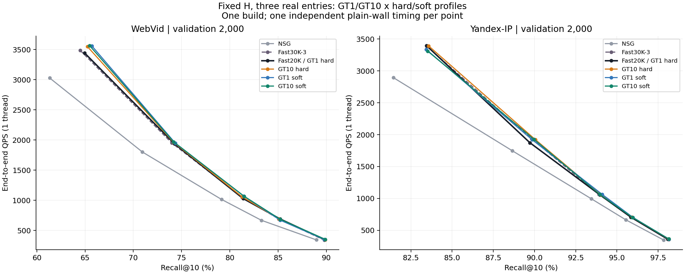
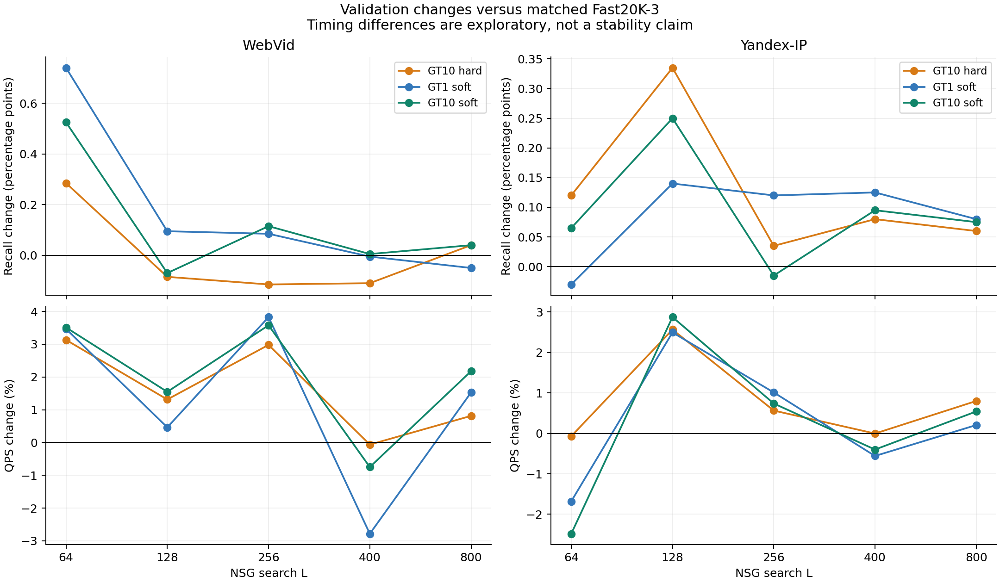

# E24｜固定 H 的 GT1/GT10 × 硬/软画像：完整结果

2026-09-10。状态：`EXPLORATORY_LOCAL_FRONTIER_SIGNAL_NO_FORMAL_GO`。用户授权的第一方向已从输入核对、协议冻结、恢复、cal选择、audit报告推进至小validation，全部结束。其它方向不是自动执行队列。

## 总体结论

**增加GT目标和软归属能产生低成本的局部Recall–QPS正信号，但没有找到一个在两数据集、全部预算上都稳定更好的统一画像。GT10值得保留，软归属不保证优于硬归属；本轮不作正式性能GO。**

按cal事先选定，WebVid主候选是GT10软（T=0.0162011385），Yandex是GT10硬。validation各2000条、五L时，两者各有3/5点同时提高Recall与实测QPS；相对matched Fast20K的两条合并实测曲线中，各自五个新点均不被旧五点支配，但仍有质量/速度交换或局部退化。不能把“存在新的非支配点”写成整条新曲线支配旧曲线。

WebVid主候选L64为+0.525pp Recall/+3.51% QPS，L128为−0.070pp/+1.55%；cal/audit L128原先+0.820/+0.586pp，没有在validation保持。Yandex主候选五L Recall均为小正值，L128是+0.335pp/+2.56%，但audit曾−0.078pp。主候选10项配对Recall差中9项未校正95% bootstrap区间跨0，另一项Yandex L128下界也仅约+0.010pp；一个构建和单次wall不足以确认稳定加速或显著收益。

完整数值不删负点：[全部原值表](results/tables.md)、[metrics.csv](results/metrics.csv)、[所有配对](results/comparisons.csv)、[结果JSON](results/summary.json)。

## 1. 实际锁定和执行

- 原base、raw-IP、NSG、QGT seed20260828、H815/821及三个互异真实入口保持不变。一画像对应一真实hub，全部画像数量与原Fast相同。
- fit为router_train原行[10000,30000)，只用fit GT100中的前1/10个目标构建；每query总贡献为1，GT名次等权，raw-hub先验1。画像是unit query加权和，GT目标只负责归属，不把GT向量当画像累加。
- 每数据集GT1硬、GT10硬及GT1/GT10软各三个T，共8份。T来自fit GT1最高/次高hub cosine差的中位数×{0.25,1,4}，任何cal搜索前固定。没有搜索训练标签、梯度训练、rank、MLP、vMF、新H或微型图拉伸。
- cal1024 L128只按HNSW真实总hits、graph NDC及冻结复杂度/tie规则选择；exact3仅作机制对照。audit1024只报告。双数据集选择和模型冻结后才读取历史validation前2000条。
- matched组M16/efConstruction200/ef10、seed20260828、真实ID升序消费。原Fast30K保留seed100和heap顺序；NSG固定原入口。每份模型跨五L完全相同。
- 评测显式threads=1，OMP/OpenBLAS/MKL=1，固定CPU15；独立/proc监测及实际OpenMP team均为1。一次一个方法的plain wall，完整路由/排序/原NSG均收费，评分、计数、hash、I/O、建图在timer外。

锁定原件：[protocol.md](protocol.md)、[config.locked.json](config.locked.json)、[lock](reviews/protocol_lock.json)。实际argv/日志/顺序：[commands.md](commands.md)、[search_jobs.json](reviews/search_jobs.json)。

## 2. 恢复与开发选择

两数据集原GT1硬P0逐位恢复，max abs=0；额外float64累加控制相对P0的max abs分别1.19e−7/7.45e−8。fit32上的旧/恢复P0×exact/HNSW，全部ID、距离bits、三入口、hits/mask及route/graph NDC一致，并与E23对应输出逐位相同。合成五L、原kernel和单线程拒绝也通过。见[恢复门](reviews/recovery_gate.json)、[合成门](reviews/synthetic_gate.json)。

所有32个cal点完成后才选择；两数据集均通过“至少多1个总GT命中”的探索进入门，没有使用C的+0.5pp门，也没有把该弱进入门称为实质改善门。

| 数据集 | 画像族 | cal冻结T | cal相对Fast20K pp | audit相对Fast20K pp | 是主候选 |
|---|---|---:|---:|---:|---|
| WebVid | GT10硬 | 硬归属 | +0.7910 | +0.0879 | 否 |
| WebVid | GT1软 | 0.064804554 | +0.6445 | +0.0391 | 否 |
| WebVid | GT10软 | 0.0162011385 | +0.8203 | +0.5859 | 是 |
| Yandex-IP | GT10硬 | 硬归属 | +0.0488 | -0.0781 | 是 |
| Yandex-IP | GT1软 | 0.0108935125 | -0.1758 | +0.0586 | 否 |
| Yandex-IP | GT10软 | 0.0108935125 | +0.0098 | -0.0195 | 否 |

WebVid两个soft族选中温度不同，validation表是“各族按同规则校准后的比较”，不能从中估计严格同T的K×soft交互项。同温度的完整GT1/GT10对照保留在cal32点中；未据validation改选更好看的族或T。[cal门](reviews/cal_gate.json)、[audit前冻结](models/frozen_before_audit.json)、[validation前冻结](models/frozen_before_validation.json)。

## 3. 冻结主候选的全部五点

Δ均相对同批matched Fast20K-3。QPS来自每点一次独立plain wall，pp是Recall百分点。

| 数据集 / 主候选 | L | Fast R% / QPS | 新画像 R% / QPS | ΔR pp / ΔQPS% | 零命中 Fast→新 |
|---|---:|---|---|---|---|
| WebVid / GT10软 | 64 | 64.960 / 3443.02 | 65.485 / 3563.91 | +0.525 / +3.51 | 109→104 |
| WebVid / GT10软 | 128 | 74.260 / 1938.54 | 74.190 / 1968.53 | -0.070 / +1.55 | 54→51 |
| WebVid / GT10软 | 256 | 81.385 / 1028.56 | 81.500 / 1065.36 | +0.115 / +3.58 | 25→21 |
| WebVid / GT10软 | 400 | 85.220 / 690.24 | 85.225 / 685.08 | +0.005 / -0.75 | 12→9 |
| WebVid / GT10软 | 800 | 89.860 / 344.65 | 89.900 / 352.15 | +0.040 / +2.18 | 4→3 |
| Yandex-IP / GT10硬 | 64 | 83.455 / 3394.80 | 83.575 / 3392.37 | +0.120 / -0.07 | 49→44 |
| Yandex-IP / GT10硬 | 128 | 89.720 / 1873.77 | 90.055 / 1921.79 | +0.335 / +2.56 | 38→32 |
| Yandex-IP / GT10硬 | 256 | 93.980 / 1053.83 | 94.015 / 1059.76 | +0.035 / +0.56 | 24→23 |
| Yandex-IP / GT10硬 | 400 | 95.850 / 705.39 | 95.930 / 705.36 | +0.080 / -0.01 | 19→18 |
| Yandex-IP / GT10硬 | 800 | 98.075 / 362.31 | 98.135 / 365.21 | +0.060 / +0.80 | 7→6 |

主候选两数据集的五L零命中数都下降，但每点仍有新受损query。L128，WebVid挽救15/新增失败12，Yandex挽救10/新增失败4；因此不能说所有query都受益。WebVid主候选83.75%、Yandex63.65%的validation query改变三入口集合，跨L保持同一集合；大量改道仍只得到小幅净质量变化。

原Fast30K及NSG是必需独立对照，不能把画像训练样本差异归于新归属。例如L128：WebVid原Fast30K 73.990%/1951.19QPS，matched Fast20K 74.260%/1938.54，新主候选74.190%/1968.53；相对原Fast30K的+0.200pp不等于相对matched的新增收益。Yandex对应89.830%/1934.67、89.720%/1873.77和90.055%/1921.79，新主候选对原Fast30K仍略慢。NSG在WebVid/Yandex L128为70.940%/1801.57与88.660%/1746.80；大部分相对NSG的提升本来就由Fast提供。

## 4. 四类画像各自说明什么

| 数据集 | 画像（相对GT1硬） | L64 | L128 | L256 | L400 | L800 |
|---|---|---:|---:|---:|---:|---:|
| WebVid | GT10硬 | +0.285pp / +3.13% | -0.085pp / +1.31% | -0.115pp / +2.98% | -0.110pp / -0.06% | +0.040pp / +0.81% |
| WebVid | GT1软 | +0.740pp / +3.47% | +0.095pp / +0.46% | +0.085pp / +3.83% | -0.005pp / -2.78% | -0.050pp / +1.53% |
| WebVid | GT10软 | +0.525pp / +3.51% | -0.070pp / +1.55% | +0.115pp / +3.58% | +0.005pp / -0.75% | +0.040pp / +2.18% |
| Yandex-IP | GT10硬 | +0.120pp / -0.07% | +0.335pp / +2.56% | +0.035pp / +0.56% | +0.080pp / -0.01% | +0.060pp / +0.80% |
| Yandex-IP | GT1软 | -0.030pp / -1.68% | +0.140pp / +2.49% | +0.120pp / +1.01% | +0.125pp / -0.56% | +0.080pp / +0.20% |
| Yandex-IP | GT10软 | +0.065pp / -2.48% | +0.250pp / +2.87% | -0.015pp / +0.74% | +0.095pp / -0.40% | +0.075pp / +0.54% |

1. **GT10硬是最清楚的多目标消融。** Yandex五L的Recall均有小幅正值，WebVid却在L128/256/400下降；GT1信息丢失是有用假设，但扩大GT数并非跨数据统一修复。
2. **软归属的收益依赖数据和预算。** WebVid GT1软L64为+0.740pp，是该点预定消融中的最大Recall增益；L800却−0.050pp。Yandex cal倾向最低T的轻微软化，温度升高普遍没有改善cal。不能将validation单点更强的GT1软改成新的主选择。
3. **GT10软没有稳定胜过GT10硬。** WebVid多个预算更好，但也有L128等负值；Yandex两者互有高低。没有证据说“同时多目标和软化必然最好”。
4. **支持统计变好不等于搜索效用变好。** WebVid GT1硬只有802/815个画像有query质量，中位ESS=16；GT10硬覆盖815个、ESS=67.36；主候选GT10软ESS=132.28，query侧中位有效hub数23.42。其支持更充分，却未保住validation L128收益。Yandex GT10硬ESS从22增至60.08，query中位有效hub数3.60。

高T会显著摊薄每query的权重：WebVid/Yandex GT1软最高T的query中位有效hub数达447.48/703.10，平均最大权重仅0.0412/0.0147。ESS很高可以来自广泛平滑，不能解读为这些hub都获得了独立且高信息的服务样本。没有通过本轮证明单峰画像是主要失败原因，也没有引入多原型或vMF。

## 5. 画像检索、真实入口效用与前沿

audit L128，WebVid主候选精确top3比HNSW多0.146pp（75.752%对75.605%），Yandex主候选精确top3反而低0.020pp（88.672%对88.691%）；两者ANN top3集合覆盖约94.24%/97.85%。精确画像排序仍不是有限NSG真实效用oracle，不能把精确top3的误差全部视为搜索Recall损失。[完整近似检索表](results/ann_diagnostics.csv)。

以各方法五个**实际测量点**构成非支配集合，两个主候选均有3点同时提高同L Recall/QPS，另外两点有交换；新增五点各自都处于与Fast20K合并后的非支配集合。这说明本机小样本有局部前沿扩展，不能说明整条曲线稳定支配。见[实测点前沿](results/frontier_points.csv)。

另外保留明确标注的事后描述性插值：[frontier_interpolation.csv](results/frontier_interpolation.csv)。在Fast20K中间三档L对应的Recall上，以新曲线log-QPS线性插值得到WebVid约+0.95%/+4.58%/−0.69%，Yandex约+5.62%/+1.09%/+1.71%。这些是稀疏L之间的估计，**不是在相等Recall实测的加速比**，不用于选择或性能GO；同时保留QPS直接线性插值以展示插值依赖。

## 6. 路由成本和离线成本

L128单独route-only测量，Fast20K每query为WebVid7.166μs、Yandex4.535μs，约为各自独立端到端wall的1.39%/0.85%；主候选降到6.521/4.391μs。graph-only对应Fast20K为495.912/518.351μs、主候选492.910/510.092μs。这些独立测量不能相加替代端到端wall，量级上也不支持Micro-HNSW是当前主要总时耗。

Yandex L128主候选graph NDC实际上微增（2871.986→2872.525），而独立wall更快；因此不能把QPS差全部归因于少算距离或更快路由，缓存/路径位置及单次计时变动没有被分离。WebVid该点graph NDC从1658.170降至1646.826，route NDC128.549降至112.062；两层成本仍分列。

| 本轮程序成本 | 数值 | 口径 |
|---|---:|---|
| 输入核对及准备 | 22.41s | 原输入hash、行/向量核对、fit温度统计、隔离I/O |
| GT1硬恢复核心 | 0.447s | 两数据集核心重建及float64控制；不含全部启动/产物I/O |
| 其余七候选/数据集构建阶段合计 | 15.30s | 含fit读取、共享目标评分/归属、画像、支持统计和保存；16线程 |
| 独立评测器编译 | 11.47s | 独立bin，不改原build |
| P1搜索恢复进程 | 16.63s | 含加载/建图/验收/计数/I/O等，不能换算QPS |
| cal搜索进程 | 70.52s | 含加载/建图/验收/计数/I/O等，不能换算QPS |
| audit搜索进程 | 34.26s | 含加载/建图/验收/计数/I/O等，不能换算QPS |
| validation60点进程 | 484.65s | 含加载/建图/验收/计数/I/O等，不能换算QPS |
| 评测中累计plain policy构建 | 4.341s | 含重复微型图构建和保存，已包含于上述进程，不重复相加 |
| 真实NSG调用 | 543,296 | 全部按协议，训练标注0，修复预留0 |
| 观测峰值RSS | 9.920GiB | 单个被测进程，限制40GiB |

完整账本：[costs.json](results/costs.json)。原exact GT、QGT选H、NSG从零生成时间没有新测，均为null+reason；因此上述秒级闭式构建不是完整从零离线成本。新方法不需要E22的3272万single或E23的88万triple标签，二者本轮既未读取为训练输入，也未重生成。

## 7. 验收、身份和保护

- 8个恢复点+32个cal点+16个audit点+60个validation点，共116点、169408个输出，独立从返回ID计算GT10集合交集与mask，全部通过。
- 每个点count/plain/原kernel前16条的ID、距离bits和NDC已验收；正式点全批warm/plain/count一致。三入口互异合法；匹配方法按真实ID升序消费。
- 三条基线NSG、原Fast30K、matched Fast20K的30个validation点、60000个输出与E23逐位一致（包括距离、入口、hits/mask、route/graph NDC）。QPS为本轮新测，不借用E23时间。
- 同画像的五个L序列化HNSW图与逐query入口相同。cal选择独立重算一致，冻结文件hash未变。
- 63个绑定上游文件的base/图/训练输入/源码/库及旧文档快照已复核；所有旧源码、图、GT、标签、模型、结果保留。保护范围是实际绑定资产，不假称重新hash了整个仓库所有大文件。

证据：[独立结果核验](reviews/result_verification.json)、[冻结与保护](reviews/immutable_integrity.json)、[cal前冻结](models/frozen_before_cal.json)。

## 8. 局限与收口

一个QGT构建、每数据集validation2K、每点一次wall；温度与主候选来自复用历史开发池，validation同样有E22/E23及更早历史访问。2000次query配对bootstrap只描述这些query上的变动，未校正多重比较，不能当三独立构建或新盲测。held-out原文件本轮未打开，不能称全项目历史从未使用过held-out。

目标/hub的cosine归属仍舍弃Yandex raw-IP范数；虽然fit目标范数已记录，本轮没有范数感知规则对照，不能把残余问题归因于范数。单画像平均仍是几何代理，支持增加和检索准确都不保证真实finite-L入口收益。

**本版本完成并收口，保留局部正信号，保持`NO_FORMAL_GO`。** 不扩温度/GT数，不按validation更换主候选，不启动rank/MLP/vMF/新H、旧大实验/C或held-out。若之后继续方法研究，优先沿s-target的2A研究固定H的真实finite-L效用分组，并保留本轮冻结画像作为对照；这是后续建议，未自动执行。路由只占当前L128总wall的小部分，单独拉伸微型图的预期端到端收益需要另证。

本轮没有出现需要修复的身份/parity错误，cal进入门通过，P3预定点完整结束；不存在未运行的协议内后续阶段。
