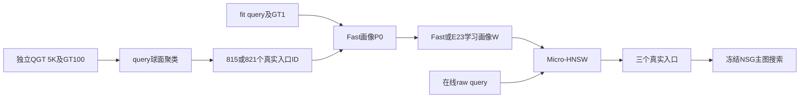

# GT入口、聚类、rank与OOD路由图：四个问题的调研

2026-09-10。状态：`RESEARCH_COMPLETE_METHOD_UNSELECTED_UNRUN`。本次只核对源码、已有结果和一手论文；没有重新聚类、生成搜索标签、训练模型、构建ANN或运行新评测。文献阅读范围与访问限制见[阅读记录](papers.md)，本地数值及输入hash见[结构化证据](local_evidence.json)。

**当前GT1相关规则是合理的轻量起点，但没有“最优入口”保证；聚类优先改进分组依据；rank8尚未证明最优；对HNSW作查询感知变换有理论依据，但当前证据不足以把它判为主要瓶颈。** 建议先保留现有真实入口H，研究GT-topK软归属对画像的影响；若要改变真实入口，再以有限预算内的真实搜索收益挑代表节点。成对拉伸微型HNSW可作为单独的效率方向。

## 1. 先明确当前系统中三个不同的对象

| 对象 | 当前实际做法 | 它回答的问题 |
|---|---|---|
| 真实入口 `h` | QGT 5K query做spherical k-means，从GT100挑815/821个互异base ID | 从主图哪些真实节点开始搜索 |
| 入口画像 `p_h` | 原Fast以20K/30K query的GT1分配basin，再累加query向量；E23在此P0上学习完整W或rank8残差 | 什么query应该被送到该入口 |
| Micro-HNSW | 索引815/821个画像，以`1-qᵀp_h`选三个真实入口 | 怎样快速检索高分画像 |

随后运行的是包含2.505M/10M真实节点的**冻结NSG主图**。用户所说“最后的HNSW”在当前实现中对应入口路由小图；主图不是HNSW。画像是query画像，通常不等于GT1或真实hub向量。E23的最终画像还经过学习，更不能直接称为“GT1聚类中心”。

实现依据：[Fast builder](../../benches/run/build_fast_entry_variants.py)、[E23 trainer](../20260910_three_entry_rank_v1/src/train.py)、[E23 evaluator](../20260910_three_entry_rank_v1/src/evaluate.cpp)、[原搜索kernel](../../ACSG/ACSG.cpp)。

## 2. 问题一：选GT1合理吗，要不要考虑连通度？

### 2.1 当前并非“直接查询聚类中心的GT1”

`choose_unique_gt_hubs`先归一化5K query，FAISS spherical k-means进行25轮、`nredo=1`，当前构建seed为20260828。对每个簇，按query到质心的cosine相似度排序；从最靠前query的exact GT100按名次扫描，选第一个未被前面簇使用的真实节点，必要时才继续下一个query。最后按真实ID排序输出。

因此，通常首先尝试的是**代表query的GT1**；已被占用时可以选GT2及以后。没有求“质心的GT1”，没有全簇GT投票，也没有按图效用择优。当前两数据集空QGT簇均为0；实现另有全GT顺序扫描补足入口的兜底。已有manifest没有保存被选GT名次分布，本次不能声称某个百分比入口确实来自GT1。

第二处GT1更严格：`build_gt_basin_prototypes`把每个训练query的GT1真实向量归一化，分到与它cosine最近的raw hub。画像为：

`p_h = normalize(unit(h) + Σ_{q: assignment(q)=h} unit(q))`。

这里是**query向量之和加一个单位hub先验**，不是均值加一个等权hub。20K/30K阶段重新分配query，不沿用最初QGT的簇。

### 2.2 合理性和缺口

这套规则便宜、可复现，且选中节点与代表查询的目标有直接联系，适合作为Fast初始化。但“某一个query的最近答案”“代表整个簇的节点”“从这里能用有限beam找到更多答案的入口”是三个目标，不能互相替代。

已有E20在每数据集512条历史开发query、L128、单入口条件下给出：

| 数据集 | 按正确GT1选basin后搜索 | 从现有全部H中免费选最佳single后搜索 | 差值 |
|---|---:|---:|---:|
| WebVid | 75.605% | 85.957% | +10.352pp |
| Yandex-IP | 91.758% | 96.563% | +4.805pp |

两列都是实际NSG搜索的Recall@10，但第二列由事后答案选入口，没有支付在线选择成本。它说明**现有H里面已经有GT1-basin错过的有效入口**；不证明这些入口可被学习器低成本找到，也不是本次新性能结果。[E20复盘](../../experiment_history/08_fast_router_diagnosis.md)、[原始汇总](../../fast_router_diagnosis/20260908_v1/analysis/v2/analysis.json)

应该考虑的是**有限预算下对该类query有用的可达性**。纯度数只适合做便宜的候选特征或诊断：

- 入度高表示很多节点指向它，不等于从它向外能快速到达目标。
- 出度高可能提供更多方向，也会多付邻居距离计算；相似邻居很多时可能只是冗余。
- 图在拓扑上连通，只保证存在路径；实际beam可能沿着query分数提前放弃该路径。
- 三入口还涉及互补和重复。单个入口很强，不保证与另两个入口放在同一beam里最强。

本地BTG多版已经试过静态拓扑/BFS扩散，未形成双数据集稳定收益；旧rerouter也用过真实merged效用，不能把“图特征”“联合收益”当成从未研究过的新概念。[历史04](../../experiment_history/04_utility_and_representation.md)、[历史05](../../experiment_history/05_probe_reroute.md)

与此相关，RoarGraph用query到多个真实近邻的关系构图，并投影、剪枝和增强连接；它也用最近base点作为pivot，但另有GT近邻集合支持。可借鉴的是query相关的目标覆盖，不是“GT1必然错误”或“度越大越好”。[RoarGraph §4](https://arxiv.org/html/2408.08933v1)

**若改变真实入口，我建议保留query聚类作为初始组织方式，在簇内GT-topK候选中，用代表query的真实有限L搜索效果挑入口，连同成本和三入口互补性评价。** 这需要独立标注与协议；本次没有执行。由于现有H已有明显免费oracle空间，当前不必先更换全部H。

## 3. 问题二：球面k-means是否合理，有什么更适合OOD？

这里的OOD主要指**query分布与base分布不同**，不等于query本身全是异常点。当前k-means聚的是query，已经利用query侧分布，不能仅凭OOD判定算法错误。问题在于：它优化query方向接近，而最后关心的是目标覆盖和NSG搜索收益；两者是否一致需要证据。

当前5K query分815/821簇，算术平均仅约6.13/6.09条query。这个数提示高维簇的支持可能薄弱，不是已测得每簇都小。后续画像分配也存在不均衡：

| 数据集/画像输入 | 有query的画像 | 单个非空画像最少/最多query |
|---|---:|---:|
| WebVid 20K | 802/815 | 1 / 242 |
| WebVid 30K | 807/815 | 1 / 345 |
| Yandex-IP 20K | 821/821 | 1 / 82 |
| Yandex-IP 30K | 821/821 | 3 / 122 |

这些是旧manifest中的**画像归属**计数，不是最初QGT聚类计数。WebVid 20K中有13个画像只有raw-hub先验。计数尚不能证明不均衡导致了性能损失；将所有簇强制等大也可能切断真实语义区域。

另外，Yandex正式指标是raw IP；GT1由raw IP产生，而GT1到hub的归属用归一化后的cosine，丢失了目标向量范数。只归一化同一query不会改变它的IP答案顺序，但归一化目标/hub可能改变归属。它是一层需要核对的代理差异，尚不能判为Yandex全部问题的原因。

| 可考虑的方法 | 比当前规则增加什么 | 对本项目的判断 |
|---|---|---|
| GT-topK软归属，保留现有H | 一条query对多个目标/入口分配权重，画像汇聚更多目标方向 | 优先：先检验GT1信息丢失，变量少，仍可导出相同数量画像 |
| 球面混合模型vMF，或有最小支持约束的层次球面聚类 | vMF容许软重叠、不同集中程度；层次结构可先形成有充分支持的粗簇 | 备选聚类器；5K/约800簇时须限制自由度，不能默认复杂模型更好 |
| query–目标关系驱动的分组 | 用GT-topK落入哪些目标区域，或在哪些入口上搜索有效，作为分组依据 | 与OOD检索目标更直接，但需要处理稀疏性、标签成本与query可预测性 |

vMF混合模型是球面方向数据的概率模型，球面k-means可视为其受限情形；这是软分配的依据，不是跨模态ANN性能保证。[Banerjee等，JMLR 2005](https://jmlr.org/papers/volume6/banerjee05a/banerjee05a.pdf)

LIRA以query的近邻分布监督分区路由，并用冗余分配处理单分区遗漏；其论文含Yandex TI实验。它支持“分组要看查询目标”这一方向，但其分区检索与当前冻结NSG入口层并不等价。[LIRA §3–4](https://arxiv.org/html/2503.23409v1)

本项目可借鉴的**未执行定义**是：保留H，取每query现有exact IP GT-topK；让每个目标对hub产生软归属，再把K个目标的权重汇总成`a(q,h)`，以`normalize(unit(h)+Σ_q a(q,h)unit(q))`构建画像。第一版若仍用目标–hub cosine，只能检验topK/软归属效应，不能声称同时解决了raw-IP范数问题。K、温度、权重和支持约束均须在后续协议里冻结或按fit/cal选择。

与旧版本的具体区别是改变GT目标归属，而不是在原GT1 basin内部再分两个query mode，也不是多跑三个k-means seed再增加在线候选评分。若改用真实效用聚合query，旧search-aware centroid已经做过single获胜者硬分组；新的研究必须说明软效用、可预测分组或三入口条件作用带来了什么区别，不能仅换名称。[历史04](../../experiment_history/04_utility_and_representation.md)

其边界也很明确：GT-topK覆盖仍不是实际NSG收益，而且query可能有多个相隔较远的目标方向，简单平均仍可能消掉重要模式。纯GT ID重合的图聚类也可能太稀疏；旧128对近query诊断中，Yandex平均GT10交集仅0.250个。因此更重的方法应考虑粗目标区域或真实效用，而不能直接假定GT ID图一定形成好簇。[E20证据](../../fast_router_diagnosis/20260908_v1/analysis/v2/analysis.json)

Neural LSH的平衡图分区可作方法参考，但其方法讨论假设query与数据分布相近；照搬base kNN图分区并不自动修复OOD。SOAR的互补冗余说明多分配应减少重复错误；它也不保证多个入口在共享NSG beam中的联合收益。[Neural LSH §2](https://arxiv.org/html/1901.08544)、[SOAR §3](https://arxiv.org/html/2404.00774v1)

## 4. 问题三：rank8是不是最优？

**尚未确定，也没有做过足以确定它的比较。** E23只比较预设rank8与完整W，两者各试三个λ；没有rank4/16/32的曲线。当前`W=P0+τD`，低秩`D=(VZ)ᵀ`，V和Z都训练；8是残差共享方向的容量上限，不是8个入口，不是把原始512/200维query压到8维，更不是已知OOD内在维数。

E23已知两项事实：

1. Full固定训练目标优化充分，且在所有同λ对照中训练目标都低于rank8。
2. Yandex最终五个L的Recall都是rank8高于Full。当前只能把正则化、泛化、代理目标/部署差异列为可能原因，不能断言哪一种已经被单独证明。

选中Full模型的残差前8个奇异值能量占比为WebVid **90.25%**、Yandex **63.27%**。这只是Full解的Frobenius能量压缩程度，不是最优rank判据；query加权分数误差、top3边界和真实搜索收益才与部署更直接相关。[E23模型行为](../20260910_three_entry_rank_v1/reviews/model_behavior.json)

LoRA说明低秩更新是一种容量约束；AdaLoRA进一步把rank预算分配作为可优化变量。它们没有提供本项目应取8的结论。[LoRA](https://arxiv.org/html/2106.09685v2)、[AdaLoRA §3](https://arxiv.org/html/2303.10512v2)

若后续选择继续此目标，可以把`r∈{4,8,16,32}+Full`列为一个受限比较草案，固定样本、标签、λ规则、初始化和部署条件，只用cal选取，冻结后再评价。这是未来设计，不是已启动的sweep。优先级应在目标/画像定义稳定之后，否则调出来的rank未必适用于新方法。

当前在线均折叠为同尺寸W并建立同规模HNSW，因此提高rank不自动增加在线矩阵维度，降低rank也不自动提高QPS。若改成在线低维因子检索，则是新的执行方式，必须同时保留P0部分的分数并重新评估成本。

## 5. 问题四：能否针对OOD拉伸HNSW，使它更快找到更好入口？

### 5.1 分开“高分画像检索”与“有效入口选择”

query与base的OOD缺口，不可直接等同于query与这些query均值画像的缺口。均值化、GT1筛选和后续学习仍可能使画像分布收缩或偏移；本次没有新测其分布距离，不能称微型图已经ID，也不能称它和10M base一样OOD。

已有E23 audit1024、L128，将微型HNSW换成对同一画像W的精确top3，得到以下**最终NSG Recall@10**：

| 数据集/画像 | HNSW选3 | 精确选3 | 精确减HNSW |
|---|---:|---:|---:|
| WebVid Fast20K | 75.020% | 75.303% | +0.283pp |
| WebVid Full | 75.195% | 75.459% | +0.264pp |
| Yandex-IP Fast20K | 88.770% | 88.848% | +0.078pp |
| Yandex-IP Full | 88.906% | 88.809% | −0.098pp |

这部分诊断没有独立wall，QPS为null；路由NDC约111–128，对应精确打分815/821次。它只能说明在这些模型/样本上，完全消除画像近似检索错误并未显著改善最终质量，个别点还下降。**精确top3只是画像分数的正确答案，不是实际入口效用oracle。** HNSW偶尔选到分数略低、真实搜索却更好的入口，数学上完全可能。[原始诊断](../20260910_three_entry_rank_v1/results/summary.json)

所以当前不宜先把微型图改造当作主要质量修复。它仍可能改善路由耗时，但NDC占比不能直接当wall占比，完整矩阵变换的代价也可能超过约800节点的搜索节省。

### 5.2 “拉伸”的三种含义

| 改动 | 数学作用 | 是否值得作为当前方案 |
|---|---|---|
| 图画得更开；或所有向量统一正比例缩放/正交旋转 | 画图不改搜索；后两者在精确算术、固定随机与tie规则下保留相关比较次序 | 没有明确算法收益机制 |
| query和画像同乘一个各向异性矩阵A | 分数变为`qᵀAᵀAp` | 是新度量/评分模型，可能改变相关性，需搜索收益监督或独立校准 |
| 画像乘A，query乘A的逆转置 | 保留原分数，改变画像之间的几何 | 值得单独检验路由效率，但必须重建微型图 |

第三种可写成一个精确恒等式。将query和画像视为列向量，A可逆：

`p′ = Ap，q′ = A⁻ᵀq ⇒ q′ᵀp′ = qᵀp`。

而画像–画像内积变为`p_iᵀAᵀAp_j`，用于建图的相互关系发生改变。在同一份邻接图上，这种成对变换保留所有query分数，因此理想算术下沿图搜索不会凭空变快；**只有重建图，使边选择变化，才可能改变访问路径**。另外不能在变换后分别把每个画像重新单位化，那会破坏恒等式。

LeanVec研究query与database不同分布时的双侧表示变换；GleanVec中的LeanVec-Sphering全维形式给出保持内积的成对变换关系。通常的降维形式则只是近似保分数，并配合原空间重排。这里“保维、只作用于约800个画像、重建微型HNSW”的方案是本项目的迁移推导，尚无收益实证。[LeanVec §2](https://arxiv.org/html/2312.16335v2)、[LeanVec-Sphering §3.1，式10](https://arxiv.org/html/2410.22347v1)

如果选这一方向，优先考虑正对角A作为最小版本：query变换仅O(d)，限制尺度范围以控制数值条件；全矩阵O(d²)版本留待收益足够再考虑。A只从fit信息确定，I为恢复原状对照，另以相同HNSW参数/seed和精确top3检查评分一致、ANN检索损失与路由wall，再把变换成本纳入整批端到端QPS。此处只给验证逻辑，没有默认参数或已批准运行预算。

一种具体初始化思路是从fit raw query的**未中心化二阶矩**估计尺度：`A_ii ∝ sqrt(mean(q_i²)+ε)`，再限制最大/最小尺度比。这样query侧逆变换缩小高能量方向，画像侧相应放大；全矩阵对应二阶矩加正则后的平方根。它是受论文启发的待检验初始化，既不保证对角变换能修复跨维相关，也不保证该方向比反向缩放更利于本地建图。当前定义没有query减均值；随意中心化会引入额外分数项，不能继续声称上述恒等式原样成立。

还有另一条路：在路由小图中增加query感知的导航关系。RoarGraph/OOD-DiskANN提供query–base关系投影/连接的先例，但两者原本改的是大规模base图。移植到画像图必须重新定义query需要连接哪些画像、边如何剪枝，不能把论文整套系统的加速数当成微型图预期。[RoarGraph](https://arxiv.org/html/2408.08933v1)、[OOD-DiskANN §2](https://arxiv.org/html/2211.12850v1)

若用户真正想改NSG主图，应作为独立图方法分支：新的图身份会影响训练搜索效用标签及所有下游评测。仅在路由层做成对变换则保留base、原metric、GT和NSG身份，不等于重建主图。

## 6. 建议顺序与后续选择

| 方向 | 要解决的已知疑点 | 最小有区分力的后续检验，均未执行 |
|---|---|---|
| **1. GT-topK软画像，推荐先做方法定义** | GT1归属遗漏目标、画像支持不足 | 固定H与query输入，只变归属；精确画像选择先看真实搜索质量，再接相同micro-HNSW看Recall–QPS |
| **2. 以真实搜索作用组织分组/挑入口，较重备选** | 几何代表不等于有效门户；三入口有条件互补 | 从固定小候选集、代表query及明确L开始，比较原GT规则与真实效用选代表；三入口必须测联合，不使用独立命中并集代替 |
| **3. 保分数的成对拉伸，效率支线** | 同一评分函数下HNSW导航可能有浪费 | 固定W和真实ID，I与受限对角A对照；先验评分不变，再看重建图是否在保持质量时减少总wall |

方向1是低成本、易解释的对照，不是已经证明能解决GT1到真实效用的全部缺口。方向2仍需处理query可预测性和选择成本，不能靠免费oracle过关；若研究重点是三入口联合决策，E23之后提出的整组三入口评分也仍是候选，本报告没有证明它已无必要。rank只在选定目标后作为容量对照，vMF/平衡聚类是分组实现选项，不额外展开为无限候选队列。

后续协议应绑定相同base/metric/图/split/GT及入口数，方法定义和调参只用fit/cal，audit保留其既有开发历史，冻结后才进入另行选定的评估范围；已经看过的E23 validation不能再称全新盲测。正式查询单线程、每次一个方法、独立plain wall；路由变换、画像搜索和NSG均计入端到端成本。阈值、样本与预算由后续具体方案确定，本次研究不构成实验授权。

阅读边界：本次定向核对14项一手工作，方法章节阅读、摘要筛查和无法访问全文的记录分开；并非穷尽全部文献，也未作首次性结论。最近真实实验仍是[E23](../20260910_three_entry_rank_v1/report.md)，其“有小幅Recall信号、无明确整体QPS优势”结论保持不变。
