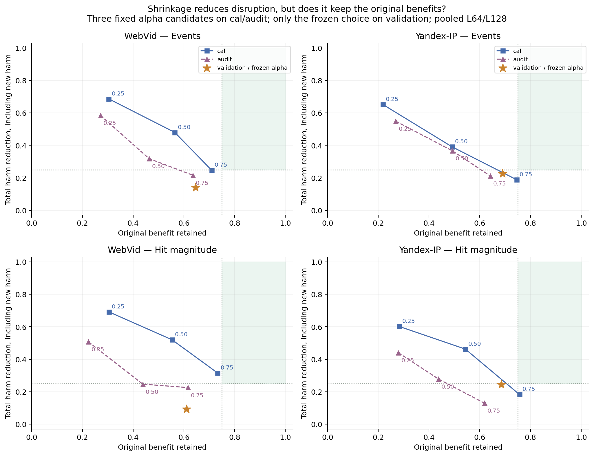
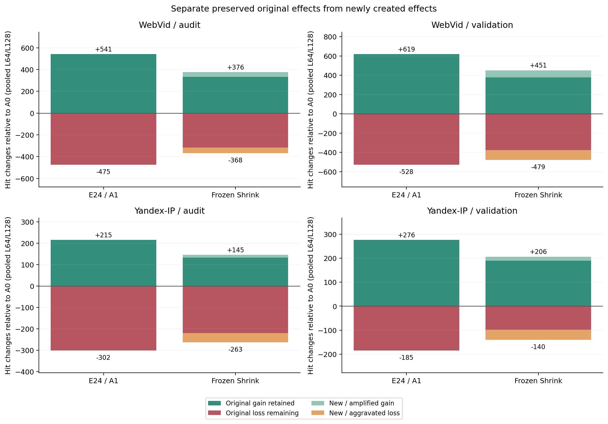
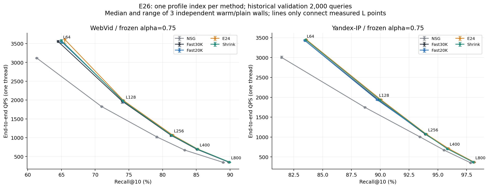
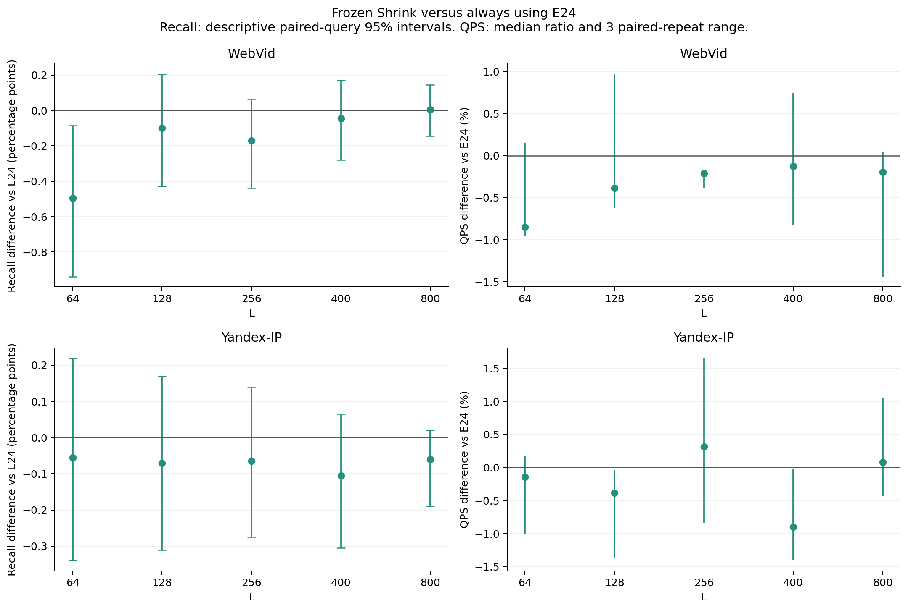

# E26：单路画像收缩的完整复盘

状态：`SHRINKAGE_DID_NOT_STABILIZE_SELECTIVITY_NO_FORMAL_GO`。全部预定阶段完成，未形成正式性能GO。

## 结论与本轮回答

把E24画像往原Fast画像拉回，确实能减少部分旧损失，但同时丢掉原来的有效改道，并产生新的入口组合和损伤。两个数据集均在cal选择alpha=0.75，但三个候选在cal都未达到预设联合目标；audit也未建立稳定选择性。单路实现消除了E25双路门控的结构性额外工作，却不能靠减小画像位移自动获得更好的收益/损失取舍。

本结果约束固定H、固定两个端点和三点全局插值；不否定所有画像学习或选择方法。E24原有局部正信号、E25局部质量修复与全部负点保留。按照[用户最新时间安排](authorization_update.md)，完成本轮后当晚收口，明天再讨论新方向；原07:00安排作为协议历史保留。

## 方法、来源与数据边界

A0是E24 matched Fast20K/GT1硬画像；A1是E24旧cal选定的WebVid GT10软T0.016201138496398926、Yandex GT10硬画像。固定真实H815/821、原base/raw-IP/NSG；每hub使用`normalize((1-alpha)W0+alpha W1)`，alpha只有0.25/0.50/0.75。混合及归一化float64后导出float32；0/1端点逐位复制。每份W独立重建同参数Micro-HNSW，单次取三个唯一真实ID升序，主搜索只运行一次原kernel。

不使用新增训练标签或优化器。新cal为router_train[6144,8192)共2048，audit为[8192,10000)共1808，均不参与E24的fit20K，也不同于E25的cal/audit。所有W先冻结，再读cal；cal选择及代码/候选/输入全局冻结后才导出audit；audit只报告，然后才访问历史validation前2000。开发池有历史使用，validation被E24/E25使用且启发本追问，不能称新盲测；held-out未打开或hash。

与旧E09的区别：E09从top32真实single效用聚合signed query残差并修正旧Fast30K；这里仅缩小E24两个既有几何画像的位移，不复用其监督或runner，也不主张插值本身新颖。身份和公式见[冻结协议](protocol.md)、[配置](config.locked.json)、[构建代码](src/build_profiles.py)。

## 保留收益、减少总损失

以下合并L64/128，以query×L事件统计：R是原正事件仍为正的比例，Rh只计保留的原正命中幅度；A_all、Ah_all分别是全体受损事件和负命中损失的净减少比例，新损失也收费。目标R/Rh≥75%、A_all/Ah_all≥25%，且净命中≥max(0,A1净命中)。cal全部不达标时按冻结S及ties选最接近候选作反证，不能称筛选成功。

| 数据集 | 分段 | R | Rh | A_all | Ah_all | 净命中 vs A0 / A1原净命中 | 目标 |
|---|---|---|---|---|---|---|---|
| WebVid | cal | 70.94% | 73.27% | 24.67% | 31.56% | +151 / +67 | NOT_MET |
| WebVid | audit | 63.55% | 61.55% | 21.59% | 22.53% | +8 / +66 | NOT_MET |
| WebVid | validation | 64.62% | 61.07% | 14.02% | 9.28% | -28 / +91 | NOT_MET |
| Yandex-IP | cal | 74.55% | 75.65% | 18.84% | 18.28% | -46 / -49 | NOT_MET |
| Yandex-IP | audit | 64.18% | 61.86% | 21.13% | 12.91% | -118 / -87 | NOT_MET |
| Yandex-IP | validation | 68.92% | 68.48% | 22.58% | 24.32% | +66 / +91 | NOT_MET |

三个alpha在两个开发段的全部结果、每L指标和必要基线对照见[原值表](results/tables.md)。图中浅绿区域只表示四项比例目标，仍需满足净命中条件。

## 避免的旧损失是否被新损失抵消

损失恒等式：`新总损失 = 原损失 - 避免的原损失 + 新增/加重损失`。收益恒等式：`新总收益 = 保留的原收益 + 新增/放大收益`。两项独立核对，不能把新收益记成保留、也不能只报旧坏查询被救回多少。下表单位均为GT10命中数。

| 数据集 | 分段 | 原正命中 | 保留原正 | 新增/放大正 | 原负命中 | 避免原负 | 新增/加重负 | 新总负 |
|---|---|---|---|---|---|---|---|---|
| WebVid | audit | 541 | 333 | 43 | 475 | 159 | 52 | 368 |
| WebVid | validation | 619 | 378 | 73 | 528 | 153 | 104 | 479 |
| Yandex-IP | audit | 215 | 133 | 12 | 302 | 82 | 43 | 263 |
| Yandex-IP | validation | 276 | 189 | 17 | 185 | 87 | 42 | 140 |

原好事件翻坏、原中性事件变坏、原坏事件进一步加重分别保存在[analysis.json](results/analysis.json)。按固定原行ID选出的最大损失/救回实例见[WebVid实例](results/mechanism/webvid2_5m_light_v1/illustrative_cases.json)和[Yandex实例](results/mechanism/yandex_t2i_official10M_ip_v1/illustrative_cases.json)，仅作事后解释，不用于调alpha。

“受损查询数”另按两个L任一受损去重如下。一个query可在不同L一好一坏，正/负query组可重叠；该辅助口径不替代预设query×L目标。

| 数据集 | 原有效query | 仍有效query | 原受损query | 收缩后受损query | 原受损且两L均保护 | 新策略跨L正负并存 |
|---|---|---|---|---|---|---|
| WebVid | 158 | 103 | 144 | 124 | 40 | 24 |
| Yandex-IP | 47 | 33 | 45 | 33 | 20 | 3 |

## 连续画像不等于连续入口行为

收缩的画像角位移是连续的，但Micro-HNSW路径和前三入口是离散的。以下L64将query按与A0/A1实际三入口是否完全相同分组。五L入口不变已验收；若三入口相同，返回ID、距离bits、命中和graph NDC均相同。第三套入口既可增加收益，也可制造新损失，这解释了为什么简单降低改动强度不等于选择原有好改道。该分组尚不能分离精确排序变化与Micro-HNSW近似误差的因果份额。

| 数据集 | 入口组 | query数 | 净命中 vs A0 | 净命中 vs A1 | A1非负却新受损事件 |
|---|---|---|---|---|---|
| WebVid | same_both | 313 | 0 | 0 | 0 |
| WebVid | A0_only | 216 | 0 | -32 | 0 |
| WebVid | A1_only | 771 | 45 | 0 | 0 |
| WebVid | third_entry_set | 700 | -39 | -67 | 17 |
| Yandex-IP | same_both | 711 | 0 | 0 | 0 |
| Yandex-IP | A0_only | 200 | 0 | -2 | 0 |
| Yandex-IP | A1_only | 789 | 25 | 0 | 0 |
| Yandex-IP | third_entry_set | 300 | -12 | -9 | 7 |

完整cal/audit/validation分组见[入口转换验收](reviews/validation_entry_transitions.json)；逐hub角度和分数位移上界见[WebVid几何](models/webvid2_5m_light_v1/geometry.json)、[Yandex几何](models/yandex_t2i_official10M_ip_v1/geometry.json)。没有把角度或NDC改善当作端到端成功。

## 单线程Recall–QPS与不确定性

两数据集×五方法×五L共50点，每点三次独立整批warm/plain，CPU15且实际线程1。QPS来自包含真实路由和原NSG的纯端到端wall；训练、建图、GT、count、hash和I/O在timer外。下表只比较本轮同时重测的A1/E24。

| 数据集 | L | ΔRecall pp | 描述性95%区间 | ΔQPS中位数 % | 三轮ΔQPS % | Recall正且三轮QPS正 |
|---|---|---|---|---|---|---|
| WebVid | 64 | -0.495 | [-0.940, -0.085] | -0.85 | +0.15/-0.95/-0.12 | no |
| WebVid | 128 | -0.100 | [-0.430, +0.205] | -0.39 | +0.97/-0.39/-0.63 | no |
| WebVid | 256 | -0.170 | [-0.440, +0.065] | -0.21 | -0.23/-0.21/-0.38 | no |
| WebVid | 400 | -0.045 | [-0.280, +0.170] | -0.13 | +0.74/-0.83/+0.26 | no |
| WebVid | 800 | +0.005 | [-0.145, +0.145] | -0.20 | -1.44/-0.32/+0.05 | no |
| Yandex-IP | 64 | -0.055 | [-0.340, +0.220] | -0.14 | +0.18/-0.04/-1.02 | no |
| Yandex-IP | 128 | -0.070 | [-0.310, +0.170] | -0.38 | -1.38/-0.03/-0.38 | no |
| Yandex-IP | 256 | -0.065 | [-0.275, +0.140] | +0.31 | +0.54/-0.84/+1.66 | no |
| Yandex-IP | 400 | -0.105 | [-0.305, +0.065] | -0.90 | -0.98/-1.41/-0.02 | no |
| Yandex-IP | 800 | -0.060 | [-0.190, +0.020] | +0.08 | +1.04/-0.43/+0.02 | no |

相对A1的10个Recall差中，9个描述性95%区间跨0。Recall为正且三轮对应QPS均为正的点：无。区间基于2000次配对query bootstrap，同query多L一起抽样；未做多重比较校正，计时重复不增加Recall样本。

所有NSG/Fast30K/Fast20K/E24/Shrink正负点及三次原值完整保留。实测非支配点和每轮名单在analysis.json；粗L网格的非支配点只描述已测集合，不由连线推算等Recall加速，也不构成跨构建稳定性能GO。

## 与E25放在同一质量口径下

以下仅连接相同原query、GT、base/graph及逐位相同A0/A1结果，重新计算同一套收益/总损失指标。E25与E26计时各属独立轮次，绝不拼接成一张竞争QPS表；也不从这张事后表重新选择模型。

| 数据集 | 规则 | R | Rh | A_all | Ah_all | 净命中 vs A0 |
|---|---|---|---|---|---|---|
| WebVid | E25_base_gate | 80.66% | 79.32% | 21.50% | 26.14% | +101 |
| WebVid | E25_dual_gate | 80.66% | 84.17% | 24.77% | 24.62% | +123 |
| WebVid | E26_shrink | 64.62% | 61.07% | 14.02% | 9.28% | -28 |
| Yandex-IP | E25_base_gate | 31.08% | 38.41% | 62.90% | 54.05% | +21 |
| Yandex-IP | E25_dual_gate | 59.46% | 70.29% | 43.55% | 42.16% | +87 |
| Yandex-IP | E26_shrink | 68.92% | 68.48% | 22.58% | 24.32% | +66 |

E25与E26共同提示：现有改进信号能够产生有效改道，但尚缺稳定区分好坏改道的规则。门控在WebVid保留较多收益却付出路由时间；Yandex筛掉损伤时也筛掉大部分收益。单路收缩减轻了在线结构成本，却仍不能同时控制收益流失和新损伤。证据不支持继续仅靠加密当前alpha或阈值网格来声称机制成立。

## 全部成本、验收和限制

| 数据集 | 方法 | route μs/query | graph μs/query | 独立总wall μs/query | route NDC | graph NDC | 该点Policy构建 s |
|---|---|---|---|---|---|---|---|
| WebVid | nsg | 0.007 | 550.396 | 546.857 | 0.00 | 1875.82 | 0.0000 |
| WebVid | fast30k | 6.735 | 489.073 | 507.177 | 121.95 | 1657.13 | 0.0606 |
| WebVid | fast20k | 7.017 | 489.978 | 509.324 | 128.55 | 1658.17 | 0.0602 |
| WebVid | e24 | 6.432 | 484.743 | 502.631 | 112.06 | 1646.83 | 0.0609 |
| WebVid | shrink | 6.562 | 488.587 | 504.577 | 116.01 | 1651.92 | 0.0610 |
| Yandex-IP | nsg | 0.007 | 566.025 | 572.196 | 0.00 | 3165.53 | 0.0000 |
| Yandex-IP | fast30k | 4.518 | 503.021 | 516.919 | 116.03 | 2870.09 | 0.0477 |
| Yandex-IP | fast20k | 4.568 | 503.677 | 515.462 | 110.14 | 2871.99 | 0.0479 |
| Yandex-IP | e24 | 4.410 | 501.257 | 515.266 | 106.44 | 2872.53 | 0.0474 |
| Yandex-IP | shrink | 4.375 | 506.437 | 517.249 | 104.50 | 2874.30 | 0.0473 |

分项各自单测，不相加或代替独立总wall。部署一份所选W、一个Micro-HNSW，没有门控、第二路或新增特征内积；线上HNSW访问数仍随W变化并全部收费。Policy构建包括该点加载/建微型图，不能把五L重复构建总和冒充一次部署成本。微型图字节及详细分项在[costs.json](results/costs.json)。

新画像构建及产物写入：WebVid 0.0733s、Yandex 0.0263s，各含三份alpha和两端点复制。真实搜索调用897,280，修复0，合成2268；真实搜索进程合计1000.25s，最高RSS 10.038GiB。进程时间含加载/构建/预热/计数/I/O，不能换算QPS。

本轮110点177760个输出独立评分；四条原validation曲线80000个输出对照E25的ID/距离bits/入口/route与graph NDC逐位相同。新增W与端点复制、全部候选cal比率/ties、冻结顺序、五L图与入口、所有原始资产115项完整hash均通过。8个真实job全部完成，无失败搜索或预算修复，未启动后续候选。

原exact GT、QGT、NSG、E24画像从零构建成本未重测，在成本表中保留null；不把复用说成零成本。这仍是单构建、两个工作负载、历史开发和validation、固定三alpha的受限探索。负结果不能排除不同监督/表示的选择能力；小幅同L双升不能自动推广为部署优势。

## 证据与明日接续

执行与复核入口：[commands](commands.md)、[全部job](reviews/search_jobs.json)、[合成验收](reviews/synthetic_gate.json)、[端点恢复](reviews/recovery_gate.json)、[cal前冻结](models/frozen_before_cal.json)、[audit前冻结](models/frozen_before_audit.json)、[完整性审计](reviews/immutable_integrity.json)、[最终验收](reviews/final_audit.json)。

今晚停止新实验。明天先围绕现成正负query和此前真实效用标签，判断是否存在稳定、低成本的可区分信号，再决定是否值得新机制；不自动加门控、细化alpha、扩候选或打开held-out。更长期的真实效用分组/联合评分和微型图效率路线保留在根目录[s-target](../../s-target.md)，尚未由本次收口自动启动。
