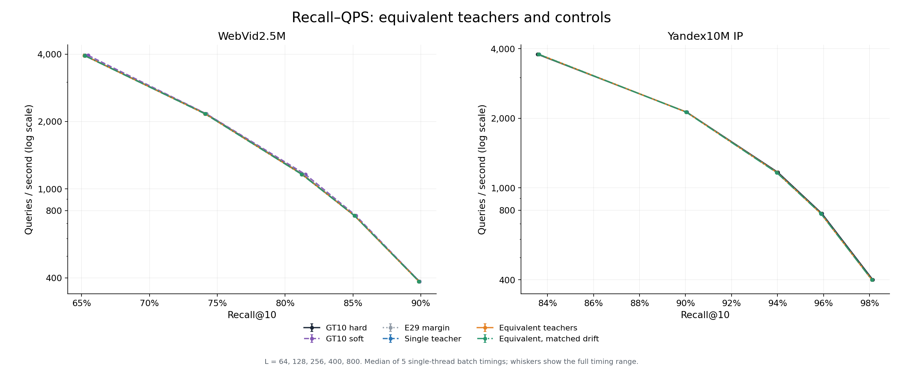
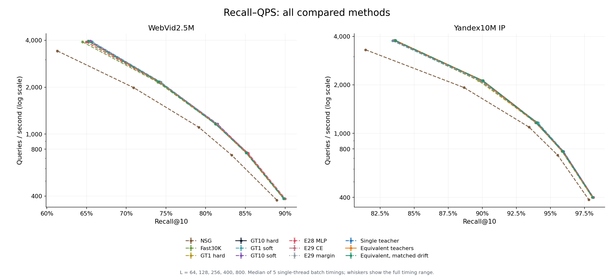
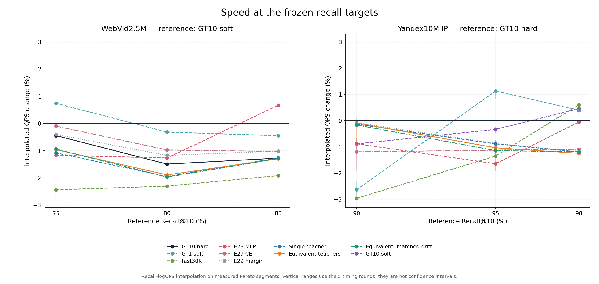
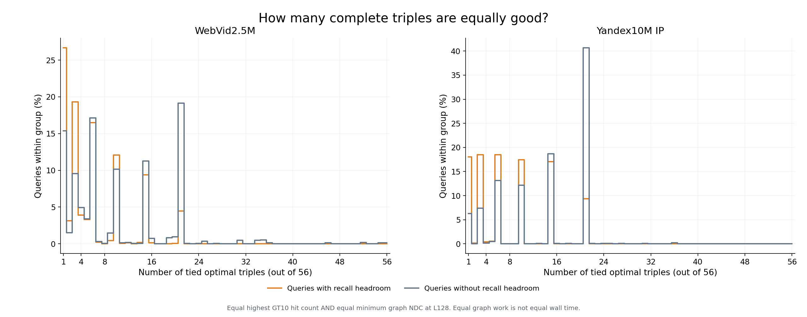
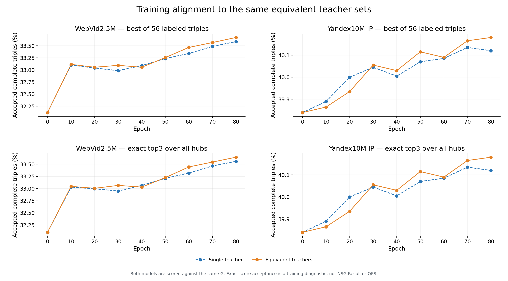
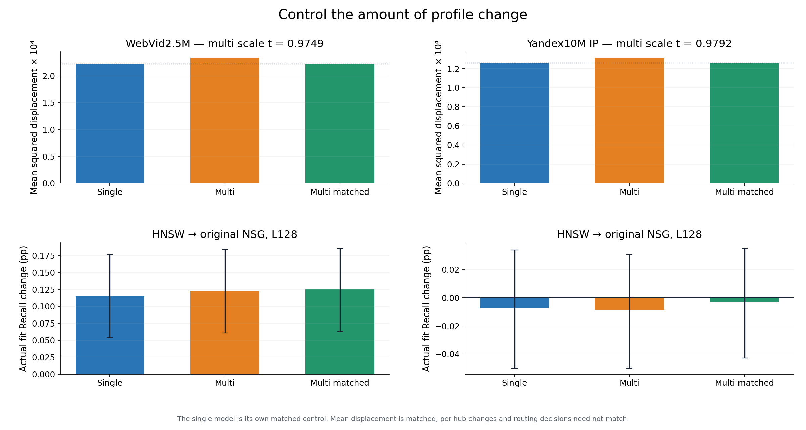
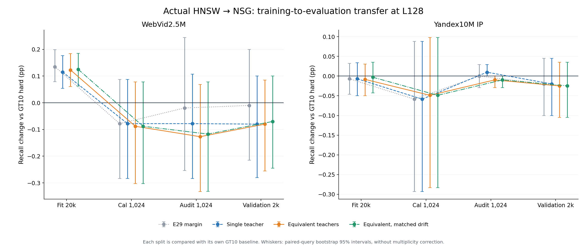

# 等效三入口教师：真实检索、漂移对照与最佳方法选择

本轮没有产生足以替换原默认方法的可靠证据。 多集合教师、单教师控制、改动幅度匹配和两数据集真实Recall–QPS均已完成。所有正负结果保留，原图/H/kernel及历史产物未覆盖。

## 1. 最后选择什么

| 数据集 | 本次插值速度几何均值最高 | 相对原默认 | 有证据支持的推荐 | 判定 |
|---|---|---|---|---|
| WebVid2.5M | GT10 soft | +0.00% | GT10 soft | 保留原默认 |
| Yandex10M IP | GT10 hard | +0.00% | GT10 hard | 保留原默认 |

“数值最快”按三个共同Recall参照的插值QPS几何平均排序；“推荐”还要求至少两个目标中位速度≥+3%、五轮对应比值全部>1、其他目标无≥3%退化，并覆盖全部参照。没有符合者就保留默认。它们是不同判断，不能把微小数值领先包装成稳定胜出。

参照为WebVid Recall 75/80/85%、Yandex 90/95/98%，来自前作已知覆盖范围；本次不是盲设目标。比较只在实测非支配曲线的Recall–logQPS之间插值，不外推，不冒充额外实测的精确等Recall点。

每个点对应实际L64/128/256/400/800，QPS为五次单线程完整warm/plain批次的中位数；误差线为五轮范围。连线没有生成新测量。

全部12种方法均在本轮重新计时，旧曲线仅用于输出回归，不跨批拼接QPS。图表原值、全部五轮wall、训练及控制记录见[Excel](chart_data.xlsx)和[all_points.csv](results/all_points.csv)。

## 2. 新方法究竟改了什么

| 方法 | 可接受教师 | 部署画像 | 作用 |
|---|---|---|---|
| single | 原唯一T0 | 共享linear原生W | 相同新损失/已知竞争域的单教师控制 |
| multi | 最高hits且最少graph NDC的全部并列三元组G | 共享linear原生W | 移除G内部的身份区分 |
| multi_matched | 沿用multi训练 | 向GT10锚点缩放到single的均方位移 | 固定整体改动幅度 |
| single_matched | 沿用single | 与single字节相同，alias | 同一实际测量，不伪装成独立第四模型 |

两集都由multi具有稍大的原生位移，因此本轮各有3份唯一W。在线仍是原始query→一份Micro-HNSW top3→三个真实hub→原NSG，无在线网络或组合重排。E29 CE/margin、E28 MLP及GT画像/NSG/Fast共同作为历史基线。

共同训练为GT10 hard锚点、无偏置共享linear、零残差初始化、float64、λ100、τ=.05、μ=.1、Adam .003、全fit20k累积、80轮最后epoch、同seed20260911。只训练4次，所有画像及控制系数在新开发query前冻结，没有通过开发/validation调参。

目标为`max_C(F+.1×非接受指示)−max_接受F`，C始终是已标注56个完整三元组。它只对C内“是否选中可接受集合”给上界；未知全H组合不被当作已知负例，完整NSG效果必须实际测量。E29→single同时改变竞争域与损失形式，所以该差异不是多教师的单因素效果。方法推导、已有理论及限制见[research.md](research.md)。

## 3. 三个预设召回处的完整比较

| 数据集 | 方法 | 覆盖目标 | 插值QPS几何均变 | 通过+3%且五轮均快的目标 | ≥3%退化目标 |
|---|---|---|---|---|---|
| WebVid2.5M | NSG | 3 | -24.19% | 0 | 3 |
| WebVid2.5M | Fast30K | 3 | -2.22% | 0 | 0 |
| WebVid2.5M | GT1 hard | 3 | -0.69% | 0 | 0 |
| WebVid2.5M | GT10 hard | 3 | -1.07% | 0 | 0 |
| WebVid2.5M | GT1 soft | 3 | -0.01% | 0 | 0 |
| WebVid2.5M | GT10 soft | 3 | +0.00% | 0 | 0 |
| WebVid2.5M | E28 MLP | 3 | -0.59% | 0 | 0 |
| WebVid2.5M | E29 CE | 3 | -0.70% | 0 | 0 |
| WebVid2.5M | E29 margin | 3 | -0.86% | 0 | 0 |
| WebVid2.5M | Single teacher | 3 | -1.43% | 0 | 0 |
| WebVid2.5M | Equivalent teachers | 3 | -1.38% | 0 | 0 |
| WebVid2.5M | Equivalent, matched drift | 3 | -1.40% | 0 | 0 |
| Yandex10M IP | NSG | 2 | -18.71% | 0 | 2 |
| Yandex10M IP | Fast30K | 3 | -1.25% | 0 | 0 |
| Yandex10M IP | GT1 hard | 3 | -2.57% | 0 | 1 |
| Yandex10M IP | GT10 hard | 3 | +0.00% | 0 | 0 |
| Yandex10M IP | GT1 soft | 3 | -0.38% | 0 | 0 |
| Yandex10M IP | GT10 soft | 3 | -0.26% | 0 | 0 |
| Yandex10M IP | E28 MLP | 3 | -0.86% | 0 | 0 |
| Yandex10M IP | E29 CE | 3 | -1.14% | 0 | 0 |
| Yandex10M IP | E29 margin | 3 | -0.72% | 0 | 0 |
| Yandex10M IP | Single teacher | 3 | -0.74% | 0 | 0 |
| Yandex10M IP | Equivalent teachers | 3 | -0.79% | 0 | 0 |
| Yandex10M IP | Equivalent, matched drift | 3 | -0.83% | 0 | 0 |

范围线使用中位前沿确定的相同插值段，再代入五轮原始速度比；不是统计置信区间，也未传播Recall采样不确定性。QPS轮次与query bootstrap分别解释，未删除慢轮或追加择优计时。

各目标的描述性最快点如下。它用于比较曲线，不是根据query/GT选择方法的在线策略，也没有实现跨方法的自动切换：

| 数据集 | Recall参照 | 数值最快方法 | 插值QPS | 相对原默认 |
|---|---|---|---|---|
| WebVid2.5M | 75% | GT1 soft | 2036.2 | +0.74% |
| WebVid2.5M | 80% | GT10 soft | 1318.0 | +0.00% |
| WebVid2.5M | 85% | E28 MLP | 782.9 | +0.67% |
| Yandex10M IP | 90% | GT10 hard | 2134.5 | +0.00% |
| Yandex10M IP | 95% | GT1 soft | 954.6 | +1.13% |
| Yandex10M IP | 98% | Fast30K | 419.4 | +0.60% |

在同样的预设召回范围内，分段插值曲线的数值最高者如下。分界由实测曲线之间的交点计算，边界附近的细小优势受计时波动影响；这不改变上面的默认替换规则：

| 数据集 | Recall区间 | 描述性最快曲线 |
|---|---|---|
| WebVid2.5M | 75.000%–78.500% | GT1 soft |
| WebVid2.5M | 78.500%–83.902% | GT10 soft |
| WebVid2.5M | 83.902%–85.000% | E28 MLP |
| Yandex10M IP | 90.000%–93.118% | GT10 hard |
| Yandex10M IP | 93.118%–97.788% | GT1 soft |
| Yandex10M IP | 97.788%–98.000% | Fast30K |

每个固定L中，同时考虑Recall较高和QPS较高的非支配方法如下；同L筛选不等于最终跨L前沿。跨全部方法和L的非支配标记另存于[all_points.csv](results/all_points.csv)的`pareto_all_methods_and_L`列：

| 数据集 | L | 同L非支配方法 |
|---|---|---|
| WebVid2.5M | 64 | GT1 soft, GT10 soft |
| WebVid2.5M | 128 | GT1 soft, GT10 soft, E29 CE, Equivalent teachers |
| WebVid2.5M | 256 | GT10 hard, GT10 soft, E29 margin, Equivalent teachers |
| WebVid2.5M | 400 | GT10 hard, GT10 soft, E28 MLP, E29 margin |
| WebVid2.5M | 800 | GT10 hard, E28 MLP, Equivalent, matched drift |
| Yandex10M IP | 64 | E29 CE, E29 margin, Equivalent teachers |
| Yandex10M IP | 128 | GT10 hard, E29 margin, Equivalent teachers |
| Yandex10M IP | 256 | GT10 hard, GT1 soft, E29 margin, Equivalent teachers |
| Yandex10M IP | 400 | GT1 soft, GT10 soft, Equivalent, matched drift |
| Yandex10M IP | 800 | Fast30K, GT10 soft |

五轮计时波动以`(最大QPS−最小QPS)/中位QPS`描述：

| 数据集 | 正式点数 | 中位波动 | 最大波动 | 波动>3%的点 |
|---|---|---|---|---|
| WebVid2.5M | 60 | 0.43% | 1.88% | 0 |
| Yandex10M IP | 60 | 0.28% | 1.35% | 0 |

该范围描述本机这些轮次的变化，不能直接当成方法效果的置信区间，也不能把较小的正负速度比解释为稳定差异。

## 4. 新模型与桥接对照的全部五L正负

下表均相对同批GT10 hard；Recall变化为百分点，QPS为同L比值。两者同时给出也不等于精确等Recall加速。95%区间来自2000次配对query bootstrap，未作多重比较校正。

### WebVid2.5M

| L | 方法 | ΔRecall pp | 95%区间 | Δ同L QPS | Δgraph NDC | 获益/受损query |
|---|---|---|---|---|---|---|
| 64 | E29 margin | -0.020 | [-0.255, +0.225] | -0.05% | +0.04% | 15/18 |
| 64 | Single teacher | -0.025 | [-0.270, +0.210] | -0.02% | +0.06% | 16/18 |
| 64 | Equivalent teachers | -0.035 | [-0.275, +0.190] | +0.04% | -0.02% | 16/21 |
| 64 | Equivalent, matched drift | -0.030 | [-0.270, +0.195] | -0.02% | +0.01% | 16/20 |
| 128 | E29 margin | -0.010 | [-0.215, +0.200] | +0.08% | +0.02% | 14/14 |
| 128 | Single teacher | -0.080 | [-0.280, +0.100] | +0.03% | -0.00% | 14/14 |
| 128 | Equivalent teachers | -0.080 | [-0.255, +0.085] | +0.16% | -0.04% | 13/17 |
| 128 | Equivalent, matched drift | -0.070 | [-0.245, +0.100] | +0.11% | -0.03% | 13/15 |
| 256 | E29 margin | +0.055 | [-0.035, +0.180] | -0.08% | +0.12% | 9/8 |
| 256 | Single teacher | -0.040 | [-0.140, +0.050] | -0.07% | +0.13% | 8/9 |
| 256 | Equivalent teachers | -0.045 | [-0.145, +0.045] | +0.02% | +0.09% | 8/10 |
| 256 | Equivalent, matched drift | -0.045 | [-0.145, +0.045] | -0.09% | +0.09% | 8/10 |
| 400 | E29 margin | +0.025 | [-0.020, +0.070] | -0.02% | +0.06% | 7/5 |
| 400 | Single teacher | +0.010 | [-0.090, +0.090] | -0.09% | +0.13% | 8/5 |
| 400 | Equivalent teachers | +0.005 | [-0.095, +0.085] | -0.07% | +0.10% | 8/6 |
| 400 | Equivalent, matched drift | +0.005 | [-0.095, +0.085] | -0.05% | +0.10% | 8/6 |
| 800 | E29 margin | -0.005 | [-0.035, +0.025] | -0.02% | +0.04% | 2/4 |
| 800 | Single teacher | -0.040 | [-0.135, +0.020] | -0.01% | +0.03% | 2/4 |
| 800 | Equivalent teachers | -0.045 | [-0.145, +0.020] | -0.02% | +0.02% | 2/5 |
| 800 | Equivalent, matched drift | -0.045 | [-0.145, +0.020] | +0.04% | +0.02% | 2/5 |

### Yandex10M IP

| L | 方法 | ΔRecall pp | 95%区间 | Δ同L QPS | Δgraph NDC | 获益/受损query |
|---|---|---|---|---|---|---|
| 64 | E29 margin | +0.060 | [-0.030, +0.155] | -0.05% | +0.04% | 11/2 |
| 64 | Single teacher | +0.060 | [-0.030, +0.155] | -0.09% | +0.09% | 10/1 |
| 64 | Equivalent teachers | +0.040 | [-0.050, +0.135] | +0.02% | -0.01% | 8/2 |
| 64 | Equivalent, matched drift | +0.040 | [-0.050, +0.135] | -0.00% | -0.01% | 8/2 |
| 128 | E29 margin | -0.020 | [-0.100, +0.045] | +0.09% | -0.03% | 3/3 |
| 128 | Single teacher | -0.020 | [-0.100, +0.045] | +0.04% | -0.01% | 3/3 |
| 128 | Equivalent teachers | -0.025 | [-0.105, +0.035] | +0.13% | -0.06% | 2/3 |
| 128 | Equivalent, matched drift | -0.025 | [-0.105, +0.035] | +0.05% | -0.06% | 2/3 |
| 256 | E29 margin | -0.045 | [-0.135, +0.020] | +0.04% | -0.03% | 1/3 |
| 256 | Single teacher | -0.045 | [-0.135, +0.020] | -0.03% | -0.02% | 1/3 |
| 256 | Equivalent teachers | -0.055 | [-0.140, +0.000] | +0.05% | -0.04% | 0/3 |
| 256 | Equivalent, matched drift | -0.055 | [-0.140, +0.000] | -0.21% | -0.04% | 0/3 |
| 400 | E29 margin | -0.035 | [-0.120, +0.025] | -0.07% | -0.01% | 1/2 |
| 400 | Single teacher | -0.035 | [-0.120, +0.025] | -0.05% | +0.00% | 1/2 |
| 400 | Equivalent teachers | -0.045 | [-0.130, +0.000] | +0.00% | -0.01% | 0/2 |
| 400 | Equivalent, matched drift | -0.045 | [-0.130, +0.000] | +0.03% | -0.01% | 0/2 |
| 800 | E29 margin | -0.040 | [-0.120, +0.000] | -0.01% | +0.02% | 0/1 |
| 800 | Single teacher | -0.040 | [-0.120, +0.000] | -0.01% | +0.03% | 0/1 |
| 800 | Equivalent teachers | -0.040 | [-0.120, +0.000] | -0.06% | +0.02% | 0/1 |
| 800 | Equivalent, matched drift | -0.040 | [-0.120, +0.000] | -0.00% | +0.02% | 0/1 |

## 5. 教师是否确实有多个等效答案

| 数据集 | 组 | query数 | G数量中位数 | 多个G比例 | 原Recall | 教师Recall | 原graph NDC | 教师graph NDC |
|---|---|---|---|---|---|---|---|---|
| WebVid2.5M | all | 20000 | 6 | 82.25% | 75.016% | 79.642% | 1642.94 | 1621.29 |
| WebVid2.5M | headroom | 4234 | 4 | 73.33% | 49.653% | 71.504% | 1729.55 | 1838.99 |
| WebVid2.5M | no_headroom | 15766 | 6 | 84.64% | 81.827% | 81.827% | 1619.67 | 1562.83 |
| Yandex10M IP | all | 20000 | 15 | 92.43% | 90.079% | 92.929% | 2862.29 | 2822.89 |
| Yandex10M IP | headroom | 2161 | 6 | 81.95% | 58.001% | 84.378% | 3000.89 | 3263.86 |
| Yandex10M IP | no_headroom | 17839 | 15 | 93.70% | 93.965% | 93.965% | 2845.50 | 2769.47 |

G保留了原cost教师的最高hits和最少graph NDC，没有放宽成本标准。它只描述C8内教师；不代表全H上界、相同wall或可部署oracle。不同G成员可以命中不同GT成员，等效针对本协议的命中计数与graph NDC。

## 6. 拟合、组合结构与实际推动

所有曲线用同一G评价。候选内选择、全H精确top3和HNSW实际入口分别报告，不能把三者的接受率混为一谈。

| 数据集 | 训练模型 | C8最优属于G 初→末 | 全H精确top3属于G 初→末 | 末期全H预测仍在C8 |
|---|---|---|---|---|
| WebVid2.5M | Single teacher | 32.120%→33.585% | 32.100%→33.560% | 99.960% |
| WebVid2.5M | Equivalent teachers | 32.120%→33.670% | 32.100%→33.645% | 99.955% |
| Yandex10M IP | Single teacher | 39.840%→40.120% | 39.840%→40.120% | 100.000% |
| Yandex10M IP | Equivalent teachers | 39.840%→40.180% | 39.840%→40.180% | 100.000% |

| 数据集 | 模型 | 本格loss初→末 | 目标初→末 | 末期梯度范数 | 训练秒 |
|---|---|---|---|---|---|
| WebVid2.5M | Single teacher | 0.5551→0.5115 | 0.5551→0.5337 | 0.3771 | 7.71 |
| WebVid2.5M | Equivalent teachers | 0.5488→0.5033 | 0.5488→0.5267 | 0.3772 | 7.45 |
| Yandex10M IP | Single teacher | 0.9447→0.9182 | 0.9447→0.9307 | 0.1974 | 4.64 |
| Yandex10M IP | Equivalent teachers | 0.9390→0.9120 | 0.9390→0.9251 | 0.1952 | 4.71 |

固定80轮和同优化器不构成收敛证书，且两目标的数值尺度/有效梯度未被归一化为同一种风险。最终梯度和完整轨迹保留；不据有限预算失败推导不可学习。

同一份分数下，两种教师是否真的改变每query对hub分数的梯度：

| 数据集 | 检查点 | 组 | 分数梯度不同 | 最佳好组合变化 | 最强竞争组合变化 | single−multi平均loss |
|---|---|---|---|---|---|---|
| WebVid2.5M | initial | all | 12.10% | 0.00% | 12.10% | 0.00634 |
| WebVid2.5M | initial | headroom | 1.04% | 0.00% | 1.04% | 0.00060 |
| WebVid2.5M | initial | no_headroom | 15.06% | 0.00% | 15.06% | 0.00789 |
| WebVid2.5M | multi | all | 16.34% | 5.29% | 11.54% | 0.00831 |
| WebVid2.5M | multi | headroom | 6.40% | 5.36% | 1.20% | 0.00224 |
| WebVid2.5M | multi | no_headroom | 19.01% | 5.28% | 14.31% | 0.00994 |
| Yandex10M IP | initial | all | 10.87% | 0.00% | 10.87% | 0.00568 |
| Yandex10M IP | initial | headroom | 0.65% | 0.00% | 0.65% | 0.00037 |
| Yandex10M IP | initial | no_headroom | 12.11% | 0.00% | 12.11% | 0.00632 |
| Yandex10M IP | multi | all | 12.86% | 2.97% | 9.99% | 0.00646 |
| Yandex10M IP | multi | headroom | 3.42% | 2.82% | 0.60% | 0.00088 |
| Yandex10M IP | multi | no_headroom | 14.01% | 2.99% | 11.13% | 0.00713 |

这是冻结后对既有fit的只读分解，没有optimizer step或新搜索。G多不意味着每条训练约束都变化：只有当前最强竞争组合或最佳接受组合改变时才可能影响梯度。上表是对hub logits的逐query梯度，不是参数梯度冲突或验证性能的因果证明。

具体地，原T0已经在严格并列组内按原锚点分数择优；初始化时，两集所有query的最高分可接受组合均仍是T0。因此，起点的多教师差异来自去掉其它G成员作为“错误竞争者”的margin，而不是找到一个分数更高的新正例。真实有命中空间组的分数梯度改变比例仅WebVid 1.04%、Yandex 0.65%，没有空间组则为15.06%、12.11%。在最终multi分数下，有空间组升至6.40%、3.42%，仍低于没有空间组的19.01%、14.01%。这是对初始与最终两个已检查分数面的描述，不能覆盖整个优化轨迹或证明性能因果。

结合单/多教师实际收益很接近，这组证据削弱了“唯一教师身份是当前主要瓶颈”的判断。等效答案的数量本身不足以说明训练中有同样多的有害约束。它也没有排除不同目标、优化方式或表达能力的可能性。

完整组合不能任意拆成成员软标签。下表检查G的共同必需入口及其成员频率top3；频率使用了真实教师标签，只是结构诊断，不是学习方法或可部署对照。即使该诊断接受率高，也不能推出query到这些入口的映射容易学习。

| 数据集 | 组 | 共同必需入口均数 | 由共同核心和成员并集完整描述的比例 | 成员频率top3仍属于G | 频率top3损失Recall pp |
|---|---|---|---|---|---|
| WebVid2.5M | all | 1.43 | 94.44% | 99.91% | 0.000 |
| WebVid2.5M | headroom | 1.69 | 98.35% | 99.98% | 0.000 |
| WebVid2.5M | no_headroom | 1.36 | 93.39% | 99.90% | 0.000 |
| Yandex10M IP | all | 1.18 | 99.04% | 100.00% | 0.000 |
| Yandex10M IP | headroom | 1.38 | 99.95% | 100.00% | 0.000 |
| Yandex10M IP | no_headroom | 1.16 | 98.93% | 100.00% | 0.000 |

## 7. 控制画像改动幅度

| 数据集 | single位移 | multi位移 | 目标位移 | multi缩放t | 导出相对误差 |
|---|---|---|---|---|---|
| WebVid2.5M | 0.000221967 | 0.000233552 | 0.000221967 | 0.974881 | 7.61e-09 |
| Yandex10M IP | 0.000125773 | 0.000131164 | 0.000125773 | 0.979231 | 6.46e-09 |

位移是全H的平均平方弦长。缩放系数只由fit模型得到，single_matched与single逐位相同，直接引用同一测量；multi_matched独立构建微型图并执行原NSG。该控制不保证逐hub改动或入口变化数量相同，也不能用缩放前输出模拟缩放后的QPS。

共同位移下multi−single的实际差值：

| 数据集 | 阶段 | L | ΔRecall pp | 95%区间 | Δgraph NDC | Δ同L QPS |
|---|---|---|---|---|---|---|
| WebVid2.5M | fit | 128 | +0.010 | [-0.015, +0.033] | +0.01% | 未计时 |
| WebVid2.5M | validation | 64 | -0.005 | [-0.095, +0.100] | -0.05% | -0.00% |
| WebVid2.5M | validation | 128 | +0.010 | [-0.065, +0.110] | -0.03% | +0.08% |
| WebVid2.5M | validation | 256 | -0.005 | [-0.015, +0.000] | -0.03% | -0.02% |
| WebVid2.5M | validation | 400 | -0.005 | [-0.015, +0.000] | -0.03% | +0.03% |
| WebVid2.5M | validation | 800 | -0.005 | [-0.015, +0.000] | -0.01% | +0.05% |
| Yandex10M IP | fit | 128 | +0.004 | [-0.021, +0.031] | +0.01% | 未计时 |
| Yandex10M IP | validation | 64 | -0.020 | [-0.045, +0.000] | -0.10% | +0.09% |
| Yandex10M IP | validation | 128 | -0.005 | [-0.015, +0.000] | -0.05% | +0.01% |
| Yandex10M IP | validation | 256 | -0.010 | [-0.030, +0.000] | -0.02% | -0.19% |
| Yandex10M IP | validation | 400 | -0.010 | [-0.030, +0.000] | -0.02% | +0.08% |
| Yandex10M IP | validation | 800 | +0.000 | [+0.000, +0.000] | -0.01% | +0.01% |

## 8. 从完整fit到开发与最终验证

| 数据集 | 模型 | fit L128 Recall | cal L128 Recall | audit L128 Recall | validation L128 Recall |
|---|---|---|---|---|---|
| WebVid2.5M | GT10 hard | 75.016% | 75.322% | 75.107% | 74.175% |
| WebVid2.5M | E29 margin | 75.151% | 75.244% | 75.088% | 74.165% |
| WebVid2.5M | Single teacher | 75.131% | 75.244% | 75.029% | 74.095% |
| WebVid2.5M | Equivalent teachers | 75.139% | 75.234% | 74.980% | 74.095% |
| WebVid2.5M | Equivalent, matched drift | 75.141% | 75.234% | 74.990% | 74.105% |
| Yandex10M IP | GT10 hard | 90.079% | 89.736% | 88.691% | 90.055% |
| Yandex10M IP | E29 margin | 90.072% | 89.678% | 88.691% | 90.035% |
| Yandex10M IP | Single teacher | 90.072% | 89.678% | 88.701% | 90.035% |
| Yandex10M IP | Equivalent teachers | 90.070% | 89.688% | 88.682% | 90.030% |
| Yandex10M IP | Equivalent, matched drift | 90.076% | 89.688% | 88.682% | 90.030% |

每个split内对照同一baseline，各split难度不同，不把绝对Recall差直接解释为过拟合。以下分组依据原C8标签，不能在部署时用GT决定是否改道：

| 数据集 | 模型 | 组 | ΔRecall pp | 净增命中 | 增加/丢失命中 | 获益/受损query | 教师正空间保留 | Δgraph NDC |
|---|---|---|---|---|---|---|---|---|
| WebVid2.5M | Single teacher | headroom | +1.134 | 480 | 510/30 | 172/16 | 5.51% | +0.06% |
| WebVid2.5M | Single teacher | no_headroom | -0.159 | -250 | 1/251 | 1/96 | 不适用 | -0.10% |
| WebVid2.5M | Equivalent teachers | headroom | +1.179 | 499 | 528/29 | 186/16 | 5.71% | +0.11% |
| WebVid2.5M | Equivalent teachers | no_headroom | -0.160 | -253 | 1/254 | 1/100 | 不适用 | -0.11% |
| WebVid2.5M | Equivalent, matched drift | headroom | +1.179 | 499 | 527/28 | 185/15 | 5.70% | +0.13% |
| WebVid2.5M | Equivalent, matched drift | no_headroom | -0.158 | -249 | 1/250 | 1/98 | 不适用 | -0.10% |
| Yandex10M IP | Single teacher | headroom | +0.523 | 113 | 113/0 | 24/0 | 1.98% | +0.18% |
| Yandex10M IP | Single teacher | no_headroom | -0.071 | -127 | 0/127 | 0/29 | 不适用 | -0.01% |
| Yandex10M IP | Equivalent teachers | headroom | +0.509 | 110 | 110/0 | 27/0 | 1.91% | +0.31% |
| Yandex10M IP | Equivalent teachers | no_headroom | -0.071 | -127 | 0/127 | 0/27 | 不适用 | -0.02% |
| Yandex10M IP | Equivalent, matched drift | headroom | +0.504 | 109 | 109/0 | 26/0 | 1.89% | +0.31% |
| Yandex10M IP | Equivalent, matched drift | no_headroom | -0.064 | -115 | 0/115 | 0/25 | 不适用 | -0.01% |

空间保留分子为逐query实际正增命中与教师增量的较小者之和，分母为教师正增量总和；它只描述已有候选教师的训练侧迁移。完整fit统计包括C8外预测的实际搜索结果，未把条件子集当作全量。

实际HNSW入口接受情况：

| 数据集 | 方法 | 实际入口仍在C8 | 唯一教师匹配 | 任一G匹配 | 不同于唯一教师但同属G | C8外query |
|---|---|---|---|---|---|---|
| WebVid2.5M | GT10 hard | 100.000% | 28.625% | 30.325% | 340 | 0 |
| WebVid2.5M | E29 margin | 99.635% | 29.270% | 31.525% | 451 | 73 |
| WebVid2.5M | Single teacher | 99.590% | 29.270% | 31.530% | 452 | 82 |
| WebVid2.5M | Equivalent teachers | 99.545% | 28.360% | 31.600% | 648 | 91 |
| WebVid2.5M | Equivalent, matched drift | 99.550% | 28.360% | 31.580% | 644 | 90 |
| Yandex10M IP | GT10 hard | 100.000% | 37.910% | 39.075% | 233 | 0 |
| Yandex10M IP | E29 margin | 99.915% | 37.570% | 39.280% | 342 | 17 |
| Yandex10M IP | Single teacher | 99.910% | 37.525% | 39.265% | 348 | 18 |
| Yandex10M IP | Equivalent teachers | 99.910% | 37.060% | 39.310% | 450 | 18 |
| Yandex10M IP | Equivalent, matched drift | 99.910% | 37.065% | 39.295% | 446 | 18 |

audit上的精确入口诊断只看同一画像的全H分数，不是按真实搜索效用选优的oracle，也没有正式QPS：

| 数据集 | 方法 | HNSW Recall | exact Recall | exact−HNSW pp |
|---|---|---|---|---|
| WebVid2.5M | GT10 hard | 75.107% | 75.498% | +0.391 |
| WebVid2.5M | E29 margin | 75.088% | 75.547% | +0.459 |
| WebVid2.5M | Single teacher | 75.029% | 75.518% | +0.488 |
| WebVid2.5M | Equivalent teachers | 74.980% | 75.479% | +0.498 |
| WebVid2.5M | Equivalent, matched drift | 74.990% | 75.488% | +0.498 |
| Yandex10M IP | GT10 hard | 88.691% | 88.672% | -0.020 |
| Yandex10M IP | E29 margin | 88.691% | 88.672% | -0.020 |
| Yandex10M IP | Single teacher | 88.701% | 88.672% | -0.029 |
| Yandex10M IP | Equivalent teachers | 88.682% | 88.672% | -0.010 |
| Yandex10M IP | Equivalent, matched drift | 88.682% | 88.672% | -0.010 |

## 9. 预设推进门与收口

| 数据集 | multi fit净增pp | fit成本增幅 | 同漂移multi−single pp | cal均增pp | audit均增pp | 未满足条件 |
|---|---|---|---|---|---|---|
| webvid2_5m_light_v1 | +0.123 | -0.06% | +0.010 | +0.063 | -0.186 | fit_effect, audit_effect |
| yandex_t2i_official10M_ip_v1 | -0.009 | +0.02% | +0.004 | -0.078 | +0.034 | fit_effect, cal_effect |

推进条件事先锁定为两集fit各≥+0.20pp、图NDC增幅≤1%、同漂移multi优于single、cal/audit各自平均L64/128均正。该条件控制是否继续扩大研究，不能替代最终性能判断。

本轮未达到推进条件，停止这套共享linear/固定目标的进一步优化和容量扩展。按照用户要求，已冻结有效模型仍完成最终曲线和择优，不因开发负值省略最终交付。

这不否定所有多教师学习、其它优化器或表达形式，也不抹去原GT10和E28 MLP的历史局部正信号。当前能支持的结论限定于本轮G定义、已知C8竞争域、共享linear、固定正则/80轮和一套H/原图。

## 10. 实际成本与核验

| 项目 | 实际 |
|---|---|
| 复用训练标签 | 2,240,000个逻辑三元组；原始IDs全量重评分 |
| 新增训练标签 / 合成NSG | 0 / 0 |
| 训练 | 4次，CPU8，共24.52s，包含对齐诊断 |
| 漂移控制 | 每集1个新W，额外optimizer step=0，系数仅来自fit |
| 原NSG调用 | 3,177,280，repair=0 |
| 真实输出 | 180点，491,200个query输出独立评分 |
| 正式曲线 | 120点，每点5次独立warm/plain单线程wall |
| 旧方法逐位回归 | 180,000个输出，含ID/距离bits/入口/图与路由NDC |
| 完整fit与已知标签一致 | 199,593个实际相同三入口结果 |
| 评测进程总wall | 3207.20s，含加载/构建/count/核验，不能当成QPS |
| 准备及保护 | 21.64s |
| 独立编译 | 11.41s，仅修改3→5计时重复合同 |
| 从零GT/QGT/主图成本 | 本轮未新测；既有依赖不隐去 |

机器为CPU-only Intel Xeon 6982P-C；正式固定CPU15，实际进程/OMP线程1，OMP/OpenBLAS/MKL1。query阶段没有并发训练或矩阵分析。数据/图/旧源及模型通过完整身份保护，所有训练画像在开发前冻结。最终核验入口见[final_audit.json](reviews/final_audit.json)。

fit/cal/audit/validation均有历史使用；只测试一个优化种子、一个H/图、固定80轮与目标。五轮计时不构成独立query样本。held-out未读取/hash，本轮选择是有前作信息的本地探索，不是新的盲测或论文充分性确认。

## 11. 原始产物与复现入口

- [冻结协议](protocol.md)、[方法研究](research.md)、[标签检查](reviews/teacher_verification.json)、[损失测试](reviews/objective_tests.json)。
- [模型独立核验](reviews/model_verification.json)、[开发门](results/development_gate.json)、[选择判定](results/method_selection.json)、[所有原始点](results/all_points.csv)。
- [同漂移差值](results/contrasts.csv)、[完整fit分组](results/fit_groups.csv)、[梯度差异解释](results/objective_disagreement.csv)、[Excel](chart_data.xlsx)。
- [调用账](logs/evaluation_jobs.json)、[输出验收](reviews/output_verification.json)、[状态](state.json)。

启动顺序为prepare→build/test_objective→train→match_drift→verify_models→run_evaluation→analyze→diagnose_sets→plot→write_report→文档同步→图表/数据人工复核→final_audit。新执行必须创建独立目录；本版本原runner拒绝已有输出，不能为了更好结果覆盖记录。
