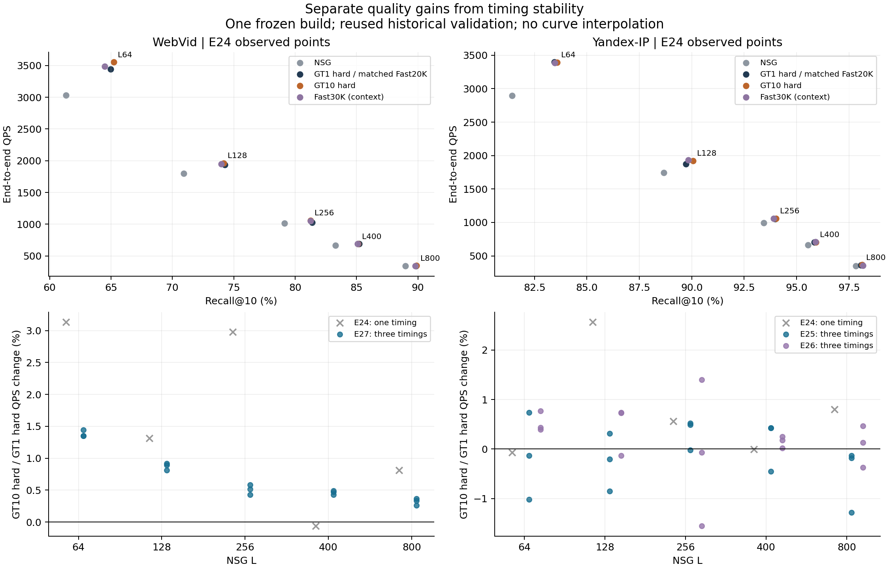
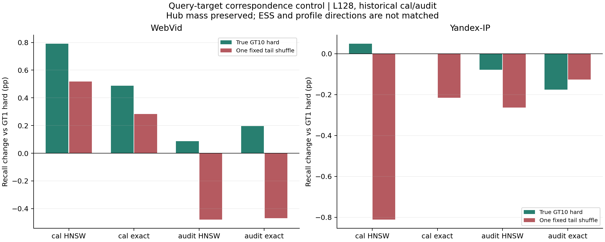
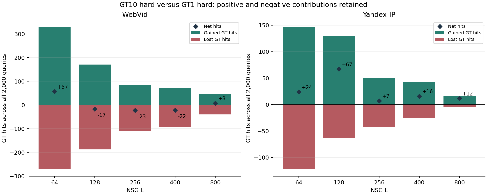

# E27｜GT10收益机制分析

2026-09-11。状态：`GT10_MECHANISM_ANALYSIS_COMPLETE_WITH_BOUNDED_DIAGNOSTICS`。已有证据分析与限定补测全部完成。E24/E25/E26原资产保留，后续方法分支未启动。本报告是对一个冻结构建和历史query的机制解释，不升级为新盲测、普遍性能GO或新方法选择。

## 1. 现在能支持的解释

**GT10把一条训练query的方向，分给其多个真实目标所对应的hub，改变了这些hub“应该服务哪些query”的画像。由此改变实际三入口，少数query在有限L的原NSG中多找到答案，另一些会受损；正负幅度的净差构成观察到的Recall收益。它同时扩大有效支持，但不能把收益简化为ESS增加、填补空画像或HNSW偶然选错。**

两个具体正点去掉HNSW近似后仍有收益：WebVid validation L64，GT10 hard−GT1 hard从HNSW的+0.285pp变为exact3的+0.435pp；Yandex L128从+0.335pp变为+0.310pp。因此这些点的收益主要保留在画像分数改变所选择的三入口上，近似后端在两点分别削减0.150pp、增加0.025pp。该差分是这两个点的后端交互，不是所有L统一的归因比例。

**速度是另一条证据链。** WebVid hard在本次三轮中五L均略快，中位QPS增幅为+1.360%/+0.890%/+0.583%/+0.484%/+0.339%；与少量路由及主图距离计算减少一致，原E24若干约3%的幅度没有完整保留。Yandex原L128的+2.563%在E25/E26为−0.184%/+0.038%，不能视作已证实的独立加速机制。命中提升仍然保留，速度幅度另行收窄。

本轮的打乱对照进一步提供有限证据：保持每hub总质量后，shuffle的ESS反而更高，但8个开发段/后端比较中7个Recall低于真实GT10。query与第2–10名目标的对应关系有值得保留的信号；不过8个配对区间都跨0，且shuffle也改变了方向集中度和位移，尚不能给“真实多目标信息”和“一般平滑”分别分配收益百分比。

## 2. 先扣开Fast本来已有的收益

完整原值及NSG/Fast30K/软画像均见[已有证据报告](existing_report.md)、[全部指标](results/all_metrics.csv)和[完整辅助表](results/tables.md)。下表只汇总主归因对照；Recall来自相同query的真实输出。E24速度与新/旧重复分批报告，未混合绝对QPS。

| 数据 | L | GT1 hard R% | GT10 hard R% | Fast−NSG pp | GT10−GT1 pp | E24 ΔQPS% | 后续独立批次ΔQPS% |
|---|---:|---:|---:|---:|---:|---:|---|
| WebVid | 64 | 64.960 | 65.245 | +3.625 | +0.285 | +3.132 | E27 +1.360 |
| WebVid | 128 | 74.260 | 74.175 | +3.320 | −0.085 | +1.314 | E27 +0.890 |
| WebVid | 256 | 81.385 | 81.270 | +2.245 | −0.115 | +2.980 | E27 +0.583 |
| WebVid | 400 | 85.220 | 85.110 | +1.940 | −0.110 | −0.062 | E27 +0.484 |
| WebVid | 800 | 89.860 | 89.900 | +0.890 | +0.040 | +0.814 | E27 +0.339 |
| Yandex-IP | 64 | 83.455 | 83.575 | +2.015 | +0.120 | −0.072 | E25 −0.105；E26 +0.760 |
| Yandex-IP | 128 | 89.720 | 90.055 | +1.060 | +0.335 | +2.563 | E25 −0.184；E26 +0.038 |
| Yandex-IP | 256 | 93.980 | 94.015 | +0.540 | +0.035 | +0.563 | E25 +0.228；E26 −0.068 |
| Yandex-IP | 400 | 95.850 | 95.930 | +0.310 | +0.080 | −0.005 | E25 +0.311；E26 +0.103 |
| Yandex-IP | 800 | 98.075 | 98.135 | +0.245 | +0.060 | +0.799 | E25 −0.923；E26 +0.128 |

WebVid目前支持约65.2% Recall附近的同L质量/速度局部双升；约89.9%处也有很小的双升，Recall净增只有8个命中。74%–85%附近三个点属于小幅质量损失换速度，不能称全面改善。Yandex在这份validation的83.6%–98.1%范围保留正Recall差，最明确的观察点在L128约90.1%；尚无跨批次稳定的速度增幅。全部[旧实测非支配点](results/hard_frontier.csv)和[新逐轮实测非支配点](supplement/results/repeat_frontier.csv)保留，不用稀疏L连线声称等Recall实测加速。

E25/E26的WebVid A1是GT10 soft，Yandex A1才是GT10 hard。前者作为辅助重复保留在[repetition.csv](results/repetition.csv)，没有冒充WebVid hard的重复。三个版本相同query/模型的七字段原结果逐位回归；计时重复不增加Recall样本数。E24与E27绝对QPS也有批次变化，所以只在各自同批对照内比较。

## 3. 从目标归属到画像方向

原GT1把unit(query)全部交给GT1目标最接近的hub。GT10 hard对十个GT目标分别硬归属，再对query权重取平均：

`a10(q,h) = (1/10) Σ_j 1[b(q,j)=h]`，`W_h = unit(unit(raw_hub_h) + Σ_q a(q,h) unit(q))`。

这是一个单画像对多个相关目标区域的分数分配。GT目标向量不进入画像求和；训练query仍20K，总权重仍20K，H和在线三入口也没有增加。更准确的统计对象是“随机抽一个top10目标时，哪些query需要这个hub”，而非只看每条query的第一个目标。

| fit20K统计 | WebVid GT1→GT10 hard | Yandex GT1→GT10 hard |
|---|---|---|
| 每query平均不同hub数 | 1→5.993 | 1→4.571 |
| 离开原GT1 hub的平均质量 | 71.844% | 58.447% |
| 十个目标都归同hub | 272/20000 | 1383/20000 |
| 每hub mass中位数 | 16→16.5 | 22→21.5 |
| 每hub ESS中位数 | 16→67.361 | 22→60.082 |
| ESS<5的hub | 114→20 | 7→0 |
| 完全无query支持的hub | 13→0 | 0→0 |
| 加权query方向集中度中位数 | 0.727→0.703 | 0.643→0.616 |
| 同hub画像角位移中位数 | 11.66° | 11.19° |

这些画像得到更多不同query的分数支持，方向分布也更宽；它们并没有获得十倍质量或更强的总训练权重。ESS是权重集中度指标，同一条query对多个hub的贡献不构成多份独立样本。方向集中度下降既可能扩大服务范围，也可能混入不合适的query，不能单独叫作更好的泛化。

逐rank归属、真实hub ID、目标范数、质量转移矩阵与每hub原值均在[WebVid rank表](results/webvid2_5m_light_v1_rank_to_hub.csv)、[Yandex rank表](results/yandex_t2i_official10M_ip_v1_rank_to_hub.csv)、两份`*_fit_assignments.npz`及`*_hub_profiles.csv`。这些是后续fit画像basin，不是最初5K QGT k-means簇。

四份已选画像/数据集的归属digest和support原值全部恢复。GT1按原dense assignments身份核对，另三份按manifest中的float64摘要核对。GT1 float64重聚合相对原float32 W误差只有1.19e−7/7.45e−8，cal/audit/validation的float64精确重评分top3均未改变；见[数值控制](results/numeric_control.csv)。这把舍入和真实画像大幅位移分开了，但没有冒称另一份W的完整HNSW建图也已逐位测试。

## 4. 支持增加到什么程度能解释收益

**支持不足得到缓解是实测事实；“收益主要来自填空hub”不成立为直接入口解释。** WebVid补齐的13个原零支持hub没有作为新增入口出现在这2000条validation中；Yandex原本没有零支持hub。WebVid新增入口含原ESS<5的query只有68条，其中L64贡献+31净命中，但L128只贡献+3；Yandex对应11条在L64/128命中均不变。不能将整个收益归给极低支持hub。改变未被选中画像可能间接改变HNSW导航，本轮未单独阻断这种间接作用。

辅助软画像也反驳“ESS越大越好”：WebVid原cal选中的GT1 soft中位ESS达到4602，却不是各L都优于GT10 hard；Yandex轻微软化的收益同样随分段/L改变。WebVid两软族温度不同，不能将其validation族比较称同T纯交互；[完整辅助表](results/tables.md)保留了原cal同温度全部对照。

为进一步区分，对每条query保留自己的0.1 GT1项，再把第2–10名归属作为一组从固定排列的另一条query搬来。第一份PCG64 seed20260911排列无固定点，没有重抽。每rank全局hub频次、每hub总质量和每query总质量都保持；详见[补测协议](supplement/protocol.md)。

| 控制结果 | WebVid | Yandex |
|---|---:|---:|
| 真实GT10 ESS中位 | 67.361 | 60.082 |
| shuffle ESS中位 | 77.358 | 70.251 |
| shuffle画像相对GT1角位移中位 | 24.17° | 42.19° |
| 真实−shuffle：cal HNSW pp | +0.273 | +0.859 |
| 真实−shuffle：cal exact pp | +0.205 | +0.215 |
| 真实−shuffle：audit HNSW pp | +0.566 | +0.186 |
| 真实−shuffle：audit exact pp | +0.664 | −0.049 |

7/8比较方向支持保留query–真实目标对应关系，而不是仅追求边际质量/ESS；Yandex audit exact反向小点完整保留。WebVid shuffle在cal仍比GT1 hard好+0.518pp（HNSW）/+0.283pp（exact），说明一般混合/平滑本身也可能产生局部收益，不能说一旦失去真实对应就必然退化。

**该控制仍不足以完成因果份额分解。** 八个真实−shuffle差的描述性配对区间全部跨0；且shuffle不保持ESS、GT1与tail的重合或方向位移，Yandex角位移明显扩大。它是一个有明确保持项的破坏对应关系诊断，不是完全匹配实验，也没有与所有可能的GT1平滑规则比较。一个排列不提供随机化检验。原值与全部正负事件见[shuffle比较](supplement/results/shuffle_comparisons.csv)。

## 5. 哪些三入口真正带来更多命中

WebVid/Yandex分别有1562/1273条validation query换了三入口（78.10%/63.65%）。相同三入口的返回ID、距离bits、hits/mask与graph NDC全相同；但大部分换入口仍不改变命中数。五L中，WebVid有144条query至少一次获益、128条至少一次受损，29条兼有两种作用；Yandex为50/50/8。各有1757/1908条五L都保持命中数。这里的“持平”不要求找到完全相同的GT成员，rank级mask交换另存。

| 数据 | L | 正query / 负query | 获得 / 损失命中 | 净命中 | 零命中救回 / 新增失败 |
|---|---:|---|---|---:|---|
| WebVid | 64 | 114 / 101 | 328 / 271 | +57 | 31 / 22 |
| WebVid | 128 | 70 / 74 | 171 / 188 | −17 | 14 / 9 |
| WebVid | 256 | 44 / 52 | 85 / 108 | −23 | 4 / 3 |
| WebVid | 400 | 35 / 37 | 71 / 93 | −22 | 3 / 1 |
| WebVid | 800 | 27 / 18 | 48 / 40 | +8 | 1 / 1 |
| Yandex | 64 | 42 / 41 | 146 / 122 | +24 | 12 / 7 |
| Yandex | 128 | 32 / 21 | 130 / 63 | +67 | 10 / 4 |
| Yandex | 256 | 12 / 10 | 50 / 43 | +7 | 4 / 3 |
| Yandex | 400 | 10 / 8 | 42 / 26 | +16 | 3 / 2 |
| Yandex | 800 | 4 / 4 | 16 / 4 | +12 | 1 / 0 |

Yandex L128的收益也不只是多找到后九名GT：GT1净增9个命中，第2–10名合计净增58。每rank新增/丢失包括命中数不变query的成员交换，不能把它们直接冒充表内按query正负差定义的获益/损失幅度。见[GT名次命中变化](results/GT_rank_hit_changes.csv)。

对每个评测query的GT10再作同规则hub归属，用“这些目标hub有几个在实际三入口中”作几何诊断：WebVid全体平均3.0115→3.2065，Yandex4.6565→4.836。这只是几何覆盖。特别是Yandex L128获益组的覆盖反而2.969→2.813，受损组却2.476→2.762；**更靠近更多GT目标区域，并不自动等于有限L内更有效的三入口。** 这也是仍需真实联合搜索证据的原因，不能用single命中并集或几何覆盖替代。

正负案例按“该段/L最大正差与最大负差，tie取最小原row ID”固定规则选取；没有只挑成功query。完整案例、入口、mask和graph NDC见[cases.json](results/cases.json)，全部query连接见`results/*_paired.npz`与[分层统计](results/query_groups.csv)。

## 6. 画像分数与近似后端分别贡献什么

| 数据/历史段 | L | GT10−GT1：HNSW pp | GT10−GT1：exact3 pp |
|---|---:|---:|---:|
| WebVid cal | 128 | +0.791 | +0.488 |
| WebVid audit | 128 | +0.088 | +0.195 |
| Yandex cal | 128 | +0.049 | 0.000 |
| Yandex audit | 128 | −0.078 | −0.176 |
| WebVid validation，补测 | 64 | +0.285 | +0.435 |
| Yandex validation，补测 | 128 | +0.335 | +0.310 |

在两个具体正点，exact下真实联合搜索的净命中分别+87/+62；原HNSW下+57/+67。WebVid近似后端减少了观察到的收益，Yandex仅增加5个净命中。因此不能把这两个提升主要解释成HNSW偶然误差。也不能据此声称精确检索总是提升Recall：Yandex同画像exact比HNSW反而GT1 −0.015pp、GT10 −0.040pp，画像分数并非搜索效用目标。

补测的两点因原先有正信号而选来解释，没有承担盲验证或模型选择。WebVid其它validation L、Yandex其它validation L没有补exact结果，不能向其外推上述差分。所有区间均为未多重校正的描述性query bootstrap；局部exact净收益不是新的普遍显著性结论。[exact完整比较](supplement/results/local_exact_comparisons.csv)。

## 7. Recall与速度为何不能合成一个故事

WebVid hard的route NDC从128.549降到118.317；graph NDC五L依次减少1.191%/0.725%/0.499%/0.290%/0.115%。原NSG和入口数不变，画像及Micro-HNSW边改变后，路由访问和主图所评分节点改变。计数可以确认少算了一些距离，不能确认扩展路径更短或cache更好。

本轮WebVid L128独立总wall为466.300→462.185μs/query，route-only为6.964→6.597μs，graph-only为450.165→446.603μs。路由只占总wall约1.49%；路由分项节省0.367μs，量级上只相当于原总wall约0.079%，不足以单独解释约0.890%的QPS增幅。图分项与总wall均有小幅改善，但独立分项不相加或当作精确耗时归因。

命中改善组也没有统一“更省”：按所有2000 query分母分摊graph NDC变化，WebVid L64获益组+0.9305、持平组−6.3785、受损组−5.5765，总计−11.0245。L128分别+2.8945/−10.7705/−4.144，总计−12.020。**部分少算来自受损query，以及命中数不变的query；不能把这些节省全叫作更有效的成功路径。** QPS和Recall因此必须在完整实测前沿上一起看，而不是从NDC下降直接推出质量提高。

Yandex L128对应graph NDC贡献+2.8565/−0.0205/−2.297，总计反而+0.539/query，与原2871.986→2872.525一致。E24的速度增幅缺乏重复支持；硬件cache、路径位置、批次与评测wrapper条件未被单独分离，本轮不编造其原因。已有和补测的纯wall均有合法边界，但不能跨批次拼绝对QPS。原GT/QGT/NSG从零成本也没有被测成“免费”。

## 8. E25/E26为什么没继续稳定增强

本轮cal特征四分位边界固定后再看audit/validation，原入口ESS、画像角位移和入口重合数都没有稳定的单调收益关系。例：WebVid L128原支持第3档在cal净+50、audit +18，validation变为−19；Yandex原支持第2档cal +23、audit +11，validation为0。全表均保留，不能据个别分层重新训练或挑规则。

这与E25已发生的特征预测迁移不足相容，也解释了为什么“支持更薄就换”“改动小一点就更安全”还不是可用规则。E25 WebVid保留部分收益却增加双路成本；Yandex减少损伤时丢掉多数有效改道。E26插值会生成第三套入口，并同时丢失原收益、制造新损伤；连续画像变化不保证离散top3或有限beam输出单调。这里只连接相同A0/A1的真实质量结果，时间各自独立。

这些结论约束E25/E26已试规则，不否定GT10原提升，也不证明所有选择性方法不可行。75%/25%是两次增强的目标，不是本轮判断GT10的门槛。[历史14](../../experiment_history/14_selective_profile_gate.md)、[历史15](../../experiment_history/15_profile_shrinkage.md)。

## 9. 成立条件、未知项与下一步

| 解释 | 当前证据与边界 |
|---|---|
| 多目标改变服务画像→实际三入口→局部命中 | 支持。权重/方向已恢复，原图/kernel固定，同入口结果相同；两个正点在exact下仍保留收益。 |
| 有效支持扩大参与改善 | 有描述性支持，尚不能单独量化因果份额；只增ESS/填空hub不足以解释全部收益。 |
| query–真实目标对应关系值得保留 | 一个固定控制7/8方向支持；所有差区间跨0，ESS/方向仍有混杂，不能提升为普遍独立信息定理。 |
| HNSW误差是主要收益来源 | 两个已补正点不支持；其它validation L仍未完全分解。 |
| WebVid有小幅速度收益 | 本轮五L三轮同向，与小幅计数减少一致；非跨机器/跨构建保证，部分节省来自受损事件。 |
| Yandex原约2.56%速度已确证 | 不支持。后续批次近0且正负波动。保留已验证的质量变化。 |
| 大ESS、较大/较小位移或GT区域覆盖可直接选好改道 | 不支持成为现成决策规则；分段不稳定，几何覆盖与真实收益可反向。 |
| 更短扩展路径、更好cache、单峰画像是主要瓶颈 | 尚未测到相应证据。不能由NDC/均值画像代填结论。 |

收益目前成立于**这份固定H和画像、相关query–目标分配、指定有限L及已使用query集合**；不要求每条query或每个L受益。Yandex后续开发段多数小L净差为负，说明其validation五点全正不是跨workload保证，详见[later_development.csv](results/later_development.csv)。WebVid有较明确的小幅计算节省，同时中间L存在质量交换。新的独立构建、query分布和精确匹配Recall的完整前沿仍未验证。

**建议保留的结构是query相关的多目标分数归属、每query质量1、matched GT1/GT10 hard及原冻结soft对照。** 支持/角位移/覆盖统计适合作诊断字段，当前不宜直接变成选择门控。若继续方法研究，应先把尚未对齐的“画像几何分数与实际有限L三入口作用”作为明确问题，再由用户选定2A或其它一个分支及其独立协议；本轮不把效用可学习性视为已证实，也不自动开标签、rank、聚类、微型图拉伸或新网格。

## 10. 执行、成本与证据身份

先完整阅读根五文档，沿历史13/14/15核对原协议、构建/评测代码、manifest、逐query结果和成本。A–C阶段新增搜索0：108个既有点169152输出独立GT10评分；原E24恢复点另由旧证据及新恢复覆盖，没有把它们重复算进该数。两数据集四份已选画像的归属摘要、support与W数值通过。E25/E26重复只按真实画像身份连接。

明确缺口后冻结[补测协议](supplement/protocol.md)、[配置](supplement/config.locked.json)、[模型/输入/源码锁](supplement/reviews/frozen_before_search.json)，完成9个真实job、30点36448个输出独立评分。真实调用181376、恢复修复0、合成0；真实查询进程总242.491s，峰值RSS约9.918GiB，全部CPU15/实际1线程。该进程时间含加载/建图/预热/count/I/O，不能换算QPS。新增控制不依赖single/triple标签，不作梯度训练。新控制构建、编译和准备时间单列在对应manifest；原exact GT/QGT/NSG从零成本未新测。

第一次已有证据分析遇到GT1 manifest使用`assignments_identity`、其它候选使用`assignments_sha256`的schema差异而停下；仅修正新分析器读取方式，保留首个日志，没有发生真实搜索或更改旧资产。全部真实补测job一次成功；补测评测器只在独立副本放行旧Policy已有的exact3开关，原kernel、Policy和timer不改。

全部fit/cal/audit/validation有历史使用，validation又启发本问题，不能称盲测。held-out未读取、未hash、未测试。QGT只有一个构建seed，重复计时不是重复训练。原E24/E25/E26的5634个文件已在开始时登记保护，最终完整性与文档验收见[final_audit.json](reviews/final_audit.json)。

主要入口：[已有分析](existing_report.md)、[完整表格](results/tables.md)、[既有来源](reviews/existing_sources.json)、[既有评分验收](reviews/existing_verification.json)、[补测账本](supplement/reviews/search_jobs.json)、[补测分析](supplement/results/analysis.json)、[补测执行成本](supplement/reviews/execution_complete.json)。状态与后续目标见根[summary](../../summary.md)、[s-target](../../s-target.md)及[历史16](../../experiment_history/16_gt10_mechanism.md)。
