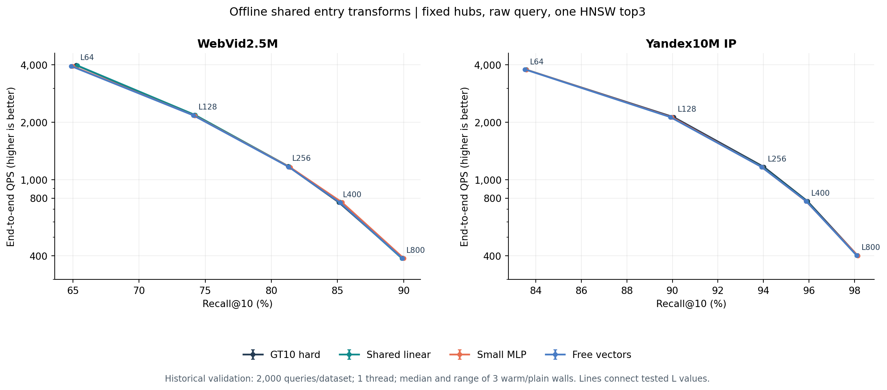
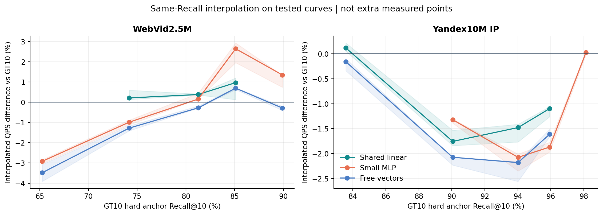
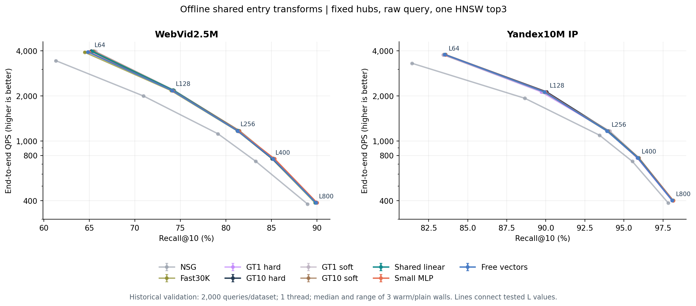
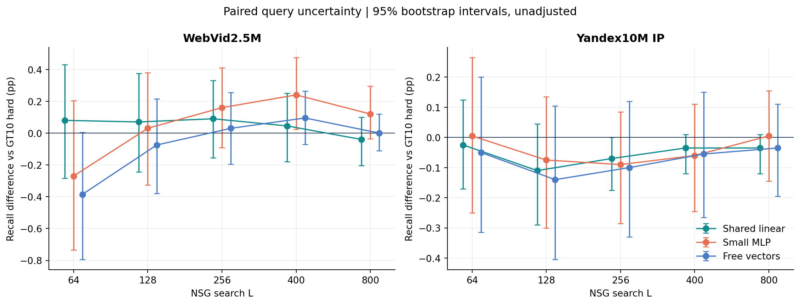
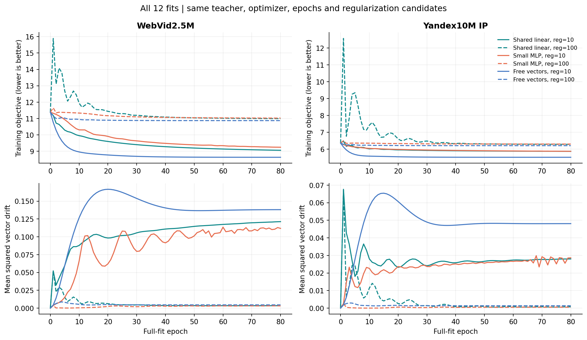

# GT10 共享入口变换：真实检索比较与方法判断

本轮没有建立共享线性或小 MLP 优于原 GT10 画像的稳定双数据证据。默认保留原已冻结的 GT10 路线；下列实测曲线用于区分不同数据集、召回区间和方法的局部变化。模型已经训练并完成真实检索，结论不依赖训练损失或教师上界代替查询结果。

研究固定原始 query→一次 microHNSW top3→三个真实 hub→原 NSG。线性和 MLP 都只在离线生成入口向量；在线没有神经网络前向。测试覆盖两数据集、9个方法、5个 L，共90个正式点，每点3次完整 warm/plain 单线程端到端 wall。

文献部分提供机制和新颖性判断的依据；实测矩阵由这里列出的9种配置组成。硬件为Intel Xeon 6982P-C，16个逻辑CPU、约123GiB内存，正式查询固定CPU15/实际单线程；环境版本见[machine.json](reviews/machine.json)。

## 1. 主比较图



点为实际 L64/128/256/400/800 的测试；QPS 取三次独立批次的中位数，误差线为最小/最大值。连线只连接测试点，纵轴为对数刻度；三次 wall 不增加 Recall 样本量。完整原始数值见 [all_points.csv](results/all_points.csv)，所有图表的工作簿见 [chart_data.xlsx](chart_data.xlsx)。

## 2. 哪个方法更好：分数据集和召回区间回答

先列L128的实际值作量级参照；选择方法仍需结合整条曲线。

| 数据集 | 模型 | Recall@10 | QPS中位数 | 三次QPS范围 |
|---|---|---|---|---|
| WebVid2.5M | gt10_hard | 74.175% | 2183.2 | 2166.1～2186.2 |
| WebVid2.5M | linear | 74.245% | 2177.6 | 2158.8～2189.0 |
| WebVid2.5M | mlp | 74.205% | 2157.5 | 2140.7～2159.7 |
| WebVid2.5M | free | 74.100% | 2169.3 | 2153.4～2171.7 |
| Yandex10M IP | gt10_hard | 90.055% | 2123.4 | 2123.4～2123.7 |
| Yandex10M IP | linear | 89.945% | 2120.8 | 2118.9～2126.1 |
| Yandex10M IP | mlp | 89.980% | 2119.4 | 2117.8～2120.1 |
| Yandex10M IP | free | 89.915% | 2123.6 | 2119.9～2123.6 |

下面以原 GT10 hard 的实测 Recall 点为参照，仅保留四个主方法共同覆盖的点，在线性 Recall–log QPS 坐标内插值，并计算速度比的几何平均。它用于概括本次粗网格的相对位置，是事后描述；既不是新增选择规则，也不是额外实测的等 Recall 点。区间之外不外推。

| 数据集 | 方法 | 共同参照点数 | 插值QPS几何平均变化 | 这些点的变化范围 | 同L质量/速度同时提高 |
|---|---|---|---|---|---|
| WebVid2.5M | linear | 3 | +0.52% | +0.21% ～ +0.97% | 1/5 |
| WebVid2.5M | mlp | 3 | +0.59% | -0.99% ～ +2.64% | 1/5 |
| WebVid2.5M | free | 3 | -0.29% | -1.28% ～ +0.69% | 0/5 |
| Yandex10M IP | linear | 3 | -1.44% | -1.76% ～ -1.10% | 0/5 |
| Yandex10M IP | mlp | 3 | -1.76% | -2.08% ～ -1.32% | 0/5 |
| Yandex10M IP | free | 3 | -1.96% | -2.18% ～ -1.61% | 0/5 |


本轮的具体推荐是继续保留WebVid原冻结GT10 soft、Yandex GT10 hard。共享linear在WebVid共同参照点的插值平均变化约+0.52%，在Yandex约−1.44%；MLP分别约+0.59%与−1.76%，没有形成双数据统一优势。free也没有提供更好的整体证据。

MLP的WebVid高召回局部信号值得单独保留：L400实测Recall为85.350%，比GT10 hard高0.240pp，QPS约持平；在GT10 hard的85.110%召回参照处，曲线插值速度比约+2.64%。这与L64双降、Yandex中间几个点下降同时成立，不能写成MLP整条曲线最好。




色带为三次对应插值速度比的范围，不是统计置信区间。原始完整曲线与此图一起读取，避免重叠曲线掩盖小幅变化。


预设门要求两数据集在0.90/0.95/0.98中至少两个共同覆盖的召回点上达到≥3%插值中位QPS提升、三次对应比值均>1，并无约定的明显前沿退化。覆盖不足时记录“未建立”，不更换目标点来补一个通过结论。全部门结果见 [performance_gate.json](results/performance_gate.json)，插值点和三次比值见 [interpolated_same_recall.csv](results/interpolated_same_recall.csv)。

| 方法 | 数据集 | 可覆盖预设点 | 达到速度条件的点 | 明显退化点 |
|---|---|---|---|---|
| linear | WebVid2.5M | 0 | 0 | 0 |
| linear | Yandex10M IP | 3 | 0 | 0 |
| mlp | WebVid2.5M | 0 | 0 | 0 |
| mlp | Yandex10M IP | 3 | 0 | 0 |
| free | WebVid2.5M | 0 | 0 | 1 |
| free | Yandex10M IP | 3 | 0 | 0 |


**门设计的覆盖限制：** 至少一个数据集的原GT10曲线没有覆盖两个预设目标，因此这一统一门在本轮不可充分检验。不能将它的“不通过”作为模型无效的证据，也没有事后改目标点。方法推荐另依据上面实际共同覆盖区间的比较、全部实测点和波动范围；本轮没有完成新的精确等Recall测量。


GT10 hard 是新模型的共同锚点；历史按 cal 冻结的正式画像仍分别是 WebVid GT10 soft、Yandex GT10 hard。下图保留 soft、GT1 hard、原 Fast30K 和 NSG，避免只在几个新模型里选一个相对不差者。原 Fast30K 的30K输入、seed100和旧入口顺序身份单列。



## 3. 完整五个 L 的增减与不确定性

以下所有差值均相对本批次 GT10 hard；pp 表示百分点。QPS 为同 L 的中位数之比，与等 Recall 加速不同。Recall 区间采用相同 query 的2000次配对 bootstrap，未做多重比较校正，也不包含不同图、训练种子或机器的不确定性。

### WebVid2.5M

| L | 方法 | ΔRecall pp | 95%区间 | Δ同L QPS | Δgraph NDC | 获益/受损query |
|---|---|---|---|---|---|---|
| 64 | linear | +0.080 | [-0.285, +0.430] | -0.28% | +0.37% | 30/37 |
| 128 | linear | +0.070 | [-0.245, +0.375] | -0.26% | +0.28% | 28/23 |
| 256 | linear | +0.090 | [-0.155, +0.330] | -0.41% | +0.23% | 20/14 |
| 400 | linear | +0.045 | [-0.180, +0.250] | +0.46% | +0.13% | 17/11 |
| 800 | linear | -0.040 | [-0.205, +0.100] | -0.24% | +0.09% | 5/8 |
| 64 | mlp | -0.270 | [-0.735, +0.205] | -1.21% | +0.60% | 90/100 |
| 128 | mlp | +0.030 | [-0.325, +0.380] | -1.18% | +0.87% | 69/63 |
| 256 | mlp | +0.160 | [-0.090, +0.410] | -1.21% | +0.69% | 54/37 |
| 400 | mlp | +0.240 | [+0.025, +0.475] | +0.02% | +0.39% | 40/30 |
| 800 | mlp | +0.120 | [-0.035, +0.295] | -0.39% | +0.19% | 18/20 |
| 64 | free | -0.385 | [-0.795, +0.005] | -1.07% | +0.91% | 45/68 |
| 128 | free | -0.075 | [-0.380, +0.215] | -0.64% | +0.59% | 38/41 |
| 256 | free | +0.030 | [-0.195, +0.255] | -0.54% | +0.37% | 30/25 |
| 400 | free | +0.095 | [-0.070, +0.265] | -0.36% | +0.27% | 24/17 |
| 800 | free | +0.000 | [-0.110, +0.120] | -0.29% | +0.12% | 8/12 |

### Yandex10M IP

| L | 方法 | ΔRecall pp | 95%区间 | Δ同L QPS | Δgraph NDC | 获益/受损query |
|---|---|---|---|---|---|---|
| 64 | linear | -0.025 | [-0.170, +0.125] | +0.34% | -0.04% | 8/9 |
| 128 | linear | -0.110 | [-0.290, +0.045] | -0.13% | -0.03% | 3/8 |
| 256 | linear | -0.070 | [-0.175, +0.000] | -0.01% | +0.03% | 1/4 |
| 400 | linear | -0.035 | [-0.120, +0.010] | -0.06% | +0.05% | 1/1 |
| 800 | linear | -0.035 | [-0.120, +0.010] | -0.07% | +0.07% | 1/1 |
| 64 | mlp | +0.005 | [-0.250, +0.265] | -0.03% | +0.33% | 24/21 |
| 128 | mlp | -0.075 | [-0.300, +0.135] | -0.19% | +0.20% | 11/15 |
| 256 | mlp | -0.090 | [-0.285, +0.085] | -0.19% | +0.12% | 5/11 |
| 400 | mlp | -0.060 | [-0.245, +0.110] | -0.15% | +0.04% | 4/6 |
| 800 | mlp | +0.005 | [-0.145, +0.155] | -0.12% | +0.04% | 2/1 |
| 64 | free | -0.050 | [-0.315, +0.200] | +0.29% | +0.07% | 17/15 |
| 128 | free | -0.140 | [-0.405, +0.105] | +0.01% | +0.01% | 8/12 |
| 256 | free | -0.100 | [-0.330, +0.120] | -0.10% | +0.11% | 2/9 |
| 400 | free | -0.055 | [-0.265, +0.150] | -0.00% | +0.09% | 2/5 |
| 800 | free | -0.035 | [-0.195, +0.110] | +0.03% | +0.08% | 2/2 |




正、负 query 同时保留，净命中恒等式为 gained_hits−lost_hits。新增零命中、挽救零命中和入口改变比例也保存在差值CSV中；没有用一个净正数隐藏其它查询受损。

## 4. 教师空间、模型拟合与实际检索

每个 fit query 的候选为两条原硬画像实际 HNSW3 并集补齐八个入口，枚举56个真实三入口搜索。教师先最大GT10 hits，再最小graph NDC。这是 GT 参与的 C8 内选择；既不是全H上界，也不能部署，更不构成等工作或QPS收益。

| 数据集 | 原GT10 fit Recall | 教师Recall | 教师增量pp | 原graph NDC | 教师graph NDC | 存在正命中空间的query |
|---|---|---|---|---|---|---|
| WebVid2.5M | 75.016 | 79.642 | +4.626 | 1642.9 | 1621.3 | 21.17% |
| Yandex10M IP | 90.079 | 92.929 | +2.850 | 2862.3 | 2822.9 | 10.80% |


训练后另作教师分组诊断，不增加搜索，也不用于改选择。下表区分有额外命中空间与原GT10已经达到C8最大命中的query；教师可能仍为了同命中下更低NDC而改变三入口。它说明标签构成，不能证明哪一组导致最终性能变化，因果区分需要新的控制实验。

| 数据集 | query组 | 行数 | 占fit比例 | 教师改变集合 | 平均同最高hits集合数 | 教师平均hit增量 | 平均每query相对NDC变化 |
|---|---|---|---|---|---|---|---|
| WebVid2.5M | 有Recall空间 | 4234 | 21.17% | 100.00% | 13.4 | 2.185 | +10.33% |
| WebVid2.5M | 无Recall空间 | 15766 | 78.83% | 63.69% | 51.7 | 0.000 | -3.03% |
| Yandex10M IP | 有Recall空间 | 2161 | 10.80% | 100.00% | 13.8 | 2.638 | +16.41% |
| Yandex10M IP | 无Recall空间 | 17839 | 89.20% | 57.50% | 54.4 | 0.000 | -2.45% |


无额外命中空间的query占78.83%/89.20%，其中教师仍为63.69%/57.50%更换集合；这些行平均有51.7/54.4个集合达到相同最高hits，监督很大一部分来自成本tie-break。真正增加命中的组平均每query相对graph NDC反而增加10.33%/16.41%。因此总体平均NDC下降不意味着质量收益无成本，组内相对变化均值也不同于总体均值之比。


三族各用λ10/100，cal在L64/128平均Recall上选择；精确同分依总NDC和较强正则打破ties。两集最终配置如下，audit与validation结果均未用于改动它们。

| 数据集 | 模型 | 冻结配置 |
|---|---|---|
| WebVid2.5M | linear | linear_r100 |
| WebVid2.5M | mlp | mlp_r10 |
| WebVid2.5M | free | free_r100 |
| Yandex10M IP | linear | linear_r100 |
| Yandex10M IP | mlp | mlp_r10 |
| Yandex10M IP | free | free_r100 |

| 数据集 | 模型 | fit集合CE | 教师入口重合度 原→新 | 教师集合完全匹配 | 新精确集合超出C8 |
|---|---|---|---|---|---|
| WebVid2.5M | linear | 11.387→10.655 | 66.16%→64.15% | 27.10% | 0.66% |
| WebVid2.5M | mlp | 11.387→8.130 | 66.16%→56.08% | 17.52% | 14.79% |
| WebVid2.5M | free | 11.387→10.420 | 66.16%→64.24% | 26.36% | 2.79% |
| Yandex10M IP | linear | 6.365→6.217 | 69.61%→68.88% | 37.97% | 0.01% |
| Yandex10M IP | mlp | 6.365→5.590 | 69.61%→66.12% | 31.65% | 1.30% |
| Yandex10M IP | free | 6.365→6.076 | 69.61%→69.47% | 37.70% | 0.24% |


训练侧入口重合度用float64全H精确评分统计，分母为每query三个教师入口；集合匹配则要求三个全对。共享模型的CE下降没有带来重合度提升，因此不能把当前结果简单解释为“只差一点优化工程”。这也不证明所有共享模型都无效：本轮只有一种教师压缩、温度、宽度、种子和固定80轮优化。自由向量提供更大表容量参考，但相同训练轮数不等于相同收敛程度。



同一λ内可比较三族目标；不同λ改变了目标定义，跨λ损失值不直接排序。最终梯度范数、参数量、漂移和全部训练曲线都保留，没有按验证结果挑选某一epoch。

## 5. 开发段差异与微型HNSW的影响

下表是L128的真实检索Recall。fit probe只取训练集前256行，cal/audit各1024行，validation各2000行；不同段的绝对难度不同，不能把列间差异都叫作泛化损失。比较应看每段内同一query的模型与GT10差。

| 数据集 | 模型 | fit probe | cal | audit | validation |
|---|---|---|---|---|---|
| WebVid2.5M | gt10_hard | 76.914 | 75.322 | 75.107 | 74.175 |
| WebVid2.5M | linear | 77.188 | 75.146 | 75.293 | 74.245 |
| WebVid2.5M | mlp | 76.992 | 75.244 | 75.332 | 74.205 |
| WebVid2.5M | free | 77.695 | 75.195 | 75.264 | 74.100 |
| Yandex10M IP | gt10_hard | 90.234 | 89.736 | 88.691 | 90.055 |
| Yandex10M IP | linear | 90.625 | 89.766 | 88.672 | 89.945 |
| Yandex10M IP | mlp | 90.664 | 89.854 | 88.428 | 89.980 |
| Yandex10M IP | free | 90.234 | 89.814 | 88.643 | 89.915 |


audit的精确画像top3诊断如下。精确画像评分只消除入口小图的近似，不能消除画像评分与有限L搜索效用的不一致；它可能提高或降低最终Recall。

| 数据集 | 模型 | HNSW3 Recall | exact3 Recall | exact−HNSW pp |
|---|---|---|---|---|
| WebVid2.5M | gt10_hard | 75.107 | 75.498 | +0.391 |
| WebVid2.5M | linear | 75.293 | 75.527 | +0.234 |
| WebVid2.5M | mlp | 75.332 | 75.371 | +0.039 |
| WebVid2.5M | free | 75.264 | 75.586 | +0.322 |
| Yandex10M IP | gt10_hard | 88.691 | 88.672 | -0.020 |
| Yandex10M IP | linear | 88.672 | 88.672 | +0.000 |
| Yandex10M IP | mlp | 88.428 | 88.389 | -0.039 |
| Yandex10M IP | free | 88.643 | 88.623 | -0.020 |

## 6. 在线和离线成本

| 数据集 | 模型 | 端到端μs/query | route单测μs | graph单测μs | route/独立总wall | graph NDC |
|---|---|---|---|---|---|---|
| WebVid2.5M | gt10_hard | 458.04 | 6.60 | 443.98 | 1.44% | 1646.1 |
| WebVid2.5M | linear | 459.22 | 6.89 | 445.65 | 1.50% | 1650.8 |
| WebVid2.5M | mlp | 463.51 | 7.72 | 449.88 | 1.66% | 1660.5 |
| WebVid2.5M | free | 460.99 | 6.89 | 447.46 | 1.50% | 1655.9 |
| Yandex10M IP | gt10_hard | 470.94 | 4.31 | 462.43 | 0.92% | 2872.5 |
| Yandex10M IP | linear | 471.53 | 4.35 | 462.32 | 0.92% | 2871.5 |
| Yandex10M IP | mlp | 471.84 | 4.52 | 463.63 | 0.96% | 2878.2 |
| Yandex10M IP | free | 470.91 | 4.34 | 463.07 | 0.92% | 2872.8 |


分项wall是另外的测量，不相加当作总wall。模型前向已经离线完成，但入口几何会改变microHNSW访问和后续NSG路径，故“在线没有MLP开销”不代表所有模型QPS相同。NDC只计距离操作，不能代表访存、分支或全部运行时间。

| 数据集 | 模型 | λ | 参数量 | 训练秒 | 导出秒 | 最终梯度范数 |
|---|---|---|---|---|---|---|
| WebVid2.5M | linear | 10 | 262144 | 38.73 | 0.0019 | 0.15233 |
| WebVid2.5M | linear | 100 | 262144 | 38.93 | 0.0020 | 0.46828 |
| WebVid2.5M | mlp | 10 | 65600 | 38.59 | 0.0016 | 0.77839 |
| WebVid2.5M | mlp | 100 | 65600 | 36.91 | 0.0015 | 0.23368 |
| WebVid2.5M | free | 10 | 417280 | 39.44 | 0.0013 | 0.00544 |
| WebVid2.5M | free | 100 | 417280 | 39.62 | 0.0012 | 0.00534 |
| Yandex10M IP | linear | 10 | 40000 | 38.67 | 0.0008 | 0.04111 |
| Yandex10M IP | linear | 100 | 40000 | 38.96 | 0.0008 | 0.26874 |
| Yandex10M IP | mlp | 10 | 25664 | 37.37 | 0.0008 | 0.14908 |
| Yandex10M IP | mlp | 100 | 25664 | 38.12 | 0.0009 | 0.01526 |
| Yandex10M IP | free | 10 | 164200 | 39.85 | 0.0008 | 0.00191 |
| Yandex10M IP | free | 100 | 164200 | 36.84 | 0.0007 | 0.00296 |


整个研究实际新增NSG调用 **3,377,147** 次：新标注1,971,899、标注核验256、开发/正式评测1,404,992；另268,101个逻辑三元组复用兼容缓存。修复搜索0、合成搜索0，未借用历史剩余额度。两集标注进程合计107.49s（16线程且带计数，包含加载等），12次训练合计462.03s（8线程）。这些离线吞吐不能和单线程在线QPS比较。

候选生成另有80,000次纯microHNSW路由与32,720,000个精确画像分数计算，均为fit候选准备；不计作NSG调用，也不混进正式查询wall。

精确训练GT、QGT hub、原GT10画像、主图和base均为既有依赖；本轮没有重新测从零构建总成本。模型导出和microHNSW构建单独保存，但不能据此声称完整系统构建只需这些时间。若未来有稳定同Recall加速，仍需按额外离线成本和每query节省的wall计算摊销规模。

## 7. 验收、限制与研究建议

原始ID独立GT评分覆盖150个开发/正式点、235,296个query输出；其中6条原对照×2数据集×5L的120,000个输出回归历史E24，ID、入口、graph NDC、hits和mask一致。每点plain/count结果、16条原wrapper结果及正式三轮结果逐位对齐；同一模型五个L入口一致。模型的NumPy独立前向和概率归一化重算通过。最终资产/预算/链接核验见 [final_audit.json](reviews/final_audit.json)。

本轮只有一个既有hub/图构建，历史fit/cal/audit/validation均已多轮使用；cal选λ之后冻结并不能把这些切片变成新的盲测。bootstrap只描述固定模型下的query波动；三次wall仅描述本机重复范围。没有访问或hash held-out，没有额外调参、追加L、换种子或训练更大网络。

现阶段应把后续优先级放在“真实联合教师怎样被压缩成可靠的静态top3评分”，而不是首先扩大MLP。当前教师确有候选范围内空间，但共享模型的损失改善与教师入口命中没有同步，这是可核验的监督/压缩问题。若继续该方向，下一独立版本应先固定一个比本轮更贴近top3错误的目标，检验训练侧和开发侧的真实三入口收益；只有这一步成立，再讨论更强非线性、结构特征或新的未使用测试集。这些建议尚未执行，不自动开启新预算。

GT10原来的局部正信号与本轮共享变换的结果分开保留；一个增强失败不推翻先验本身。作为论文方向，GATE式离线表示加小图已有明确先例，MLP组件、成对线性变换和固定大小集合似然本身都不构成新颖性证明。可检验的贡献候选在于联合搜索监督、固定部署约束下的压缩机制和可重复端到端收益。

## 8. 证据与复现入口

- [冻结协议](protocol.md)、[选择与冻结](models/frozen_before_validation.json)、[执行账](logs/evaluation_jobs.json)。
- [全部数据工作簿](chart_data.xlsx)、[全部点CSV](results/all_points.csv)、[配对差值](results/validation_differences.csv)、[插值表](results/interpolated_same_recall.csv)。
- [训练源码](src/train.py)、[原生标注](src/label.cpp)、[评测器](src/evaluate.cpp)、[完整构建参数](bin/evaluate.build.json)。
- [标注核验](reviews/label_verification.json)、[模型核验](reviews/model_verification.json)、[输出核验](reviews/output_verification.json)、[修改前文档](source_before/summary.md)。

本目录脚本使用冻结绝对输入路径，拒绝覆盖已有训练和搜索输出。重跑真实实验需要新的独立目录、相同依赖身份和新的预算；不能直接在本已完成目录执行原训练命令。原始来源和方法推导如下。


## 9. 方法依据：研究对象与部署约束

目标是在离线阶段学出更适合选入口的向量，再用一份微型 HNSW 直接给出三个真实 hub，交给原 NSG。训练复杂度与查询复杂度在这里可以分开：训练时能使用真实搜索反馈；部署只保存每个 hub 一条定长向量，模型前向不进入查询路径。

[E27](../20260911_gt10_mechanism_v1/report.md) 已观察到：GT10 hard 的两个局部正点在 exact3 下仍有净命中提升。因此“微型 HNSW 没有找准原有画像的 top3”不足以解释全部收益。本轮主问题是改变画像评分所选择的入口；纯保分数几何变换仍是另一项研究，不能把两者混作同一种优化。

整个链条固定为：

```text
离线：GT10 hard 原型 P ──共享变换/自由残差──> 单位入口向量 W ──> microHNSW
                        ↑
              fit query 的真实三入口搜索教师

在线：原始 query ──一次 microHNSW top3──> 三个真实 hub ──原 NSG──> top10
```

本轮没有 query 端 MLP、在线组合重排、修改主图距离、重新选择 H 或更改 GT。图中训练教师不是上线所需的数据；验证查询的 GT 只在原始结果生成之后参与评分。

## 10. 文献所支持的部分与迁移边界

| 一手来源 | 可核实的方法内容 | 对本轮的启发与边界 |
|---|---|---|
| GATE，KDD 2025 [^1] | 选 hub，采局部子图、提取结构特征；通过到近邻的 hop 构造监督，融合节点与结构特征并学入口表示，再构建高层导航图 | 支持“离线学入口、在线查小图”的路线。它的 GT1/hop 标签与本轮固定 L、GT10、三个入口共同搜索的反馈不同 |
| GATE 作者固定提交代码 [^2] | 发布训练实际用 cosine triplet；hub 侧模型输出与 query 向量直接比较；在线源码 raw query→HNSW3→映射真实入口→NSG | 原始 query 配合离线 hub 变换在其公开实现中可行。论文两塔/对比学习描述与代码细节分别记录，不能声称本轮是 GATE 完整复现 |
| Learning to Route in Similarity Graphs，ICML 2019 [^3] | 学习节点/query 映射，用内积替代图内扩展评分；以到真实近邻的 hop 教师训练，采用访问状态上的模仿学习，并按原距离重排结果 | 说明“学搜索所需评分”有先例。它改变图内路由，本轮只改入口；不能直接借用其效果证明入口方法有效 |
| ListNet，ICML 2007 [^4] | 从 pairwise 转向 listwise，以 top-one 概率和交叉熵构建可训练排名目标 | 提醒训练目标应与最终选择一致。本轮不是复用 ListNet top-one：选择单位是无序三元组，归一化包含全部 H 的三元组 |
| k-DPP，ICML 2011 [^5] | 固定集合大小的概率分布，其归一化由 elementary symmetric polynomial 给出 | 本轮的加性集合概率是 diagonal k-DPP 的特例。所用 normalizer 不是新理论，也没有非对角 DPP 的多样性机制 |
| SlateQ，IJCAI 2019 [^6] | 通过单项选择、奖励/转移只依赖被选项等假设，将 slate 价值分解 | NSG 三入口共享搜索过程不满足这些现成前提。不能从该论文推导三个单入口收益相加就等于联合收益 |
| GleanVec / LeanVec-Sphering [^7] | 利用 query 分布构造线性投影，并研究分段线性降维；全维成对变换可保留原始内积 | 区分“保评分、改几何”与本轮“改入口评分”。本文只借用该区分，没有训练或评测 GleanVec |

GATE 论文 §4.3 的文字与公式存在表述不一致处：一处写成减小正例相似度，但公式及后文说明实际意图是拉近正例。本文以公式和作者训练代码共同核对，不沿用该文字错误。其文中关于 cosine 的 metric 表述也不能作为任意 cosine distance 满足三角不等式的证明；本轮并不依赖这个论断。[^1][^2]

## 11. 为什么同时比较线性、MLP 和自由入口向量

令固定原型为 \(P\in\mathbb{R}^{H\times d}\)，输出为：

\[
W_h=\operatorname{normalize}(P_h+f_\theta(P_h)).
\]

共享线性采用无偏置矩阵；小 MLP 采用 \(d\to64\to d\)，中间 ReLU、有隐藏偏置、无输出偏置。两者的残差输出都零初始化，使训练从 GT10 原型附近开始。自由参考为每个 hub 独立的残差 \(D_h\)，同样归一化；它使用完全相同的教师、损失、正则候选、训练轮数和优化器。

| 模型 | WebVid d512/H815 参数量 | Yandex d200/H821 参数量 | 查询时新增网络计算 |
|---|---:|---:|---:|
| 原 GT10 hard | 0 | 0 | 0 |
| 共享 linear | 262144 | 40000 | 0 |
| 小 MLP，宽64 | 65600 | 25664 | 0 |
| free 残差 | 417280 | 164200 | 0 |

参数量与最终画像存储量是不同概念：四种方法最终都存同样的 \(H\times d\) float32 表。只要导出静态 W，上线选择始终是 \(q^TW_h\)。两个入口之间的精确评分边界为 \(q^T(W_a-W_b)=0\)；MLP 没有使 query 空间的这条边界变成非线性。

因此，这里的 MLP 主要改变“如何从原型生成并共享入口向量”，提供一个参数共享和正则化假设。固定 H 时，任意导出的 MLP 向量表都能由 free 表表示；不能说 MLP 的最终函数族比自由 W 更大。如果 MLP 更好，需要用实测说明是共享规律或优化/正则带来的收益。如果 free 更好，也不能直接归因于结构无用，因为相同轮数不保证不同参数化达到相同优化程度。

线性 query 塔有时可折叠到离线 hub 表：若评分为 \((Bq)^TW_h\)，则等于 \(q^T(B^TW_h)\)。真正的非线性 query 塔一般不能这样精确折叠。本轮保持一次 microHNSW 的部署约束，不引入这个在线成本；“两塔”本身也不能充当创新性结论。

## 12. 为什么重新构造完整三元组教师

旧 [E23](../20260910_three_entry_rank_v1/report.md) 已经使用过真实三入口搜索标签，不能把它误写成只用了单入口伪标签。其训练将固定另外两个入口时的第三入口偏好压成 pairwise 约束；在有限抽样中，确实观察到同一 query 的某些入口相对偏好随另外两个入口改变。这个事实说明条件偏好可能冲突，但不足以证明所有静态评分方法都不可能成功。

本轮不继续将不同上下文的条件偏好分别压入一个排序，而为每个 query 直接给出一个完整目标三元组。候选来自实际部署的 GT1 hard HNSW3 与 GT10 hard HNSW3 并集，再用 GT10 原型精确分数补齐八个 hub。两条已部署基线的实际三入口因而一定包含在 56 个枚举三元组中。

每个三元组按真实 ID 升序注入原 NSG，在 L128 搜索，保存原始 top10 ID、hits/mask 和 graph NDC。教师按以下确定次序选择：最大 hits；在这些集合中最小 graph NDC；再取原型分数和最大者；最后真实 ID 字典序。前两项让教师优先关注有限 L 的检索质量，并在同等质量下偏好较低图工作。

这里有三个明确限制。第一，八个候选仍由原画像提出，教师无法发现候选以外的更好入口。第二，最优观察集合只针对一个 L，未必在其它 L 最优。第三，先 max hits 再 min NDC 是一个固定偏好次序，并非直接最小化同 Recall 的真实 wall。教师的 NDC 降低也不是 QPS 结论。

旧缓存复用要求相同 query、GT、H 映射、图、L 和入口顺序。两套原输入完整 hash 一致，缓存又与新原生 kernel 抽查对齐后才使用；新旧标签合并后由独立 Python 根据原始 ID 重新计算全部 224 万个三元组的 hits 和 mask。缓存节省的是重复调用，不创造新的独立样本。

## 13. 与直接 top3 相容的目标，以及它仍然不能解决的问题

使用归一化 query 只在训练中消除范数造成的温度差异。上线使用原始 query；对于相同 query，正比例缩放不会改变精确内积排序。设

\[
z_h=\hat q^TW_h/0.05,\qquad
P_\theta(S\mid q)=\frac{\exp(\sum_{h\in S}z_h)}{Z_3(q)},\quad |S|=3,
\]

\[
Z_3(q)=\sum_{1\le a<b<c\le H}\exp(z_a+z_b+z_c).
\]

训练损失为目标三元组的负对数似然，加上画像漂移惩罚：

\[
\mathcal L=\frac1N\sum_i\left[\log Z_3(q_i)-\sum_{h\in S_i^*}z_{ih}\right]
+\lambda\frac1H\sum_h\|W_h-P_h\|^2.
\]

最大概率集合就是三个最大分数的入口：若一个集合包含分数较低的 a，却遗漏分数更高的 b，将 a 换成 b 会增加分子而不改变分母。重复这一替换即得到 top3。该推导只保证模型自身的精确 MAP；HNSW 可能没有返回这个 MAP，更没有保证其 MAP 等于真实 NSG 最优入口。

令 \(e_k\) 为权重 \(\exp z\) 的第 k 阶 elementary symmetric polynomial，则 \(Z_3=e_3\)。本轮实现用 log-prefix 递推计算 e1/e2/e3，复杂度 \(O(3H)\)，避免枚举全部 \(\binom H3\) 个模型集合。小 H 穷举 normalizer、穷举梯度、有限差分、平移不变性、极端 logits 有限性和 top3 MAP 都已核验。该计算与 diagonal k-DPP 的归一化一致。[^5]

全 H 归一化约束候选以外的分数，避免只在 C8 内排序后任由未约束入口进入上线 top3。但是，候选以外并未逐一搜索过，把有限教师当作目标仍包含信息损失。目标是对教师集合的模仿，不是无偏估计全部 H 的搜索效用。

这个加性分布不建模任意互补性。它不具有非对角 DPP 的成对多样性项，更不能表示任意三元组协同。如果为了得到更一般的三元组分数而加入在线成对交互，通常就无法只靠一次独立 top3 完成精确选择。当前实验保持固定部署接口，检验这个受限但廉价的模型族是否已足够有用。

还必须区分“模型的 MAP 是 top3”与“损失每次下降都会改善 top3”。一个可直接计算的反例是五个入口、教师为 {0,1,2}：分数从 `[0.03,0.02,0.01,0,-0.01]` 变为 `[10,10,1,2,-10]` 时，教师概率从约0.103升至0.269，负对数似然从2.273降至1.313，但 top3 从正确的 {0,1,2} 变为 {0,1,3}。前两个教师项更确定，足以补偿第三项排错造成的概率损失。这个数学例子不构成搜索性能证据，却说明受限参数化、正则和有限优化下，必须另测真实选择；不能由代理损失下降推断入口已经更好。计算见 [反例数值](reviews/surrogate_counterexample.json)。

## 14. 控制变量与解释顺序

三族同用 fit20k、唯一教师、温度0.05、Adam lr0.003、80个完整梯度 epoch、λ10/100。仅 cal1024 的 L64/128 选择每族一个 λ；不选 epoch、不挑 seed、不展开宽度/秩/温度。原 hard/soft 对照按历史身份保留，原 Fast30K 保持其 query 数、seed100 和入口顺序，避免把输入或顺序差异当作神经模型收益。

训练损失、训练侧精确教师命中和真实检索成绩必须依次判断。损失下降只说明优化器推动了代理目标；教师匹配上升只说明模仿得更接近；同 L hits/NDC 改善只说明一个预算参数下的效果。最终选择仍看同机、同一批次的完整 Recall–QPS 前沿。

训练和正式计时分开运行。每个查询方法实际线程为1，固定 CPU15、OMP/BLAS/MKL均为1；每个点三次完整 warm+plain wall，轮换方法顺序。计时包含原始 query 路由、映射与排序、原 NSG 和结果写入预分配内存；GT、计数器、I/O、索引加载构建在外。逐位核验不同重复、plain/count、原 wrapper 结果。

报告保留所有五个 L 和全部方法，包括负点。精确 top3 只作为 audit 的画像/近似分解诊断。两个方法在相同 L 的 Recall 差采用逐 query 配对 bootstrap；wall 三次重复只表示本机重复波动范围，不能伪装成三倍 query 样本量。曲线之间的 log-QPS 插值单独标为插值，不能写成实测等 Recall 加速。

## 15. 怎样看待论文潜力

目前可研究的核心不是“在入口前放 MLP”，而是固定部署约束下的三个问题：什么样的联合搜索反馈能够压缩为可检索的静态入口表；GT10 多目标先验是否稳定改善这种压缩；共享结构是否减少样本需求并改善跨 query 泛化。GATE、图路由学习、listwise 和固定集合分布都已经覆盖若干组件，不能单靠组件拼接声称新方法。

要形成有说服力的研究贡献，至少需要稳定的端到端前沿收益、对负点的机制解释、教师与部署选择之间误差的可量化分析，以及独立数据/图/种子上的重复。当前重复使用的开发与 validation 切片只能支持本地探索结论。即便某条曲线领先，也不足以直接判断达到某一会议等级；如果原 GT10 更好，应保留这个结果，解释标签和模型瓶颈，而不是因为模型更复杂就优先推荐它。

本轮后续建议必须由实测结果约束：教师有空间但模型学不到时，优先研究压缩与监督；fit 好而开发/validation 差时，优先研究泛化或正则；exact 好而 HNSW 差时，再研究小图近似；质量改善但 wall 无收益时，检查图内工作与访存。这些是结果解释分支，不是自动授权的新实验队列。

若研究更贴近 top3 的训练目标，应先从完整教师集合与最强负例之间的 margin 开始，明确它优化的是教师成员选择，仍不等于真实 NSG 效用。更复杂的备选包括 SoftSort 的排序连续松弛，以及 SOFT top-k 用熵正则最优传输近似集合成员指示。前者以排序值到原分数的距离构造行softmax；后者通过Sinkhorn求解并对运输问题求导。它们提供可微选择工具，但温度/熵正则带来近似偏差，没有解决本项目的教师偏差和候选覆盖，也没有被本轮训练或评测；不因其名称包含top-k就预期收益。[^8][^9]

## 来源

[^1]: Ruan et al. [Empowering Graph-based Approximate Nearest Neighbor Search with Adaptive Awareness Capabilities](https://arxiv.org/html/2506.15986v1)，KDD 2025，§4.2–4.3。缓存 [PDF](sources/gate.pdf)。

[^2]: GATE 作者代码，[固定提交 229f18dadb791ddede22597e44d5ceb028b104ba](https://github.com/jacksondca/gate/tree/229f18dadb791ddede22597e44d5ceb028b104ba)。训练入口 `cluster/model/train/__main__.py`、模型 `model.py`、导出 `infer.py`、在线 `tests/test_gate_search.cpp`；本地代码与来源核验见 sources。

[^3]: Baranchuk et al. [Learning to Route in Similarity Graphs](https://proceedings.mlr.press/v97/baranchuk19a.html)，ICML 2019，§3。缓存 [PDF](sources/learn_route.pdf)。

[^4]: Cao et al. [Learning to Rank: From Pairwise Approach to Listwise Approach](https://www.microsoft.com/en-us/research/wp-content/uploads/2016/02/tr-2007-40.pdf)，ICML 2007，§4–5。缓存 [PDF](sources/listnet.pdf)。

[^5]: Kulesza and Taskar. [k-DPPs: Fixed-Size Determinantal Point Processes](https://www.alexkulesza.com/pubs/kdpps_icml11.pdf)，ICML 2011，§3。缓存 [PDF](sources/kdpp.pdf)。

[^6]: Ie et al. [SlateQ: A Tractable Decomposition for Reinforcement Learning with Recommendation Sets](https://www.ijcai.org/proceedings/2019/0360.pdf)，IJCAI 2019，§4.1。缓存 [PDF](sources/slateq.pdf)。

[^7]: Tepper et al. [GleanVec: Accelerating vector search with minimalist nonlinear dimensionality reduction](https://arxiv.org/abs/2410.22347)，固定 v1，§3.1 Eq.10 及 §4。缓存 [PDF](sources/gleanvec.pdf)。

[^8]: Prillo and Eisenschlos. [SoftSort: A Continuous Relaxation for the argsort Operator](https://proceedings.mlr.press/v119/prillo20a.html)，ICML 2020，§1及算子定义。缓存 [PDF](sources/softsort.pdf)。

[^9]: Xie et al. [Differentiable Top-k Operator with Optimal Transport](https://arxiv.org/abs/2002.06504)，2020，§2–3。缓存 [PDF](sources/soft_topk.pdf)。
