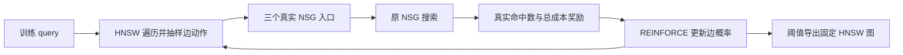

# E33：强化学习直接训练 HNSW 图边

2026-09-11，实验完成，结论`HNSW_EDGE_RL_COMPLETE_WEBVID_SIGNAL_NO_DUAL_GAIN`。本轮确实改变了 HNSW 的邻接结构，导出后直接用原 HNSW 遍历；WebVid 有局部收益，Yandex 两个种子在 cal/audit 均下降，未建立跨数据集优势。WebVid 的主图在 audit 也没有超过同出度随机删边控制。按预锁双集开发门停止，未开展新 validation/QPS，当前默认不替换。

## 1. 这次强化学习究竟训练什么

训练对象是当前815/821个入口构成的 **Micro-HNSW底层有向边**，不是原NSG大图，也不是E32的C8候选重排。每条非保护边有一个可训练logit，决定保留概率；一条query在图中真实遍历，每遇到可影响下一步的边就抽样保留或删除，最后取三个真实入口进入原NSG，用真实Recall与总NDC奖励更新这些边概率。

环境状态包括query、当前节点、候选队列和visited；动作是keep/remove，转移严格沿用原HNSW。策略只依赖边ID，因此训练结束后可以把概率≥.5的边固化为一张图。线上使用静态图，无策略采样、神经网络或全H扫描；画像坐标、映射和HNSW上层逐位保持。

奖励为`hits−hits_base−0.1×(totalNDC/totalNDC_base−1)`，hits是K10真实命中个数。它以质量为主，附加较小成本项；策略梯度采用REINFORCE、每query历史奖励EMA基线和熵正则。它是实际搜索轨迹上的强化学习，采用边参数表；没有采用PPO/critic，也没有使用可微检索代理。搜索接口不读取GT，真实ID返回后才由Python评分并提供奖励。

方法依据是[Baranchuk与Babenko的RL构图工作](https://arxiv.org/abs/1911.12122)，本轮做了完整HNSW入口图和下游NSG奖励的适配；不是其TRPO/神经网络实验复现。原文主要报告NSW/NSG的Recall@1–距离计算量，不能据此推导本项目端到端QPS。详见[方法依据](literature/method_basis.md)、[协议](protocol.md)、[有效训练源代码](src/train_v2.py)、[环境接口](src/environment_v2.cpp)。

## 2. 固定对照与训练结果

固定当前默认画像WebVid GT10-soft-t1/Yandex GT10-hard、原H/真实ID、M16/efConstruction200/efSearch10/建图seed20260828、raw-IP及原NSG L128/K10。原fit20K用固定排列划分train16000/monitor4000；monitor本轮不更新梯度，但全部query有历史使用，不能称独立盲测。

两集各seed20260911/20260912，共4次×600更新、batch128，实际307200条新训练反馈；每100步及0步导出静态图做4000-query监测。每种子按非零checkpoint中monitor奖励最高者选点；cal随后只选主seed，audit不选模型。所有模型、轨迹和中间图均保留。

| 数据集 | RL seed | 选中step | monitor ΔRecall pp | monitor 总NDC变化 | 保留/原底层边 |
|---|---|---|---|---|---|
| WebVid2.5M | 20260911 | 600 | +0.0600 | -0.817% | 5239/7530 |
| WebVid2.5M | 20260912 | 400 | -0.0300 | -0.792% | 5229/7530 |
| Yandex10M IP | 20260911 | 300 | -0.0675 | -0.509% | 5965/9055 |
| Yandex10M IP | 20260912 | 100 | +0.0500 | -0.558% | 5981/9055 |

上述每个seed各有一份随机控制：保留相同骨架，且**每个节点**留下与学习图相同数量的非保护边，边身份随机选择。它不匹配全局搜索轨迹或距离次数，实际成本仍独立测量。主图为WebVid seed20260912/step400，Yandex seed20260911/step300；选中seed在monitor未必最好，因为seed选择只按预设cal规则，这一反转也反映结果不稳定。

主图分别从7530降到5229条、9055降到5965条底层边，删除30.56%/34.12%。原强连通骨架保持；全部36份checkpoint/selected/control图独立解析验证，只有底层邻接变化，坐标、外部ID、层级和上层边完全相同。[图结构](figures/graph_structure.svg)、[训练与静态图曲线](figures/training_and_static_graphs.svg)。曲线的星号是每seed的monitor选点，左侧50步滑动训练奖励来自不同随机batch，不是同query固定对照。

4次首100步与末100步的平均采样奖励都有描述性改善，但末段均仍低于原图奖励0，静态导出也有种子波动。选中非保护边概率约41%–60%落在.45–.55，表示许多边仍接近导出阈值；这只是观察到的不确定性，不能直接归因成训练步数不足，更不能据此宣布增加PPO就会解决。

## 3. 开发集、随机对照与停止

每集cal/audit各1024条，原图+两RL图+两随机控制，20个L128点全部完成。下表为cal选定主图相对同画像原HNSW；两个数据集的原默认均完整恢复上一轮结果。

| 数据集/split | 原图R@10 | RL图R@10 | ΔRecall pp | 配对95%区间 pp | 总NDC变化 |
|---|---|---|---|---|---|
| WebVid2.5M/cal | 75.3516% | 75.6934% | +0.3418 | [+0.0293, +0.7227] | -0.978% |
| WebVid2.5M/audit | 75.6055% | 75.7324% | +0.1270 | [-0.0488, +0.3223] | -0.985% |
| Yandex10M IP/cal | 89.7363% | 89.5703% | -0.1660 | [-0.6055, +0.2734] | -0.424% |
| Yandex10M IP/audit | 88.6914% | 88.4180% | -0.2734 | [-0.6641, +0.0391] | -0.350% |

WebVid主图两点都过预设质量/成本条件，cal+audit合并奖励也胜随机控制，保留此局部信号。Yandex主图两点都未通过，合并奖励也未胜随机控制；另一seed四个Yandex开发对照中的另外两点同样为负。因此**双集门失败，后续validation/QPS没有执行**，没有用剩余预算追加种子、超参或单集性能网格。[开发门](results/development_gate.json)、[cal选择](results/cal_selection.json)。

学习图相对匹配随机图的结果如下，全部区间覆盖0：

| 数据集/split | RL−随机 ΔRecall pp | 配对95%区间 pp |
|---|---|---|
| WebVid2.5M/cal | +0.2832 | [-0.1760, +0.7227] |
| WebVid2.5M/audit | -0.0684 | [-0.2932, +0.1465] |
| Yandex10M IP/cal | +0.1465 | [-0.3320, +0.7129] |
| Yandex10M IP/audit | -0.3125 | [-0.7812, +0.1174] |

WebVid audit 的随机图相对原图+0.1953pp，学习图+0.1270pp；不能把全部改善归因于学到有效边。WebVid cal区间为正，但该split参与了seed选择，这个区间没有校正选择，不能当作独立显著性结论。audit与其它区间仍有较大不确定性；Yandex的观测下降和预算内NO_GO也不是证明所有RL图优化不可能。

完整8个RL点及8个随机点均保留，没有只汇总主seed的正值：

| 数据集 | split | 方法 | ΔRecall pp | 总NDC变化 |
|---|---|---|---|---|
| WebVid2.5M | cal | rl_20260911 | +0.0195 | -0.727% |
| WebVid2.5M | cal | random_20260911 | +0.0488 | -0.454% |
| WebVid2.5M | cal | rl_20260912 | +0.3418 | -0.978% |
| WebVid2.5M | cal | random_20260912 | +0.0586 | -0.710% |
| Yandex10M IP | cal | rl_20260911 | -0.1660 | -0.424% |
| Yandex10M IP | cal | random_20260911 | -0.3125 | -0.618% |
| Yandex10M IP | cal | rl_20260912 | -0.2930 | -0.500% |
| Yandex10M IP | cal | random_20260912 | -0.1660 | -0.287% |
| WebVid2.5M | audit | rl_20260911 | -0.0098 | -1.125% |
| WebVid2.5M | audit | random_20260911 | -0.0391 | -1.051% |
| WebVid2.5M | audit | rl_20260912 | +0.1270 | -0.985% |
| WebVid2.5M | audit | random_20260912 | +0.1953 | -1.096% |
| Yandex10M IP | audit | rl_20260911 | -0.2734 | -0.350% |
| Yandex10M IP | audit | random_20260911 | +0.0391 | -0.740% |
| Yandex10M IP | audit | rl_20260912 | -0.2637 | -0.667% |
| Yandex10M IP | audit | random_20260912 | -0.2637 | -0.746% |

## 4. 成本为什么只降低一点

主图的HNSW路由NDC降低约18%–19%，但原路由仅占完整检索的一小部分。后续NSG NDC反而增加约0.19%–0.38%，最终总NDC只降低WebVid约0.98%，Yandex约0.35%–0.42%。这是实测距离计数，未测wall，**不能换算成QPS**。[完整开发与成本图](figures/development_and_cost.svg)、[原始点表](results/csv/real_points.csv)。

真实NSG调用500,736，预留收费500,992，均低于1,200,000硬上限。HNSW查询508,608单列，旧C8标签使用0。训练加固定monitor共218.20s，完整训练进程255.41s包含加载、基线、参考检查和保存；不把它称纯优化时间或完整GT-inclusive离线成本。实际训练进程最大线程1/RSS约10.25GiB。20个开发点均CPU15/进程与OMP线程1，OMP/BLAS/MKL1，独立plain/count与原NSG核验通过。无新exact GT计算，历史GT构建时间未重测。

## 5. 实现验收、修正和访问范围

首次结构预检要求每节点原出度≥2，在任何HNSW查询/NSG/优化前失败。独立解析发现WebVid原图有38个出度1节点，图仍正反向全可达。原件保留，v2将规则修正为`min(2,原出度)`，仍保护BFS出树/入树，不增边，不变奖励/seed/split/收益门。见[训练前结构修正](structural_preflight_repair.md)与[首次停止记录](reviews/first_preflight_failure.json)。

已验证all-keep、保护骨架、随机mask的hook与实际删边HNSW结果一致；极端概率抽样与固定mask一致；episode内边动作不重复。小图16种mask枚举核验REINFORCE/有限差分与baseline不变性。独立NumPy从实际轨迹重放全部2400次优化，与24个非零checkpoint的logit最大误差<2.4e−15；479680个保存的训练/monitor/基线/开发query输出独立GT复算，开发另有完整plain/count一致和每点16条原NSG参考检查。见[路由验收](reviews/router_preflight_v2.json)、[训练独立复核](reviews/training_independent_verification.json)、[最终验收](reviews/final_audit.json)。

本轮fit、cal、audit输入分别记录hash与数组解码；原validation仅在旧保护链做stat身份核对，未hash/解码或开展新评测；held-out未读/hash。全部split已有历史使用，只有一个原HNSW建图seed和两个RL seed。旧E32完整目录与实际依赖做SHA256保护，更早9211文件只核验既有stat身份，不能把后者写成新做的全量SHA验证。[访问记录](reviews/access_scope.json)、[保护清单](reviews/protected_before.json)。

## 6. 当前判断与使用方式

用户希望的“训练改变图，再让遍历得到更合适结果”已经实现了**边结构版本**。它证明工程闭环可行，也保留WebVid的局部收益；本轮没有得到足以替换当前默认的稳定效果，没有证明优于随机剪枝，更没有端到端性能GO。E32是候选域内重排，E33是HNSW底层删边，结论分别保留。

选中静态图保存在`models/<dataset>/<seed>/selected/graph.hnsw`，配合相同画像W与真实ID映射传给[Policy的graph_file接口](src/benchmark_with_nsg.cpp)，在线由原hnswlib直接加载搜索，随后调用原NSG。随机对照为同目录`random_graph.hnsw`。原默认仍使用原图；没有替换任何历史索引。

下一轮若继续此方向，应先检验WebVid学习收益能否超过多个匹配随机控制并在新开发数据保留；若研究“坐标偏移”，须另立低维导航表示位移→重建HNSW→真实奖励的闭环，并设置与当前删边、监督画像变换的对照。本轮只删已有边，没有验证加边/重连/坐标训练。仅增加RL更新次数或换PPO尚无证据依据，下一步详细目标见根[s-target](../../s-target.md)。

全部表格来源为[report_tables.json](results/report_tables.json)，可下载[Excel](chart_data.xlsx)及[CSV目录](results/csv/)。[状态](state.json)、[执行账](logs/jobs.json)、[源码目录](src/)、[README](README.md)。
