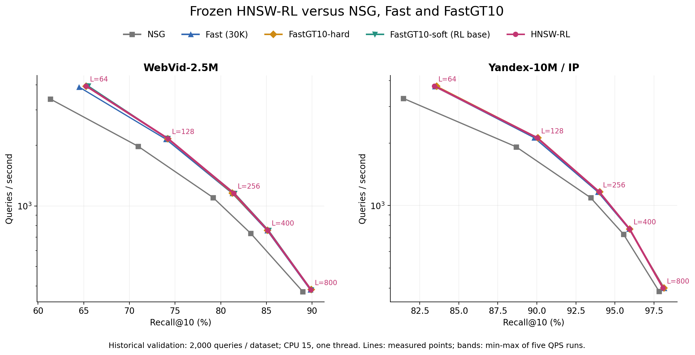
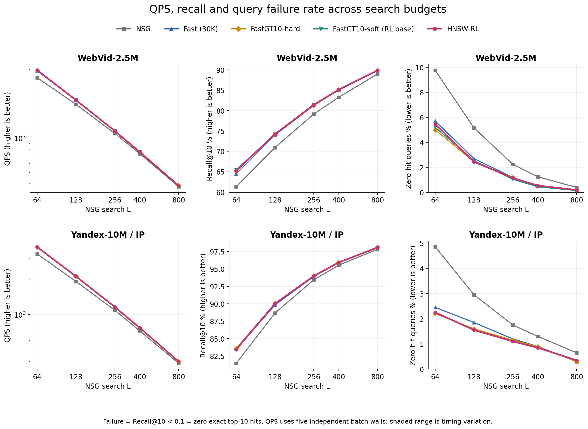
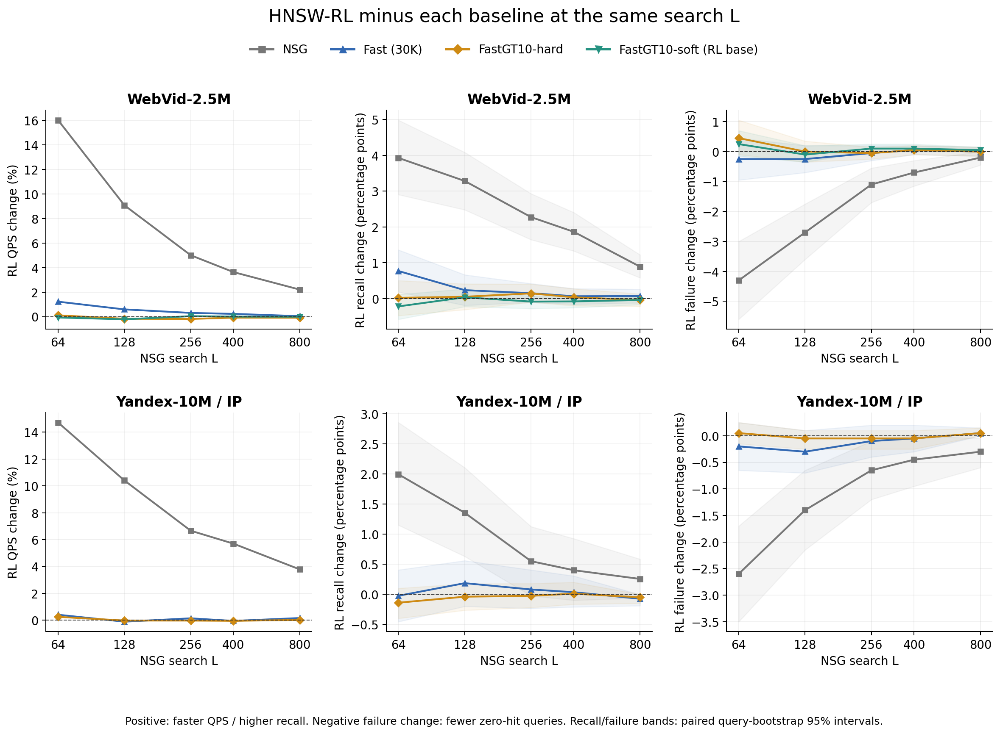

# E34：HNSW-RL、NSG、Fast 与 FastGT10 性能比较

2026-09-11。用户另行授权E33冻结图的QPS、Recall与查询失败率测试。本轮45个方法点、225次独立整批wall全部完成；E33原开发门失败及当时没有QPS的记录保持。这里只测已选图，没有新训练或重新选seed/checkpoint。

## 1. 结果与图

本轮未建立RL相对当前GT10起点的进一步收益：两集各4/5个L的Recall更低，三个共同Recall插值位置的QPS也均较低。相对NSG，RL在十个同L点的Recall、QPS、失败率均改善；但原Fast/GT10也已有这些优势，不能把相对NSG的全部改善归因于强化学习。WebVid相对GT10-hard仍保留小幅同Recall正信号，须与其实际GT10-soft起点对照分开解释。

WebVid相对其直接起点，五L的Recall变化为-0.220～+0.035pp，QPS变化-0.22%～+0.04%；1/5点Recall上升，2/5点QPS上升。同Recall三个描述性插值位置的QPS变化为-0.91%～-0.29%。
Yandex-IP相对其直接起点，五L的Recall变化为-0.140～+0.010pp，QPS变化-0.04%～+0.25%；1/5点Recall上升，2/5点QPS上升。同Recall三个描述性插值位置的QPS变化为-0.63%～-0.38%。

[Recall–QPS SVG](figures/recall_qps.svg) · [三指标随L变化 SVG](figures/metrics_by_search_L.svg) · [RL相对各基线变化 SVG](figures/rl_changes.svg) · [Excel数据](chart_data.xlsx)。全部PNG/PDF同名保存；原值CSV见[points](results/points.csv)、[五轮计时](results/qps_runs.csv)、[配对变化](results/paired_changes.csv)。

## 2. 方法与公平比较边界

NSG使用原图固定入口。Fast沿用原30K闭式GT1画像、构图seed100和legacy堆顺序。FastGT10-hard采用E24后20K的GT10硬画像、构图seed20260828。WebVid另列GT10-soft-t1，因为E33实际从这张图训练；Yandex的起点就是GT10-hard。Fast与GT10的训练量/构图seed不同，其差异不能全部归因GT数量。

HNSW-RL为E33真实HNSW→NSG奖励训练后的静态底层删边图：WebVid seed20260912/step400；Yandex seed20260911/step300。本轮直接加载冻结物理图，原画像、真实ID、上层及NSG保持，线上没有策略网络、采样或训练hook。与直接起点的差异才隔离了本次边学习/导出造成的变化；本轮未加入新的随机对照，学习与随机删边的归因仍以[E33控制实验](../20260911_hnsw_edge_rl_v1/report.md)为准。

两集历史validation2000，同一query/GT/row IDs、raw-IP、K10、L64/128/256/400/800、CPU15、实际进程/OMP/OpenBLAS/MKL1。每方法点一次完整warmup和五轮轮换plain整批wall；QPS取五轮中位数并显示min/max。完整计时包含路由/映射/原NSG/输出，GT、计数、I/O、hash和加载在timer外。所有搜索进程串行，没有并发训练/数值分析。

查询失败严格定义为Recall@10<0.1，即10个返回结果对exact GT10零命中；它不是程序错误或超时率。Recall/失败率由相同query的保存结果计算，重复计时不会增加样本量。完整协议见[protocol](protocol.md)。

## 3. 相对RL直接起点的全部五L结果

| 数据集 | L | RL−起点 ΔRecall pp | ΔQPS % | 起点→RL失败数 | Δ失败率 pp |
|---|---:|---:|---:|---:|---:|
| WebVid | 64 | -0.220 | -0.07 | 104→109 | +0.250 |
| WebVid | 128 | +0.035 | -0.22 | 51→49 | -0.100 |
| WebVid | 256 | -0.085 | +0.04 | 21→23 | +0.100 |
| WebVid | 400 | -0.080 | +0.00 | 9→11 | +0.100 |
| WebVid | 800 | -0.040 | -0.01 | 3→4 | +0.050 |
| Yandex-IP | 64 | -0.140 | +0.25 | 44→45 | +0.050 |
| Yandex-IP | 128 | -0.040 | -0.02 | 32→31 | -0.050 |
| Yandex-IP | 256 | -0.025 | -0.02 | 23→22 | -0.050 |
| Yandex-IP | 400 | +0.010 | -0.04 | 18→17 | -0.050 |
| Yandex-IP | 800 | -0.050 | +0.02 | 6→7 | +0.050 |

下表固定列出训练使用的L128，避免事后挑最好点；完整45点见CSV与Excel。

| 数据集 | 方法 | Recall@10 % | QPS 中位数 [最小,最大] | 失败数/2000 | 失败率 % |
|---|---|---:|---:|---:|---:|
| WebVid | NSG | 70.940 | 1981.7 [1979.3,1983.0] | 103 | 5.15 |
| WebVid | Fast (30K) | 73.990 | 2149.1 [2146.6,2154.0] | 54 | 2.70 |
| WebVid | FastGT10-hard | 74.175 | 2165.5 [2160.9,2166.2] | 49 | 2.45 |
| WebVid | FastGT10-soft (RL base) | 74.190 | 2166.5 [2162.8,2167.7] | 51 | 2.55 |
| WebVid | HNSW-RL | 74.225 | 2161.7 [2158.6,2162.8] | 49 | 2.45 |
| Yandex-IP | NSG | 88.660 | 1920.9 [1918.7,1926.4] | 59 | 2.95 |
| Yandex-IP | Fast (30K) | 89.830 | 2123.0 [2120.4,2128.2] | 37 | 1.85 |
| Yandex-IP | FastGT10-hard | 90.055 | 2121.2 [2120.3,2124.3] | 32 | 1.60 |
| Yandex-IP | HNSW-RL | 90.015 | 2120.8 [2116.4,2124.0] | 31 | 1.55 |

## 4. 相对每个基线的配对变化

ΔRecall和Δ失败率单位为绝对百分点；ΔQPS为两个五轮中位数的相对变化。挽救表示基线零命中、RL非零；新增失败表示基线非零、RL零命中。两者均按原query ID配对，完整95%描述性区间及所有轮速度比另存CSV。

| 数据集 | 对照 | L | ΔRecall pp | ΔQPS % | Δ失败率 pp | 挽救/新增失败 |
|---|---|---:|---:|---:|---:|---:|
| WebVid | NSG | 64 | +3.930 | +16.02 | -4.300 | 137/51 |
| WebVid | Fast (30K) | 64 | +0.770 | +1.22 | -0.250 | 29/24 |
| WebVid | FastGT10-hard | 64 | +0.020 | +0.11 | +0.450 | 13/22 |
| WebVid | FastGT10-soft (RL base) | 64 | -0.220 | -0.07 | +0.250 | 7/12 |
| WebVid | NSG | 128 | +3.285 | +9.08 | -2.700 | 73/19 |
| WebVid | Fast (30K) | 128 | +0.235 | +0.59 | -0.250 | 13/8 |
| WebVid | FastGT10-hard | 128 | +0.050 | -0.18 | +0.000 | 7/7 |
| WebVid | FastGT10-soft (RL base) | 128 | +0.035 | -0.22 | -0.100 | 5/3 |
| WebVid | NSG | 256 | +2.275 | +5.00 | -1.100 | 29/7 |
| WebVid | Fast (30K) | 256 | +0.150 | +0.30 | -0.050 | 4/3 |
| WebVid | FastGT10-hard | 256 | +0.145 | -0.19 | -0.050 | 3/2 |
| WebVid | FastGT10-soft (RL base) | 256 | -0.085 | +0.04 | +0.100 | 0/2 |
| WebVid | NSG | 400 | +1.865 | +3.63 | -0.700 | 17/3 |
| WebVid | Fast (30K) | 400 | +0.065 | +0.22 | +0.050 | 1/2 |
| WebVid | FastGT10-hard | 400 | +0.035 | -0.09 | +0.050 | 1/2 |
| WebVid | FastGT10-soft (RL base) | 400 | -0.080 | +0.00 | +0.100 | 0/2 |
| WebVid | NSG | 800 | +0.890 | +2.20 | -0.200 | 5/1 |
| WebVid | Fast (30K) | 800 | +0.070 | +0.04 | +0.000 | 1/1 |
| WebVid | FastGT10-hard | 800 | -0.040 | -0.09 | +0.000 | 1/1 |
| WebVid | FastGT10-soft (RL base) | 800 | -0.040 | -0.01 | +0.050 | 0/1 |
| Yandex-IP | NSG | 64 | +1.995 | +14.72 | -2.600 | 70/18 |
| Yandex-IP | Fast (30K) | 64 | -0.025 | +0.41 | -0.200 | 13/9 |
| Yandex-IP | FastGT10-hard | 64 | -0.140 | +0.25 | +0.050 | 2/3 |
| Yandex-IP | NSG | 128 | +1.355 | +10.40 | -1.400 | 43/15 |
| Yandex-IP | Fast (30K) | 128 | +0.185 | -0.10 | -0.300 | 11/5 |
| Yandex-IP | FastGT10-hard | 128 | -0.040 | -0.02 | -0.050 | 2/1 |
| Yandex-IP | NSG | 256 | +0.550 | +6.67 | -0.650 | 22/9 |
| Yandex-IP | Fast (30K) | 256 | +0.080 | +0.15 | -0.100 | 6/4 |
| Yandex-IP | FastGT10-hard | 256 | -0.025 | -0.02 | -0.050 | 2/1 |
| Yandex-IP | NSG | 400 | +0.400 | +5.70 | -0.450 | 16/7 |
| Yandex-IP | Fast (30K) | 400 | +0.035 | -0.05 | -0.050 | 4/3 |
| Yandex-IP | FastGT10-hard | 400 | +0.010 | -0.04 | -0.050 | 2/1 |
| Yandex-IP | NSG | 800 | +0.255 | +3.79 | -0.300 | 7/1 |
| Yandex-IP | Fast (30K) | 800 | -0.075 | +0.17 | +0.050 | 0/1 |
| Yandex-IP | FastGT10-hard | 800 | -0.050 | +0.02 | +0.050 | 0/1 |

## 5. 同Recall对照与不确定性

同L质量或QPS单独上升不等于整条曲线更好。以下仅在两方法各自实测非支配点的共同Recall区间取25/50/75%位置，以log-QPS作线性插值；不外推。这是测量点之间的描述性估计，不是新增实测搜索宽度，也不是按validation选模型。五轮速度比范围仅反映该批计时变化，不包括查询/构图seed/模型选择不确定性。

中心值由各实测点的QPS中位数构成曲线后求比；范围则由同序号两轮的插值QPS求比。中位数、插值和求比不交换，因此中心值偶尔可略超出逐轮比值范围；该范围不是中心值的置信区间。

| 数据集 | 对照 | 共同区间位置 | 目标Recall % | RL相对QPS % | 五轮估计范围 % |
|---|---|---:|---:|---:|---:|
| WebVid | NSG | 25% | 71.191 | +36.17 | [+36.07,+36.18] |
| WebVid | NSG | 50% | 77.118 | +31.93 | [+31.81,+31.99] |
| WebVid | NSG | 75% | 83.044 | +28.56 | [+28.48,+28.63] |
| WebVid | Fast (30K) | 25% | 71.396 | +3.38 | [+3.09,+3.36] |
| WebVid | Fast (30K) | 50% | 77.528 | +2.15 | [+1.93,+2.17] |
| WebVid | Fast (30K) | 75% | 83.659 | +1.36 | [+1.25,+1.66] |
| WebVid | FastGT10-hard | 25% | 71.414 | +0.19 | [+0.07,+0.25] |
| WebVid | FastGT10-hard | 50% | 77.562 | +0.65 | [+0.56,+0.68] |
| WebVid | FastGT10-hard | 75% | 83.711 | +0.73 | [+0.60,+0.78] |
| WebVid | FastGT10-soft (RL base) | 25% | 71.579 | -0.45 | [-0.55,-0.39] |
| WebVid | FastGT10-soft (RL base) | 50% | 77.673 | -0.29 | [-0.40,-0.26] |
| WebVid | FastGT10-soft (RL base) | 75% | 83.766 | -0.91 | [-0.98,-0.85] |
| Yandex-IP | NSG | 25% | 87.034 | +26.95 | [+26.82,+26.96] |
| Yandex-IP | NSG | 50% | 90.632 | +27.01 | [+26.87,+27.02] |
| Yandex-IP | NSG | 75% | 94.231 | +18.00 | [+17.90,+18.18] |
| Yandex-IP | Fast (30K) | 25% | 87.116 | +0.96 | [+0.82,+1.42] |
| Yandex-IP | Fast (30K) | 50% | 90.773 | +2.41 | [+2.21,+2.57] |
| Yandex-IP | Fast (30K) | 75% | 94.429 | +1.55 | [+1.39,+1.74] |
| Yandex-IP | FastGT10-hard | 25% | 87.203 | -0.63 | [-0.77,-0.53] |
| Yandex-IP | FastGT10-hard | 50% | 90.830 | -0.58 | [-0.74,-0.53] |
| Yandex-IP | FastGT10-hard | 75% | 94.458 | -0.38 | [-0.50,-0.28] |

Recall/失败差的paired bootstrap为2000次、seed20260915、未做多重比较修正；历史validation重复使用且每集仅2000query（一个失败query=0.05pp）。只有一份预选RL图及一个原构图身份，没有跨seed性能复现或新held-out。因此本次提供实测曲线和局部信号，不自动更换默认图，不由删边数/NDC、单个正点或小幅五轮中位数差升级为稳定方法结论。

## 6. 成本、验收与资产保护

实际原NSG调用630720=45×(7×2000+16)，修复0；225次计时、90000个aligned输出。两个查询进程总713.11s（含索引加载、计数、核验和写盘，不能当QPS），峰值RSS 9.997GiB，实际进程最大线程1。新优化步数0、GT生成0，冻结模型训练成本见E33；从零GT/QGT/NSG成本本轮未测。

全部90000输出独立GT复算；原NSG/Fast/GT10共70000输出的ID、距离bits、入口、hits/mask和两项NDC回归E30完全一致。所有五轮plain/count及16query原kernel核验通过；同方法跨五L图字节和逐query入口一致，失败配对恒等式通过。证据：[输出验收](reviews/output_verification.json)、[调用账](logs/jobs.json)、[binary来源](bin/provenance.json)。

本轮在独立目录执行，原E33完整目录及实际依赖前后核验SHA；原训练、图、GT、labels、build和历史结果保留。只读取授权的历史validation样本，held-out未读取/hash。协议、配置、源码、输入、结果和图表保存来源；最终验收见[final_audit](reviews/final_audit.json)，接续状态见[state](state.json)。
