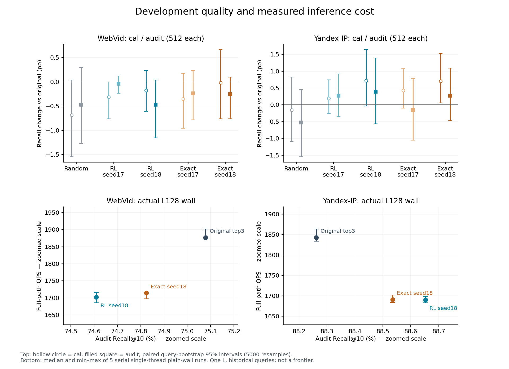
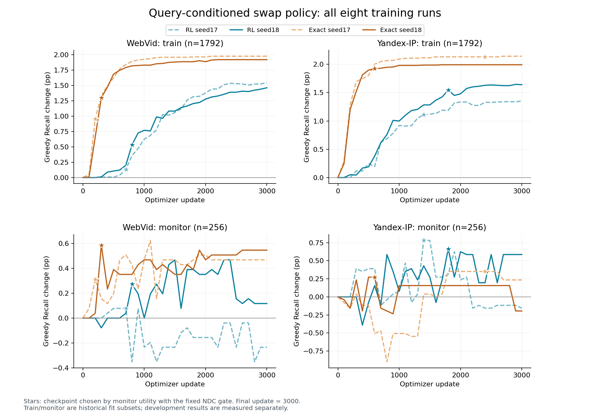
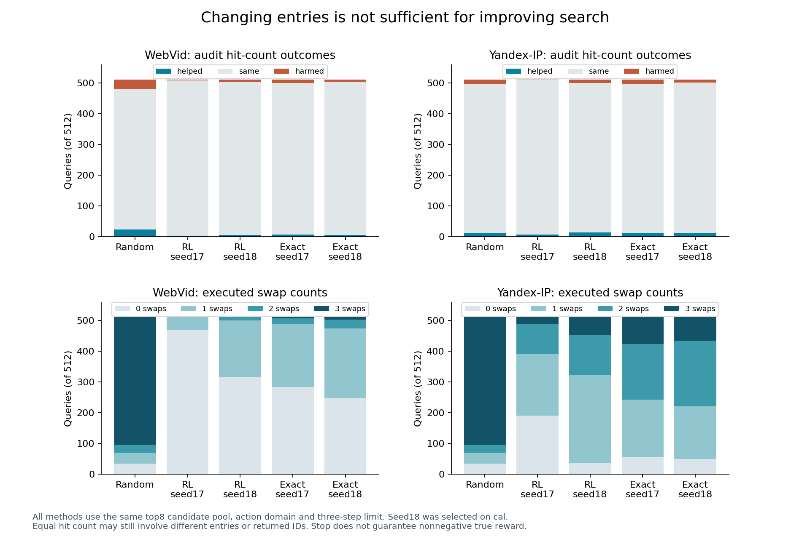

# E36：query相关的三入口换点策略

2026-09-11。用户确认推进“针对这个query换入哪个点、换出哪个点，用实际三入口联合搜索收益反馈”。已实现、训练并实际部署8个策略：两数据集×REINFORCE/同策略精确期望控制×两seed，每个3000次更新。[冻结协议](protocol.md)、[状态](state.json)、[开发门](results/development_gate.json)、[最终验收](reviews/final_audit.json)。

## 1. 结果与解释

查询相关的组合选择在Yandex保留了局部正信号；当前实现没有通过预定双数据开发门，单点实测也支付了明显推理时间。状态`COMPLETE_QUERY_SWAP_POLICY`，判断`QUERY_SWAP_POLICY_COMPLETE_YANDEX_SIGNAL_WEBVID_AND_COST_NO_GO`。已执行工作收口，默认保持原GT10。

| 数据 | 所选RL cal ΔRecall | audit ΔRecall | audit ΔQPS |
|---|---|---|---|
| WebVid | -0.1758 pp | -0.4688 pp | -9.32% |
| Yandex-IP | +0.7227 pp | +0.3906 pp | -8.30% |

这里的对照是同一当前GT10候选源的原top3。Yandex相对Exact的增量只有cal +0.019531pp、audit +0.117188pp，且配对区间跨0，不能宣称采样RL已胜精确优化。WebVid cal/audit均未提高。此结果约束本轮表示、训练数据量和实现，不是否定所有RL、所有query相关选择，也不抹去E24原GT10或E35组合oracle信号。

## 2. 实际学了什么

固定WebVid GT10-soft-t1与Yandex GT10-hard，H815/821及真实ID、画像、原HNSW M16/efC200/seed20260828/efSearch10和原NSG/raw IP不变。一次HNSW取top8，以原前三个为初态；56个三元素集合，每态为停止或15种单点换出/换入，最多3步。线上模型只看当前query和候选特征，完成选择后执行一次NSG L128/K10，三个真实入口升序使用原共享beam。

策略给完整三入口集合打分，不把三个单入口收益相加。76维特征包含候选rank、原query–profile cosine及相对top1差、query与画像的固定16维投影交互、三个画像pair cosine及query投影。训练1792行的统计量标准化，特征先量化float32、再float64计算。MLP 76→16→16→1/ReLU，共1521参数；集合势函数为原rank先验−0.25×(rank和−3)加MLP。初始贪心停止，后继16个集合的softmax给动作概率；线上按最高分、1e−9同分时优先停止，至多3步。

这是有限状态的查询相关局部改写，未改HNSW图或重新挑选全局H。[方法依据](method_basis.md)说明与NeuRewriter的关系及差别；并非复现其Q-actor-critic。停止只是不再修改当前集合，不使用GT兜底；即使预测分数提高，真实Recall仍可能下降。

## 3. 真实反馈、训练控制和样本

每个fit query的全部56集合都实际运行原NSG，保存返回ID、距离、入口和NDC，GT只在查询结束后评分。U(q,S)=hits(q,S)−hits(q,S0)−0.1×[总NDC(q,S)/总NDC(q,S0)−1]；每步奖励为相邻U之差，γ=1，累计等于终态U。总NDC包括HNSW路由和图距离计算，包含不了特征/矩阵乘等费用，后者进入独立wall。

RL采用REINFORCE，减去只用以往轨迹更新的query×state EMA基线；不使用当前动作的奖励拟合当前baseline。Exact控制对完全同一16动作、3步、停止吸收的策略，以56状态动态规划计算期望终态U并精确反传。两臂表示、初始化、batch顺序、AdamW、学习率和训练日程一致；Exact不是另一个终态softmax，也不是线上GT oracle。每臂两seed、batch64，每100步保存模型/优化器/曲线，固定3000步。反馈缓存源自真实完整联合搜索，优化时复用缓存，不把每个梯度更新伪称一次新NSG。

每集从当前E24 fit20K预选2048行，1792训练、256 monitor，cal/audit各取原对应1024行的前512。四部分行ID不重叠；这些数据历史上均使用过，画像也来自历史fit，不能称全管线盲测。先冻结训练模型才准备cal，cal选seed后冻结再准备audit。checkpoint从100..3000选择monitor平均U最高且图NDC≤原+1%的最早点，两集cal均选RL18和Exact18；audit不换seed。旧E28/E32是两路union C8，本轮是一次当前GT10 top8，因此重新生成全部真实标签。

## 4. 全部训练轨迹与选点

| 数据 | 训练臂/seed | 所选step | 所选train Δpp | 所选monitor Δpp | 3000步train Δpp | 3000步monitor Δpp |
|---|---|---|---|---|---|---|
| WebVid | rl / 17 | 700 | +0.1339 | +0.0781 | +1.5458 | -0.2344 |
| WebVid | rl / 18 | 800 | +0.5357 | +0.2734 | +1.4621 | +0.1172 |
| WebVid | exact / 17 | 200 | +0.9542 | +0.3125 | +1.9754 | +0.4688 |
| WebVid | exact / 18 | 300 | +1.3002 | +0.5859 | +1.9196 | +0.5469 |
| Yandex-IP | rl / 17 | 1400 | +1.1105 | +0.7812 | +1.3504 | -0.1562 |
| Yandex-IP | rl / 18 | 1800 | +1.5458 | +0.6641 | +1.6406 | +0.5859 |
| Yandex-IP | exact / 17 | 2400 | +2.1317 | +0.3516 | +2.1429 | +0.2344 |
| Yandex-IP | exact / 18 | 600 | +1.9252 | +0.2734 | +1.9922 | -0.1953 |

8次固定训练全部完成，训练进程125.42s、单线程、峰值RSS约624MiB；这不是查询QPS。RL四次共768000条缓存反馈轨迹，8次共24000更新。train收益总体提高，但monitor波动，末点不持续优于早期所选点；例如WebVid RL17从所选monitor +0.0781pp降到末点−0.2344pp，Yandex RL17由+0.7813pp降至−0.1563pp。当前证据不支持简单追加epoch。所选点/末点和全部24000步曲线均保存，没有只展示最佳train点。

## 5. 全部开发结果和配对差值

失败定义为返回top10与GT前10零交集。每个split/方法512查询，表中改善/受损按逐query命中数与原top3比较，其余命中数相同。

| 数据/split | 方法 | Recall % | ΔRecall pp | 失败率 % | 总NDC变化 % | 改善/受损query |
|---|---|---|---|---|---|---|
| WebVid/cal | 原top3 | 76.210938 | +0.000000 | 2.343750 | +0.0000 | 0/0 |
| WebVid/cal | 随机换点 | 75.527344 | -0.683594 | 2.734375 | +1.0200 | 14/22 |
| WebVid/cal | RL seed17 | 75.898438 | -0.312500 | 2.343750 | +0.0734 | 0/3 |
| WebVid/cal | RL seed18 | 76.035156 | -0.175781 | 2.734375 | +0.2162 | 7/9 |
| WebVid/cal | Exact seed17 | 75.859375 | -0.351562 | 2.148438 | +0.0643 | 2/9 |
| WebVid/cal | Exact seed18 | 76.191406 | -0.019531 | 1.953125 | +0.0372 | 14/10 |
| Yandex-IP/cal | 原top3 | 90.000000 | +0.000000 | 1.562500 | +0.0000 | 0/0 |
| Yandex-IP/cal | 随机换点 | 89.843750 | -0.156250 | 1.562500 | +2.2940 | 12/17 |
| Yandex-IP/cal | RL seed17 | 90.195312 | +0.195312 | 1.171875 | +0.4009 | 7/7 |
| Yandex-IP/cal | RL seed18 | 90.722656 | +0.722656 | 0.976562 | +0.7798 | 14/11 |
| Yandex-IP/cal | Exact seed17 | 90.429688 | +0.429688 | 1.171875 | +1.0565 | 14/7 |
| Yandex-IP/cal | Exact seed18 | 90.703125 | +0.703125 | 0.781250 | +0.9356 | 13/11 |
| WebVid/audit | 原top3 | 75.078125 | +0.000000 | 1.171875 | +0.0000 | 0/0 |
| WebVid/audit | 随机换点 | 74.609375 | -0.468750 | 1.953125 | +1.9638 | 24/32 |
| WebVid/audit | RL seed17 | 75.039062 | -0.039062 | 1.171875 | +0.0059 | 3/3 |
| WebVid/audit | RL seed18 | 74.609375 | -0.468750 | 1.562500 | +0.3876 | 6/7 |
| WebVid/audit | Exact seed17 | 74.843750 | -0.234375 | 1.367188 | -0.1269 | 7/11 |
| WebVid/audit | Exact seed18 | 74.824219 | -0.253906 | 1.562500 | +0.2856 | 6/8 |
| Yandex-IP/audit | 原top3 | 88.261719 | +0.000000 | 1.757812 | +0.0000 | 0/0 |
| Yandex-IP/audit | 随机换点 | 87.734375 | -0.527344 | 2.148438 | +0.6060 | 12/14 |
| Yandex-IP/audit | RL seed17 | 88.535156 | +0.273438 | 1.562500 | +0.6185 | 7/2 |
| Yandex-IP/audit | RL seed18 | 88.652344 | +0.390625 | 1.562500 | +0.2832 | 14/11 |
| Yandex-IP/audit | Exact seed17 | 88.105469 | -0.156250 | 1.953125 | +0.2737 | 13/14 |
| Yandex-IP/audit | Exact seed18 | 88.535156 | +0.273438 | 1.171875 | +0.4175 | 12/10 |

| 数据/split | RL18比较对象 | ΔRecall pp | 描述性95%区间 pp | Δ平均U |
|---|---|---|---|---|
| WebVid/cal | 原top3 | -0.175781 | [-0.6055, +0.2349] | -0.017990 |
| WebVid/cal | 随机换点 | +0.507812 | [-0.2539, +1.3672] | +0.051657 |
| WebVid/cal | Exact seed18 | -0.156250 | [-0.9375, +0.6836] | -0.015837 |
| WebVid/audit | 原top3 | -0.468750 | [-1.1523, +0.0391] | -0.047468 |
| WebVid/audit | 随机换点 | +0.000000 | [-0.8594, +0.8008] | +0.001980 |
| WebVid/audit | Exact seed18 | -0.214844 | [-0.7422, +0.1758] | -0.021658 |
| Yandex-IP/cal | 原top3 | +0.722656 | [-0.0391, +1.6406] | +0.070836 |
| Yandex-IP/cal | 随机换点 | +0.878906 | [-0.0977, +1.9531] | +0.090593 |
| Yandex-IP/cal | Exact seed18 | +0.019531 | [-0.7031, +0.7617] | +0.002823 |
| Yandex-IP/audit | 原top3 | +0.390625 | [-0.5664, +1.3867] | +0.037608 |
| Yandex-IP/audit | 随机换点 | +0.917969 | [-0.2930, +2.1680] | +0.092276 |
| Yandex-IP/audit | Exact seed18 | +0.117188 | [-0.9180, +1.1719] | +0.011731 |

区间为5000次query配对bootstrap、seed20260920；是当前历史样本的描述性区间，不校正历史选择/多重比较，不作显著性GO。Yandex RL18对原top3的audit区间为[−0.5664,+1.3867]pp，对Exact18为[−0.9180,+1.1719]pp。WebVid所选RL18 audit −0.46875pp，另seed17 −0.03906pp，不能看到audit后改选seed17。

预定门要求两集cal≥+0.10pp、audit>0、总NDC≤+1%，且RL合并cal/audit平均U胜随机。两集RL均胜随机的平均U；Yandex通过这些开发点门，WebVid Recall门失败，因此`STOP_DUAL_DEVELOPMENT_GATE`。开发门通过也不能替代端到端性能证据。

## 6. 换点行为与收益集中性

WebVid RL18 audit改变196/512个入口集合、平均0.4043次交换，61.72%第一步停止；6个query改善、7个受损、499个命中数相同，新增2个零命中失败且没有救回。Yandex改变474/512个集合、平均1.4102次交换，7.42%第一步停止；14个改善、11个受损、487个命中数相同，救回3个失败但新增2个。换了很多入口并不意味着大多数query受益。

完整[动作频次](results/action_counts.csv)、[交换次数](results/swap_counts.csv)、[逐query结果](results/query_results.csv)保留。随机控制使用相同动作域、停止和三步上限，实际步数与学习策略不同，不宣称动作数或wall完全匹配。线上模型不读query row ID；row ID只用于冻结的随机控制。

## 7. 实测在线成本

两数据集各audit512、固定L128，原top3/所选RL/所选Exact，完整warmup后五轮轮换串行plain整批wall。CPU15，进程/OMP/BLAS/MKL1线程，无并发训练或其它方法；timer内含一次HNSW、query投影、56集合特征和全部MLP分数、至多3步选择、真实ID映射、原NSG及输出。模型load、GT、NDC计数、hash与文件I/O在计时外。

| 数据 | 方法 | Recall % | 总NDC | QPS中位数 | 五轮min–max | ΔQPS % |
|---|---|---|---|---|---|---|
| WebVid | 原top3 | 75.078125 | 1740.879 | 1876.77 | 1871.96–1901.98 | +0.000 |
| WebVid | RL seed18 | 74.609375 | 1747.627 | 1701.82 | 1686.05–1716.23 | -9.322 |
| WebVid | Exact seed18 | 74.824219 | 1745.852 | 1714.17 | 1697.79–1716.90 | -8.664 |
| Yandex-IP | 原top3 | 88.261719 | 2940.406 | 1843.30 | 1833.76–1863.88 | +0.000 |
| Yandex-IP | RL seed18 | 88.652344 | 2948.732 | 1690.37 | 1683.62–1699.22 | -8.296 |
| Yandex-IP | Exact seed18 | 88.535156 | 2952.682 | 1691.43 | 1683.94–1701.98 | -8.239 |

当前选择器即使早停，也先计算全部56个集合势函数；仅MLP每query约83328次乘加，另有16×d query投影及特征处理。这解释了NDC增加不到1%却无法保证总时间接近原方法的原因，但没有独立分段计时，不能把全部wall差额精确归因某个算子。Yandex得到同L质量与速度的权衡；WebVid此单点质量、速度均较差。只测一个L，不能认定完整前沿优劣或正式方法性能GO。

## 8. 调用、资源、核验和修正

| 阶段 | 新NSG调用 | 说明 |
|---|---|---|
| fit完整56组合 | 229376 | 每集2048×56 |
| 标签原路由/原kernel回归 | 192 | 每集96 |
| fit真实部署与回归 | 1152 | 8模型×64及plain/reference |
| cal全部六方法与回归 | 12480 | 每集512，双seed完整保留 |
| audit全部六方法与回归 | 12480 | cal先选seed并冻结 |
| L128 wall及回归 | 24672 | 两集各三方法，warmup+五轮及核验 |
| 合计 | 280352 | 硬上限300000；剩余额度不扩实验 |

新HNSW调用总62464；标签/部署/计时十个job均完成，实际查询峰值线程1，最高RSS 9.937GiB。训练0新NSG，缓存轨迹复用单列；无新GT生成、validation/held-out访问、多L前沿或全局构图迭代。总新产物上限384MiB、余盘至少10GiB，最终实值见验收。

优化前[preflight](reviews/preflight.json)独立复算229376个完整三入口标签，检查原生/NumPy全部特征相等，枚举3616条终止路径，DP/期望策略梯度/baseline与有限差分通过。[训练核验](reviews/training_verification.json)独立恢复全部248个checkpoint的贪心和期望值、768000条RL轨迹奖励/回报/EMA，以及每100步块首的策略概率和动作RNG；没有声称重新执行所有优化器更新。另4096个原top3输出与E33历史当前GT10完整ID/距离/入口/NDC一致。

[部署核验](reviews/deployment_verification.json)涵盖38个点：C++/NumPy分数最大误差小于1e−12、逐步动作和真实入口完全一致；8个fit点共512查询与缓存完整返回一致；六个wall点与audit结果一致。所有方法count/plain和预定16行原kernel回归通过。最终再以独立集合交集复算标签/实际部署命中，核对CSV/Excel/图源、冻结依赖与根文档链接。

两项版本变化有记录：初始label runner没有导出部署特征核验所需pool距离，新`runner_v2.cpp`仅增加输出/距离byte parity，在任何部署前冻结，原runner保留；第一次报告分析因NumPy布尔无法JSON序列化停止，`analyze_v2.py`只转换两个gate布尔类型，原脚本和部分派生输出在reviews保留，0新查询/训练。实际输入、策略、奖励和选点规则未变。[修正记录](reviews/analysis_correction.json)、[build v2](bin/build_v2.json)。

## 9. 接续判断与证据入口

优先从已有逐query标签分析WebVid泛化和收益/损伤，控制相同目标的Exact，避免直接增加模型/epoch。其次在冻结模型和返回完全一致的条件下减少56集合打分开销，再决定是否值得正式前沿；Yandex局部正值须保留。局部图交换作为补充候选覆盖的后续路线，须另建协议，不能凭本轮质量信号直接运行。详细前三方向、成本与停止条件见[当前s-target](../../s-target.md)。

原始入口为[协议](protocol.md)→[输入](inputs/selection.json)→[标签/部署runner](src/runner_v2.cpp)→[训练](src/train.py)→[独立训练核验](src/audit_training.py)→[真实部署](src/deploy.py)→[结果分析](src/analyze_v2.py)。[CSV/Excel工作簿](results/query_swap_policy.xlsx)含完整模型、checkpoint、24000步曲线、38点、28配对、30轮时间及逐query/动作；嵌套utility区间与时间列表保留在JSON。图有PNG/SVG/PDF，原始标签、模型、轨迹和旧E35原件均保留。复现训练应建新版本和预算，当前完成版本有状态/重复执行保护，不能直接重跑冻结runner覆盖结果。
