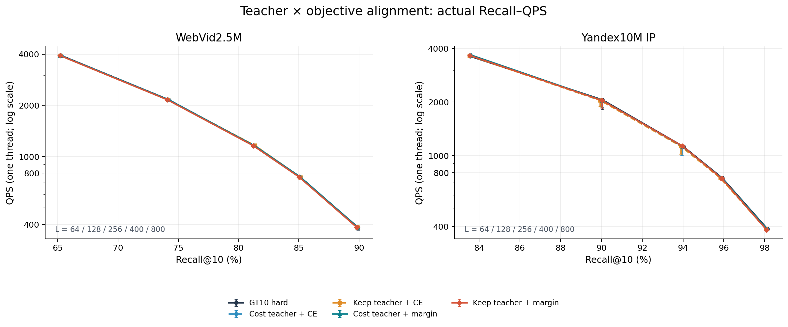
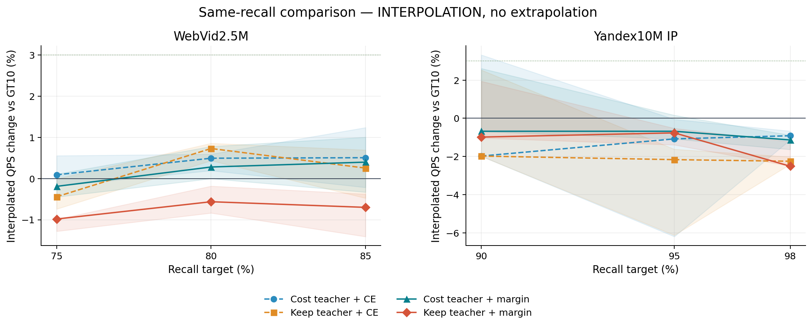
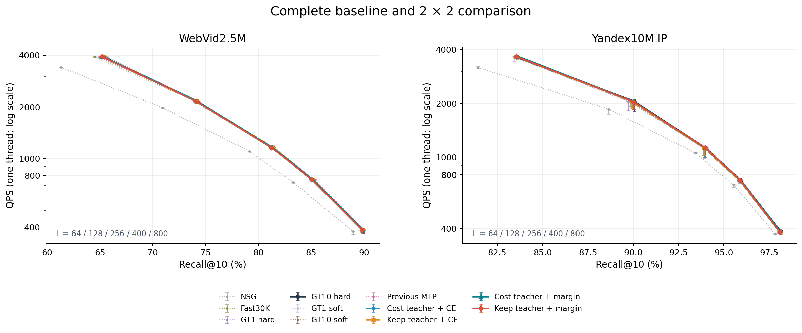
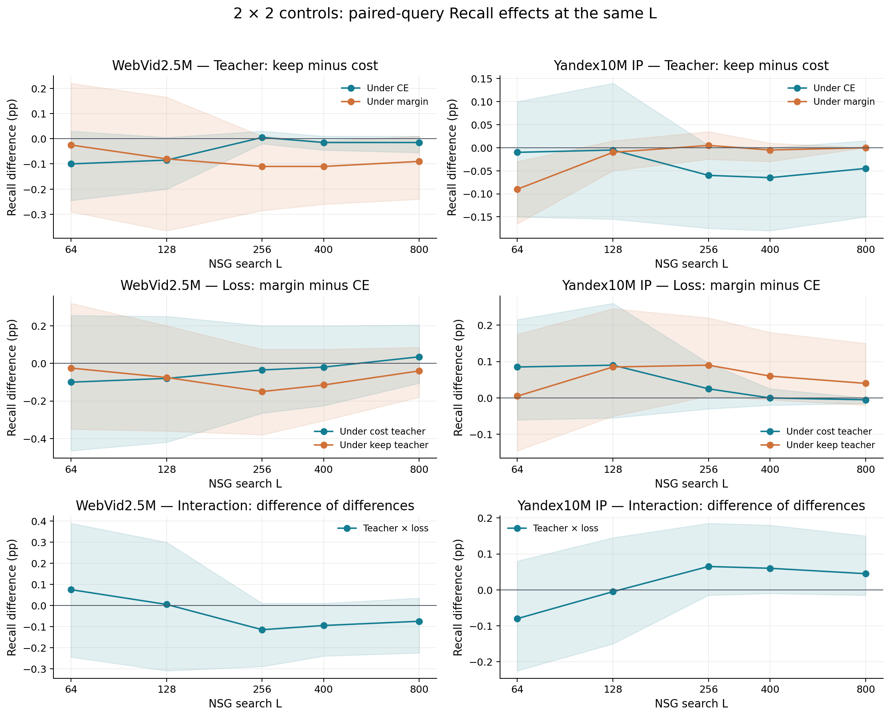
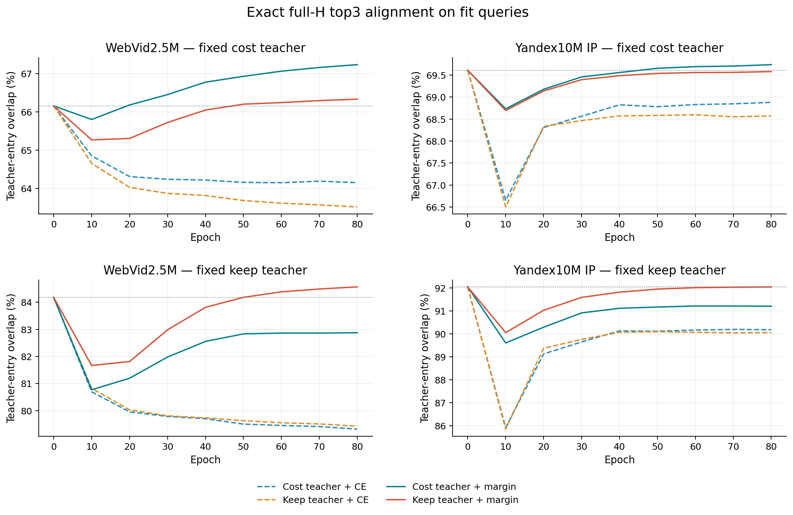
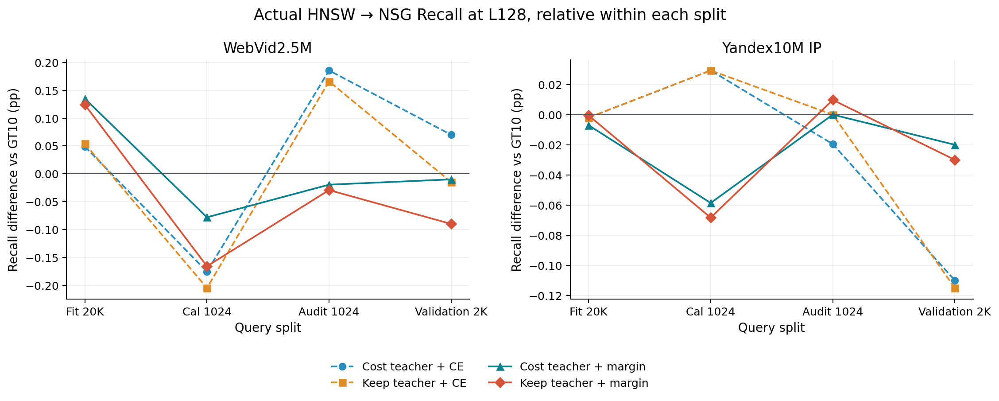

# 教师标签与训练目标对齐：2×2真实检索研究

本轮未建立优于原GT10的稳定双数据Recall–QPS优势。 当前建议继续保留WebVid已冻结GT10 soft、Yandex GT10 hard；本轮四格均没有足够证据支持替换。 所有教师/损失对照均已训练、冻结并完成真实查询，下面分别报告监督拟合、实际命中和端到端速度。

两数据集、8次共享linear训练、11种方法×5个L，共110个正式点，每点3次单线程完整warm/plain计时。另对完整fit20k、cal1024、audit1024执行真实检索；旧模型逐位恢复后同批重新计时。这里沿用历史验证查询，不能称为新的盲测。

## 1. 主Recall–QPS图

每个点均为实际L64/128/256/400/800测试；QPS为三轮中位数，误差线为三轮最小/最大值，纵轴对数。连线不是新增测量。原始数据见[all_points.csv](results/all_points.csv)，全部图表数据及训练记录见[chart_data.xlsx](chart_data.xlsx)。

## 2. 四个模型究竟改了什么

| 名称 | 教师 | 损失 | 与原对照的实质区别 |
|---|---|---|---|
| cost_ce | 原max-hits/min-NDC完整三入口 | 全H集合CE | E28 linear λ100恢复对照 |
| keep_ce | 无额外hits空间时保留原入口 | 相同集合CE | 只改教师 |
| cost_margin | 原完整三入口教师 | 结构化top3 margin | 只改损失 |
| keep_margin | 无额外hits空间时保留原入口 | 相同margin | 两轴同时改变，交互单列 |

共同设置：GT10 hard锚点，W=normalize(P+AP)，无偏置共享linear；λ100、τ=.05、80epoch、Adam .003、全fit梯度累积、固定seed20260911。margin μ=.1，对应单位query分数差.005。所有模型在新开发查询前冻结，没有根据cal/audit/validation换超参数或epoch。原cost_ce在两集都逐位恢复E28 linear_r100。

在线始终是raw query→一份microHNSW top3→三个真实hub→原NSG。microHNSW为M16/efConstruction200/efSearch10、seed20260828，按真实ID升序注入；原Fast30K保留seed100/legacy顺序。没有在线网络前向、GT、重排或额外搜索。

## 3. 哪个更好：完整前沿与预设参照

下表在预设WebVid 75/80/85%、Yandex 90/95/98%召回处，对各自实测非支配曲线作Recall–logQPS插值，汇总相对原GT10 hard的速度比。只有实际共同覆盖的点参与；不外推。这是有前作信息的粗网格比较，不是额外实测的精确等Recall点。

| 方法 | 数据集 | 覆盖点 | 插值QPS几何平均变化 | 满足≥3%且三轮均更快的点 | ≥3%退化点 |
|---|---|---|---|---|---|
| cost_ce | WebVid2.5M | 3 | +0.36% | 0 | 0 |
| cost_ce | Yandex10M IP | 3 | -1.33% | 0 | 0 |
| keep_ce | WebVid2.5M | 3 | +0.18% | 0 | 0 |
| keep_ce | Yandex10M IP | 3 | -2.13% | 0 | 0 |
| cost_margin | WebVid2.5M | 3 | +0.16% | 0 | 0 |
| cost_margin | Yandex10M IP | 3 | -0.83% | 0 | 0 |
| keep_margin | WebVid2.5M | 3 | -0.75% | 0 | 0 |
| keep_margin | Yandex10M IP | 3 | -1.42% | 0 | 0 |

色带是三个对应计时轮次的插值比值范围，不是统计置信区间；使用中位前沿确定的相同插值段。预设本地性能条件要求两集各至少两个覆盖点≥3%，三个比值均>1且没有约定的退化点；覆盖不足单独记录。全部判定见[performance_gate.json](results/performance_gate.json)。

本轮Yandex计时波动较大，小幅负速度比也不能写成稳定退化。以每点(max QPS−min QPS)/median QPS计，WebVid的55点中位波动为0.27%、最大4.01%，2点超过3%；Yandex分别为1.45%、12.69%，19点超过3%。全部轮次原值保留在CSV/Excel，并画出范围；没有删慢轮、追加择优计时或凭一个正点宣称提升。该波动限制了细微速度排序的可信度，未将其原因归给未测量的系统因素。

原正式画像仍分别是WebVid已冻结GT10 soft和Yandex GT10 hard，另保留E28 MLP局部信号。下图把这些基线与NSG/Fast/GT1同时列出，不能仅在四格内部选一个相对较好者就声称替代原方法。

L128绝对值作为量级参照：

| 数据集 | 方法 | Recall@10 | QPS中位数 | 三轮QPS范围 |
|---|---|---|---|---|
| WebVid2.5M | gt10_hard | 74.175% | 2165.8 | 2159.1–2172.9 |
| WebVid2.5M | gt10_soft | 74.190% | 2162.4 | 2160.1–2164.1 |
| WebVid2.5M | e28_mlp | 74.205% | 2134.7 | 2134.2–2138.1 |
| WebVid2.5M | cost_ce | 74.245% | 2153.2 | 2153.1–2157.6 |
| WebVid2.5M | keep_ce | 74.160% | 2154.9 | 2153.7–2158.6 |
| WebVid2.5M | cost_margin | 74.165% | 2161.9 | 2160.9–2162.8 |
| WebVid2.5M | keep_margin | 74.085% | 2159.9 | 2146.1–2160.7 |
| Yandex10M IP | gt10_hard | 90.055% | 2056.3 | 1812.1–2069.5 |
| Yandex10M IP | gt10_soft | 89.970% | 2057.9 | 2057.6–2070.5 |
| Yandex10M IP | e28_mlp | 89.980% | 2050.1 | 1992.4–2063.1 |
| Yandex10M IP | cost_ce | 89.945% | 2042.0 | 1899.8–2071.6 |
| Yandex10M IP | keep_ce | 89.940% | 2043.6 | 1886.4–2073.5 |
| Yandex10M IP | cost_margin | 90.035% | 2045.6 | 1863.4–2073.8 |
| Yandex10M IP | keep_margin | 90.025% | 2041.2 | 1853.2–2053.1 |

## 4. 全部五L正负变化

以下相对本批GT10 hard，pp为百分点，QPS列是同L比值，不是等Recall加速。95%区间来自相同query的2000次配对bootstrap，未做多重比较校正；三轮计时不增加Recall样本。

### WebVid2.5M

| L | 方法 | ΔRecall pp | 95%区间 | Δ同L QPS | Δgraph NDC | 获益/受损query |
|---|---|---|---|---|---|---|
| 64 | cost_ce | +0.080 | [-0.285, +0.430] | -0.80% | +0.37% | 30/37 |
| 64 | keep_ce | -0.020 | [-0.415, +0.335] | -0.69% | +0.37% | 31/45 |
| 64 | cost_margin | -0.020 | [-0.255, +0.225] | -0.31% | +0.04% | 15/18 |
| 64 | keep_margin | -0.045 | [-0.295, +0.200] | -0.50% | +0.14% | 13/14 |
| 128 | cost_ce | +0.070 | [-0.245, +0.375] | -0.58% | +0.28% | 28/23 |
| 128 | keep_ce | -0.015 | [-0.345, +0.290] | -0.51% | +0.25% | 28/27 |
| 128 | cost_margin | -0.010 | [-0.215, +0.200] | -0.18% | +0.02% | 14/14 |
| 128 | keep_margin | -0.090 | [-0.270, +0.060] | -0.27% | +0.05% | 11/11 |
| 256 | cost_ce | +0.090 | [-0.155, +0.330] | -0.19% | +0.23% | 20/14 |
| 256 | keep_ce | +0.095 | [-0.145, +0.335] | +0.21% | +0.28% | 22/15 |
| 256 | cost_margin | +0.055 | [-0.035, +0.180] | -0.08% | +0.12% | 9/8 |
| 256 | keep_margin | -0.055 | [-0.185, +0.035] | +0.02% | +0.07% | 7/7 |
| 400 | cost_ce | +0.045 | [-0.180, +0.250] | -0.01% | +0.13% | 17/11 |
| 400 | keep_ce | +0.030 | [-0.195, +0.235] | -0.12% | +0.14% | 17/13 |
| 400 | cost_margin | +0.025 | [-0.020, +0.070] | +0.11% | +0.06% | 7/5 |
| 400 | keep_margin | -0.085 | [-0.230, +0.015] | +0.24% | +0.05% | 4/7 |
| 800 | cost_ce | -0.040 | [-0.205, +0.100] | +0.07% | +0.09% | 5/8 |
| 800 | keep_ce | -0.055 | [-0.220, +0.085] | -0.16% | +0.10% | 5/9 |
| 800 | cost_margin | -0.005 | [-0.035, +0.025] | -0.09% | +0.04% | 2/4 |
| 800 | keep_margin | -0.095 | [-0.250, +0.005] | -0.12% | +0.03% | 1/4 |

### Yandex10M IP

| L | 方法 | ΔRecall pp | 95%区间 | Δ同L QPS | Δgraph NDC | 获益/受损query |
|---|---|---|---|---|---|---|
| 64 | cost_ce | -0.025 | [-0.170, +0.125] | +1.24% | -0.04% | 8/9 |
| 64 | keep_ce | -0.035 | [-0.210, +0.130] | +0.83% | -0.02% | 9/11 |
| 64 | cost_margin | +0.060 | [-0.030, +0.155] | +1.50% | +0.04% | 11/2 |
| 64 | keep_margin | -0.030 | [-0.105, +0.015] | +1.13% | +0.08% | 1/1 |
| 128 | cost_ce | -0.110 | [-0.290, +0.045] | -0.70% | -0.03% | 3/8 |
| 128 | keep_ce | -0.115 | [-0.290, +0.040] | -0.62% | -0.06% | 3/9 |
| 128 | cost_margin | -0.020 | [-0.100, +0.045] | -0.52% | -0.03% | 3/3 |
| 128 | keep_margin | -0.030 | [-0.105, +0.015] | -0.73% | +0.05% | 1/1 |
| 256 | cost_ce | -0.070 | [-0.175, +0.000] | +0.10% | +0.03% | 1/4 |
| 256 | keep_ce | -0.130 | [-0.285, -0.015] | +0.43% | -0.03% | 1/6 |
| 256 | cost_margin | -0.045 | [-0.135, +0.020] | +0.23% | -0.03% | 1/3 |
| 256 | keep_margin | -0.040 | [-0.120, +0.000] | +0.45% | +0.02% | 0/1 |
| 400 | cost_ce | -0.035 | [-0.120, +0.010] | -0.07% | +0.05% | 1/1 |
| 400 | keep_ce | -0.100 | [-0.240, +0.000] | +0.07% | +0.01% | 1/4 |
| 400 | cost_margin | -0.035 | [-0.120, +0.025] | +0.11% | -0.01% | 1/2 |
| 400 | keep_margin | -0.040 | [-0.120, +0.000] | -0.22% | +0.02% | 0/1 |
| 800 | cost_ce | -0.035 | [-0.120, +0.010] | +0.13% | +0.07% | 1/1 |
| 800 | keep_ce | -0.080 | [-0.220, +0.015] | +0.12% | +0.09% | 2/2 |
| 800 | cost_margin | -0.040 | [-0.120, +0.000] | +0.04% | +0.02% | 0/1 |
| 800 | keep_margin | -0.040 | [-0.120, +0.000] | -1.39% | +0.03% | 0/1 |

## 5. 教师与损失各自的作用

第一行在相同损失下比较keep−cost，第二行在相同教师下比较margin−CE，第三行是两项教师效应之差。色带为配对query的未校正95%区间，全部基于真实HNSW→NSG输出。若交互存在，不能把同时改两项后的结果全归给其中一项；同L Recall效应仍不能替代完整性能判断。

L128的因素差值为：

| 数据集 | 对照 | ΔRecall pp | 95%区间 | Δgraph NDC |
|---|---|---|---|---|
| WebVid2.5M | teacher_under_ce | -0.085 | [-0.200, +0.005] | -0.42 |
| WebVid2.5M | teacher_under_margin | -0.080 | [-0.365, +0.165] | +0.53 |
| WebVid2.5M | loss_under_cost | -0.080 | [-0.420, +0.250] | -4.28 |
| WebVid2.5M | loss_under_keep | -0.075 | [-0.360, +0.200] | -3.33 |
| WebVid2.5M | interaction | +0.005 | [-0.310, +0.300] | +0.95 |
| Yandex10M IP | teacher_under_ce | -0.005 | [-0.155, +0.140] | -0.65 |
| Yandex10M IP | teacher_under_margin | -0.010 | [-0.050, +0.015] | +2.28 |
| Yandex10M IP | loss_under_cost | +0.090 | [-0.055, +0.260] | +0.05 |
| Yandex10M IP | loss_under_keep | +0.085 | [-0.050, +0.245] | +2.98 |
| Yandex10M IP | interaction | -0.005 | [-0.150, +0.145] | +2.93 |

## 6. 新教师保留了多少空间、付出什么代价

| 数据集 | 有额外hits空间的query | 两教师改变的query | 原GT10 fit Recall | 共同教师Recall | 原graph NDC | 成本教师NDC | 保留教师NDC |
|---|---|---|---|---|---|---|---|
| WebVid2.5M | 4234/20000 | 10041 | 75.016% | 79.642% | 1642.94 | 1621.29 | 1666.10 |
| Yandex10M IP | 2161/20000 | 10257 | 90.079% | 92.929% | 2862.29 | 2822.89 | 2890.70 |

两教师逐query最高hits相同，但keep教师放弃了无额外命中组的成本选优，因此平均图工作高于cost教师。候选教师每query使用GT从56个真实三元组中选优，不能部署，也不是全H上界或等工作/端到端QPS收益。

## 7. 损失下降是否真的修复top3

每个子图固定同一套教师，因此可比较四个模型；两行教师不同，绝对重合率不能跨行当作任务难度不变的排名。虚线为零残差初始模型。这里用float64全H精确评分，不代表HNSW查询结果。

| 数据集 | 模型 | 本格损失 初→末 | 本格教师入口重合 初→末 | 完整集合匹配 初→末 | 最终W漂移 |
|---|---|---|---|---|---|
| WebVid2.5M | cost_ce | 11.387→10.655 | 66.16%→64.15% | 32.10%→27.10% | 0.003394 |
| WebVid2.5M | keep_ce | 11.137→10.337 | 84.17%→79.43% | 70.06%→56.04% | 0.003699 |
| WebVid2.5M | cost_margin | 0.599→0.553 | 66.16%→67.23% | 32.10%→32.88% | 0.000232 |
| WebVid2.5M | keep_margin | 0.305→0.283 | 84.17%→84.56% | 70.06%→70.02% | 0.000142 |
| Yandex10M IP | cost_ce | 6.365→6.217 | 69.61%→68.88% | 39.84%→37.97% | 0.000728 |
| Yandex10M IP | keep_ce | 5.701→5.515 | 92.04%→90.05% | 84.27%→78.44% | 0.000900 |
| Yandex10M IP | cost_margin | 0.980→0.952 | 69.61%→69.73% | 39.84%→39.57% | 0.000131 |
| Yandex10M IP | keep_margin | 0.254→0.246 | 92.04%→92.04% | 84.27%→84.13% | 0.000047 |

margin通过在非教师分数上加μ寻找最难竞争集合，显式上界μ×教师漏选数。其零损失条件和梯度已由独立全枚举/有限差分检验；8份模型的NumPy导出、最终损失和重合统计全部复核。数学保证针对教师成员错误，不保证NSG命中，更不保证80轮有限优化后的每个query都改善。

CE与margin的loss单位和有效梯度不同，不能从较小损失值给不同目标排序。固定λ也没有固定最终漂移；保守改动与目标方向变化仍须区别。以下几何比较只用于说明两种变换关系，不给未执行的漂移匹配控制填写QPS：

另外，keep教师保留的是原HNSW实际集合，精确评分训练并不自动复现近似路由决策。零残差时，精确top3与原HNSW实际三入口完全一致的比例为WebVid2.5M 87.13%、Yandex10M IP 93.88%。该差异不改变原线上规则，但要求将精确对齐与部署入口分别核对。

| 数据集 | 教师 | margin/CE漂移向量范数比 | 漂移方向cosine | 最佳缩放后未解释能量比例 |
|---|---|---|---|---|
| WebVid2.5M | cost | 0.261 | -0.173 | 97.00% |
| WebVid2.5M | keep | 0.196 | -0.025 | 99.94% |
| Yandex10M IP | cost | 0.424 | -0.260 | 93.26% |
| Yandex10M IP | keep | 0.229 | -0.070 | 99.51% |

## 8. 从训练对齐到真实检索与开发段

每列均相对该split原GT10，同L128；不同split的query难度不同，不能把列间绝对Recall差都当成过拟合。完整fit20k使训练侧真实效用有全量证据，不再只依赖少量probe或C8内预测子集。

| 数据集 | 模型 | fit Recall | cal Recall | audit Recall | validation Recall |
|---|---|---|---|---|---|
| WebVid2.5M | gt10_hard | 75.016% | 75.322% | 75.107% | 74.175% |
| WebVid2.5M | cost_ce | 75.065% | 75.146% | 75.293% | 74.245% |
| WebVid2.5M | keep_ce | 75.070% | 75.117% | 75.273% | 74.160% |
| WebVid2.5M | cost_margin | 75.151% | 75.244% | 75.088% | 74.165% |
| WebVid2.5M | keep_margin | 75.140% | 75.156% | 75.078% | 74.085% |
| Yandex10M IP | gt10_hard | 90.079% | 89.736% | 88.691% | 90.055% |
| Yandex10M IP | cost_ce | 90.077% | 89.766% | 88.672% | 89.945% |
| Yandex10M IP | keep_ce | 90.077% | 89.766% | 88.691% | 89.940% |
| Yandex10M IP | cost_margin | 90.072% | 89.678% | 88.691% | 90.035% |
| Yandex10M IP | keep_margin | 90.078% | 89.668% | 88.701% | 90.025% |

完整fit的有/无额外hits空间分组如下。分组由原C8标签预先定义，结果来自本轮每条query的真实搜索，包括C8外预测；这些分组不是在线可用条件。

| 数据集 | 模型 | 组 | ΔRecall pp | Δ平均graph NDC | 获益/受损query | 教师正命中空间保留 |
|---|---|---|---|---|---|---|
| WebVid2.5M | cost_ce | headroom | +1.741 | +0.45% | 314/40 | 8.90% |
| WebVid2.5M | cost_ce | no_headroom | -0.405 | +0.12% | 0/252 | 不适用 |
| WebVid2.5M | keep_ce | headroom | +1.845 | +0.44% | 329/39 | 9.38% |
| WebVid2.5M | keep_ce | no_headroom | -0.427 | +0.15% | 0/252 | 不适用 |
| WebVid2.5M | cost_margin | headroom | +1.209 | +0.21% | 181/15 | 5.76% |
| WebVid2.5M | cost_margin | no_headroom | -0.153 | -0.15% | 0/99 | 不适用 |
| WebVid2.5M | keep_margin | headroom | +0.893 | +0.19% | 149/14 | 4.30% |
| WebVid2.5M | keep_margin | no_headroom | -0.082 | -0.04% | 0/58 | 不适用 |
| Yandex10M IP | cost_ce | headroom | +0.731 | +0.13% | 49/7 | 3.58% |
| Yandex10M IP | cost_ce | no_headroom | -0.091 | -0.04% | 0/45 | 不适用 |
| Yandex10M IP | keep_ce | headroom | +0.676 | +0.05% | 45/7 | 3.26% |
| Yandex10M IP | keep_ce | no_headroom | -0.084 | -0.02% | 0/42 | 不适用 |
| Yandex10M IP | cost_margin | headroom | +0.481 | +0.23% | 26/0 | 1.82% |
| Yandex10M IP | cost_margin | no_headroom | -0.066 | -0.03% | 0/28 | 不适用 |
| Yandex10M IP | keep_margin | headroom | +0.148 | +0.01% | 11/1 | 0.70% |
| Yandex10M IP | keep_margin | no_headroom | -0.018 | -0.00% | 0/8 | 不适用 |

保留比例的分子为每query实际正命中增量与C8教师增量的较小者之和，分母为对应教师正增量；它只描述训练侧已知空间的迁移。C8外实际改善可以存在，不能把C8称为全局oracle。总均值之比与逐query相对变化均值另存CSV，不混用。

本轮margin对照呈现清楚的训练侧取舍：WebVid有空间组的净增命中由cost教师的512降到keep教师的378，同时无空间组的损失由242降到130，整体净增由270降到248。Yandex对应为104→32、损失118→33，整体−14→−1。保留规则确实减少损伤，也减少了获益；正式曲线并未整体改善，因此“去掉同命中成本改道目标会更好”的猜想未获这轮支持。

audit L128的精确入口与实际HNSW结果：

| 数据集 | 方法 | HNSW Recall | exact Recall | exact−HNSW pp |
|---|---|---|---|---|
| WebVid2.5M | gt10_hard | 75.107 | 75.498 | +0.391 |
| WebVid2.5M | cost_ce | 75.293 | 75.527 | +0.234 |
| WebVid2.5M | keep_ce | 75.273 | 75.508 | +0.234 |
| WebVid2.5M | cost_margin | 75.088 | 75.547 | +0.459 |
| WebVid2.5M | keep_margin | 75.078 | 75.459 | +0.381 |
| Yandex10M IP | gt10_hard | 88.691 | 88.672 | -0.020 |
| Yandex10M IP | cost_ce | 88.672 | 88.672 | +0.000 |
| Yandex10M IP | keep_ce | 88.691 | 88.672 | -0.020 |
| Yandex10M IP | cost_margin | 88.691 | 88.672 | -0.020 |
| Yandex10M IP | keep_margin | 88.701 | 88.672 | -0.029 |

exact按画像分数精确选入口，仍不是按有限L搜索效用选择的oracle。它不带正式QPS；若精确画像排名没有提高最终Recall，也不能把差异全归于微型HNSW近似。

## 9. 梯度分组：解释监督，不替代性能归因

冻结模型后另对fit做一次只读梯度分解，未进行optimizer step或新搜索。headroom/no_headroom的梯度都按总query数归一化，因此是原目标的实际组贡献；每组单独均值也保留。cosine<0表示两组对当前参数的局部推动方向有冲突；它不证明某组造成了验证性能变化。

| 数据集 | 模型 | 检查点 | 有空间梯度范数 | 无空间梯度范数 | 两组cosine | 有空间对总梯度投影比例 |
|---|---|---|---|---|---|---|
| WebVid2.5M | cost_ce | initial | 0.8557 | 3.3575 | 0.936 | 0.197 |
| WebVid2.5M | keep_ce | initial | 0.8557 | 3.5613 | 0.940 | 0.188 |
| WebVid2.5M | cost_margin | initial | 0.1443 | 0.2284 | 0.705 | 0.369 |
| WebVid2.5M | keep_margin | initial | 0.1443 | 0.0998 | 0.196 | 0.649 |
| Yandex10M IP | cost_ce | initial | 0.2043 | 1.5294 | 0.927 | 0.112 |
| Yandex10M IP | keep_ce | initial | 0.2043 | 1.7800 | 0.923 | 0.097 |
| Yandex10M IP | cost_margin | initial | 0.0811 | 0.2879 | 0.780 | 0.197 |
| Yandex10M IP | keep_margin | initial | 0.0811 | 0.0645 | 0.053 | 0.607 |

梯度投影比例因相消可超出[0,1]，不是概率；表中不含锚定正则。初始及最终全部数据见[gradient_diagnostics.json](results/gradient_diagnostics.json)。本轮没有漂移匹配的新搜索控制，不能据梯度方向单独认定因果机制。

初始cost教师下，两组参数梯度cosine在CE约0.93、margin约0.70/0.78，都为正；没有证据把无额外命中组整体称为与有空间组对抗的梯度噪声。keep＋margin明显降低了无空间组的梯度份额，但这并未带来稳定前沿改善。另一个确定的几何事实是margin位移不是CE位移的简单缩放：cost教师下两者cosine为−0.17/−0.26，最佳标量缩放仍不能解释约97%/93%的margin位移能量。该事实与“未做漂移匹配性能控制”的限制同时成立。

## 10. 成本、计时与独立核验

| 项目 | 本轮实际 |
|---|---|
| 兼容逻辑三入口标签复核 | 2,240,000；新增标注调用0 |
| 训练 | 8次，合计176.44s，CPU8，含训练对齐诊断 |
| 原NSG真实调用 | 2,085,120；正常上限2,085,120；修复0；合成0 |
| 开发/正式输出 | 170点，471,200个query输出独立评分 |
| 正式输出 | 110点，各3次warm/plain；220,000个不同方法/query输出 |
| 历史原模型输出回归 | 160,000个query输出，含E28 linear/MLP |
| fit缓存与本轮原生输出一致 | 199,159个同入口已知三元组 |
| 查询进程总wall | 2056.56s，含加载/构建/核验，不能充作QPS |
| 精确GT/QGT/主图从零成本 | 未新测；已有依赖不隐去 |
| 保护/标签准备总wall | 未单独完整仪表化，不补造秒数 |

机器为Intel Xeon 6982P-C，CPU-only；正式CPU15/实际进程和OpenMP线程1、OMP/OpenBLAS/MKL1。binary与E28逐位相同，原源码/kernel/build/图/base/H只读。计时包含raw query、入口路由、排序、原NSG和预分配输出写入；GT/count/hash/I/O/加载建图均在计时外。route/graph组件在L128另测，不能相加当作独立端到端wall。

所有三轮warm/plain、全批count与前16条原wrapper的ID/距离bits/入口一致；五L同模型入口及微型图一致。原标签全部ID→GT重新评分，T0/T1规则核验、模型NumPy导出/损失、实际新输出和历史回归分别通过。保护与冻结最终状态见[final_audit.json](reviews/final_audit.json)。

## 11. 结论的适用范围与下一步

本轮未建立优于原GT10的稳定双数据Recall–QPS优势。 当前建议继续保留WebVid已冻结GT10 soft、Yandex GT10 hard；本轮四格均没有足够证据支持替换。

原教师＋margin有局部正点：Yandex L64的Recall较GT10 hard高0.060pp、同L中位QPS高约1.50%；WebVid L256高0.055pp但QPS约持平。这些点不构成整条曲线胜出；本轮原教师＋margin在预设三召回点的插值速度平均为WebVid+0.16%、Yandex−0.83%，且Yandex轮次波动限制了精细排序。保留教师＋margin在WebVid五L的Recall均低于原GT10。

结论限定于本轮两套历史query、一个H/主图、共享linear、固定λ100/μ.1/80轮。它不证明所有教师设计或margin都无效，也不把小幅局部正值抹去。优化并非收敛证书：梯度和完整训练轨迹已保留，同epoch不等于两种损失达到相同最优程度。

下一步应由本轮完整图和分组证据决定，不自动新增实验。若教师对齐提高而真实fit收益有限，优先研究“多个近似等效好集合如何作为监督”，而不是继续追唯一教师的入口身份；若fit有收益但开发不稳，应先验证可迁移信号和保护原决策的约束。漂移匹配控制可分清更保守的变换与损失方向作用；这些均未在本轮执行。

E24/原GT10以及E28 MLP的历史局部信号继续保留。一次新增强未产生稳定整体优势不能倒推出原方法没有价值。

## 12. 复现与证据入口

- [冻结协议](protocol.md)、[方法推导与一手来源](research.md)、[源码](src/common.py)、[状态](state.json)。
- [教师复核](reviews/teacher_verification.json)、[损失全枚举测试](reviews/objective_tests.json)、[模型独立复核](reviews/model_verification.json)。
- [原始点表](results/all_points.csv)、[因素差值](results/factor_contrasts.csv)、[fit分组](results/fit_groups.csv)、[全部训练轨迹](results/training_curves.csv)。
- [调用账](logs/evaluation_jobs.json)、[模型冻结](models/frozen_before_validation.json)、[输出复核](reviews/output_verification.json)、[图表工作簿](chart_data.xlsx)。

重跑必须创建新的独立输出版本；原脚本拒绝覆盖。既有cal/audit/validation结果不得用来改本轮冻结配置。完整启动链是prepare→prepare_additional→test_objective→train→verify_models→run_evaluation→gradient_diagnostics→analyze→plot→write_report→update_docs→图表人工检查→final_audit；原图和数据路径由已冻结配置绑定，不复制大数据或访问held-out。补充资产检查在本轮首次查询前以相同内联代码执行，后来整理为prepare_additional.py，原冻结prepare.py字节保留。
