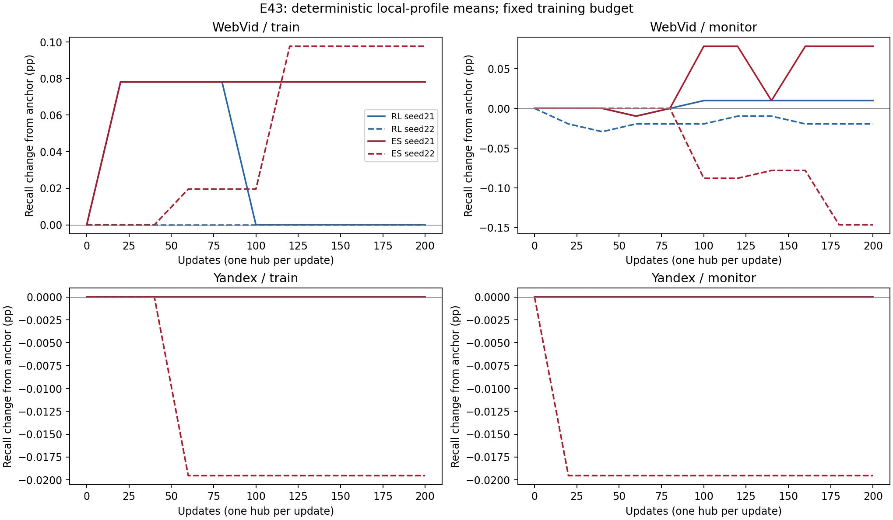
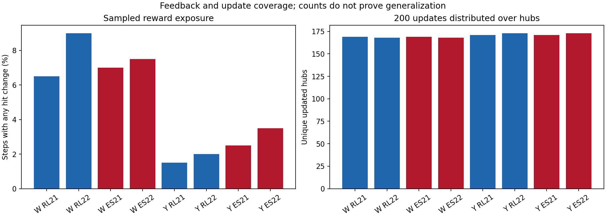

# E43 固定背景的局部画像RL/ES

2026-09-12，状态`COMPLETE_LOCAL_PROFILE_RL_STOP_MONITOR_GATE`，门`STOP_THIS_PARAMETERIZATION_BUDGET_EXPANSION`。用户持续推进至20:00的总目标另由[下一阶段](../../s-target.md)跟踪；本阶段八次训练已完成。

局部画像训练完整完成，但未形成双数据集稳定的质量增量。WebVid选中RL两seed monitor为+0.0098/−0.0098pp，ES为+0.0781/0pp；Yandex RL均0，ES为0/−0.0195pp。WebVid ES的局部正值保留，不能写成RL额外优势。Yandex未过预锁monitor门，因此本版本停止扩展预算，不进入新开发或QPS。

## 实现与控制

固定E37 P/B/H和同train4096/monitor1024，独立H×16行系数：W_h=normalize(P_h+0.0625||P_hB||tanh(z_h)Bᵀ)，零参数直接复制原P字节。每次只改一行、其它当前画像不动。hub从原train三入口多重集合GT无关抽取，与uniform batch128独立；RL/ES同seed的hub/batch日程逐位相同。两臂σ.3、8候选、200步、原Adam步长，行局部计数作偏差修正。

每步真实重建当前图并run128，再逐个构建8个单行候选并run同128。奖励为原J的配对差，命中/总NDC/零命中/原漂移全部计入。8独立方向LOO-RL与4对方向ES同属高斯平滑黑箱目标，区别为估计器，不是两个不同模型族。共同当前J在两种梯度里抵消，单纯改名ΔJ不会改变估计器；新变量为局部动作与独立参数。E43自由度及额外当前基线成本都不同于E37，跨版本不是纯奖励消融。

checkpoint仍是确定均值，非采样最佳候选；每20步真实评估train512/monitor1024，按非零monitor U最高且graph NDC≤+1%选最早点。仅用monitor选择checkpoint，未按GT选hub或改变日程。最终输出是一份静态W/普通HNSW，线上仍原始query→一次HNSW top3→升序真实ID→原NSG，无在线优化模型。

[协议](protocol.md)、[锁定配置](config.locked.json)、[训练源码](src/train.py)、[缓存诊断补充](analysis_addendum.md)。两数据集/seed没有按结果增补epoch、σ或batch。

## 完整结果

| 数据集 | 方法/seed | 选中步 | train ΔR pp | monitor ΔR pp | 末点monitor ΔR pp | monitor U |
|---|---|---:|---:|---:|---:|---:|
| WebVid | RL/21 | 140 | +0.0000 | +0.0098 | +0.0098 | +0.000812 |
| WebVid | RL/22 | 140 | +0.0000 | -0.0098 | -0.0195 | -0.001086 |
| WebVid | ES/21 | 180 | +0.0781 | +0.0781 | +0.0781 | +0.007866 |
| WebVid | ES/22 | 20 | +0.0000 | +0.0000 | -0.1465 | -0.000011 |
| Yandex | RL/21 | 200 | +0.0000 | +0.0000 | +0.0000 | +0.000047 |
| Yandex | RL/22 | 80 | +0.0000 | +0.0000 | +0.0000 | +0.000017 |
| Yandex | ES/21 | 60 | +0.0000 | +0.0000 | +0.0000 | +0.000013 |
| Yandex | ES/22 | 200 | -0.0195 | -0.0195 | -0.0195 | -0.001923 |

正负及末点均保留。R为Recall@10，表中百分点相对当前GT10锚点；train512/monitor1024只是历史fit内分区，均有历史使用，非盲测或端到端性能验证。全G/L/失败/NDC见[质量CSV](results/quality.csv)。

## 反馈及诊断

| 数据集 | 方法/seed | 有命中变化的步/200 | 有命中变化候选/1600 | 更新hub数 | 每活跃hub更新中位数/最大 |
|---|---|---:|---:|---:|---:|
| WebVid | RL/21 | 13 | 40 | 169 | 1.0/6 |
| WebVid | RL/22 | 18 | 46 | 168 | 1.0/3 |
| WebVid | ES/21 | 14 | 39 | 169 | 1.0/6 |
| WebVid | ES/22 | 15 | 51 | 168 | 1.0/3 |
| Yandex | RL/21 | 3 | 11 | 171 | 1.0/3 |
| Yandex | RL/22 | 4 | 9 | 173 | 1.0/4 |
| Yandex | ES/21 | 5 | 15 | 171 | 1.0/3 |
| Yandex | ES/22 | 7 | 13 | 173 | 1.0/4 |

反馈仍然稀疏：WebVid每200步只有13–18步出现任一候选命中变化，Yandex仅3–7步；每次更新覆盖168–173个不同hub，每个活跃hub更新中位数为1。平均确定均值画像位移约0.0035–0.0037，而采样候选约0.060–0.064。这同时提示查询抽样、每hub学习暴露与采样/确定差异，尚不能单独定因。单行责任已可追踪，但绝大多数更新并未观察到命中反馈；不能仅凭非零总reward声称学到了检索收益。

候选梯度与确定更新不同：未对所有更新后的均值在该步原batch补测，不能从画像位移推断实际收益。逐query半批次/方差仅为固定方向条件分析，漂移项另列，不包括方向采样噪声；不能把分量范数相加当贡献百分比。

## 门与后续

预锁门要求每数据集RL与ES各至少一seed选中monitor ΔRecall>0、U>0且graph NDC≤+1%。实际[STOP_THIS_PARAMETERIZATION_BUDGET_EXPANSION](results/method_gate.json)。下一明确目标为固定E43原状态/八方向的完整train4096条件参照，比较uniform128与GT无关、正确加权的分层128采样方差及正负反馈覆盖。先做该诊断，不重训或调σ/epoch；双集条件方差明确改善才考虑唯一采样修订。该后继控制尚未执行，当前20:00总目标继续。

默认保持WebVid GT10-soft-t1 / Yandex GT10-hard；旧E37开发门、E41局部+4无损和E42条件责任各自保留。本阶段无新cal/audit/QPS，不能由monitor正值推断RL额外价值或泛化优势。

## 成本、验证与原件

实际1,992,256次NSG（预留1,993,440/硬限2,200,000）、1,991,104次HNSW、14,510次普通构图，1600次更新。两个训练进程累计1691.212s，含加载/构图/反馈/写盘/验收；预检另计。峰值RSS约5.459/9.956GiB。CPU15、实际进程/OMP/BLAS/MKL1线程、方法及数据集串行。不是QPS。

运行期间为保持原余盘合同，曾在CPU8归档可再生成环境字节码；这是短暂辅助I/O，训练wall不作无干扰速度对比，见[资源记录](resource_note.md)。全部实验原件和源码保留。

双集预检恢复10240原基线输出，零参数/单行构造、共同baseline抵消、梯度/Adam和plain/原kernel通过。训练独立集合评分1,978,368个返回，核验12,800候选W hash、1600奖励/梯度/四分量/Adam更新、88完整checkpoint、16选中/末点模型及1024query三路parity。候选行用独立逐坐标公式核验，完整W由记录行字节重放，未调用ANN重训。原E37–E42/实际native/NSG依赖与query前冻结保持，根文档前件独立保存。无新GT和原validation/held-out读取/hash；保护旧隔离开发产物的字节读取不混为新开发。

[完整训练模型](results/training_analysis.json)、[逐步反馈](results/steps.csv)、[实际调用](logs/jobs.json)、[成本](results/cost.json)、[独立重放](reviews/training_verification.json)、[完成审计](reviews/completion_audit.json)、[最终验收](reviews/final_audit.json)。所有已完成输出保留，runner拒绝覆盖。
