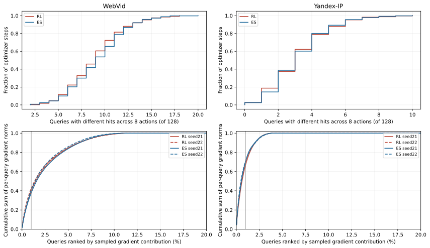
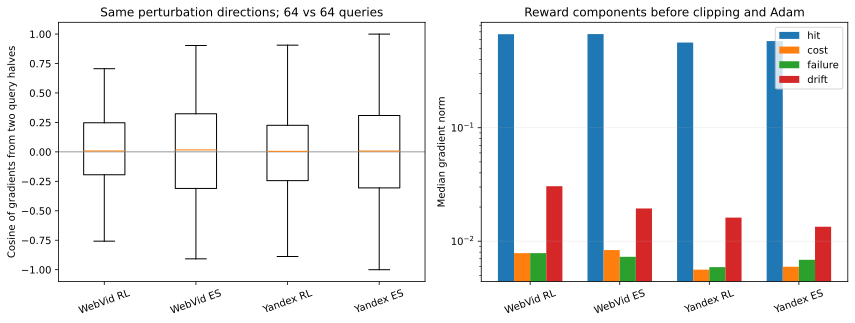
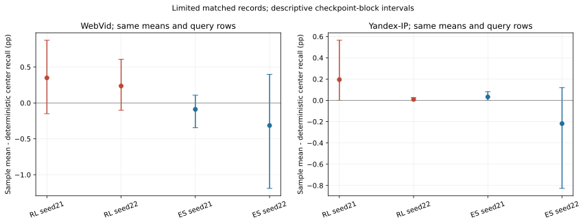

# E38：离线画像学习为何没有稳定收益

2026-09-12。基于E37已有原始返回/轨迹/模型的诊断；0新NSG、0HNSW查询/构图、0训练更新、0新GT，没有读取/hash新的validation/held-out原始输入。原E37目录保持不变。用户要求“诊断一下”，本轮对应原s-target的第一优先。

## 当前判断

当前最直接的瓶颈是：真实命中反馈集中在少数查询，batch128给出的更新方向不稳定。两臂同样出现这一现象。它支持优先检查查询批次噪声，但尚不能证明增大batch就一定能学出更好的画像，也不能排除当前共享表示下的真实可改进方向本来就很弱。

RL每步能区分八动作命中质量的query中位数仅WebVid 9/128、Yandex 3/128；相同扰动下两半query梯度的余弦中位数为0.0078/0.0041，约半数步为负。命中梯度远大于成本/漂移项，总梯度与命中梯度余弦约0.999，不支持“惩罚压住学习”作为主要解释。

随机动作转确定均值有局部差距，但严格匹配仅覆盖80组、1188条重复query记录，每run只有126/128个独立query身份；区间包含0，部分差值受单条记录影响很大。共享画像表达不足仍未被单独验证。下一步建议固定μ与扰动，仅检验更多查询是否能稳定方向，暂不追加epoch、改表示或启动新训练。

这里诊断的是E37的一步Gaussian静态共享画像搜索，不能将结论扩为所有离线RL、所有画像模型或HNSW构造策略。E37原GT10局部贡献、ES局部正值以及E36的不同在线费用边界各自保留。

## 1. 真实反馈并非完全为零，但区分度集中

“有区分度query”严格定义为同一步八个候选的GT10命中数不全相同；这是能区分动作的命中反馈，与“相对原GT10更换入口”或“某动作命中变化”分别统计。每数据集每臂合并双seed为400步；每步128行，每行八次真实候选反馈。

| 数据 | 臂 | 区分query中位/128 | 入口变化事件 % | 命中变化事件 % | 有区分query % | 至多1个区分query的步 % |
|---|---|---|---|---|---|---|
| WebVid | rl | 9.00000 | 27.54883 | 2.68726 | 7.00000 | 0.00000 |
| WebVid | es | 9.00000 | 26.06543 | 2.49976 | 7.20703 | 0.00000 |
| Yandex-IP | rl | 3.00000 | 20.00464 | 0.94092 | 2.50000 | 18.75000 |
| Yandex-IP | es | 3.00000 | 19.14795 | 0.92261 | 2.51953 | 14.50000 |

RL中，WebVid约27.55%的动作-query事件改变入口，但仅2.69%改变命中；Yandex为20.00%与0.94%。WebVid每步都有一些区分反馈，因此不能说所有奖励都是零；Yandex有18.75%的更新至多依靠1个query区分命中。这里分母是实际重复观测，不是独立query数或完整train4096质量。

每run有4086/4088个训练query实际出现，另10/8行未被抽到；每query中位出现6个batch、最高15/16个。未见行在暴露统计记为0次，不将其效用填写为0。受益与损伤、原始命中和梯度范数累计全部按原source row ID对齐。

## 2. 相同扰动下，换一半查询就没有稳定同向建议

把每步的μ和八个扰动固定，对128个query作16个预定随机二分；各半64行分别重算数据项梯度，逐步取16个余弦的中位数，再汇总400步。没有重新抽动作或修改参数，因此这项主要检查query采样噪声。数据项含hits/cost/failure，画像漂移不含query，另列。

| 数据 | 臂 | 两半方向余弦中位 | 中位余弦负的步 % | 条件信噪估计中位 | 最大query范数占比中位 | 去最大query后余弦中位 |
|---|---|---|---|---|---|---|
| WebVid | rl | 0.00775 | 48.50000 | -0.02068 | 0.30749 | 0.70373 |
| WebVid | es | 0.01659 | 47.50000 | -0.01845 | 0.29706 | 0.72186 |
| Yandex-IP | rl | 0.00413 | 49.50000 | 0.03056 | 0.57708 | 0.49969 |
| Yandex-IP | es | 0.00708 | 49.00000 | 0.02975 | 0.58417 | 0.51814 |

RL两半方向余弦约0.008/0.004，48.5%/49.5%的步为负；ES表现相似。它不是由“256维中八个不同随机方向天然接近正交”直接推断出来的：这里比较的两半使用同一组方向。相邻步梯度余弦也接近0，但同时混入μ、方向和batch变化，只作为辅助描述。

令每query的条件梯度为g_q，batch均值为ḡ。估计其均值采样方差V=(1−128/4096)Σ||g_q−ḡ||²/(127×128)，表中的条件信噪估计为||ḡ||²/V−1。负值表示在本批数据中扣除估计噪声后没有可辨正信号，不表示真实梯度能量为负或数学上无可学习方向。该量不计扰动方向采样噪声，也不能代替总体梯度或全数据测量。

单批最大query占命中项“逐query梯度范数之和”的中位数约31%/58%。跨训练累计，最集中约1%的query（41行）占RL这项范数和的40%–43%/67%–70%；这不是它们占最终参数或收益的比例。下表除以各query实际出现次数后重新排序，集中性仍保留，说明不只是随机暴露次数不同。

| 数据 | 臂 | seed | 暴露校正后前41行范数占比 | 未抽到行数 |
|---|---|---|---|---|
| WebVid | rl | 20260921 | 0.37470 | 8 |
| WebVid | rl | 20260922 | 0.39720 | 10 |
| WebVid | es | 20260921 | 0.37272 | 8 |
| WebVid | es | 20260922 | 0.38095 | 10 |
| Yandex-IP | rl | 20260921 | 0.66324 | 8 |
| Yandex-IP | rl | 20260922 | 0.68417 | 10 |
| Yandex-IP | es | 20260921 | 0.68141 | 8 |
| Yandex-IP | es | 20260922 | 0.69598 | 10 |

## 3. 成本惩罚、漂移正则和参数裁剪不是当前首要解释

以下为同一梯度公式下四个奖励项的向量范数，均在L2裁剪/Adam之前。看候选间的变化和梯度，比只看负reward的绝对值更能判断哪个项影响更新。

| 数据 | 臂 | hits范数中位 | cost范数中位 | failure范数中位 | drift范数中位 | 总梯度/hits余弦 | 辅助项大于hits的步 % |
|---|---|---|---|---|---|---|---|
| WebVid | rl | 0.66743 | 0.00785 | 0.00785 | 0.03050 | 0.99910 | 0.00000 |
| WebVid | es | 0.66870 | 0.00834 | 0.00729 | 0.01943 | 0.99961 | 0.00000 |
| Yandex-IP | rl | 0.56321 | 0.00561 | 0.00591 | 0.01613 | 0.99961 | 2.75000 |
| Yandex-IP | es | 0.58033 | 0.00595 | 0.00686 | 0.01340 | 0.99977 | 2.75000 |

RL命中梯度中位约0.667/0.563，成本项0.00785/0.00561，漂移项0.03050/0.01613。总梯度与命中梯度的余弦约0.999，WebVid辅助项从未主导，Yandex只在少量无命中区分的步主导。不能完全排除正则对长期轨迹的影响，但“正则太强让模型不动”缺乏支持。

8次训练中μ的绝对值最大不超过1.047，距原±2限制尚有余量，无参数撞边；12800扰动都实际改变过画像/构图身份，部署也有明确入口变化。L2梯度裁剪确实出现，RL为WebVid71/400步、Yandex53/400步；它缩放范数而不把方向清零，不据此断定裁剪无影响。B与PB都满列秩16，B覆盖train query能量约55.37%/50.11%，原画像能量88.57%/80.20%。这些只排除明显退化，不证明rank16足够，也不证明共享画像能表达所需联合效用。

## 4. 随机策略与确定画像的差距：存在局部迹象，尚不能定主因

只配对checkpoint s与动作step s+1，要求保存的mu_before与中心μ逐字一致，并限制query属于中心已测train512。每query先平均八个候选hits，再减确定中心hits；表中乘10转为Recall百分点。共80组、1188条重复query记录，每run10组/143或154条、126或128个query身份；不是1188个独立样本。

| 数据 | 臂 | seed | 记录数 | query身份数 | 差值非零记录 | 随机均值−确定 pp | 区间低 pp | 区间高 pp | 去最大记录后 pp |
|---|---|---|---|---|---|---|---|---|---|
| WebVid | rl | 20260921 | 154 | 128 | 12 | 0.34903 | -0.14925 | 0.87280 | 0.10621 |
| WebVid | rl | 20260922 | 143 | 126 | 18 | 0.23601 | -0.10263 | 0.60834 | 0.06162 |
| WebVid | es | 20260921 | 154 | 128 | 9 | -0.08929 | -0.34560 | 0.10762 | 0.00817 |
| WebVid | es | 20260922 | 143 | 126 | 16 | -0.31469 | -1.19013 | 0.39736 | -0.00880 |
| Yandex-IP | rl | 20260921 | 154 | 128 | 3 | 0.19481 | 0.00000 | 0.56507 | 0.03268 |
| Yandex-IP | rl | 20260922 | 143 | 126 | 3 | 0.00874 | 0.00000 | 0.02604 | 0.00000 |
| Yandex-IP | es | 20260921 | 154 | 128 | 2 | 0.03247 | 0.00000 | 0.08185 | 0.00817 |
| Yandex-IP | es | 20260922 | 143 | 126 | 3 | -0.21853 | -0.82721 | 0.12019 | 0.04401 |

区间按checkpoint块做5000次bootstrap，只描述这批重复、相互依赖的记录，不是总体因果区间。WebVid RL两个seed的随机均值约高0.349/0.236pp，但区间跨0；去掉各自最大单条记录后降为0.106/0.062pp。Yandex RL seed22差距只有0.0087pp，ES两集均有相反方向记录。随机动作到确定中心的失配值得检查，但现有覆盖不能解释全部失败，不能从这些样本挑一个随机画像当新模型。

## 5. monitor小幅正值不足以说明训练已稳定学会

全88中心、train512/monitor1024共176个统计都重算，选中与末点逐query另存。以下只列所选RL；其它全部保留在CSV。

| 数据 | seed | split | ΔRecall pp | 换入口query | 命中变化query | 受益 | 受损 | 新增hits | 损失hits | 前5行绝对变化占比 |
|---|---|---|---|---|---|---|---|---|---|---|
| WebVid | 20260921 | train | 0.11719 | 88 | 7 | 5 | 2 | 11 | 5 | 0.87500 |
| WebVid | 20260921 | monitor | 0.13672 | 195 | 23 | 11 | 12 | 39 | 25 | 0.54688 |
| WebVid | 20260922 | train | 0.37109 | 118 | 10 | 7 | 3 | 22 | 3 | 0.80000 |
| WebVid | 20260922 | monitor | 0.31250 | 225 | 21 | 14 | 7 | 48 | 16 | 0.59375 |
| Yandex-IP | 20260921 | train | -0.21484 | 67 | 4 | 1 | 3 | 1 | 12 | 1.00000 |
| Yandex-IP | 20260921 | monitor | 0.16602 | 155 | 6 | 4 | 2 | 22 | 5 | 0.96296 |
| Yandex-IP | 20260922 | train | -0.17578 | 64 | 2 | 0 | 2 | 0 | 9 | 1.00000 |
| Yandex-IP | 20260922 | monitor | 0.14648 | 123 | 7 | 6 | 1 | 17 | 2 | 0.89474 |

例如Yandex主RL seed22在train512只损伤2个query、共丢9个hits；monitor则6个受益/1个受损，净多15个hits。monitor的正数来自少量查询和幅度差，不能概括成大多数query更好。WebVid主RL monitor甚至受益11个、受损12个，只是正变化幅度较大。其后cal/audit结果仍沿用E37冻结选择，不作事后回选。

20步窗口的采样reward和命中差另存[窗口统计](results/window_summary.csv)，它们在不同μ与不同query批次上产生，不能与确定train512曲线直接相减或当作固定中心的总体质量。

## 6. 可反驳本判断的最小下一步

## 第一优先：固定参数与动作，验证查询批次噪声是否可压低

E38既有反馈诊断已完成；最小接续为一个尚未执行的静态诊断，不直接重训。每数据集只固定两个参数点：μ=0和E37按cal冻结的主RL μ；各自沿用原轨迹中对应checkpoint后一步的八个扰动动作。这样函数、μ和方向都固定，仅改变用于评价这些动作的查询数量。

从E37已有train4096中另取1024行，排除这两个原128-query动作批次；按固定无标签seed均匀抽取、分成8个互斥128-query块，同一名单服务两参数点。它们仍有历史训练暴露，只是在该固定动作梯度估计中与原批次分开，不能称新盲测。真实执行八动作和确定中心，保留全部逐query命中/NDC/奖励。

核心比较为128、256、512、1024聚合后的条件方差与方向一致性，尤其两组互斥512是否建议相近方向；固定方向只检查query采样噪声，不能评估完整256维梯度或全部扰动噪声。奖励仍用原公式，不借诊断选择新μ、σ、rank或checkpoint，也不把被评估动作中最高者部署。

正常搜索预算为2数据集×2参数点×(8动作+1确定中心)×1024=36,864次NSG，另预留parity，建议总硬上限40,000；0optimizer更新、0新GT、0新validation/held-out、无QPS/默认替换。画像/小图仅按这36个冻结配置重建，调用、线程与计时合同须在新版本协议中落实。这是待执行建议，不是E38实际调用。

若更大互斥批次的方向仍接近无相关或经常相反，就停止扩大训练预算，回到表示/局部目标是否有可学习空间的问题；若方向能稳定，才讨论同总真实调用预算下的microbatch累计方案。增大batch会减少可用更新次数或扰动数量，后续必须保留预算匹配控制，不能把更多总标签费用当作算法优势。本控制尚未运行，无排队任务。

## 验收、成本与产物

分析重算1,773,568条已有返回、12800奖励、1600梯度分解和88中心；同入口时原NSG返回/graph NDC完全一致。独立脚本用集合交集和逐项梯度公式再次检查32个分层抽样step、32768个动作返回、条件方差/半批方向，以及全部1188条精确μ匹配记录。方法诊断与实现审计分别记录，旧E37验收状态不修改。

主分析实际单线程约8.454s、峰值RSS约168MiB，不计人工阅读/脚本编写/绘图/最终验收；这不是训练时间或QPS。新搜索/构图/训练/GT调用均0。[协议](protocol.md)、[源码](src/analyze.py)、[独立核验](reviews/independent_verification.json)、[最终验收](reviews/final_audit.json)。

- [分组核心结果](results/group_summary.csv)、[八run完整统计](results/runs.csv)、[1600步](results/steps.csv)、[12800动作奖励分解](results/actions.csv)。
- [按真实query行的暴露/贡献](results/query_exposure.csv)、[暴露校正](results/exposure_control.csv)、[176中心统计](results/centers.csv)、[选中/末点逐query](results/endpoint_queries.csv)。
- [精确匹配逐query](results/matched_queries.csv)、[匹配组](results/matched_groups.csv)、[描述区间](results/matched_summary.csv)、[JSON](results/diagnosis.json)。
- [前版完整报告](../20260912_offline_profile_rl_v1/report.md)、[历史27](../../experiment_history/27_offline_profile_diagnosis.md)、[下一阶段](../../s-target.md)。

E37全部2721个文件在本轮前后SHA核验；本轮根文档变更前件在source_before，原源码/图/GT/模型/训练与部署返回均保留。历史开发数据暴露不因本次分析消失。结论只提升“批次噪声应优先检查”的证据，不授予新方法、默认替换或正式性能GO。
