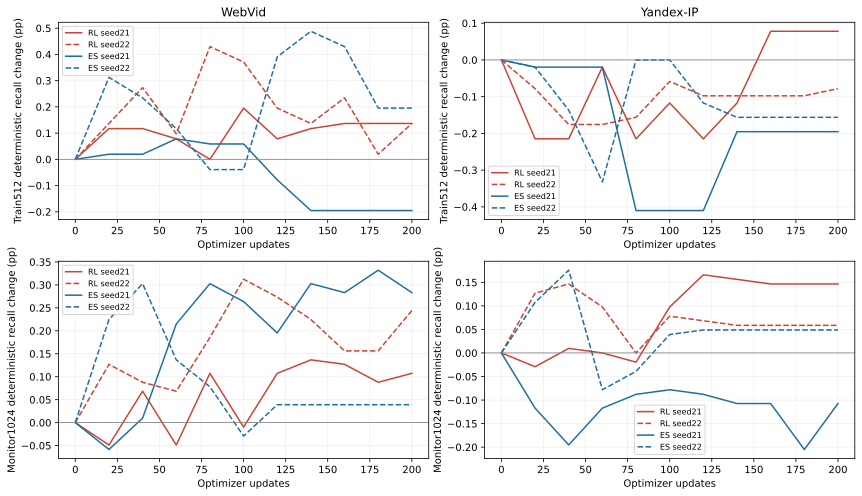
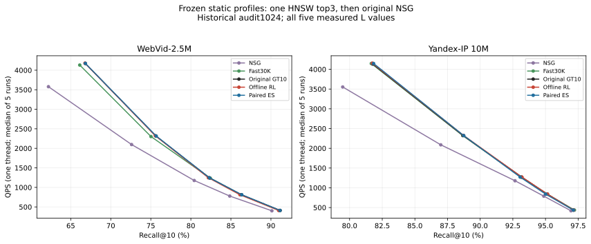
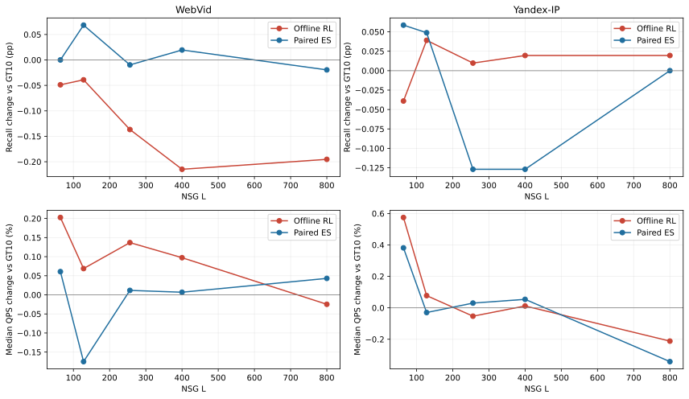

# E37：离线训练入口画像，再构建普通HNSW

2026-09-12。独立版本`20260912_offline_profile_rl_v1`；完成两数据集、两种估计器、双seed的训练、冻结模型部署和五L完整wall。用户要求把学习费用移到离线，本版本在线为raw query→一次普通HNSW top3→原NSG，没有query MLP或56集合枚举。原H/真实ID/大图/metric不变，默认画像未替换。

## 结果与判断

离线训练静态画像、再重建普通HNSW的部署形式已实现，但本轮RL没有获得稳定检索增量。所选RL的WebVid cal/audit为−0.1172/−0.0391pp，Yandex为−0.0195/+0.0391pp，双集开发门停止。成对扰动ES在这四项略好，RL对ES的audit配对区间均包含0；不能归因出RL的稳定额外价值。

在线不再运行query MLP；L128相对原GT10的QPS变化仅+0.069%/+0.078%。完整五L中WebVid RL Recall全部略降，Yandex四点微升、L64下降，尚无稳定跨数据集前沿优势。ES也有中高L负点。保留这些局部正值，默认不替换。

| 数据 | cal所选模型 | cal ΔRecall pp | audit ΔRecall pp | audit Δtotal NDC % | audit L128 ΔQPS % |
|---|---|---|---|---|---|
| WebVid | RL_seed21 | -0.117188 | -0.039062 | -0.028363 | 0.068835 |
| WebVid | ES_seed21 | 0.117188 | 0.068359 | 0.191849 | -0.174948 |
| Yandex-IP | RL_seed22 | -0.019531 | 0.039062 | -0.042194 | 0.077532 |
| Yandex-IP | ES_seed22 | 0.048828 | 0.048828 | -0.067028 | -0.029920 |

这一轮的变化确实传到了部署：所选RL画像的中位旋转角为WebVid 3.288°、Yandex 2.379°，小图拓扑都改变；audit L128分别有219/135个query更换三入口，但命中数变化只出现在26/2个query。WebVid新增33个正确命中、同时损失37个；Yandex新增4个命中，全部来自2个query。这支持“画像能改变路由，但有用联合命中变化稀少且损伤可抵消收益”的解释，尚不能区分梯度噪声、共享表示限制和确定均值部署差异。

主RL在WebVid五L的Recall变化为−0.0488至−0.2148pp；Yandex为−0.0391至+0.0391pp。对应QPS差异分别−0.0248%至+0.2027%、−0.2117%至+0.5746%，均保留五轮原值而不把微小单点变化当作稳定加速。共同区间插值中的WebVid RL三点均负，Yandex三点小正；它们来自历史audit的五点曲线，不构成新的独立确认。

两集所选ES的L128 cal/audit皆有小正值，但Yandex L256/L400都下降0.126953pp，不能据此替换默认。RL对ES的Yandex cal描述性区间为[−0.15625,−0.009766]pp、audit为[−0.107422,+0.058594]pp，方向和不确定性应完整保留，不能概括成“RL显著优于对照”。

WebVid主RL选中点在train512/monitor上小正、到cal/audit转负；Yandex主RL选中点连train512 Recall都下降，monitor则小正。因此不能把问题统一说成训练没有跑够，也不能从monitor最高点推导已学到可泛化画像。下一步先用已有动作/实际输出做奖励尺度、梯度波动及确定部署诊断，不追加原网格。

预定双集开发门为`STOP_DUAL_DEVELOPMENT_GATE`。该门要求每集RL cal≥+0.10pp、audit>0、两者total NDC≤+1%；不根据结果改变门。无论门是否通过，本轮都完成预定的历史audit曲线；`independent_formal_GO=false`。

## 方法：学习画像，而非在每次查询中运行RL

当前P为WebVid GT10-soft-t1、Yandex GT10-hard。train4096单位query二阶矩的前16方向形成固定B；动作X有256个共享参数，W=normalize(P+0.25(PB)(tanh(X)/4)Bᵀ)。零参数按原P字节恢复。每个采样W都真实重建M16/efConstruction200/seed20260828的普通小HNSW；efSearch10返回top3，真实ID升序执行原NSG L128/K10。这里只通过画像改变重建后的图，没有独立删边/换边动作，也不训练大NSG。

策略为μ+0.3ε的一步Gaussian参数搜索。RL用8个独立扰动和leave-one-out奖励基线；ES用4对正负扰动。两者同参数化、同高斯平滑目标、同batch日程和预算，差别在估计器；不能凭RL名称声称多步决策或新的表示能力。Adam、200更新、步长与σ均预先固定，随机候选的奖励不能替代确定均值模型的实际部署结果。

每query U=hits−hits₀−0.1(totalNDC/totalNDC₀−1)−0.1(零命中指示−原零命中指示)，batch均值再减画像均方漂移。C++先返回真实联合搜索，Python后读GT评分；不相加单入口收益、不使用固定C8未知标签、不复用旧56组合监督。NDC只是低噪声训练项，完整wall单独实测。

与旧实验的实质区别：E28优化全H教师代理；E32真实奖励受旧C8重排限制；E33只删固定画像图的原边；E36在线模型做query相关交换。E37直接优化最终HNSW→NSG路径的静态画像，但qᵀW仍是逐入口线性评分，无法表示任意三入口联合效用。固定rank16/256参数和单构图seed只界定本版本，不能据此否定所有离线画像学习。[协议](protocol.md)、[方法依据与一手参照](method_basis.md)。

## 数据、选择与实际训练

每集从E24历史fit20K取train4096/monitor1024，PCG64 seed20260912；cal/audit各历史1024。四角色源行互斥；B只用train，checkpoint只看monitor，全部训练和独立复算结束后才准备cal，cal选各臂seed并冻结后再准备audit。原画像与这些开发样本曾用于历史实验，因而不是全管线盲测。本轮没有读取或hash validation/held-out原始输入，没有新增GT。

每次200更新，每步8候选×128实际搜索，step0及20..200各评测确定性train512/monitor1024。表中“选中”依monitor U且graph NDC≤+1%选择非零checkpoint，cal只再选seed；所有seed和末点都保留。

| 数据 | 臂 | seed | 选中step | 选中train ΔR pp | 选中monitor ΔR pp | 末点train ΔR pp | 末点monitor ΔR pp | cal选中 | 画像中位角度 ° | 拓扑变化 |
|---|---|---|---|---|---|---|---|---|---|---|
| WebVid | rl | 20260921 | 140 | 0.117188 | 0.136719 | 0.136719 | 0.107422 | 是 | 3.287564 | 是 |
| WebVid | rl | 20260922 | 100 | 0.371094 | 0.312500 | 0.136719 | 0.244141 | 否 | 3.918974 | 是 |
| WebVid | es | 20260921 | 180 | -0.195312 | 0.332031 | -0.195312 | 0.283203 | 是 | 2.537923 | 是 |
| WebVid | es | 20260922 | 40 | 0.234375 | 0.302734 | 0.195312 | 0.039062 | 否 | 2.226091 | 是 |
| Yandex-IP | rl | 20260921 | 120 | -0.214844 | 0.166016 | 0.078125 | 0.146484 | 否 | 3.187129 | 是 |
| Yandex-IP | rl | 20260922 | 40 | -0.175781 | 0.146484 | -0.078125 | 0.058594 | 是 | 2.379129 | 是 |
| Yandex-IP | es | 20260921 | 100 | -0.410156 | -0.078125 | -0.195312 | -0.107422 | 否 | 2.659944 | 是 |
| Yandex-IP | es | 20260922 | 40 | -0.136719 | 0.175781 | -0.156250 | 0.048828 | 是 | 2.165555 | 是 |

## cal/audit：全部正负结果

以下均L128、相对本轮相同行原GT10；baseline绝对Recall同列。未选seed的audit结果只供完整报告，未用于回选。

| 数据 | split | 模型 | Recall % | ΔR pp | 失败率 % | Δtotal NDC % | mean U | 受益/受损query |
|---|---|---|---|---|---|---|---|---|
| WebVid | cal | 原GT10 | 75.351562 | 0.000000 | 2.148438 | 0.000000 | 0.000000 | 0/0 |
| WebVid | cal | RL_seed21 | 75.234375 | -0.117188 | 2.246094 | -0.154134 | -0.011877 | 7/13 |
| WebVid | cal | RL_seed22 | 75.224609 | -0.126953 | 2.148438 | -0.198196 | -0.012720 | 8/12 |
| WebVid | cal | ES_seed21 | 75.468750 | 0.117188 | 2.050781 | 0.224756 | 0.011511 | 5/4 |
| WebVid | cal | ES_seed22 | 75.419922 | 0.068359 | 2.148438 | -0.044173 | 0.006719 | 5/7 |
| WebVid | audit | 原GT10 | 75.605469 | 0.000000 | 1.074219 | 0.000000 | 0.000000 | 0/0 |
| WebVid | audit | RL_seed21 | 75.566406 | -0.039062 | 0.976562 | -0.028363 | -0.003970 | 12/14 |
| WebVid | audit | RL_seed22 | 75.585938 | -0.019531 | 1.171875 | 0.025322 | -0.002284 | 12/16 |
| WebVid | audit | ES_seed21 | 75.673828 | 0.068359 | 0.976562 | 0.191849 | 0.006424 | 11/11 |
| WebVid | audit | ES_seed22 | 75.371094 | -0.234375 | 1.171875 | -0.118593 | -0.023570 | 6/11 |
| Yandex-IP | cal | 原GT10 | 89.736328 | 0.000000 | 1.562500 | 0.000000 | 0.000000 | 0/0 |
| Yandex-IP | cal | RL_seed21 | 89.716797 | -0.019531 | 1.660156 | -0.069014 | -0.002010 | 6/6 |
| Yandex-IP | cal | RL_seed22 | 89.716797 | -0.019531 | 1.562500 | -0.139508 | -0.001853 | 1/3 |
| Yandex-IP | cal | ES_seed21 | 89.687500 | -0.048828 | 1.562500 | -0.136418 | -0.004827 | 4/8 |
| Yandex-IP | cal | ES_seed22 | 89.785156 | 0.048828 | 1.562500 | 0.136320 | 0.004710 | 4/2 |
| Yandex-IP | audit | 原GT10 | 88.691406 | 0.000000 | 1.855469 | 0.000000 | 0.000000 | 0/0 |
| Yandex-IP | audit | RL_seed21 | 88.730469 | 0.039062 | 1.855469 | -0.046886 | 0.004002 | 3/1 |
| Yandex-IP | audit | RL_seed22 | 88.730469 | 0.039062 | 1.855469 | -0.042194 | 0.003922 | 2/0 |
| Yandex-IP | audit | ES_seed21 | 88.740234 | 0.048828 | 1.757812 | -0.121958 | 0.005046 | 2/1 |
| Yandex-IP | audit | ES_seed22 | 88.740234 | 0.048828 | 1.855469 | -0.067028 | 0.004894 | 2/1 |

配对query bootstrap 5000次的95%区间是历史开发样本的描述性不确定性；没有校正选点或历史复用，不能充当独立确认试验。

| 数据 | split | 模型 | 参照 | ΔR pp | 95%低 pp | 95%高 pp |
|---|---|---|---|---|---|---|
| WebVid | cal | RL_seed21 | 原GT10 | -0.117188 | -0.302734 | 0.058594 |
| WebVid | cal | ES_seed21 | 原GT10 | 0.117188 | -0.078125 | 0.380859 |
| WebVid | cal | RL_seed21 | ES_seed21 | -0.234375 | -0.537109 | 0.009766 |
| WebVid | audit | RL_seed21 | 原GT10 | -0.039062 | -0.400391 | 0.322266 |
| WebVid | audit | ES_seed21 | 原GT10 | 0.068359 | -0.156250 | 0.302979 |
| WebVid | audit | RL_seed21 | ES_seed21 | -0.107422 | -0.478516 | 0.273438 |
| Yandex-IP | cal | RL_seed22 | 原GT10 | -0.019531 | -0.097656 | 0.068359 |
| Yandex-IP | cal | ES_seed22 | 原GT10 | 0.048828 | -0.039062 | 0.156250 |
| Yandex-IP | cal | RL_seed22 | ES_seed22 | -0.068359 | -0.156250 | -0.009766 |
| Yandex-IP | audit | RL_seed22 | 原GT10 | 0.039062 | 0.000000 | 0.107422 |
| Yandex-IP | audit | ES_seed22 | 原GT10 | 0.048828 | -0.039062 | 0.156250 |
| Yandex-IP | audit | RL_seed22 | ES_seed22 | -0.009766 | -0.107422 | 0.058594 |

## 五L完整Recall–QPS与失败率

历史audit1024，两集各5方法×5L；五次独立plain整批wall取中位QPS。CPU15、实际线程1、串行、无训练或重分析并发；count与原kernel核验、GT评分在timer外。不同L的同模型画像、小图和入口完全相同。Fast30K沿用原训练量/seed，不能把它与GT10的所有差别归为本轮优化。

### WebVid

| 模型 | L | Recall % | 失败率 % | QPS中位 | QPS最小 | QPS最大 | route NDC | graph NDC | ΔR pp | ΔQPS % |
|---|---|---|---|---|---|---|---|---|---|---|
| Fast30K | 64 | 66.123047 | 3.222656 | 4132.203708 | 4094.191530 | 4138.119468 | 121.089844 | 942.016602 | -0.703125 | -0.961825 |
| NSG | 64 | 62.216797 | 7.812500 | 3578.179477 | 3559.113582 | 3594.086244 | 0.000000 | 1179.703125 | -4.609375 | -14.240345 |
| 原GT10 | 64 | 66.826172 | 3.125000 | 4172.334274 | 4163.887743 | 4199.801556 | 111.774414 | 932.283203 | 0.000000 | 0.000000 |
| RL_seed21 | 64 | 66.777344 | 2.832031 | 4180.791673 | 4178.313989 | 4204.081538 | 113.269531 | 930.958984 | -0.048828 | 0.202702 |
| ES_seed21 | 64 | 66.826172 | 2.832031 | 4174.872425 | 4129.372865 | 4198.328635 | 112.632812 | 933.895508 | 0.000000 | 0.060833 |
| Fast30K | 128 | 75.019531 | 1.269531 | 2301.981992 | 2287.080796 | 2309.915403 | 121.089844 | 1665.275391 | -0.585938 | -0.767533 |
| NSG | 128 | 72.597656 | 3.515625 | 2096.930802 | 2086.502311 | 2106.046634 | 0.000000 | 1905.144531 | -3.007812 | -9.606758 |
| 原GT10 | 128 | 75.605469 | 1.074219 | 2319.787133 | 2310.672932 | 2323.814849 | 111.774414 | 1654.546875 | 0.000000 | 0.000000 |
| RL_seed21 | 128 | 75.566406 | 0.976562 | 2321.383951 | 2302.212206 | 2326.764520 | 113.269531 | 1652.550781 | -0.039062 | 0.068835 |
| ES_seed21 | 128 | 75.673828 | 0.976562 | 2315.728720 | 2314.425268 | 2325.571688 | 112.632812 | 1657.077148 | 0.068359 | -0.174948 |
| Fast30K | 256 | 82.421875 | 0.292969 | 1236.775506 | 1235.656412 | 1238.093213 | 121.089844 | 3041.236328 | 0.097656 | -0.677998 |
| NSG | 256 | 80.419922 | 1.562500 | 1176.795577 | 1172.403161 | 1180.431784 | 0.000000 | 3263.500000 | -1.904297 | -5.494820 |
| 原GT10 | 256 | 82.324219 | 0.585938 | 1245.218065 | 1244.053119 | 1246.563051 | 111.774414 | 3018.609375 | 0.000000 | 0.000000 |
| RL_seed21 | 256 | 82.187500 | 0.585938 | 1246.922145 | 1246.116749 | 1248.182942 | 113.269531 | 3016.659180 | -0.136719 | 0.136850 |
| ES_seed21 | 256 | 82.314453 | 0.585938 | 1245.363201 | 1244.091867 | 1247.253965 | 112.632812 | 3021.106445 | -0.009766 | 0.011655 |
| Fast30K | 400 | 86.269531 | 0.097656 | 809.662293 | 805.764664 | 810.045995 | 121.089844 | 4505.603516 | -0.068359 | -0.223194 |
| NSG | 400 | 84.853516 | 1.074219 | 778.349628 | 774.096500 | 779.658380 | 0.000000 | 4737.651367 | -1.484375 | -4.081936 |
| 原GT10 | 400 | 86.337891 | 0.097656 | 811.473454 | 809.659123 | 813.335729 | 111.774414 | 4493.740234 | 0.000000 | 0.000000 |
| RL_seed21 | 400 | 86.123047 | 0.195312 | 812.263462 | 811.412597 | 813.133742 | 113.269531 | 4491.270508 | -0.214844 | 0.097355 |
| ES_seed21 | 400 | 86.357422 | 0.097656 | 811.528994 | 810.521591 | 812.596619 | 112.632812 | 4497.729492 | 0.019531 | 0.006844 |
| Fast30K | 800 | 91.054688 | 0.097656 | 409.621225 | 408.804587 | 410.437083 | 121.089844 | 8411.681641 | -0.097656 | -0.181208 |
| NSG | 800 | 90.117188 | 0.390625 | 400.997557 | 398.723760 | 401.347815 | 0.000000 | 8607.683594 | -1.035156 | -2.282672 |
| 原GT10 | 800 | 91.152344 | 0.000000 | 410.364839 | 410.237735 | 410.409101 | 111.774414 | 8406.082031 | 0.000000 | 0.000000 |
| RL_seed21 | 800 | 90.957031 | 0.097656 | 410.263229 | 409.327287 | 410.661732 | 113.269531 | 8404.656250 | -0.195312 | -0.024761 |
| ES_seed21 | 800 | 91.132812 | 0.000000 | 410.541718 | 409.169322 | 410.847706 | 112.632812 | 8407.859375 | -0.019531 | 0.043103 |

### Yandex-IP

| 模型 | L | Recall % | 失败率 % | QPS中位 | QPS最小 | QPS最大 | route NDC | graph NDC | ΔR pp | ΔQPS % |
|---|---|---|---|---|---|---|---|---|---|---|
| Fast30K | 64 | 81.660156 | 3.515625 | 4146.905085 | 4130.727172 | 4159.419484 | 115.570312 | 1609.358398 | -0.117188 | 0.351371 |
| NSG | 64 | 79.472656 | 5.566406 | 3552.997730 | 3485.184466 | 3558.445755 | 0.000000 | 1912.445312 | -2.304688 | -14.020652 |
| 原GT10 | 64 | 81.777344 | 3.710938 | 4132.385072 | 4113.745579 | 4145.605117 | 107.431641 | 1612.647461 | 0.000000 | 0.000000 |
| RL_seed22 | 64 | 81.738281 | 3.710938 | 4156.130160 | 4131.259423 | 4162.127972 | 107.651367 | 1609.873047 | -0.039062 | 0.574610 |
| ES_seed22 | 64 | 81.835938 | 3.515625 | 4148.144869 | 4130.041754 | 4160.620866 | 108.191406 | 1611.348633 | 0.058594 | 0.381373 |
| Fast30K | 128 | 88.662109 | 1.855469 | 2321.629032 | 2317.197783 | 2327.023847 | 115.570312 | 2806.720703 | -0.029297 | -0.038819 |
| NSG | 128 | 86.982422 | 3.515625 | 2088.225479 | 2085.808181 | 2093.710593 | 0.000000 | 3118.481445 | -1.708984 | -10.088355 |
| 原GT10 | 128 | 88.691406 | 1.855469 | 2322.530605 | 2315.135069 | 2325.028325 | 107.431641 | 2806.452148 | 0.000000 | 0.000000 |
| RL_seed22 | 128 | 88.730469 | 1.855469 | 2324.331312 | 2320.584755 | 2328.646062 | 107.651367 | 2805.002930 | 0.039062 | 0.077532 |
| ES_seed22 | 128 | 88.740234 | 1.855469 | 2321.835706 | 2318.529027 | 2330.096030 | 108.191406 | 2803.739258 | 0.048828 | -0.029920 |
| Fast30K | 256 | 93.134766 | 1.171875 | 1271.350827 | 1270.169507 | 1273.755582 | 115.570312 | 4943.625000 | -0.048828 | 0.028117 |
| NSG | 256 | 92.666016 | 1.660156 | 1178.569604 | 1169.940137 | 1179.385232 | 0.000000 | 5311.065430 | -0.517578 | -7.271781 |
| 原GT10 | 256 | 93.183594 | 1.074219 | 1270.993461 | 1250.777581 | 1271.579493 | 107.431641 | 4947.002930 | 0.000000 | 0.000000 |
| RL_seed22 | 256 | 93.193359 | 1.074219 | 1270.317340 | 1263.431763 | 1271.790292 | 107.651367 | 4945.918945 | 0.009766 | -0.053196 |
| ES_seed22 | 256 | 93.056641 | 1.171875 | 1271.376466 | 1269.547105 | 1273.693455 | 108.191406 | 4942.845703 | -0.126953 | 0.030134 |
| Fast30K | 400 | 95.146484 | 0.781250 | 840.186496 | 839.263662 | 841.713086 | 115.570312 | 7169.560547 | 0.009766 | 0.035017 |
| NSG | 400 | 94.873047 | 1.074219 | 788.510850 | 781.465848 | 788.879671 | 0.000000 | 7533.752930 | -0.263672 | -6.117634 |
| 原GT10 | 400 | 95.136719 | 0.878906 | 839.892391 | 838.027393 | 840.193613 | 107.431641 | 7169.134766 | 0.000000 | 0.000000 |
| RL_seed22 | 400 | 95.156250 | 0.878906 | 839.990500 | 832.126405 | 840.838148 | 107.651367 | 7167.369141 | 0.019531 | 0.011681 |
| ES_seed22 | 400 | 95.009766 | 0.976562 | 840.345004 | 833.109393 | 841.827668 | 108.191406 | 7164.555664 | -0.126953 | 0.053889 |
| Fast30K | 800 | 97.216797 | 0.488281 | 436.395581 | 433.908259 | 436.589893 | 115.570312 | 12785.078125 | 0.078125 | -0.000497 |
| NSG | 800 | 96.953125 | 0.781250 | 417.935333 | 415.777386 | 418.099952 | 0.000000 | 13165.806641 | -0.185547 | -4.230639 |
| 原GT10 | 800 | 97.138672 | 0.585938 | 436.397748 | 433.119319 | 436.610268 | 107.431641 | 12788.689453 | 0.000000 | 0.000000 |
| RL_seed22 | 800 | 97.158203 | 0.585938 | 435.473869 | 433.465615 | 435.599974 | 107.651367 | 12787.728516 | 0.019531 | -0.211706 |
| ES_seed22 | 800 | 97.138672 | 0.585938 | 434.904517 | 433.953295 | 436.083158 | 108.191406 | 12799.307617 | 0.000000 | -0.342172 |

同L Recall/QPS分别报告。下表仅在双方共同Recall范围内，对非支配点作log-QPS线性插值；它是五个实测点间的描述性比较，不是额外实测或独立前沿证据。

| 数据 | 模型 | 参考Recall % | 插值相对原GT10 QPS % |
|---|---|---|---|
| WebVid | ES_seed21 | 75.605469 | 0.280647 |
| WebVid | ES_seed21 | 82.324219 | -0.091748 |
| WebVid | ES_seed21 | 86.337891 | 0.213963 |
| WebVid | RL_seed21 | 75.605469 | -0.297404 |
| WebVid | RL_seed21 | 82.324219 | -1.343106 |
| WebVid | RL_seed21 | 86.337891 | -2.895613 |
| Yandex-IP | ES_seed22 | 88.691406 | 0.381199 |
| Yandex-IP | ES_seed22 | 93.183594 | -2.626052 |
| Yandex-IP | ES_seed22 | 95.136719 | -3.799987 |
| Yandex-IP | RL_seed22 | 88.691406 | 0.402978 |
| Yandex-IP | RL_seed22 | 93.183594 | 0.079023 |
| Yandex-IP | RL_seed22 | 95.136719 | 0.424151 |

### 入口变化、收益与损伤（所选模型audit L128）

| 数据 | 模型 | 入口变化query | 受益query | 受损query | 新增命中总数 | 损失命中总数 | 挽救零命中 | 新增零命中 |
|---|---|---|---|---|---|---|---|---|
| WebVid | RL_seed21 | 219 | 12 | 14 | 33 | 37 | 2 | 1 |
| WebVid | ES_seed21 | 192 | 11 | 11 | 27 | 20 | 1 | 0 |
| Yandex-IP | RL_seed22 | 135 | 2 | 0 | 4 | 0 | 0 | 0 |
| Yandex-IP | ES_seed22 | 122 | 2 | 1 | 7 | 2 | 0 | 0 |

### 路由与图的分项时间（L128）

route-only和graph-only为timer外另开测量的分项，缓存/执行环境不同，不能相加充当完整wall。在线不再运行E36的MLP，但画像和图变化仍会改变普通HNSW与NSG的工作量；不能预设零时间差。

| 数据 | 模型 | route-only μs/query | graph-only μs/query | 完整wall μs/query |
|---|---|---|---|---|
| WebVid | Fast30K | 6.681438 | 419.362615 | 434.408264 |
| WebVid | NSG | 0.007303 | 475.128995 | 476.887458 |
| WebVid | 原GT10 | 6.362352 | 418.162365 | 431.074035 |
| WebVid | RL_seed21 | 6.393721 | 417.050255 | 430.777511 |
| WebVid | ES_seed21 | 6.368636 | 417.743600 | 431.829511 |
| Yandex-IP | Fast30K | 4.393273 | 423.126389 | 430.732036 |
| Yandex-IP | NSG | 0.007308 | 478.178757 | 478.875490 |
| Yandex-IP | 原GT10 | 4.344036 | 422.233405 | 430.564832 |
| Yandex-IP | RL_seed22 | 4.323049 | 422.369311 | 430.231265 |
| Yandex-IP | ES_seed22 | 4.359046 | 422.177723 | 430.693695 |

## 离线成本和验收

| 数据 | 训练进程秒 | 峰值RSS GiB | 实测线程 |
|---|---|---|---|
| WebVid | 802.294106 | 5.458347 | 1 |
| Yandex-IP | 733.448565 | 9.955956 | 1 |

8次训练共1600更新，采样12800套静态画像；训练/预检实际重建12912个HNSW。8次训练记录的构图累计611.356s。训练进程累计1535.743s，含本轮实际反馈与导出；不含历史GT/原画像构建、准备编译、独立复核和后续部署，不能称为从原始数据开始的全部训练成本。

本轮新增NSG实际2,211,520次，预留2,212,320次，硬上限2,800,000；实际调用与失败余量分开。12800次采样候选全部真实搜索，无旧标签复用；中心/基线/原kernel重复核验、cal/audit和完整wall也计入账。[逐job账本](logs/jobs.json)、[训练进程](logs/training_processes.json)。

数学预检包括Gaussian梯度解析积分/有限差分、LOO常奖励与平移不变性、ES缩放、Adam第一步、零参数字节恢复和扰动图确定性。原GT10 fit10240行与旧返回/距离/入口/NDC逐位一致。独立训练审计重放全部动作、奖励、参数/Adam更新和88checkpoint，导出模型再通过无训练hook评测器回归1280行。部署80点、50个前沿点、250轮plain wall输出核验，原GT10 cal/audit4096行回归旧结果。完整配对、五L相同图/入口及工作簿逐单元格复核见[最终验收](reviews/final_audit.json)。

旧E36整目录SHA、实际依赖SHA及此前36090个文件的大小/mtime复核；旧源/图/GT/标签/模型/日志保留。根四文档变更前件位于[source_before](source_before/summary.md)。独立版本未替换默认模型，未排队追加训练或新评估。

## 产物与复核入口

- [锁定配置](config.locked.json)、[输入和依赖SHA](reviews/upstream.json)、[模型冻结](reviews/models_after_training.json)、[cal选择冻结](reviews/selection_before_audit.json)。
- [训练源码](src/train.py)、[实际搜索环境](src/environment.cpp)、[无hook部署](src/deploy.py)、[独立训练复算](src/audit_training.py)。
- [训练审计](reviews/training_verification.json)、[输出审计](reviews/output_verification.json)、[状态](state.json)、[开发门](results/development_gate.json)。
- [完整结果JSON](results/analysis.json)、[原值CSV](results/points.csv)、[配对CSV](results/paired.csv)、[逐queryCSV](results/query_results.csv)、[250轮wall](results/timings.csv)、[Excel八表](results/offline_profile_rl.xlsx)。
- [Recall–QPS PNG](figures/recall_qps.png)/[SVG](figures/recall_qps.svg)/[PDF](figures/recall_qps.pdf)，另存完整训练和质量成本图。
- [历史26](../../experiment_history/26_offline_profile_rl.md)、[当前结果](../../summary.md)、[实现契约](../../spec.md)、[下一阶段](../../s-target.md)。

本目录是冻结结果，prepare/train/deploy控制器拒绝重用已存在的manifest/job/output，不能原地重复执行。复核优先读取JSON/CSV、校验final_artifact_freeze内SHA；如需重新训练或新增查询，先建立新版本与协议，并完整承接固定输入/模型身份及调用预算。既有执行命令和PID/线程证据保存在训练进程、continuation和各阶段日志中。
