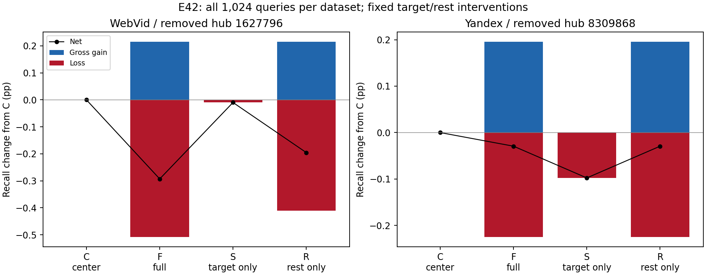
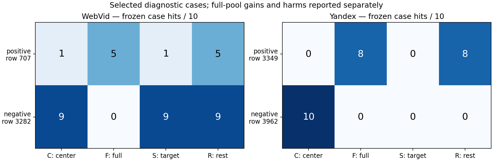

# E42 被移除入口画像的责任诊断

2026-09-12，状态`COMPLETE_REMOVED_PROFILE_ATTRIBUTION_CONTEXT_DEPENDENT_CREDIT`。用户要求先定位损伤责任、再决定RL奖励分配；指定控制已执行，奖励设计已形成。

WebVid被移除画像1627796是指定完整扰动中损伤的必要组成，但单改不足以致损；Yandex被移除画像8309868单改足以致损，但其余画像块也能独立致损，恢复该行不能修复。画像责任依赖当前其它画像背景，决定后续离线RL采用真实局部动作配对ΔJ，不能按最终入口身份静态分摊全局回报。

## 控制与输入

冻结E40同负例中唯一被移除hub：WebVid selected/action3/hub1627796（内部slot543），Yandex zero/action0/hub8309868（slot686）。保留E39每集原1024行和E40原正负例，不使用新结果换目标。C全中心、F全原扰动、S仅目标行取F、R仅目标行保持C。每行直接复制原单位float32 W，未插值/采样/训练，S/R不保证共享参数可达。

普通HNSW M16/efConstruction200/seed20260828/efSearch10，H815/821、真实ID/插入顺序、top3 ID升序和原NSG raw-IP L128 K10不变。[协议](protocol.md)、[配置](config.locked.json)、[行构造](reviews/construction.json)。

## 实测责任

| 数据集/冻结query | C | F | S | R | 命中交互 |
|---|---:|---:|---:|---:|---:|
| WebVid positive row707 | 1 | 5 | 1 | 5 | +0 |
| WebVid negative row3282 | 9 | 0 | 9 | 9 | -9 |
| Yandex positive row3349 | 0 | 8 | 0 | 8 | +0 |
| Yandex negative row3962 | 10 | 0 | 0 | 0 | +10 |

WebVid负例row3282的C/F/S/R命中为9/0/9/9，目标单独边际0、在其余改动背景下边际−9。S仍移除了1627796，却换成1427523；它的完整返回ID/距离bits/graph NDC与C相同。F换成42091并丢9命中；R恢复原三入口并救回。损伤取决于联合改道，不能把“移除旧入口”本身等同损伤，也不能把责任独占给新增画像42091。

Yandex负例row3962为10/0/0/0；S和R都到达与F相同的坏三入口。目标单独边际−10、已有其余改动时边际0，表现为重复致损，零条件边际不代表该目标一直无害。其余块内部尚未逐hub定位，不能声称找到唯一坏画像。

本次2048条命中交互I=F−S−R+C只有两条非零：WebVid row3282为−9，Yandex row3962为+10。后者是损伤重叠造成的非加和，不是正收益。E41此前全部0针对不同的“新增画像/其余”切分，不能外推到所有分块；原结果无需覆盖或回写。两集C/F/S/R的拓扑SHA均不同，评分变化和普通HNSW重建邻接变化没有独立隔离，不宣称具体访问因果或共享表示数学不可兼容。

## 全查询池收益与损伤

| 数据集 | 配置 | 新增命中G | 损伤L | 净命中 | ΔRecall pp | 受益/受损query |
|---|---|---:|---:|---:|---:|---:|
| WebVid | C 原中心 | 0 | 0 | +0 | +0.0000 | 0/0 |
| WebVid | F 完整扰动 | 22 | 52 | -30 | -0.2930 | 12/16 |
| WebVid | S 仅改被移除画像 | 0 | 1 | -1 | -0.0098 | 0/1 |
| WebVid | R 恢复该行、其余照改 | 22 | 42 | -20 | -0.1953 | 12/14 |
| Yandex | C 原中心 | 0 | 0 | +0 | +0.0000 | 0/0 |
| Yandex | F 完整扰动 | 20 | 23 | -3 | -0.0293 | 6/5 |
| Yandex | S 仅改被移除画像 | 0 | 10 | -10 | -0.0977 | 0/1 |
| Yandex | R 恢复该行、其余照改 | 20 | 23 | -3 | -0.0293 | 6/5 |

WebVid仅目标S在全1024损失1命中（row2279的5→4），没有收益；R相对F救回row2279的1个和原负例的9个，保留全部22个原增益，损伤52→42，仍净−20，不能当新默认。Yandex S净−10，R/F逐query命中完全相同，均20收益/23损失。两原正例的收益都保留在R。所有Δ以各自C为基准：WebVid为E37已选中心，Yandex为初始化；不是与当前默认的独立比较。

## RL奖励决策

后续奖励选择为当前背景下的真实局部动作ΔJ：同批GT无关训练query，比较改动前后命中，减原anchor分母下0.1×总NDC变化、0.1×零命中事件变化，再减原画像漂移正则差。完整批次的收益与损伤均收费；不能只看最后选中该hub的query。S−C与F−R分别对应两个实际背景，不混用、不永久给hub贴好坏标签。两背景平均信用已保存并核验守恒，只作记账，不作为唯一因果分配或旧共享X策略的采样奖励。新局部动作参数化与训练均未实施。

完整公式、两块交互记账与未实施训练边界见[奖励决策](reward_decision.md)。本次训练案例事后选取；只支持这两组静态干预的条件作用，不构成可学习性、泛化或Recall–QPS优势。

## 实际成本、验收与交付

实际8192正常NSG+384三路parity=8576，低于10000硬限；8448 HNSW、8普通构图、0optimizer/新GT。两个查询进程串行CPU15，配置/实际/OMP/BLAS/MKL线程均1。合计wall 19.008s，其中加载14.689s、构图0.380s；峰值RSS约5.441/9.950GiB。该wall包含加载、计数、IO及验收，不是QPS。两job均终态完成，无重试/修复查询、无排队任务。

8192返回独立集合评分、4096旧E39输出逐位恢复、4096与E41 C/F回归、128query三路parity、八W逐行来源、2048交互和hits/U/J三个信用口径复核通过。所有质量、零命中、入口变化、三项NDC及损伤明细已复核。旧E37–E41整目录与实际native/NSG依赖前后SHA保持，根文档前件独立保存；无新的原validation/held-out读取或hash，旧目录已有隔离开发产物的保护字节读取单列。

最近实际训练/完整QPS仍为E37，默认保持WebVid GT10-soft-t1 / Yandex GT10-hard。E41 WebVid单画像42091的+4无损局部正值保留；本次其它画像的损伤不能抹掉它，也不能据其启动全H自由画像训练。

[全池CSV](results/metrics.csv)、[逐query](results/queries.csv)、[案例入口](results/cases.csv)、[信用CSV](results/credit.csv)、[信用JSON](results/credit.json)、[原始汇总](results/diagnosis.json)、[运行账](logs/jobs.json)、[独立评分](reviews/independent_verification.json)、[责任核验](reviews/attribution_verification.json)、[完成审计](reviews/completion_audit.json)、[最终验收](reviews/final_audit.json)。重现入口为src/prepare.py→src/run.py（逐集）→analyze/verify/credit/plot/verify_attribution；已完成目录拒绝覆盖，不应直接重启runner。
