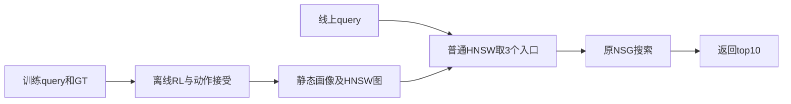

# 2026-09-12 研究收口：动作收益/损伤、离线RL与最终性能

今晚完成了收益/损伤归因、局部RL更新诊断、真实步长接受、纯离线HNSW构图RL，以及19候选固定选择后的NSG/Fast/FastGT完整对比。当前没有证据替换WebVid GT10-soft、Yandex GT10-hard默认。已证明局部机会存在，也测到了它转化为新query收益时的稀疏性和损伤；尚未得到超过匹配起点的稳定Recall–QPS增量。

## 诊断回答

**不是单一原因。早期主要有更新没有跨过离散响应边界的问题，修正后仍存在有限覆盖和少量关键损伤。**

1. E50在原RL两seed各400状态中，WebVid214步、Yandex97步有净正候选；其中原Adam均值分别184/93步命中完全不变。E51沿同一Adam方向放大，在预定正候选且均值无响应的状态救回WebVid9/12、Yandex4/4；最大半径也能新增损伤。因此局部可用动作确实存在，旧均值更新未充分实现它们。
2. E58重放E52贪心、E53联合RL、E56纯构图RL全部12条200步轨迹，908个接受动作中，monitor质量不变占WebVid73.5%–88.9%、Yandex90.0%–96.6%。WebVid三方法monitor单步内部增损并存分别7/9/0步，Yandex全部0。整体表现以稀疏响应为主，不能把全部未迁移收益归于同一步查询冲突。
3. 损伤虽少，足以抵消小收益。E53 WebVid两轨迹累计monitor命中增加80、损失84，Yandex8对8；WebVid E52/E53各轨迹前5个受损query占累计损伤70.0%–77.8%。这些是固定轨迹重复事件合计，不是独立query数，也不是最终测试表现。
4. E59固定19模型cal有限池中，任一模型能帮助的query只有WebVid11/1024、Yandex7/1024。即使知道GT并对每query免费选最佳模型，上界也仅+0.293/+0.117 pp，填补现有漏检1.19%/1.14%。与cal最佳单一模型的差额分别18/3个命中，分成未覆盖17/2、自身损伤1/1。这个位置的剩余差额主要是覆盖不足；有限池上界不能外推整个画像/图表示空间。

综上，已有动作确实对不同query产生收益和损伤，但尚未证明共享表示存在不可兼容的硬冲突。只减少损伤、只扩大步幅或只在现有19模型中做查询选择，都还没有足够的性能证据。下一步要验证新动作对独立开发query的支持和损伤约束。

## RL实际放在哪里

构图对象为WebVid815、Yandex821个入口画像节点组成的Micro-HNSW，底层仍为原NSG索引。E53离线用真实NSG效用估计RL梯度，再用实际反馈接受确定步长，输出静态画像W和普通HNSW图G(W)。E56离线用坐标C构图得到G(C)，全部训练评价和导出图始终用原画像P评分；C不进入在线评分。它实现了“训练怎样构造HNSW图”的一种形式，即学习构图坐标，尚不是直接学习每条边。

线上没有RL策略推理或每步RL选邻居。E52是Greedy候选接受对照，不能把它叫作RL。E56四个selected都出现monitor局部正值，但cal双seedWebVid−0.0195/−0.0684 pp、Yandex−0.0488/+0.0684 pp，统一19候选cal规则未改选。

## 最终同机单线程比较

WebVid选中新候选为E52 seed21拓扑单独部署，Yandex为E53 seed22联合RL。选择由原cal的U、低totalNDC、固定池顺序决定，最终结果未回流选择。E57加入E56双seed后身份不变，按事先规定整组继承E55已测矩阵；没有混用不同批次的同组方法。

L128代表点；每集历史validation2000，CPU15实际进程/OMP/BLAS/MKL均1线程，QPS来自五轮纯端到端wall。失败率为GT10零命中查询比例。

| 数据集 | 方法 | Recall@10 % | QPS五轮中位数 | 五轮QPS范围 | 零命中失败率 % |
|---|---|---:|---:|---:|---:|
| WebVid | NSG | 70.940 | 2121.37 | 2105.02–2124.23 | 5.15 |
| WebVid | Fast（GT1、30K） | 73.990 | 2299.65 | 2281.28–2306.25 | 2.70 |
| WebVid | FastGT10-hard | 74.175 | 2315.05 | 2304.59–2322.65 | 2.45 |
| WebVid | GT10-soft匹配起点 | 74.190 | 2320.38 | 2305.80–2323.76 | 2.55 |
| WebVid | cal选中新候选 | 74.145 | 2321.73 | 2302.17–2323.99 | 2.45 |
| Yandex | NSG | 88.660 | 2068.63 | 2063.97–2072.18 | 2.95 |
| Yandex | Fast（GT1、30K） | 89.830 | 2283.00 | 2278.40–2286.82 | 1.85 |
| Yandex | FastGT10-hard | 90.055 | 2281.23 | 2271.87–2284.64 | 1.60 |
| Yandex | cal选中新候选 | 89.980 | 2282.81 | 2282.03–2288.40 | 1.70 |

完整五L为64/128/256/400/800，45个最终点、225轮计时全部保留。相对匹配GT10起点，WebVid新候选五L Recall变化−0.120/−0.045/−0.065/−0.025/−0.005 pp；Yandex−0.075/−0.075/−0.050/−0.050/−0.050 pp。全部QPS差异的五轮波动包络包含0，未显示稳定增量。Fast/FastGT对原NSG的原有收益保留，不能归为本次RL贡献。Fast与FastGT除GT1/GT10外还有30K/20K和seed差异。

L128新候选相对匹配起点：WebVid27个增益命中、36个损失，4条失败被救回、2条新失败；Yandex0个增益、15个损失，2个受损query均变为零命中。平均差小不能掩盖这些稀疏损伤。历史validation曾用于研究，不是全项目新盲测；只使用已冻结2000条副本，未打开原完整validation/held-out。

[完整比较与45点](../../20260912_expanded_final_comparison_v1/report.md)、[Recall–QPS](../../20260912_expanded_final_comparison_v1/figures/recall_qps.svg)、[失败率–QPS](../../20260912_expanded_final_comparison_v1/figures/failure_qps.svg)、[全部L三指标](../../20260912_expanded_final_comparison_v1/figures/three_metrics_by_L.svg)。

## 成本和验证

以下三个后续方法各为两集×两seed×200步，成本均实际计量，不作等wall因果比较：

| 方法 | 训练NSG调用 | 实际HNSW路由 | 物理构图 | 接受步/800 | 四run总进程秒 |
|---|---:|---:|---:|---:|---:|
| E52 | 113950 | 26276864 | 7212 | 295 | 619.74 |
| E53 | 125577 | 36107264 | 9612 | 352 | 816.27 |
| E56 | 85204 | 36107264 | 19224 | 261 | 1346.10 |

纯构图训练当前每个逻辑图经过build(C)、build(P)、拓扑安装及全P字节检查，额外构图完整计入。E56虽然变化入口需要的NSG更少，整体进程仍比E53更长；减少NSG调用不等同减少wall。精确缓存只在同query和完整三个入口、同NSG/metric/L/K一致时复用原NSG，路由NDC每次重新测量。

E56的8张selected/last导出图独立解析全部层邻接和6544行评分向量，保证W恒P；6400候选、2400确定点、800梯度/接受链及512三路parity通过。E57独立133776行集合评分、所有19模型fit恢复、原17模型cal五字段回归、固定选择/五L图和实际线程计时合同通过；新增88768 NSG、0新最终计时。E58新增3146 NSG、943104 HNSW、1185build，完整重放2400步，132 checkpoint/675840行train+monitor恢复，512物理parity及逐query求和守恒通过。E59新增搜索和训练均0，233472集合评分及12288逐query分解通过。

E53历史一次运行日志封存时序问题已保留原v1并用稳定v2封存修复；E56原启动仅因预测窗口退出，native创建前0查询/0构图，有效v2只改预测窗口，算法和实际21:15训练硬停保持。E58图表仅修正布局，原图保留。各阶段修正和边界均留在原报告，未抹去失败入口或负结果。

## 接续与产物

下一轮优先验证辅助反馈上的动作支持/损伤约束，与相同候选和梯度的E53接受规则对照。辅助反馈进入接受决策即属于训练信息，另外保留迁移验证；当前monitor全1024属于初始P拟合20K，不能充当未见数据。数据角色、40状态支持控制、两臂预算推导、停止条件和可复制只读启动命令见[下一轮设计](next_experiment_design.md)。该设计尚未训练或排队。

[E50更新转化](../../20260912_candidate_commit_diagnosis_v1/report.md)、[E51方向半径](../../20260912_update_direction_radius_v1/report.md)、[E54评分/拓扑拆分](../../20260912_learned_model_factorial_v1/report.md)、[E56纯构图RL](../../20260912_construction_only_rl_v1/report.md)、[E58逐动作损益](../../20260912_accepted_action_conflicts_v1/report.md)、[E59固定池覆盖](../../20260912_frozen_pool_transfer_v1/report.md)、[训练成本CSV](training_costs.csv)、[数据角色检查](next_input_inventory.json)。原代码、索引、GT、标签、模型、日志和全部历史实验保留；未提交、推送或更换默认部署。
