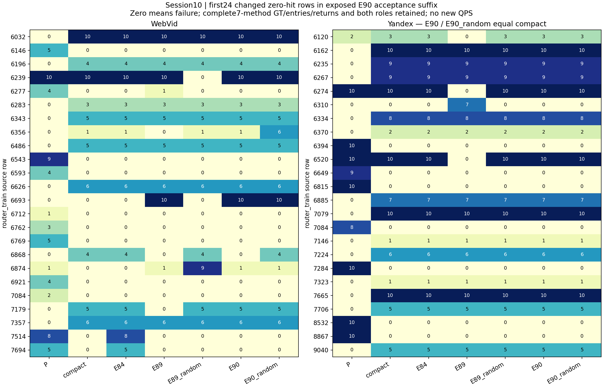

# 第10串行研究会话：E89–E91

E89/E90完成固定版本实验，均未过完整接受门；保留Web局部修复，尚未证实优于匹配起点P的完整Recall–QPS前沿。E91完成最终评估工具准备与既有数据回归。整日21:00目标未完成，E34最终对照仍待实际选型冻结和执行。

| 阶段 | Web结果 | Yandex结果 |
|---|---|---|
| E89 局部父画像恢复 | fit+224；aux7952对compact+18命中/失败−6，对P−41/+5 | fit+114；aux对compact−39/+5 |
| E90 双来源支持 | 5动作；fit20K+61、支持3976+49；接受3976对compact+21/−1、对P−22/+2，对随机+4/+1 | 0动作，主/随机均逐字compact；相对P+81/失败−8全部继承compact |

E89实际局部动作多数同时救回和损伤查询；原32动作的事件命中正负部Web1334/1274、Y610/625。筛选后单项和297/125，真实并图224/114，不能简单相加。E90另源支持确实筛掉不稳定动作，Web部分收益迁移，但仍未胜P且随机控制/分半不稳；不据接受反馈继续挑子集/调阈值。

合并七配置辅助失败并集428条、194条zero状态变化，2996个完整方法单元。对同namespace/源行/GT的两批确定性返回独立集合评分111328行后对齐；这是质量/失败汇总，不拼接QPS。E90前3976是训练，后3976也历史暴露；图取后半每集前24变化案例。

[全部失败GT/入口/返回](failure_queries.csv) · [各角色完整质量原点](quality_points.csv) · [汇总核验](derivation.json)

[E89原报告](../stage30_local_parent_restore_v1/report.md) · [E89训练损益补图](../stage30_local_parent_restore_v1/supplement_training_v1/report.md) · [E90原报告](../stage31_cross_source_restore_v1/report.md)。E90接受图的Y列为零更新compact别名，+81不是E90新收益。

最近完整性能批仍为E74：原NSG/Fast/GT10-hard/Web匹配soft/完整mode/compact，历史开发2048，五L五轮单线程同机。Y compact相对P同L命中+99/+59/+38/+1/+15，失败−10/−7/−4/−1/0；五轮QPS交叉范围全跨零。共同Recall区间的log-QPS插值+1.873/+2.455/+2.965%只是描述性插值，不能称测得同Recall提速。Web没有稳定优势。本会话未增QPS点，以下曲线保持E74原批身份。

[完整QPS报告](../stage15_compact_wall_v1/report.md) · [QPS–Recall](../stage15_compact_wall_v1/figures/recall_qps.png) · [QPS–失败率](../stage15_compact_wall_v1/figures/failure_qps.png) · [按L三指标](../stage15_compact_wall_v1/figures/three_metrics_by_L.png)

本会话新增346556 NSG（训练22716、辅助323840），3578928 HNSW。10物理导出=8非零向量安装+2零更新，4离线筛选拟合，0普通构图/新GT/梯度/QPS。训练操作104.978s、辅助260.991s，E89编译13.194s。操作含load/count/cache/I/O不是QPS；E89准备总wall含编译，不能重复相加；历史GT/P总成本未知。

E91 v3核验旧55点112640行、275既有wall；2000内存夹具110000行不生成2000QPS。32负例及额外选择资格/先拒绝后hash/固定与variable multiplicity闸通过。补齐E74所有零query全表414条独立query、825 query×L事件、4627方法单元，不与本会话辅助并集相加。最终控制器/分析器尚未在真正最终数据执行；工具准备不是最终实测。

[最终工具与具体步骤](../stage32_final_tooling_v1/readme.md) · [E74完整零失败全表](../stage32_final_tooling_v1/results/v3/failures.csv) · [候选目录v11](../candidate_inventory_v11.json)（68旧对象不变+8新增，76项；非真实最终选择）

原base/rawIP/NSG/GT固定；当前微图仍815/821真实入口，1771/2067画像slot，恢复保持所有非向量图字节。全部新ANN串行CPU15，实际及库1线程。P-fit含旧train/monitor，aux/cal/audit历史暴露，E90支持明确训练，接受反馈亦计训练信息；E34最终query/GT/row和held-out未打开。

后继优先冻结真实best_all/best_new与规则/得分/tie/完整身份，再运行同批最终2000矩阵；20:00停新训练、20:40停新增query、21:00交付。没有后台实验需要续跑。

证据索引补充：E91使用说明在综合报告生成后追加“旧二进制需兼容审查，不可静默丢候选”的说明。原说明全文已按旧SHA恢复留档，[输入引用修订](input_reference_revision.json)仅更新该文档引用，所有数值/原始返回不变，使用[input_freeze_v2](input_freeze_v2.json)。
