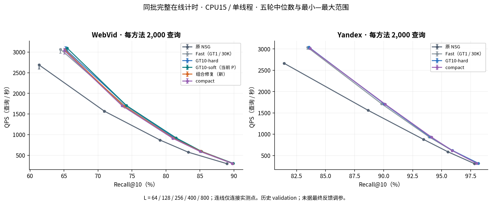
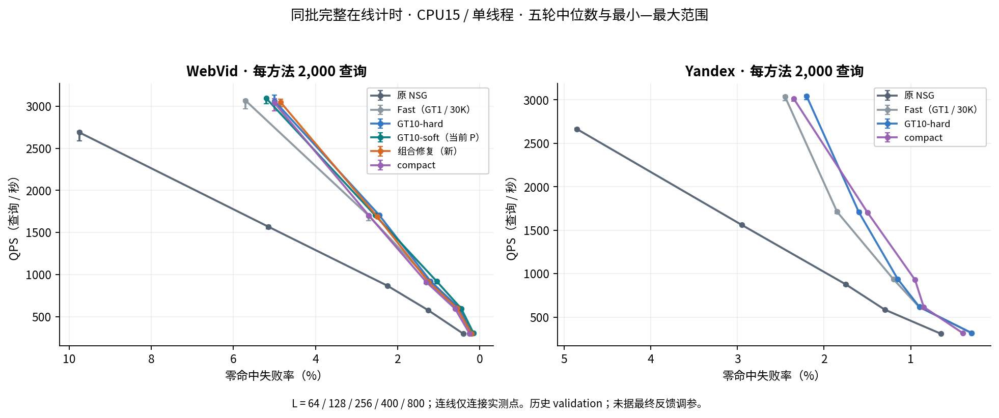
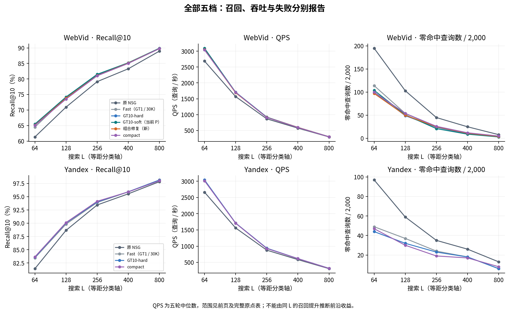
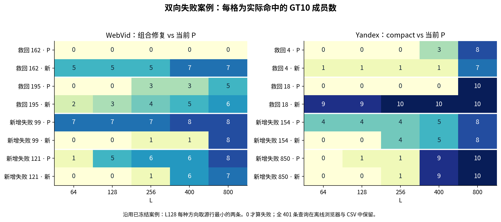

# ACSG · 9月13日整日研究汇报

**尚未找到稳定优于当前 GT10 起点的新方法，默认保持。** Web 的组合修复改善了 compact 的部分损失，但相对当前 GT10-soft P 五档召回仍落后。Yandex compact 低 L 小幅正向，高 L 出现损伤。局部修复有价值，尚不足以支持更换默认方法。

机制上，固定小幅动作的辅助支持多为空；较大的局部父画像恢复则确有同一步帮助一些查询、伤害另一些查询，以及并图相互影响。两者对应不同动作和数据角色，不能合并为“整个局部空间没有余量”或“共享表示必然冲突”。[证据与后续线索](mechanism_note.md)。

Web 组合在 compact 的 1,771 个画像槽 / 815 个真实入口上，保留已冻的 254 条查询监督补边，叠加 5 组、10 行父画像恢复。Yandex 最终候选为 2,067 槽 / 821 个真实入口的 compact。在线均为一次 Micro-HNSW 取七画像槽、去重到三个真实入口，再执行原 NSG。底层大图、base、GT 与 raw-IP 固定；新画像与图的学习只发生在线下。

开发池共 77 项目录记录，41 项具备同源质量评分（39 个非零新配置 + 两集 P），其余为控制、别名或未原生部署候选。Web 无过门新方法，选组合做反证展示，best_all 保留 P；Yandex 两个选型角色均为 compact。选择和规则先冻结，之后才打开 E34 历史 validation2000。best_all 是开发选型角色，不是部署推荐。

每集 2,000 查询；Web 六方法、Yandex 四方法；五个 L、五轮，共 50 原点 / 250 整批 wall。CPU15、配置与实际进程及数值库均为单线程，方法串行轮换。计时含完整路由、原 NSG、输出，GT、计数、hash、JSON、构建与加载在外。

| 对照（L64/128/256/400/800） | Recall 变化 pp | 失败净新增 |
|---|---|---|
| Web 组合 / compact | +0.095 / +0.270 / +0.080 / +0.085 / +0.030 | -3 / -4 / -1 / -1 / -1 |
| Web 组合 / 当前 P | -0.340 / -0.385 / -0.410 / -0.125 / -0.105 | -7 / -1 / +4 / +2 / +1 |
| Yandex compact / 当前 P | +0.090 / +0.070 / +0.120 / -0.030 / -0.125 | +3 / -2 / -4 / -1 / +2 |

全部五 L 的配对结果均保留。组合 / compact 与 Yandex compact / P 的五轮 QPS 交叉范围都跨零。组合 / P 的 L128 范围略负，其余跨零，不能宣称稳定整体加速。原报告同 Recall 插值仅为描述性结果，本页曲线没有增加插值测量点。

失败严格为返回 top10 与 GT10 交集为空；命中 1 个不失败。全方法并集有 401 条独立失败查询（Web 271 / Yandex 130），其中 346 条存在方法间状态变化。完整五 L × 各方法共 10,730 单元。原 812 个 query×L 零命中事件表只有 4,230 单元，两个范围不混用。

L128：Web 组合对 compact 新找回 66 / 丢失 12 个 GT 成员，救回 4 / 新增失败 0；对 P 新找回 274 / 丢失 351，救回 14 / 新增失败 13。Yandex compact 对 P 新找回 144 / 丢失 130，救回 8 / 新增失败 6。减少零命中不保证总 Recall 提高；GT 成员增损与逐 query 净命中增损分别统计。

P-fit20K 包含旧 train/monitor；aux、cal、audit 已历史使用，动作选择反馈均计训练。最终集本身也有历史暴露，本次最终反馈未回流训练或选择，held-out 未打开。五轮计时不增加独立 query 样本数；跨 L 也不能当成独立样本。

E94 新增 700,800 次 NSG、560,000 次 HNSW；原生任务总操作 994.213 秒，250 次纯 wall 合计 695.047 秒。8 个源小图文件，40 次 plain + 40 次 count 加载，0 新拟合 / 普通构图 / GT。当天普通实验累计 6,854,176 NSG、17,820,080 HNSW、360 次普通小图构建。旧开发的 220 点 / 1,100 wall 分属四个批次，与本次最终曲线分开。

route-only / graph-only 未单测，完整离线训练及 GT 总成本仍有未知项，不能记零；操作耗时也不能换算 QPS。第13会话只做呈现与交付整理，新增训练、ANN、构图、GT、QPS 均为 0。

[离线可交互汇报](report.html) · [打印版 PDF](report.pdf) · [50 原点](../stage35_final_comparison_v1/analysis_v1/points.csv) · [250 轮 wall](../stage35_final_comparison_v1/analysis_v1/timings.csv) · [全部配对损益](../stage35_final_comparison_v1/analysis_v1/paired.csv) · [401 失败查询完整五L表](../stage35_final_comparison_v1/supplement_v1/failed_queries_all_L.csv) · [原始完整报告及验收](../stage35_final_comparison_v1/report.md)。

第13会话交付材料已整理；整日21:00目标的状态由监督会话接续处理，本会话不将其标完成。最终反馈不再用于调参；没有待恢复实验。

网页由监督侧实际浏览器独立核验桌面、手机、全部查询和两种下载通过；本执行沙箱的两次启动受限记录另存，未伪记成功。六页 PDF 使用本地绘图工具导出，文字页预览和全部图表已目检。
