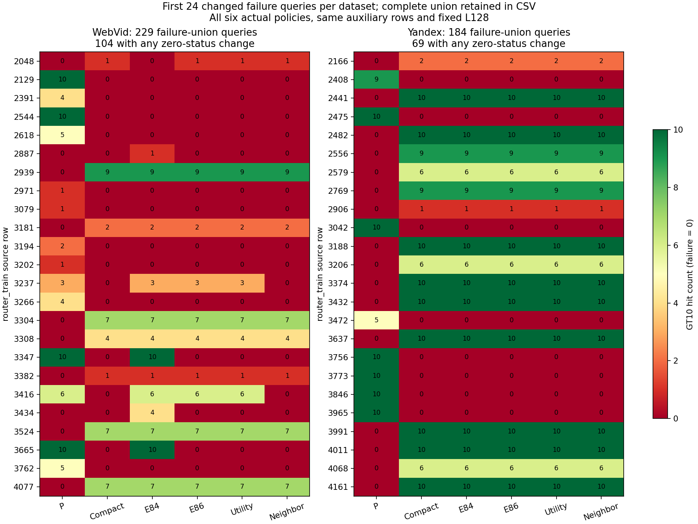
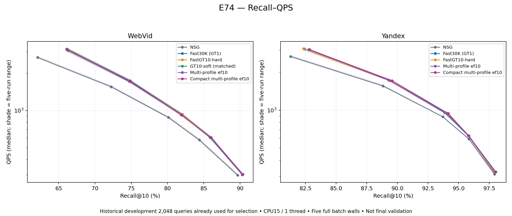
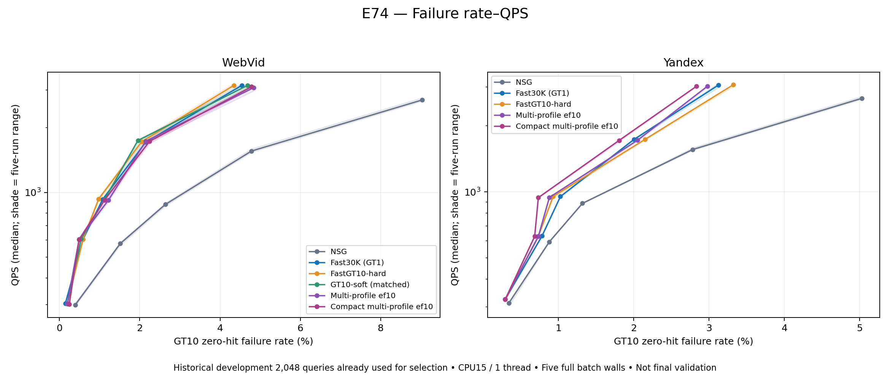
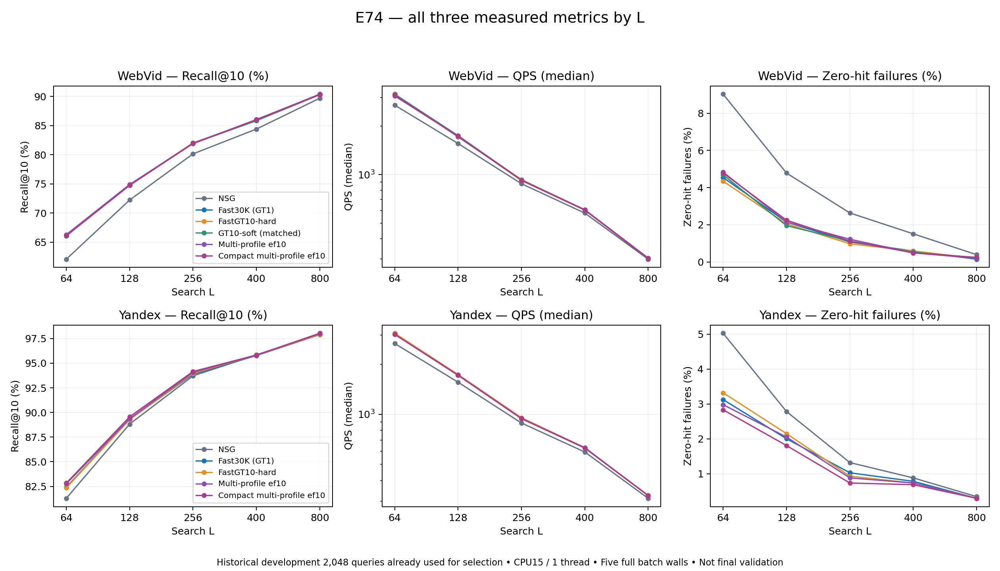

# 第9会话：E86–E88实测与失败查询

两组静态小图学习E86/E87完成，完整接受门均失败，原默认方法未替换。E88完成缓存机制诊断。本会话可安全交接，整日21:00目标尚未完成。

| 方法/数据 | 实际接受边 | fit20K对compact净命中/失败变化 | aux7952对compact | aux7952对匹配P |
|---|---:|---|---|---|
| E86 Web | 29 | +191/−13 | +18/−3 | −41/+8 |
| E86 Y | 3 | +13/−1 | −4/0 | +116/−13 |
| E87 Web | 16 | +94/−4 | +16/−3 | −43/+8 |
| E87 Y | 0 | 0/0 | 0/0 | +120/−13，继承compact |

表内是GT10净命中数和零命中查询数变化，不是Recall百分点。E86筛原几何候选的实际单边收益，E87以P优于compact的完整三入口响应提出新目标，再实际测边。合并后重新实测；Web独立边收益和235/118降为实际并图191/94，保留相互作用证据。在线固定画像、静态小图和原NSG，未加入在线学习或预测器。当前小图对应815/821个真实hub，compact有1771/2067画像slot，与10M底图区分。

E88在被测边支持query中发现Web167/Y19个提议，目标固定集前三资格19/0、实际选中19/0、NSG改善17/0；Y10个目标原本就在七slot中仍未进前三。目标在现有画像打分下尚不足以进入前三入口，继续扩大这组加边规则缺少证据。固定返回集排名不是图路径反事实。全事件中的2个未测近界事件已作范围修正，原表未改。[诊断修正版](../stage29_proposal_rank_diagnosis_v1/report_v2.md)

新增365054 NSG=8830训练+356224辅助；7756544 HNSW=7401024训练+355520辅助。10个非零静态边安装（含4首边回归）及2个Y零更新副本，4离线筛边拟合，0普通构图/梯度/新GT。新增QPS点0。E86编译13.345s；两版训练/辅助操作合计412.247s，包含load/count/cache/I/O，不能换算查询QPS；继承GT/P总成本未知。

所有ANN串行、CPU15、实际及各数值库线程1；12个原生训练/查询任务均退出0。原kernel、plain/count、完整入口缓存键、模型图字节、逐query集合/mask、七slot/真实入口映射与旧对照回归通过。综合失败表重新对本轮E87同批六配置95424行集合/mask评分，413条失败并集、173条zero状态变化、2478个GT/入口/返回单元与原表逐项一致。图显示每集前24条状态变化，CSV保留全部失败，包括所有配置都失败的240条。

本页失败六列P/Compact/E84/E86/E87/控制全部来自E87同一aux7952批次，L128，无QPS；E86单独辅助结果另附原报告。训练20K含历史train/monitor；辅助7952、两半及cal/audit都曾使用，接受/诊断反馈算训练。E34最终query/GT/row载荷及held-out本会话未读；仅准备最终配置/模型身份和输入stat。

[完整失败查询](failure_queries.csv) · [同批质量点](points.csv) · [独立复算](verification.json) · [E86完整报告](../stage27_edge_utility_v1/report.md) · [E87完整报告](../stage28_utility_proposals_v1/report.md)

以下三图来自最近完整E74独立开发批次，包含该批完整方法/L/五轮，保留原测量身份。它们不是E86/E87性能，不拼接本轮质量点，也不是尚未执行的E34最终对照。

下一会话优先在开发信息上冻结实际best_all/best_new身份与别名，再准备2000行E34完整最终矩阵，不能以最终反馈调参。已核对45/55点示例分别需630720/770880 NSG、225/275整批wall；具体候选未选择，草稿不能执行。20:00停新训练、20:40停新查询、21:00交付。

[晚间准备件](../session9_final_preparation/readme.md) · [候选目录v10](../candidate_inventory_v10.json) · [交接/下一命令](../handoff_session9.md)
