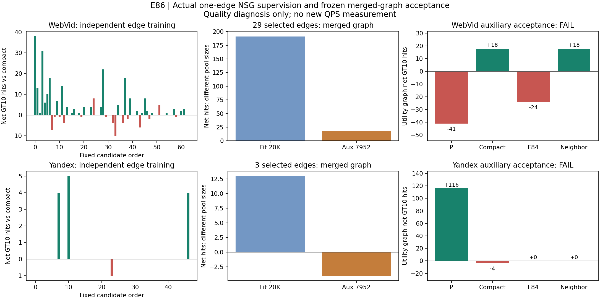
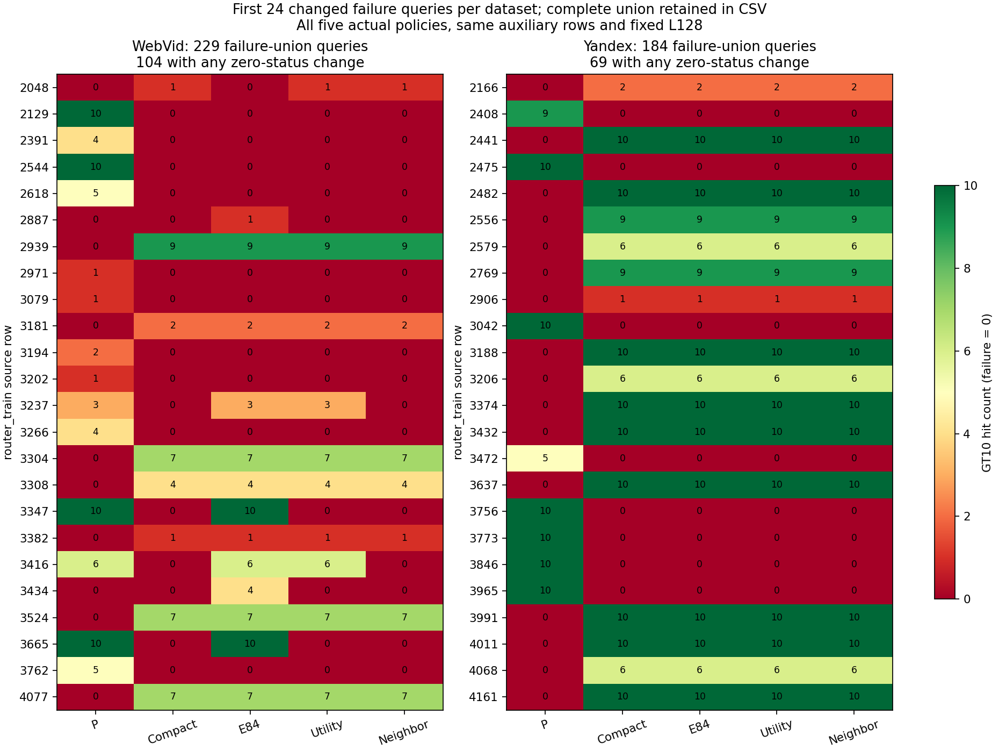

# E86：真实单边效用筛选静态小图

本阶段完成；整日21:00目标尚未完成。模型与选择规则已在aux接受前冻结。双集预锁门FAIL，本固定候选/筛边版本停止，不扩边数/阈值或按aux重训。

训练用P-fit20K，逐条实际追加已锁定候选边并运行原NSG；合格边合并后重新实测。训练与辅助池均有历史使用，aux接受反馈计训练信息。本轮未打开E34最终原始query/GT或held-out。

| 数据 | 接受边 | 合并图fit净命中/失败变化 | aux对P | aux对compact | aux对E84 | aux对同节点度控制 |
|---|---:|---|---|---|---|---|
| WebVid | 29 | +191 / -13 | -41 / +8 | +18 / -3 | -24 / +1 | +18 / -3 |
| Yandex | 3 | +13 / -1 | +116 / -13 | -4 / +0 | +0 / +0 | +0 / +0 |

表内为净GT10命中数/零命中查询变化；不是Recall百分点。失败严格为返回与GT10集合交集为0。训练池20K和aux7952数量不同，不直接比较原始净命中规模。

## 机制与迁移

E33在原单画像图中学习删原边；E84用几何漏选票数追加边；本版固定E84前64/47候选，对每条实际新增边测全fit真实NSG边际效用，按全量正/两半非负/失败不增/总NDC上限筛选。在线仍是固定compact画像、一次小图路由、三个真实入口与原NSG，没有在线预测器。全部旧图边/上层/W/映射保持。单边收益不是并图收益，合并响应另测；未接受的正负/无效边也全部保存。

WebVid：fit并图两半[97, 94]，aux对compact两半[6, 12]，救回/新增失败4/1。相对P的原compact正收益820保留803、丢失17、新增11；原损失避免32，新增或放大损失8。这些是逐query净命中记账，GT成员增损在paired.csv单列，不给单hub或单边因果信用。

Yandex：fit并图两半[9, 4]，aux对compact两半[-4, 0]，救回/新增失败0/0。相对P的原compact正收益545保留541、丢失4、新增0；原损失避免0，新增或放大损失0。这些是逐query净命中记账，GT成员增损在paired.csv单列，不给单hub或单边因果信用。

同节点度控制使用相同source的既定最近其他hub边，边长未匹配；不能把控制差异全部归因于监督信息。原E84完整几何图与本版稀疏筛选图边数不同，报告其真实差异，不能当只变标签的等容量消融。

## 成本与验收

新增170,336 NSG（训练8,416、辅助161,920）；4,842,112 HNSW（训练4,680,512、辅助161,600），6静态安装含2首边回归图，2离线筛边拟合，0普通构图/梯度/新GT。编译13.345s、训练操作77.107s、辅助native操作131.177s。操作时间含load/count/cache/保存/I/O，有不同计量范围，不能转成QPS。继承GT/P总成本未知，E84候选生成成本另属旧阶段。

全部ANN串行CPU15，进程及OMP/BLAS/MKL线程1；六原生训练/查询执行任务已完成。新NSG plain/count与每集32条三路原kernel回归通过；111边完整route hashes/patch与缓存完整键恢复、合并图全旧边/非邻接bytes、独立集合/mask、全部七slot/三入口、P/compact/E84旧结果回归通过。首个单边物理图128路由与内存图比对，余单边通过同一严格安装/恢复代码和完整plain/count；不虚称每条物理文件均另存。

完整失败并集413条，其中173条至少一方法zero状态不同；CSV包含所有query的GT10、五方法入口/完整返回，无截断。当前没有新QPS点，最近完整曲线仍为独立E74批次，不能和本阶段质量点拼接。

[完整配对](results/paired.csv) · [失败全表](results/failure_queries.csv) · [门](results/gate.json) · [成本](results/cost.json) · [协议](protocol.md) · [训练核验](reviews/training_verification.json) · [查询核验](reviews/verification.json) · [最近完整QPS–Recall/失败曲线](../stage15_compact_wall_v1/report.md)
