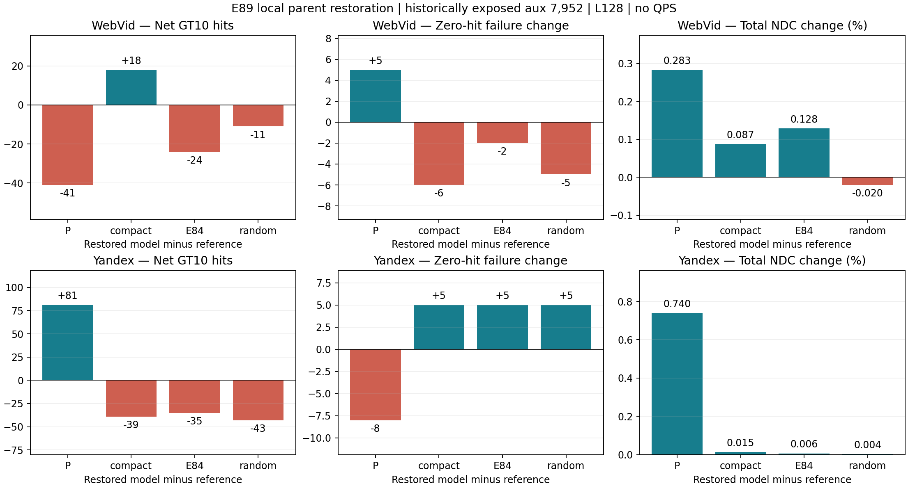
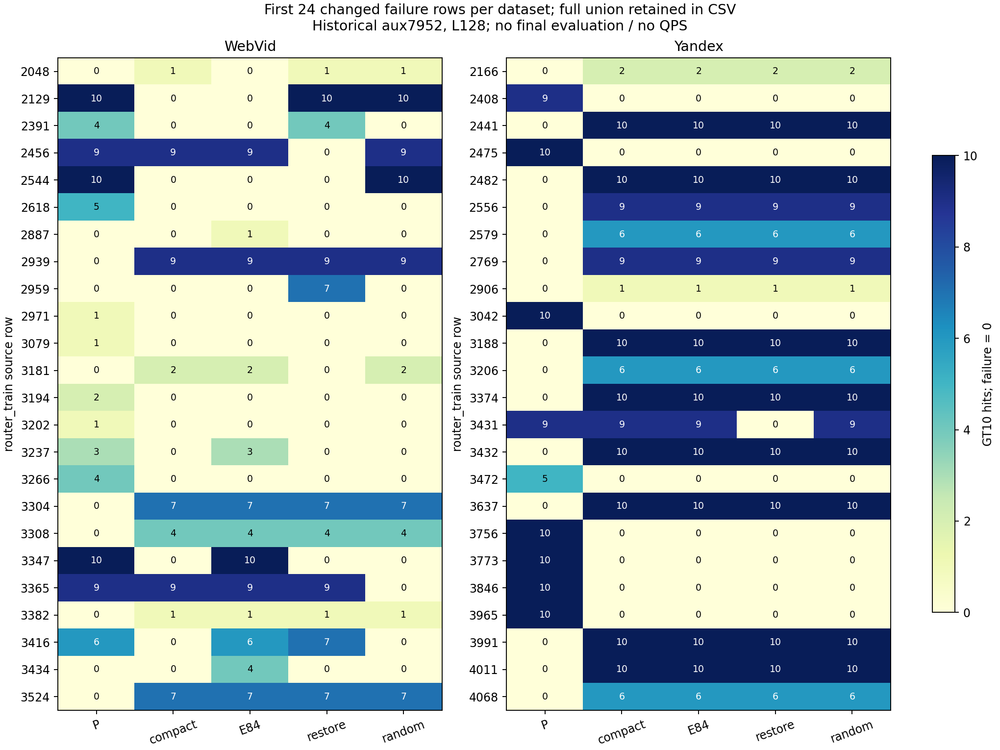

# E89 局部父画像恢复：完整实测结果

固定少数hub，将其两个子画像逐字恢复为父P，原compact全部slot、真实hub映射、图邻接/层级/入口保持。候选由P优于compact的完整训练响应提议，但只按单组真实NSG效用接受；这不把完整策略差当单hub信用。线上仍一张静态小图、七slot去重三入口、原NSG。

| 数据 | 接受hub/候选 | 单项净命中和/实际并图 | fit两半 | fit失败变化 |
|---|---:|---|---|---:|
| Web | 13/32 | +297/+224，186非加性query | [95, 129] | -27 |
| Y | 8/32 | +125/+114，6非加性query | [36, 78] | -10 |

| aux7952数据 | 参照 | 净命中 | Recall变化pp | 救回/新增零失败 | 两半净命中 | 总NDC变化% |
|---|---|---:|---:|---|---|---:|
| Web | baseline10 | -41 | -0.05156 | 44/49 | [-12, -29] | +0.2833 |
| Web | compact10 | +18 | +0.02264 | 17/11 | [4, 14] | +0.0875 |
| Web | geometric10 | -24 | -0.03018 | 21/19 | [-18, -6] | +0.1285 |
| Web | random10 | -11 | -0.01383 | 19/14 | [-17, 6] | -0.0204 |
| Y | baseline10 | +81 | +0.10186 | 40/32 | [29, 52] | +0.7395 |
| Y | compact10 | -39 | -0.04904 | 1/6 | [-10, -29] | +0.0149 |
| Y | geometric10 | -35 | -0.04401 | 1/6 | [-6, -29] | +0.0064 |
| Y | random10 | -43 | -0.05407 | 1/6 | [-15, -28] | +0.0035 |

预锁完整质量门：Web FAIL；Y FAIL。所有规则见gate.json；局部训练收益与辅助迁移分开，未替换默认。双集均未过门，停止此固定候选/恢复/筛选版本，不扫阈值或幅度。

完整失败并集427条，193条发生五配置间zero状态变化；全部GT10、三入口与返回ID在[failure_queries.csv](results/failure_queries.csv)，图只取每集前24个变化案例。失败严格GT10零命中。

新增182698 NSG（训练20778、辅助161920）；2962624 HNSW。6物理导出/6非零向量安装/0零更新副本，2离线效用筛选拟合，0普通构图/梯度/新GT/QPS。编译13.194s；训练操作62.750s，辅助操作130.076s含load/count/cache/I/O，不是QPS。继承GT/P总成本未知；准备总wall包含编译，不与编译重复相加。

单组收益和不是合并收益，实际交互逐query保存。随机控制匹配恢复hub/子行数与非向量图字节，但不匹配支持/位移/损伤，因此主控差不是标签纯因果效应。恢复为父P仍保留重复物理slot，近似路径变化包含在此整组干预效果中。

所有ANN串行CPU15，实际进程及各库1线程；原compact训练缓存、三个辅助旧对照、plain/count/原kernel、第一动作物理图和撤销恢复、全部集合/mask与非向量图bytes独立核验。P-fit20K含旧train/monitor，aux7952和两半/cal/audit历史暴露，接受反馈计训练。E34最终query/GT/row及held-out未打开；本阶段没有QPS，不能与E74拼接曲线。

[协议](protocol.md) · [门](results/gate.json) · [原值](results/points.csv) · [全部配对](results/paired.csv) · [损益迁移](results/gain_retention.json) · [训练核验](reviews/training_verification.json) · [查询核验](reviews/verification.json) · [成本](results/cost.json)

记录范围补充：协议要求在查询前给出未入选原因，实际只冻结了全事件、资格、排序规则和候选；显式[逐hub原因表](results/proposal_reasons_postfreeze.csv)在查询后从这些冻结输入重建，[更正](reviews/proposal_record_scope_correction.json)保留此时间边界。候选/模型/规则不变，没有额外ANN。
