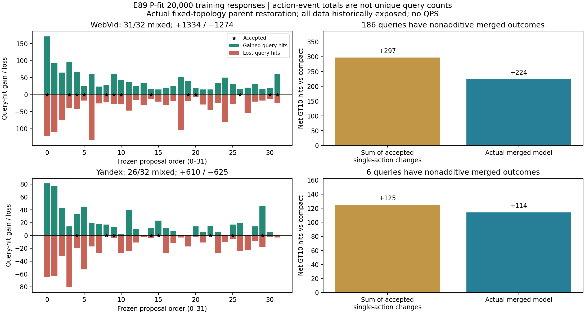

# E89 训练损益图补充

本补充仅从已封存响应导出训练图，0新增ANN/拟合。原报告和最终seal不改。Web31/32、Y26/32动作同时产生收益和损伤；1334/1274与610/625为query-action命中事件正负部，不是独立query数。筛选后单项净和297/125，实际合并224/114，训练收益不能代替迁移或QPS。

[原报告](../report.md) · [可核验派生](derivation.json)
