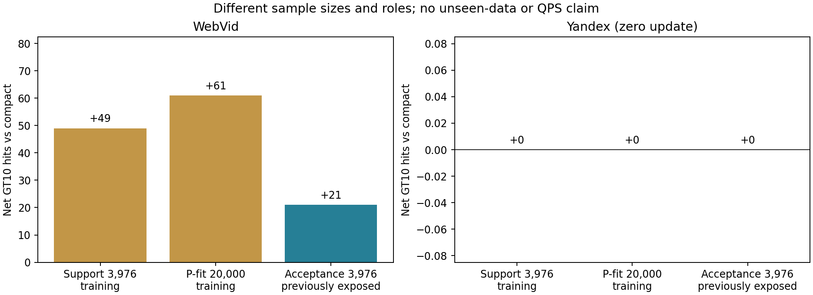
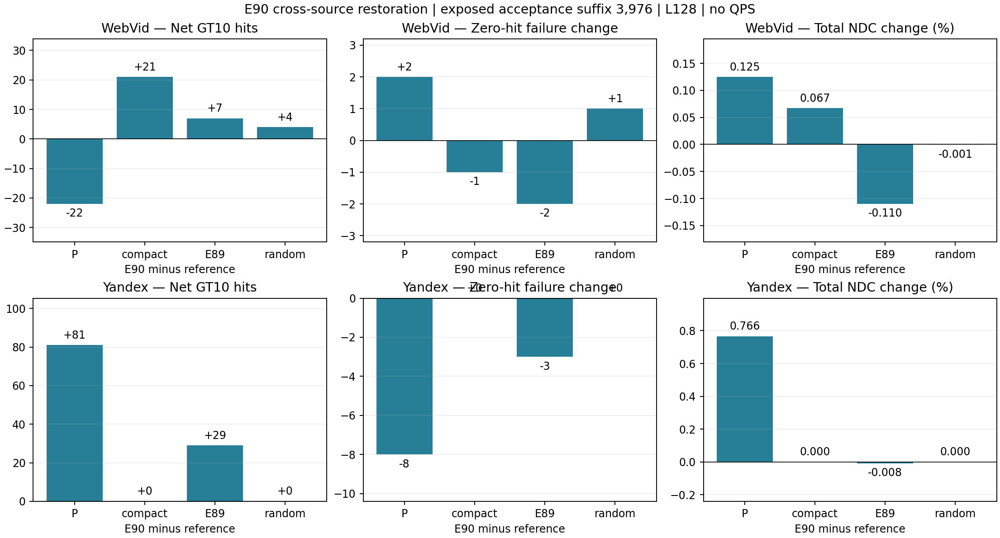
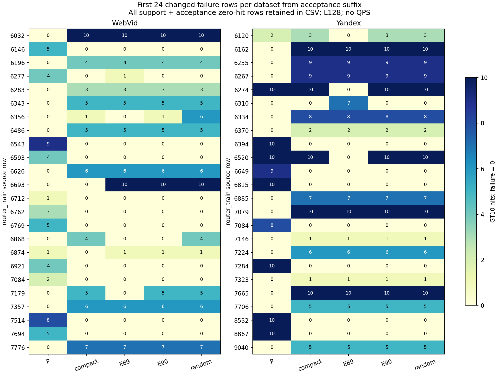

# E90 双来源支持的局部父画像恢复

固定复用E89通过P-fit20K筛选的13/8个动作，用aux前3976行作为明确的训练支持，再筛选一次。每个动作仍在原compact背景测量；两个训练来源均测量实际合并，不把单项效用和当合并收益。所有模型与门槛在本次合并辅助响应前冻结，后3976行仅接受完整模型。

P-fit为router_train[10000:30000]，含旧train/monitor；支持为[2048:6024]，接受为[6024:10000]。今天及历史已经观察全部aux，接受区不是未观察验证集，接受反馈计训练信息。原E34最终query/GT/row及held-out未打开。

| 数据 | 角色 | 动作数 | 净命中 vs compact | 两半 | 救回/新增零失败 |
|---|---|---:|---:|---|---|
| Web | support | 5 | +49 | [42, 7] | 5/0 |
| Web | fit | 5 | +61 | [19, 42] | 13/5 |
| Y | support | 0 | +0 | [0, 0] | 0/0 |
| Y | fit | 0 | +0 | [0, 0] | 0/0 |

| 接受区3976 | 参照 | 净命中 | Recall变化pp | 救回/新增零失败 | 两个1988行子半 | 总NDC变化% |
|---|---|---:|---:|---|---|---:|
| Web | baseline10 | -22 | -0.05533 | 24/26 | [-13, -9] | +0.1248 |
| Web | compact10 | +21 | +0.05282 | 4/3 | [11, 10] | +0.0669 |
| Web | previous10 | +7 | +0.01761 | 4/2 | [8, -1] | -0.1100 |
| Web | random10 | +4 | +0.01006 | 1/2 | [-8, 12] | -0.0008 |
| Y | baseline10 | +81 | +0.20372 | 19/11 | [49, 32] | +0.7660 |
| Y | compact10 | +0 | +0.00000 | 0/0 | [0, 0] | +0.0000 |
| Y | previous10 | +29 | +0.07294 | 4/1 | [14, 15] | -0.0083 |
| Y | random10 | +0 | +0.00000 | 0/0 | [0, 0] | +0.0000 |

完整预锁门：Web FAIL；Y FAIL。停止此固定双来源筛选版本，不据接受反馈扫阈值/子集/幅度；没有新增QPS。

Y无动作通过支持筛选，主方法及随机控制均逐字等于compact，相关相对P信号全部继承compact，不是新模型改善。随机控制从原13/8候选的固定置换取相同动作数，允许与主方法重叠；主控差不构成纯标签因果效应。

新增163858 NSG（训练1938、辅助161920），616304 HNSW；4物理副本，其中2非零向量安装、2零更新；2离线筛选拟合，0构图/编译/梯度/新GT/QPS。准备0.188s、训练42.228s、辅助130.915s均为操作wall，不是查询QPS；继承P/GT总成本未知。

完整两角色失败并集421行，其中185行五配置zero状态不同；[完整CSV](results/failure_queries.csv)保留角色、源行、GT10、各方法入口和全部返回。失败严格零GT10命中。图展示接受区每集源行排序前24个变化案例。

全部ANN串行CPU15，实际线程及各库1；训练完整query-key缓存、plain/count/reference、真实模型向量与非向量图字节、7slot去重入口、全部返回集合/mask、辅助旧对照和训练支持前缀一致性均核验。不同批次不拼接曲线。

[协议](protocol.md) · [训练核验](reviews/training_verification.json) · [辅助核验](reviews/verification.json) · [完整门](results/gate.json) · [逐对配对](results/paired.csv) · [成本](results/cost.json)

