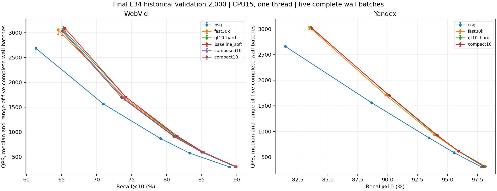
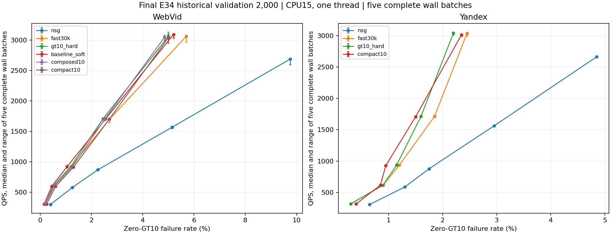
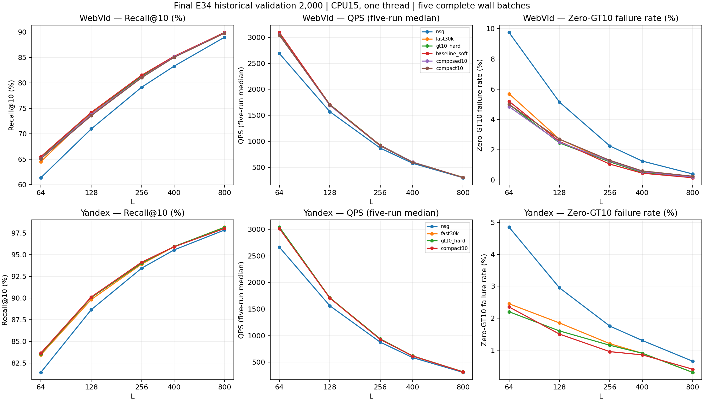
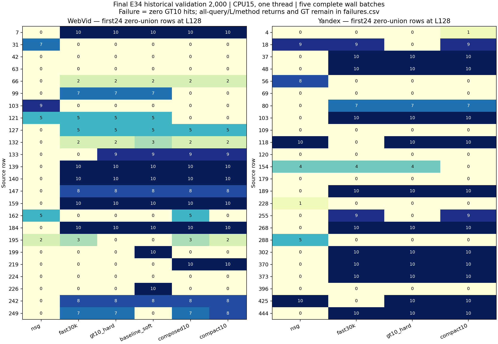

# 冻结最终矩阵：数值与失败查询

这是预冻模型在E34历史validation2000的最终对照；结果不可回流训练或选型，不称全项目从未观察。完整原NSG/Fast/GT10匹配起点/真实新方法同批五L五轮，计时覆盖路由、原NSG和输出，GT/count/hash/JSON/build/load在外。

| 数据 | 方法 | L | Recall% | QPS中位[范围] | 零命中率% |
|---|---|---:|---:|---|---:|
| webvid2_5m_light_v1 | nsg | 64 | 61.3350 | 2687.94 [2589.43, 2702.06] | 9.7500 |
| webvid2_5m_light_v1 | fast30k | 64 | 64.4950 | 3064.53 [2968.34, 3075.37] | 5.7000 |
| webvid2_5m_light_v1 | gt10_hard | 64 | 65.2450 | 3061.33 [3030.07, 3130.93] | 5.0000 |
| webvid2_5m_light_v1 | baseline_soft | 64 | 65.4850 | 3092.84 [3030.99, 3097.28] | 5.2000 |
| webvid2_5m_light_v1 | composed10 | 64 | 65.1450 | 3046.49 [2995.07, 3084.04] | 4.8500 |
| webvid2_5m_light_v1 | compact10 | 64 | 65.0500 | 3038.31 [2946.77, 3090.47] | 5.0000 |
| webvid2_5m_light_v1 | nsg | 128 | 70.9400 | 1569.47 [1541.81, 1586.02] | 5.1500 |
| webvid2_5m_light_v1 | fast30k | 128 | 73.9900 | 1697.80 [1639.89, 1700.54] | 2.7000 |
| webvid2_5m_light_v1 | gt10_hard | 128 | 74.1750 | 1707.97 [1690.86, 1715.52] | 2.4500 |
| webvid2_5m_light_v1 | baseline_soft | 128 | 74.1900 | 1705.11 [1697.50, 1721.32] | 2.5500 |
| webvid2_5m_light_v1 | composed10 | 128 | 73.8050 | 1690.34 [1674.22, 1697.28] | 2.5000 |
| webvid2_5m_light_v1 | compact10 | 128 | 73.5350 | 1702.35 [1682.33, 1711.85] | 2.7000 |
| webvid2_5m_light_v1 | nsg | 256 | 79.1400 | 868.75 [861.70, 879.62] | 2.2500 |
| webvid2_5m_light_v1 | fast30k | 256 | 81.2650 | 917.17 [912.07, 921.72] | 1.2000 |
| webvid2_5m_light_v1 | gt10_hard | 256 | 81.2700 | 923.75 [915.09, 926.47] | 1.2000 |
| webvid2_5m_light_v1 | baseline_soft | 256 | 81.5000 | 921.56 [893.64, 927.30] | 1.0500 |
| webvid2_5m_light_v1 | composed10 | 256 | 81.0900 | 915.71 [913.51, 919.94] | 1.2500 |
| webvid2_5m_light_v1 | compact10 | 256 | 81.0100 | 911.66 [890.24, 923.12] | 1.3000 |
| webvid2_5m_light_v1 | nsg | 400 | 83.2800 | 576.02 [572.98, 581.15] | 1.2500 |
| webvid2_5m_light_v1 | fast30k | 400 | 85.0800 | 598.65 [594.93, 604.67] | 0.5000 |
| webvid2_5m_light_v1 | gt10_hard | 400 | 85.1100 | 599.97 [592.63, 604.98] | 0.5000 |
| webvid2_5m_light_v1 | baseline_soft | 400 | 85.2250 | 597.29 [592.40, 601.24] | 0.4500 |
| webvid2_5m_light_v1 | composed10 | 400 | 85.1000 | 599.22 [583.90, 601.08] | 0.5500 |
| webvid2_5m_light_v1 | compact10 | 400 | 85.0150 | 594.96 [589.64, 601.05] | 0.6000 |
| webvid2_5m_light_v1 | nsg | 800 | 88.9700 | 298.41 [296.64, 300.63] | 0.4000 |
| webvid2_5m_light_v1 | fast30k | 800 | 89.7900 | 305.10 [301.90, 305.43] | 0.2000 |
| webvid2_5m_light_v1 | gt10_hard | 800 | 89.9000 | 304.72 [302.74, 306.39] | 0.2000 |
| webvid2_5m_light_v1 | baseline_soft | 800 | 89.9000 | 303.41 [302.09, 305.08] | 0.1500 |
| webvid2_5m_light_v1 | composed10 | 800 | 89.7950 | 302.83 [300.93, 306.23] | 0.2000 |
| webvid2_5m_light_v1 | compact10 | 800 | 89.7650 | 302.51 [299.90, 304.43] | 0.2500 |
| yandex_t2i_official10M_ip_v1 | nsg | 64 | 81.4400 | 2662.47 [2650.38, 2671.79] | 4.8500 |
| yandex_t2i_official10M_ip_v1 | fast30k | 64 | 83.4600 | 3034.67 [2989.85, 3051.70] | 2.4500 |
| yandex_t2i_official10M_ip_v1 | gt10_hard | 64 | 83.5750 | 3040.35 [3001.61, 3055.01] | 2.2000 |
| yandex_t2i_official10M_ip_v1 | compact10 | 64 | 83.6650 | 3014.03 [2981.98, 3020.91] | 2.3500 |
| yandex_t2i_official10M_ip_v1 | nsg | 128 | 88.6600 | 1561.08 [1555.30, 1563.48] | 2.9500 |
| yandex_t2i_official10M_ip_v1 | fast30k | 128 | 89.8300 | 1712.54 [1692.06, 1728.52] | 1.8500 |
| yandex_t2i_official10M_ip_v1 | gt10_hard | 128 | 90.0550 | 1710.92 [1707.12, 1728.91] | 1.6000 |
| yandex_t2i_official10M_ip_v1 | compact10 | 128 | 90.1250 | 1705.89 [1695.78, 1715.16] | 1.5000 |
| yandex_t2i_official10M_ip_v1 | nsg | 256 | 93.4400 | 877.35 [857.75, 886.63] | 1.7500 |
| yandex_t2i_official10M_ip_v1 | fast30k | 256 | 93.9100 | 936.51 [932.44, 945.10] | 1.2000 |
| yandex_t2i_official10M_ip_v1 | gt10_hard | 256 | 94.0150 | 938.08 [925.80, 942.53] | 1.1500 |
| yandex_t2i_official10M_ip_v1 | compact10 | 256 | 94.1350 | 928.46 [917.25, 938.22] | 0.9500 |
| yandex_t2i_official10M_ip_v1 | nsg | 400 | 95.5400 | 586.45 [581.22, 587.14] | 1.3000 |
| yandex_t2i_official10M_ip_v1 | fast30k | 400 | 95.9050 | 614.30 [605.34, 622.33] | 0.9000 |
| yandex_t2i_official10M_ip_v1 | gt10_hard | 400 | 95.9300 | 618.05 [613.34, 619.63] | 0.9000 |
| yandex_t2i_official10M_ip_v1 | compact10 | 400 | 95.9000 | 616.83 [612.88, 620.63] | 0.8500 |
| yandex_t2i_official10M_ip_v1 | nsg | 800 | 97.8300 | 308.15 [307.06, 308.51] | 0.6500 |
| yandex_t2i_official10M_ip_v1 | fast30k | 800 | 98.1600 | 318.68 [314.22, 319.97] | 0.3000 |
| yandex_t2i_official10M_ip_v1 | gt10_hard | 800 | 98.1350 | 318.54 [316.70, 318.79] | 0.3000 |
| yandex_t2i_official10M_ip_v1 | compact10 | 800 | 98.0100 | 316.69 [315.30, 318.32] | 0.4000 |

QPS范围是五轮实测范围，不是置信区间；同LRecall增量不是前沿性能GO。最终方法判断仍需根据此同批完整曲线及配对损益写出，不从单点或计数宣称胜出。

50点/250完整wall，700800 NSG/560000 HNSW；0训练/新GT/普通构图。组件wall未分测，历史离线成本缺项保留。

[所有点](points.csv) · [每轮wall](timings.csv) · [配对救回/新增与成员损益](paired.csv) · [全部零命中query×L×method](failures.csv) · [核验](verification.json) · [成本](cost.json)

