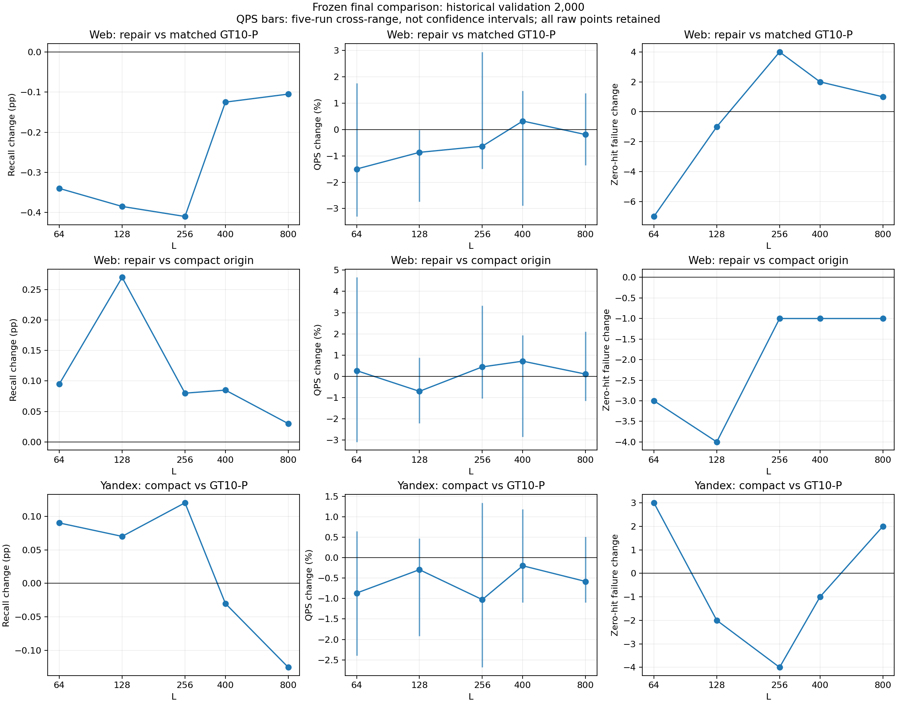
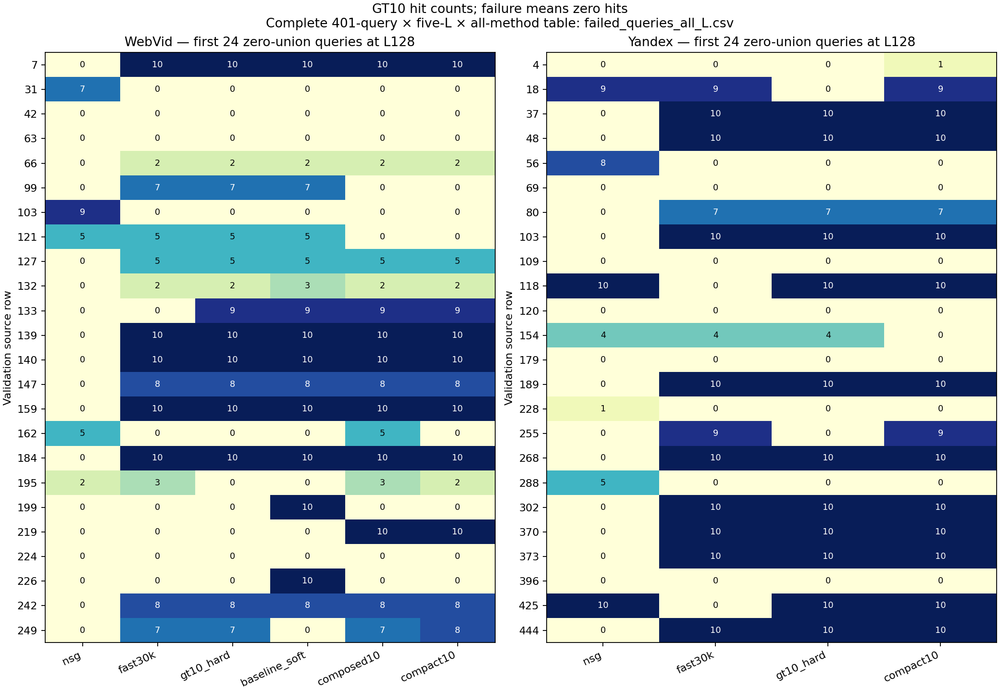
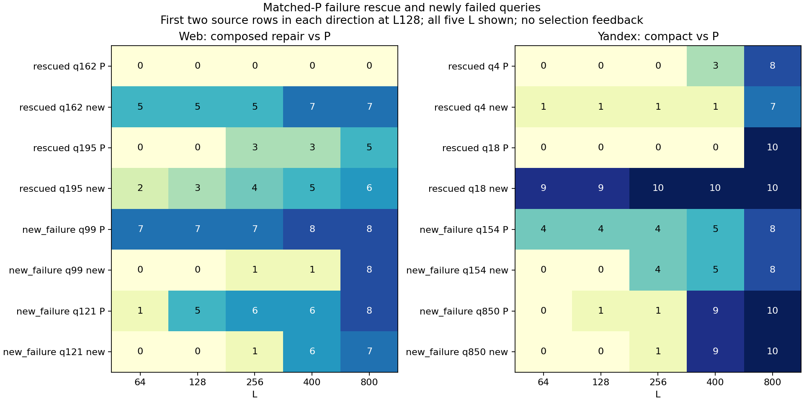

# 第11会话：组合修复与最终QPS–Recall/失败查询报告

**组合修复确实改善了 compact，但仍未得到更好的默认方法。** 最终同批2000查询中，WebVid相对compact五个L的Recall全部提高、零命中失败全部减少；相对匹配GT10-P五档Recall都下降。Yandex compact前三档Recall有小增量，高L出现损伤；两数据集没有稳定整体效率改善，默认保持。

本次先完成E92固定组合，再由E93冻结实际选择，最后E94运行完整最终矩阵。E93只用已暴露aux7952：77项逐项资格核对，41项真实评分（39个非零新配置+2P），独立集合复算326032条返回。Web没有过门新方法，best_all=P，best_new=组合反证；Y两个角色均compact。这些是开发选型角色，不是部署推荐。最终反馈没有回流训练或选择，held-out未开；E34这2000条validation本身有历史使用，不能称全项目盲测。

Web新方法保留compact的1771个画像slot/815个真实入口，叠加已冻结的254条查询监督补边和5组/10行父画像恢复；只在离线改静态图和向量。Y沿原compact的2067个画像slot/821个真实入口。在线均为一次小HNSW的七slot检索→去重三个真实入口→原NSG/raw-IP；大底图、base、GT、搜索kernel保持。Micro-HNSW是这些画像的小图。Fast30K保留其历史训练量/seed100/heap，不将全部差异归因GT目标数。

以下顺序均为L=64/128/256/400/800。Recall变化单位为百分点，失败为零GT10命中的净新增条数，QPS为五轮中位数相对变化。

| 数据/实际方法与参照 | Recall变化 pp | QPS变化 % | 失败净新增 |
|---|---|---|---|
| Web组合 / compact起点 | +0.095 / +0.270 / +0.080 / +0.085 / +0.030 | +0.27 / -0.71 / +0.44 / +0.71 / +0.11 | -3 / -4 / -1 / -1 / -1 |
| Web组合 / 匹配GT10-soft P | -0.340 / -0.385 / -0.410 / -0.125 / -0.105 | -1.50 / -0.87 / -0.63 / +0.32 / -0.19 | -7 / -1 / +4 / +2 / +1 |
| Y compact / GT10-hard P | +0.090 / +0.070 / +0.120 / -0.030 / -0.125 | -0.87 / -0.29 / -1.03 / -0.20 / -0.58 | +3 / -2 / -4 / -1 / +2 |

Web组合相对compact的五个QPS交叉范围都跨零，保留质量修复，不能称稳定加速；相对P的L128范围整体略负，其余跨零。Y相对P的五个范围均跨零。同Recall共同区间25/50/75%位置的log-QPS描述性插值：Web组合/compact +1.08/+1.34/+1.51%（范围都跨零），组合/P −3.53/−4.02/−2.57%（范围均负）；Y compact/P +0.15/+0.77/+1.19%（范围都跨零）。这些是实测非支配点间的插值，不是额外测得的等Recall提速；重复计时不是独立Recall样本，query bootstrap也仅为历史数据描述。

当前同批L128原值如下；全部五L原点和五轮wall均在链接表中。

| 数据 | 方法 | Recall % | QPS中位 [范围] | 零命中数/2000 |
|---|---|---:|---|---:|
| Web | 原NSG | 70.940 | 1569.47 [1541.81, 1586.02] | 103 |
| Web | Fast30K/GT1 | 73.990 | 1697.80 [1639.89, 1700.54] | 54 |
| Web | GT10-hard | 74.175 | 1707.97 [1690.86, 1715.52] | 49 |
| Web | 匹配GT10-soft P | 74.190 | 1705.11 [1697.50, 1721.32] | 51 |
| Web | 组合修复 | 73.805 | 1690.34 [1674.22, 1697.28] | 50 |
| Web | compact | 73.535 | 1702.35 [1682.33, 1711.85] | 54 |
| Y | 原NSG | 88.660 | 1561.08 [1555.30, 1563.48] | 59 |
| Y | Fast30K/GT1 | 89.830 | 1712.54 [1692.06, 1728.52] | 37 |
| Y | GT10-hard | 90.055 | 1710.92 [1707.12, 1728.91] | 32 |
| Y | compact | 90.125 | 1705.89 [1695.78, 1715.16] | 30 |

失败严格指返回top10与GT10交集为空，命中1个不失败。L128 Web组合对compact救回4/新增0，对P救回14/新增13；Y compact对P救回8/新增6。其它L的救回/新增、GT成员新增/丢失和逐query净命中正负部全部保留，不能只看净失败变化。

最终全方法共有401条独立失败query（Web271/Y130），其中346条在某L有方法间失败状态变化。原事件表为812个query×L事件、4230个方法单元；补充完整401 query×五L×各集全部方法，共10730单元，保留每格GT10/真实入口/返回。L128失败图按source row取每集前24条，完整表不截断；namespace明确为validation，与router_train辅助数据分开。图中的个例仅作事后解释，不生成线上选择器。

E92开发组合对compact +97命中/失败−10，但对P +38、两半+45/−7且失败+1，完整门FAIL；单项加和112→实际97，15条query交互非加性。最终Web相对compact五L正向修复表明这部分局部收益有迁移，仍没有补齐compact相对P的损失。Y的父恢复原为零更新，组合等E84，不作为新模型训练/测试；Y最终测试的是非零E73 compact。E89/E90/E92及其它旧门与原产物均保留。

E94实测50点/250轮，700800 NSG、560000 HNSW；两native操作994.213s，独立纯wall合计695.047s。8个不同源图文件、40个非NSG方法×L点，40次plain加载+40次count加载，加载0.608/0.604s；没有40张新图。0新拟合/普通构图/GT/编译。route-only/graph-only未分测，缺项为null。继承成本包括E66画像训练30.286s、E73精简0.031s/两小图构建0.348s，以及E84/E90既有训练支持；GT-inclusive全成本缺项未知，不记为零或把重用图称免费。

本会话合计781760 NSG、640800 HNSW，1组合图向量安装，0新模型拟合/普通build/GT/编译；E92操作57.740s另计，辅助选择反馈仍算训练信息。全天截至本会话6854176 NSG、17820080 HNSW、360普通构图；旧220开发QPS点/1100wall分属E65/E67/E71/E74，本次50最终点/250wall单列，绝不拼同曲线。所有ANN严格串行CPU15/进程及库1线程，四个本会话native任务已terminal0。

全部100000最终返回独立集合/mask、五轮/plain/count/原kernel800行、七slot、跨L图/路由、同三入口返回核验通过。70000条原NSG/Fast/GT10基线全七字段逐位回归E34；原selection/prequery与底图继承身份保持。当前只作完整最终反证与局部信号汇报，不替换默认、不从最终反馈调参。

[全部50原点与数值报告](analysis_v1/report.md) · [250轮wall](analysis_v1/timings.csv) · [配对损益](analysis_v1/paired.csv) · [完整401失败query五L全表](supplement_v1/failed_queries_all_L.csv) · [原812失败事件表](analysis_v1/failures.csv) · [描述性插值](supplement_v1/same_recall_interpolation.csv) · [query区间](supplement_v1/paired_query_intervals.csv) · [原始验收](analysis_v1/verification.json) · [E34回归和失败全表验收](supplement_v1/verification.json) · [冻结选择](selection.json)。

按L128每种方向取源行最小的两条，保留全五L命中（顺序64/128/256/400/800），只是事后失败解释：

| 数据 | 方向/源行 | P命中 | 新方法命中 |
|---|---|---|---|
| Web | rescued / 162 | 0 0 0 0 0 | 5 5 5 7 7 |
| Web | rescued / 195 | 0 0 3 3 5 | 2 3 4 5 6 |
| Web | new_failure / 99 | 7 7 7 8 8 | 0 0 1 1 8 |
| Web | new_failure / 121 | 1 5 6 6 8 | 0 0 1 6 7 |
| Y | rescued / 4 | 0 0 0 3 8 | 1 1 1 1 7 |
| Y | rescued / 18 | 0 0 0 0 10 | 9 9 10 10 10 |
| Y | new_failure / 154 | 4 4 4 5 8 | 0 0 4 5 8 |
| Y | new_failure / 850 | 0 1 1 9 10 | 0 0 1 9 10 |

[八例GT10/入口全表](supplement_v1/failure_cases_both_directions.csv)。原全401条完整表保持，不以个例替代整体判断。

本会话20:00前安全交接，整日21:00目标仍未标完成。后继只继续报告审阅、证据解释和交付整理；最终选型及本矩阵已冻结，不再训练/按最终反馈改方法。
