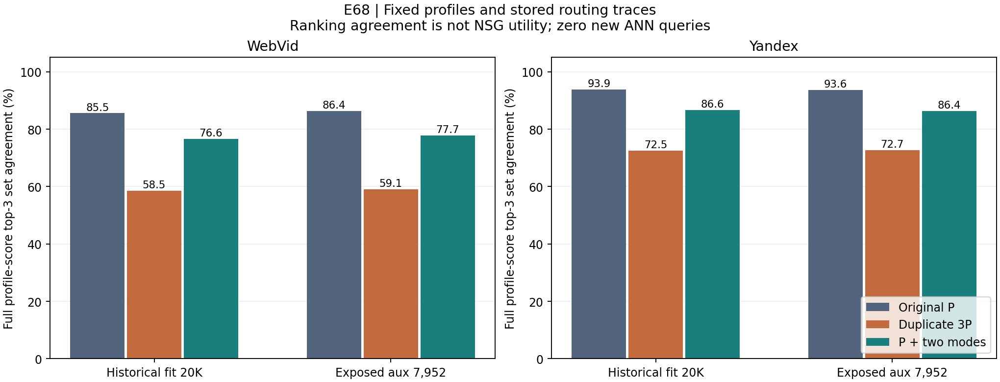

# E68 冻结画像完整排序诊断

在完整分数排序相同的条件下，重复三份P明显降低了实际三入口的排序一致率。这确认物理索引与近似检索组合存在损失，值得下一阶段检验；它没有证明提高ef会提升原NSG Recall或完整QPS。新增mode在Yandex有局部收益，而部分严重失败即使已经选中完整画像前三仍发生，不能把全部损伤归因近似误差。

本阶段复用E66的55,904条历史fit/aux和实际返回，计算111,808次原P/mode完整分数参照，duplicate另55,904逻辑alias。0新HNSW、0新NSG、0新GT、0模型/图更新，无QPS。float64 raw-query内积、每hub最高slot分数、按真实ID稳定平局；近tie单列，不声称原SIMD逐位等价。

| 数据/角色 | 原P三hub完全一致 | duplicate3P | mode3P | mode原已测净命中/失败变化 |
|---|---:|---:|---:|---:|
| WebVid fit | 85.55% | 58.51% | 76.64% | -496 / +35 |
| WebVid aux | 86.38% | 59.09% | 77.73% | -106 / +13 |
| Yandex fit | 93.88% | 72.47% | 86.63% | +164 / -11 |
| Yandex aux | 93.61% | 72.75% | 86.38% | +49 / -4 |

原P/duplicate使用同一个完整分数参照；mode列使用自己的完整画像分数前三，三列不能解释为同一个检索效用目标。排除近tie后各一致率变化小于0.04个百分点。duplicate全部55,904条trace的七个返回slot恰好只含3个真实hub；mode含3–7个。这只是返回候选占用，未测内部visited/expanded独立hub数。源码的ef10维护物理节点，而非10个不同真实hub；不能换算为固定ef/3。

Web aux中，mode选中自身完整前三的6,181条净命中−1、救回27/新增27；其余1,771条净−105、救回17/新增30。Y aux对应6,869条净+108、救回32/新增22；其余1,083条净−59、救回10/新增16。分组是事后相关性，查询难度/表示变化同时存在；未实际运行完整前三的NSG，不能把组差相加成反事实收益。

E67全部93条独立失败转换query已连接排序诊断，465个五L已测命中保持原值。以下是具体案例；原数据namespace见CSV，行号是router_train源row。

| 数据/source row | 五L原命中 → mode命中 | 原P/mode完整前三重合数 | mode近tie |
|---|---|---:|---|
| Yandex / 3846 | 10 10 10 10 10 → 0 0 0 0 0 | 2/3、3/3 | False |
| WebVid / 3849 | 0 0 0 0 0 → 10 10 10 10 10 | 2/3、0/3 | False |

Yandex 3846的mode已经完整命中画像前三，五L却从10命中降为0；WebVid 3849恰好相反，mode与其画像前三0重合，却在五L从0救回10。前者说明提高同一评分排名的近似一致性未必能救回所有损伤；后者说明逼近画像排名也可能改变已有救回。都未测新入口反事实，不能预报ef30结果。若实际mode三入口已与完整画像前三一致，进一步逼近同一个排名不会改变这条query的三入口集合；这只约束该固定评分函数与三入口合同，不推出其它评分/图/搜索预算也无法救回。排序分数不是NSG效用，不能当GT oracle。

主分析10.674秒；独立审查1.774秒，另计绘图。112次原P标量完整排序复核、14次mode标量排序复核、167,712行三方法入口集合重算及93条失败连接通过；抽样原生距离最大误差1.8e-07。均CPU15、进程与库线程1，E67两native实际退出后执行。操作耗时不作QPS。

P-fit包含旧train/monitor；aux7952已历史暴露且用于E64/E66辅助选择，本诊断继续是开发反馈。E34最终validation与held-out未读取。原E66双集门失败和E67局部曲线保持，未因此选择新ef或部署候选。下一步优先另建完整P/mode前三的真实NSG回放诊断；若有实际效用再考虑有控制的物理搜索宽度修正，本阶段均未运行。

[前瞻协议](protocol.md) · [排序统计](results/points.csv) · [事后关联](results/groups.csv) · [返回slot占用](results/occupancy.csv) · [93条失败排序注释](results/failure_ranking_annotation.csv) · [主验收](reviews/verification.json) · [独立复核](reviews/independent_review.json)

