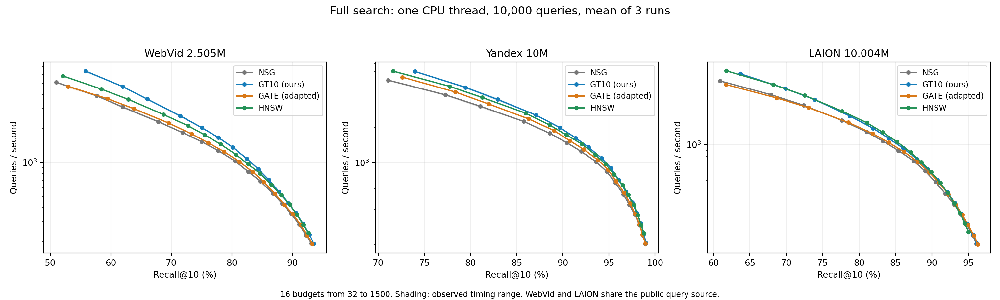
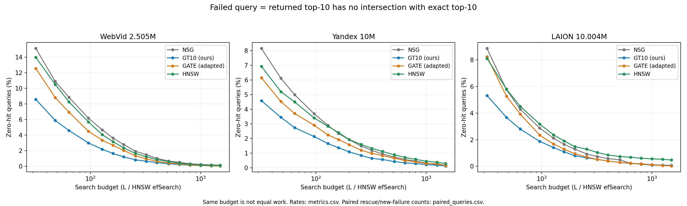

# E96：三数据集 GATE / GT10 / NSG / HNSW 完整比较

2026-09-15 完成。三套完整底库、每集10000条公开测试query，四方法、16预算、每点三次单线程平均：192点、576次计时全部通过。最终方法为 `gate_release10_v2`；Web/Y被替代的旧采样训练不进入结果。

WebVid和Yandex上，GT10在全部16个预算点的实测Recall及平均QPS都高于GATE，GATE没有进入这两集的已测点联合Pareto集合。按三次计时范围，Web有13/16点、Yandex有14/16点完全分离；其余微小速度差不作统计显著性判断。LAION有质量与速度取舍：GATE在L1500达到96.287% Recall、145.86 QPS、3条零命中；GT10为96.154%、148.94 QPS、6条零命中。GATE多0.133个百分点Recall、QPS低2.06%，且只相差3条失败，不能概括成全面胜出。

GT10与全量HNSW也有交叉，不能宣称GT10在所有召回目标上最快。本轮没有替换项目默认方法；Web保持GT10-soft-t1、Y保持GT10-hard，LAION本轮在开发集选出soft-t1。E95固定H增强分支的停止结论保持原适用范围。

## 图与完整数据

[Recall–QPS PDF](figures/recall_qps.final.pdf) · [失败率PDF](figures/failed_query_rate.final.pdf) · [192点完整数据](results/metrics.csv) · [配对挽救与新增失败](results/paired_queries.csv) · [各召回门槛最快已测点](results/common_recall.csv)。初始图保留；最终图只修正图例及配对明细文件名，指标不变。

## 达到相同召回门槛的速度

下表每格为 **QPS / L或efSearch / 实测Recall**，从全部16点选择达到门槛的最快实测点，不插值、不外推。不同方法可能超过门槛的程度不同，因此表格描述门槛约束下的已测选择，不等于精确相同Recall的连续曲线拟合。

| 数据集 | 最低Recall | NSG | GT10（我们） | GATE（适配） | HNSW |
|---|---|---|---|---|---|
| WebVid | 70% | 1838.2 / 128 / 71.854% | 2580.8 / 96 / 71.482% | 1788.7 / 128 / 73.337% | 2112.8 / 128 / 72.756% |
| WebVid | 80% | 1029.7 / 256 / 80.524% | 1365.5 / 200 / 80.121% | 1016.7 / 256 / 81.250% | 1177.5 / 256 / 80.663% |
| WebVid | 90% | 284.2 / 1000 / 91.094% | 359.1 / 800 / 90.580% | 349.1 / 800 / 90.079% | 346.2 / 1000 / 90.727% |
| Yandex | 90% | 1480.4 / 160 / 90.455% | 1625.1 / 160 / 91.417% | 1543.2 / 160 / 90.757% | 1723.0 / 160 / 90.414% |
| Yandex | 95% | 670.8 / 400 / 95.722% | 896.4 / 320 / 95.238% | 694.6 / 400 / 95.806% | 794.3 / 400 / 95.590% |
| Yandex | 99% | 未达到 | 206.4 / 1500 / 99.007% | 未达到 | 未达到 |
| LAION | 80% | 1282.8 / 128 / 81.044% | 1378.3 / 128 / 81.913% | 1242.0 / 128 / 81.861% | 1529.4 / 128 / 81.079% |
| LAION | 90% | 486.5 / 400 / 90.494% | 506.3 / 400 / 90.743% | 480.9 / 400 / 90.969% | 477.7 / 512 / 91.150% |
| LAION | 95% | 174.0 / 1250 / 95.577% | 176.6 / 1250 / 95.653% | 172.3 / 1250 / 95.770% | 185.9 / 1500 / 95.024% |

Web的四方法均未达到95%；Y的GT10在当前固定10000条query上刚过99%，不能把这一阈值跨越解释为稳健的总体99%保证；LAION四方法均未达到99%。完整曲线与所有未达标值均保留。

## 最大预算及失败定义

主失败定义是 **返回top10与exact GT top10交集为空，即单query Recall@10=0**。它不等于漏掉任意真近邻，也不等于GT1未返回；后者单独列出。L和HNSW efSearch不是等工作量，下面是最大预算的实际端点。

| 数据集 | 方法 | Recall@10 | 平均QPS | 零命中率 | GT1未返回率 |
|---|---|---|---|---|---|
| WebVid | NSG | 93.083% | 192.67 | 0.13% | 7.56% |
| WebVid | GT10 | 93.506% | 192.05 | 0.04% | 6.87% |
| WebVid | GATE | 93.247% | 190.55 | 0.06% | 7.37% |
| WebVid | HNSW | 92.563% | 238.55 | 0.11% | 8.25% |
| Yandex | NSG | 98.951% | 201.44 | 0.18% | 0.88% |
| Yandex | GT10 | 99.007% | 206.44 | 0.13% | 0.78% |
| Yandex | GATE | 98.967% | 204.73 | 0.16% | 0.84% |
| Yandex | HNSW | 98.815% | 249.17 | 0.29% | 1.09% |
| LAION | NSG | 96.099% | 147.11 | 0.07% | 4.49% |
| LAION | GT10 | 96.154% | 148.94 | 0.06% | 4.41% |
| LAION | GATE | 96.287% | 145.86 | 0.03% | 4.23% |
| LAION | HNSW | 95.024% | 185.88 | 0.48% | 5.57% |

每个点都有原始IDs、距离、真实入口、路由/底图NDC以及逐query hits、零命中、GT1 miss文件；没有从公测中筛除失败query。配对明细在同预算下统计，不能当作等工作量比较。例如LAION L1500，GATE相对GT10挽救3条零命中、新增0条，75条query命中增加、22条减少；Web则挽救2条、新增4条。

## 实际方法与训练流程

底库分别为WebVid 2505000×512 raw-IP、Yandex官方前10000000×200 raw-IP、LAION 10004480×512 unit-IP。每集使用原冻结NSG和匹配的exact GT；Y从公开100K取前10000条，另两集使用公开10K。Web和LAION公开测试query同源；这些public资产有项目历史曝光。结论适用于本轮三个工作负载，不声称三套全新盲测分布。

1. **NSG**：原底图、原固定单入口、原 `search_new` mode2。**GT10**：真实QGT hub（Web815、Y/LAION821）→ fit20K的GT10归属权重累计单位query画像及真实hub先验→单位画像Micro-HNSW M16/efC200/ef10→top3映射真实ID并升序→原NSG。画像不是800个原始base向量。Web/Y复用冻结画像；LAION用cal1024、L128比较hard/soft-t1，按总命中、底图NDC、hard平局优先选择soft-t1（8447对8435命中），公测前冻结。
2. **GATE hub与特征**：两层32×16 HBKM得到512真实hub；在原NSG中固定5近+5远，至多5hop/1000节点采样，构造Graph2Vec及原hub向量特征。Web的HBKM实物复用，其余两集本轮构建。原协议误记8×8×8，已在新hub构建前由来源manifest修正。
3. **GATE标签**：训练query为router_train[10000:20000]，monitor为[2048:3072]，每集11024×512次L64/K1搜索；以GT1首次发现的图深度构造监督，仅当最终返回GT1时该hub标签有效，其余为999。三集共16932864次标签搜索，原kernel与observer返回/距离逐位核验。正负样本规则沿固定release逻辑，每hub最多50正、50负形成三元组；训练过滤只作用于监督样本，不作用于最终10000条公测。
4. **GATE训练及导出**：hub向量与Graph2Vec经fusion Transformer和hidden2024 tower生成d维入口向量，cosine triplet margin1；Adam 1e-5、batch16384、seed42、最多200epoch，monitor RouteAcc连续20轮不改善停止，冻结最佳checkpoint。修正batch/sequence维度并验证单条/批量输出独立；每batch同hub合并forward是CPU适配，会共享该hub的dropout。本版不是作者代码的逐位原样复现。导出512个单位W后，线上只有query归一化、小HNSW M256/efC256/ef10/top3（release heap顺序映射）及原NSG，没有query神经网络前向。
5. **全量HNSW**：在各完整base上独立构建M32/efC200/seed20260828，离线16线程；构建RNG加锁、实际有序拓扑冻结。原float32向量无损恢复，所有节点的向量/标签/层级/有序邻接及128条query逐位往返验证通过。gzip仅保存拓扑以避免复制数十GB向量，在线搜索使用完整内存索引；保存/加载不计入QPS。

GATE训练10K与GT10 fit20K不同，不能称离线工作量相等。[原协议](protocol.md)、[HBKM修正](hbkm_provenance_amendment.md)、[采样修正](sampling_amendment.md)、[方法说明](method_notes.md)和各模型config为精确配置。GATE参考[固定release](https://github.com/jacksondca/gate/tree/229f18dadb791ddede22597e44d5ceb028b104ba)，本轮NSG/IP、序列维度、采样上限和CPU实现的差异已记录；不将适配结果冒称论文原始数字。

## 时间、工作量与可解释边界

全部正式点串行、CPU15、实际进程及OMP/BLAS/MKL线程均为1。预算固定32、48、64、96、128、160、200、256、320、400、512、640、800、1000、1250、1500。每点一整批warmup、三轮plain wall、一次独立count；主QPS是三个10000/wall的算术平均，同时保留10000/平均wall。所有轮次及count的IDs/距离/入口一致。计时包含完整路由、必要归一化、映射、排序、图搜索及内存结果写出；GT评分、计数、磁盘I/O、加载和构图在计时外。

正式阶段从2026-09-14 21:16:46到09-15 02:02:15，合计 **4.758小时（4小时45分29秒）**；Web/Y/LAION分别85.82/83.47/116.18分钟。576次计时共5760000条query调用；加warmup/count共9600000条。此前正式矩阵估计6.22小时；19:30给出的剩余总时间估计7–8小时、保守5.5–13小时，实际到矩阵结束约6小时32分，文档收尾另计。

| 数据集 | 实际epoch | 选中epoch（从0计） | 标签秒 | 最终tower训练秒 | GATE有效准备已知小计/分钟 |
|---|---|---|---|---|---|
| WebVid | 33 | 12 | 151.23 | 639.97 | 14.09 |
| Yandex | 45 | 24 | 200.82 | 751.71 | 27.34 |
| LAION | 63 | 42 | 230.21 | 1331.11 | 41.77 |

有效准备小计包含最终特征、标签、tower及本轮已知HBKM；Web历史HBKM未知。LAION特征945.11秒已包含HBKM922.57秒，不能重复相加；LAION整个features子进程1211.23秒另含输入准备与身份核验。历史GT、原NSG构建及Web/Y继承画像的完整成本未知，记为null。被替代Web训练739.51秒、取消的旧Y训练至少518.70秒另记，环境重启丢失的在途成本不冒称完整已测。[分项原值](results/offline_costs.json) · [避免重复计费的说明](results/cost_accounting_notes.json)。

HNSW程序记录的累计构建秒为Web262.85、Y1083.03、LAION1528.86；Y含358.18秒检查点写出，LAION恢复计时包含恢复加载且未覆盖失败保存的全部开销，不把三个值统称纯插入成本。另列保存/恢复/核验。LAION磁盘保护失败阶段1606.45秒及成功恢复144.42秒在独立记录中保留；完成节点未重建。它只影响离线耗时，正式矩阵没有失败重跑。

L128的实测成本例子如下。GATE小图每query路由约288–301次距离计算，GT10约107–112次；底图工作也不同，所以只看Recall或某一NDC不能替代完整QPS。

| 数据集 | 方法 | 路由NDC均值 | 底图NDC均值 | 完整QPS均值 |
|---|---|---|---|---|
| WebVid | GT10 | 111.95 | 1652.57 | 2030.58 |
| WebVid | GATE | 300.73 | 1805.61 | 1788.68 |
| Yandex | GT10 | 107.34 | 2851.80 | 1995.14 |
| Yandex | GATE | 288.39 | 2936.56 | 1885.03 |
| LAION | GT10 | 107.35 | 2284.93 | 1378.25 |
| LAION | GATE | 291.08 | 2462.10 | 1241.95 |

三次计时范围是观察范围，query bootstrap和Wilson区间是描述性不确定性；三次重复并非三批独立query。高L的几条失败差异不作分布层面的显著性保证。

## 验收与存储

[最终数值审计](reviews/final_numeric_audit.json)核对192点/576轮、实际单线程、唯一boot、无正式重跑、逐query记录、三次均值、288条配对恒等式、60条召回门槛选择、模型/二进制/原源码与静态库身份。三集预检、标签parity、模型独立性、完整HNSW往返、合成评测恢复均通过；图像已另行目视核查。封存见[完成记录](complete.json)。

磁盘保护时，本轮未完成LAION构建目录曾转存系统盘并保留原路径链接。测试结束后，按用户明确授权删除已解压原归档`/data/netg.tar.gz`（53154931501字节），逐文件SHA校验把LAION索引恢复到项目内普通目录；原base/NSG/GT/模型及失败产物保留，系统盘校验副本也保留。见[恢复记录](reviews/storage_recovery_20260914T2113/manifest.json)和[最终存储记录](reviews/storage_closeout/manifest.json)。
