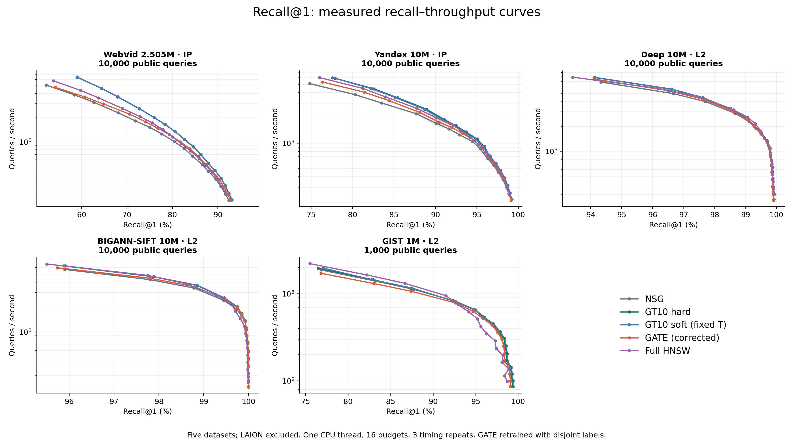
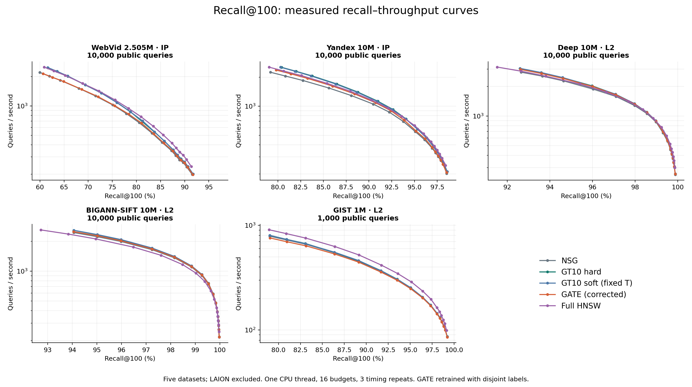

# E97：修正 GATE 后的五集 Recall@1/100 重测

2026-09-16：数值、图表与最终身份核验完成。详见[逐数据集分析与 hard/soft 建议](analysis.md)，其中保留90%/95%/99%召回门槛的实际Recall、QPS、预算以及三次计时波动。当前没有统一赢家：WebVid的K1支持GT10，GIST的K100更适合完整HNSW；Deep/SIFT的hard与soft很接近。继续保留hard为预先指定研究主线、soft为固定对照，不自动更换既有默认。

已完成 WebVid、Yandex、Deep、BIGANN-SIFT、GIST 五集，排除 LAION。五方法 × 两种 K × 16 档搜索预算，共800个正式点、2400次单线程端到端计时。所有结论来自新返回与新计时，旧 Recall@10 不参与。

GATE 负集合现在先移除同一 query 的全部正 hub，再筛选和配对。五集实际 triplet 均无正负冲突、无同一 query 同时作正负；选中 checkpoint 与导出画像已核对。WebVid/Yandex 复用身份兼容的底图、hub/子图特征、hop 缓存及完整 HNSW，GATE 模型重新训练。

新 L2 数据保留原始向量。SIFT 使用公开 BIGANN 首10M与独立公开 query/learn，替代旧本地非标准11.16M及从base抽query的版本；不能拼接旧 SIFT 数值。GIST 使用现有原始标准规模文件，但缺少原下载校验清单，这个来源限制保留。新三集 GT100 都从完整底库精确计算，并用独立 float64 直接距离检查；GT10-hard 为预先指定的主线，soft 仅使用 fit 确定的固定温度。

所有方法固定CPU15，进程/OMP/BLAS/MKL均单线程，一次warmup、三次普通计时及独立计数，重复ID/距离/入口逐位一致。QPS包含路由、归一化、ID映射、图搜索和写入预分配返回数组；不包含加载、构图、GT评分和磁盘写出。完整 HNSW 与所有 NSG 方法使用相同原生距离与完整底库。

## 新图

阴影为三次QPS的实测范围；连线保留全部16点。零命中图、每集独立图及PDF见 [figures](figures/manifest.json)。

## 相同召回门槛的实测速度

下表取达到90%召回门槛的最快实测点，未达到记为“未达到”。不插值、不外推；数值为QPS。门槛和实际Recall可能存在离散预算差异，完整0.5至0.99门槛及L在CSV中。

| 数据集 | K | NSG | GT10 hard | GT10 soft | GATE修正 | 完整HNSW |
|---|---:|---:|---:|---:|---:|---:|
| WebVid 2.505M · IP | 1 | 281 | 352 | 351 | 343 | 277 |
| WebVid 2.505M · IP | 100 | 236 | 239 | 239 | 235 | 283 |
| Yandex 10M · IP | 1 | 1,729 | 1,914 | 1,896 | 1,777 | 2,010 |
| Yandex 10M · IP | 100 | 1,052 | 1,127 | 1,128 | 1,089 | 1,161 |
| Deep 10M · L2 | 1 | 6,901 | 7,822 | 7,861 | 7,504 | 7,904 |
| Deep 10M · L2 | 100 | 2,799 | 3,056 | 3,057 | 2,986 | 3,157 |
| BIGANN-SIFT 10M · L2 | 1 | 5,688 | 6,272 | 6,281 | 5,966 | 6,610 |
| BIGANN-SIFT 10M · L2 | 100 | 2,452 | 2,583 | 2,585 | 2,505 | 2,606 |
| GIST 1M · L2 | 1 | 821 | 834 | 836 | 785 | 950 |
| GIST 1M · L2 | 100 | 366 | 369 | 369 | 358 | 416 |

这里比较的是五集公开查询的实测曲线。WebVid/Yandex 公共测试在旧实验中已经使用；新 L2 数据结果也不能代表所有查询分布。不凭同L或单个QPS差值宣布部署收益，不自动覆盖旧默认方案。

## 训练与成本

| 数据集 | 有效 triplet | 训练轮数 | GATE训练秒 | 导出最大误差 |
|---|---:|---:|---:|---:|
| GIST 1M · L2 | 981,400 | 24 | 862.0 | 0 |
| Deep 10M · L2 | 959,900 | 27 | 576.7 | 0 |
| BIGANN-SIFT 10M · L2 | 1,002,950 | 60 | 1361.0 | 0 |
| WebVid 2.505M · IP | 619,950 | 38 | 679.7 | 0 |
| Yandex 10M · IP | 713,550 | 52 | 896.8 | 0 |

本轮已记录的离线阶段合计 4.87 小时；正式评测阶段总wall 15.83 小时（含加载、warmup、计数及写出，不能倒算为查询QPS）。模型最终核验和图文整理单列于各review；复用资产的旧成本不算新构建成本，也不把未知历史成本记为零。进程峰值内存观察见 [资源记录](reviews/offline_resource_observations.json)。

新三集GT10流程：独立5000 query按球面聚类选800个真实GT hub；独立fit的20000 query取各自精确GT前10目标，按目标与原hub的cosine硬归属或soft权重分配，每query总权重1；累加单位query方向，加单位raw-hub先验1，最终画像单位化。在线只在Micro-HNSW中选3个真实入口，再查原NSG。

GATE流程：完整底库32×16 HBKM选512真实hub；每hub按5近5远/最多5跳1000节点抽子图，WL2与Doc2Vec得到结构特征；10000 train与1024独立monitor对每hub执行L64/K1搜索，真实发现深度生成正负标签；修正后cosine triplet训练batch-first网络，Adam1e-5，batch16384，最多200轮、patience20；用monitor选checkpoint、导出512画像。网络不在线运行。1000节点截断、Sinkhorn近似聚类与统一项目kernel属于已披露适配。

## 可核验产物

- [800点完整指标](results/metrics.csv)、[2400次wall](results/wall_rounds.csv)、[召回门槛比较](results/recall_targets.csv)。
- [逐query配对](results/paired_queries.csv)、[完整阶段成本](results/offline_and_evaluation_costs.json)；所有原始ID、距离、入口、NDC和hit向量保存在results各数据集目录。
- [合成修复验证](reviews/changes_verified.json)、[模型冻结](reviews/frozen_models.json)、[正式前检查](reviews/preflight.json)、[完整返回核验](reviews/raw_results_verified.json)、[最终身份核验](reviews/final_integrity.json)。
- [锁定配置](config.locked.json)、[协议](protocol.md)、[实现源码](src/evaluate.cpp)。

## Yandex 前置检查中断与限定修正

2026-09-15 14:09 前检发现 manifest 声明10000行而路径指向100000行，流水线在正式测试前停止。随后物化原 query/GT 的固定前10000行，符合E96既定前缀，无结果驱动选样；15:19前检通过、15:20恢复。约70分钟等待中断不计计算成本。原100K文件、181个原冻结资产和旧E96结果保留，限定修订后最终183个冻结资产核验通过。见[历史90a](../../experiment_history/90a_yandex_test_prefix_fix.md)、[修正审计](reviews/yandex_test_prefix_correction_v1/correction.json)。
