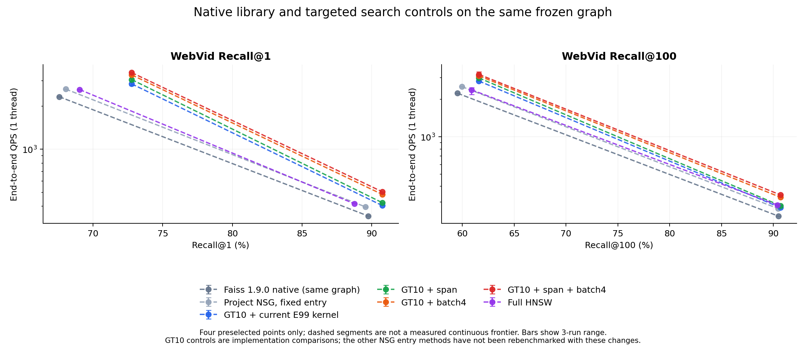
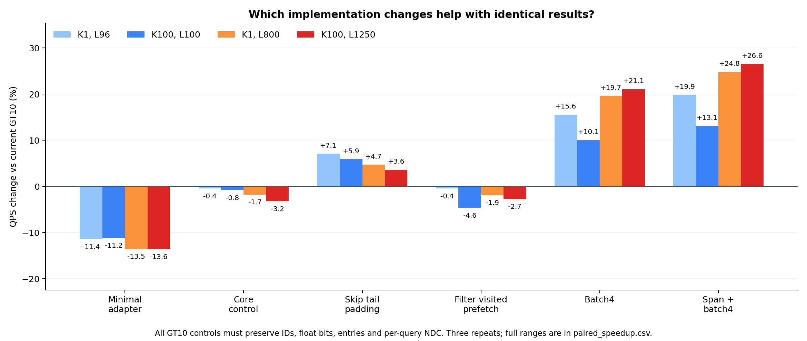

# E101：原生 Faiss NSG 同图比较与优化价值

本轮完成40个固定点、120轮单线程plain、2,000,000次真实搜索。原生Faiss、当前项目内核及六个GT10实现控制均保留完整结果。主矩阵的batch4计数包装默认使用四次scalar；现已补做[80000次真实batch4转发核验](actual_batch4_count_protocol.md)，8个配置的输出与逐query NDC全部通过。原plain计时保留，核验细节见报告末尾。生产内核仍为E99，本轮只交付独立比较代码和候选，不改变入口模型、图或默认。

GT10的span+batch4组合相对当前实现，在四点的平均QPS变化为 **+13.10% 至 +26.56%**。所有GT10控制的返回ID、距离bits、入口和逐query NDC与E99一致。组合在四点的平均QPS均提高，值得进入共享生产内核的正式落地验证。这证明本轮图访问/计算组织存在可利用的实现空间，而不是模型重新训练的收益。

## 比较对象和库边界

本轮`Faiss-native`指项目内置的 **Faiss 1.9.0**。本地NSG搜索主体和IndexNSG公开搜索包装与官方v1.9.0源码对照，去除注释/空白后相同，核查见[版本审计](reviews/library_version_audit.json)。原生版本实际调用本地库`faiss::IndexNSG::search`，借用项目冻结NSG的同一邻接与storage地址，保持Faiss入口邻居加随机点填满初始L的算法。没有调用建图、修改邻接或改变IP度量。因此这是原生Faiss 1.9.0搜索在项目冻结图上的表现，不能冒称重新构建的整套原生索引，也不是最新版Faiss的速度结论。库公开接口见[Faiss官方文档](https://faiss.ai/cpp_api/struct/structfaiss_1_1IndexNSG.html)。

另查阅了上游当前main：`Graph::get_neighbors`在第一个负值处结束邻接读取，搜索只遍历返回的有效邻居；visited接口也已变化。上游仍保留填满初始L和逐邻居scalar距离调用。这是源码事实，尚未构建/计时新版库，不能据此声称升级必然更快或无效。[上游Graph实现](https://raw.githubusercontent.com/facebookresearch/faiss/main/faiss/impl/NSG.h)、[上游搜索实现](https://raw.githubusercontent.com/facebookresearch/faiss/main/faiss/impl/NSG.cpp)。本轮span支持内部空洞，而上游前缀读取依赖负值是尾部终止标记。

`NSG-current`与`GT10-current`实际链接原E99优化库，分别注入固定单入口与GT10-soft原三入口。`GT10-minimal`沿用Faiss的候选排序/插入与遍历机制，适配三入口和未满池；它是研究适配代码，不是原生库。`GT10-core`在同一小内核启用E99预取和有效前缀复制，作为其余控制的匹配基线，隔离简化历史模式/trace等代码带来的差异。

`span`仅将固定R扫描收缩到该行最后一个有效邻接位置，内部空洞仍跳过，保留有效边顺序；`prefetch-filter`只跳过已visited目标的向量预取；`batch4`按原顺序聚合至多四个新邻居、预取向量首cache line、调用Faiss批量距离，再依原顺序插入；`span-batch4`是事先指定的两项组合。batch4控制包含聚合及预取组织变化，不能把其全部收益都归因于SIMD算术本身。

## 实测 Recall 与 QPS

所有查询来自原WebVid完整10K public集合；单线程CPU15，同机串行。QPS是三轮N/wall均值，括号是实测最小–最大，不是置信区间。

| 版本 | L96 Recall@1 | QPS（最小–最大） | L800 Recall@1 | QPS（最小–最大） |
|---|---:|---:|---:|---:|
| Faiss-native | 67.5700% | 2324.99（2314.85–2336.24） | 89.7500% | 341.18（340.50–341.90） |
| NSG-current | 68.0400% | 2628.12（2613.23–2638.15） | 89.5600% | 394.89（394.22–395.41） |
| GT10-current | 72.7700% | 2859.10（2779.18–2926.43） | 90.7500% | 404.03（403.83–404.32） |
| GT10-minimal | 72.7700% | 2532.59（2444.02–2603.41） | 90.7500% | 349.38（347.37–351.55） |
| GT10-core | 72.7700% | 2846.67（2769.93–2911.71） | 90.7500% | 397.03（396.77–397.37） |
| GT10-span | 72.7700% | 3062.25（2982.90–3116.85） | 90.7500% | 423.15（422.91–423.48） |
| GT10-prefetch-filter | 72.7700% | 2846.26（2774.03–2894.79） | 90.7500% | 396.30（395.81–397.25） |
| GT10-batch4 | 72.7700% | 3304.49（3240.99–3365.10） | 90.7500% | 483.43（481.72–485.04） |
| GT10-span-batch4 | 72.7700% | 3426.96（3349.49–3473.12） | 90.7500% | 504.34（502.41–505.58） |
| HNSW | 69.0300% | 2609.54（2604.81–2615.87） | 88.7500% | 415.84（415.49–416.13） |

| 版本 | L100 Recall@100 | QPS（最小–最大） | L1250 Recall@100 | QPS（最小–最大） |
|---|---:|---:|---:|---:|
| Faiss-native | 59.5404% | 2243.72（2239.60–2250.80） | 90.4819% | 230.52（230.47–230.61） |
| NSG-current | 59.9563% | 2536.54（2533.90–2538.77） | 90.4456% | 265.45（265.28–265.78） |
| GT10-current | 61.6003% | 2813.37（2802.30–2819.86） | 90.6868% | 269.80（269.53–270.33） |
| GT10-minimal | 61.6003% | 2499.20（2494.40–2506.74） | 90.6868% | 233.18（226.04–237.04） |
| GT10-core | 61.6003% | 2790.17（2788.57–2791.21） | 90.6868% | 261.13（254.47–264.51） |
| GT10-span | 61.6003% | 2979.68（2971.22–2985.05） | 90.6868% | 279.60（274.59–282.12） |
| GT10-prefetch-filter | 61.6003% | 2683.35（2529.72–2763.26） | 90.6868% | 262.43（258.41–264.47） |
| GT10-batch4 | 61.6003% | 3096.57（2852.45–3220.30） | 90.6868% | 326.73（325.87–327.39） |
| GT10-span-batch4 | 61.6003% | 3182.06（2887.02–3340.13） | 90.6868% | 341.45（341.11–341.74） |
| HNSW | 60.8910% | 2389.54（2186.64–2492.72） | 90.3718% | 283.19（283.12–283.25） |

图中每个K仅两个实测L，虚线只连接观测值，不代表连续前沿。原生与项目初始化不同，不能只凭相同L时间判定算法优劣；GT10各实现控制则逐query结果相同，其速度差具有更直接的可比性。

## 哪些改造值得优化

| GT10控制，相对current | K1/L96 | K100/L100 | K1/L800 | K100/L1250 |
|---|---:|---:|---:|---:|
| GT10-minimal | -11.42% | -11.17% | -13.52% | -13.57% |
| GT10-core | -0.43% | -0.82% | -1.73% | -3.21% |
| GT10-span | +7.11% | +5.91% | +4.73% | +3.63% |
| GT10-prefetch-filter | -0.45% | -4.62% | -1.91% | -2.73% |
| GT10-batch4 | +15.58% | +10.07% | +19.65% | +21.10% |
| GT10-span-batch4 | +19.86% | +13.10% | +24.83% | +26.56% |

为避免把去掉历史代码的效果误归给某项控制，还比较同一个研究内核的core基线：

- `GT10-span` 相对匹配core控制：四点平均QPS变化 +6.58% 至 +7.57%；最保守的“本控制最慢轮/基线最快轮−1”下界跨点最低为 +2.45%。
- `GT10-prefetch-filter` 相对匹配core控制：四点平均QPS变化 -3.83% 至 +0.50%；最保守的“本控制最慢轮/基线最快轮−1”下界跨点最低为 -9.37%。
- `GT10-batch4` 相对匹配core控制：四点平均QPS变化 +10.98% 至 +25.12%；最保守的“本控制最慢轮/基线最快轮−1”下界跨点最低为 +2.19%。
- `GT10-span-batch4` 相对匹配core控制：四点平均QPS变化 +14.05% 至 +30.76%；最保守的“本控制最慢轮/基线最快轮−1”下界跨点最低为 +3.43%。

三轮重复不能证明所有环境下稳定获益；较小差异或重复范围重叠，应保留不确定性。原始每轮QPS、配对差和保守范围在[paired_speedup.csv](results/paired_speedup.csv)，不是按最快一轮挑结论。

## 距离次数与总成本

| K100/L1250 | Recall@100 | QPS | 路由NDC | 图NDC | ms/query |
|---|---:|---:|---:|---:|---:|
| Faiss-native | 90.4819% | 230.52 | 0.00 | 13789.67 | 4.3381 |
| NSG-current | 90.4456% | 265.45 | 0.00 | 12727.31 | 3.7672 |
| GT10-current | 90.6868% | 269.80 | 111.95 | 12552.37 | 3.7064 |
| GT10-core | 90.6868% | 261.13 | 111.95 | 12552.37 | 3.8307 |
| GT10-span | 90.6868% | 279.60 | 111.95 | 12552.37 | 3.5771 |
| GT10-batch4 | 90.6868% | 326.73 | 111.95 | 12552.37 | 3.0607 |
| GT10-span-batch4 | 90.6868% | 341.45 | 111.95 | 12552.37 | 2.9287 |
| HNSW | 90.3718% | 283.19 | 0.00 | 13986.45 | 3.5312 |

在高预算点，原生Faiss图距离次数为13789.67/query，项目固定单入口为12727.31，GT10为12552.37，另有111.95路由距离。Faiss初始化填满L与项目最多三个初始点不同，所以原生版本的额外工作不能全部解释成“库实现慢”。Faiss循环本身也扫描graph.K，库替换并不自动去除尾部padding。

GT10各候选保持总NDC 12664.32和Recall@100 90.6868%，组合却将高预算平均wall从3.7064 ms改为2.9287 ms。这是“计算次数相同，执行组织不同”的直接控制。E100观察到71.82%的槽检查是尾部空槽；E101测量实际跳过的价值，不能把空槽比例直接当作时间节省比例。

span辅助数组共2,505,000字节，一次生成耗时0.1059秒，放在加载阶段而不隐藏进每query操作。原生和项目共用图/向量内存；HNSW继续使用原完整图、原生度量。没有为了加速增加查询线程或改变返回K。

## 正确性、成本及后继范围

6,480组配对合成用例覆盖IP/L2、4/32/512维、等距向量、重复/空入口、内部空洞、无效邻居、结果不足、K1/K100、visited轮回；普通和ASan/UBSan均通过，分别12,960次合成搜索。检查实际Faiss scalar/batch4的距离bits及调用顺序；sanitizer覆盖新研究代码，既有链接静态库未重新插桩。真实查询中36个项目/GT10/HNSW组合的180份raw文件与E99逐位一致；原生4点的warm/plain/count使用其真实public API结果核验，并检查合法ID、唯一性、顺序与有限分数。Recall另外从原GT严格按ID重算。

正式计时与count合计2,000,000次search、120轮plain，查询阶段含各点检查用时57.619分钟；主runner含加载和前后身份核验共58.017分钟，编译、合成回归及报告另计。峰值RSS 15.884 GiB。实际进程、OMP/BLAS/MKL均为1线程、CPU15、方法串行。主数据、模型、图、库和冻结源码前后身份一致；无训练、新图或新GT。

修改前备份为`dba6986eb9baa645e9ad1231f9d112bb06550c5d`，原main/index保持。原E97/E99/E100数据和报告不改；默认仍Web soft/Yandex hard。本轮只比较WebVid固定四点，不声称跨五集速度收益或完整前沿，也没有部署新的生产实现。

后继若落地有收益的控制，应将其作为小范围共享内核改动，保留现有API/trace、非有限与未知DistanceComputer回退、图生命周期约束；再公平验证NSG/hard/soft/GATE，重点测WebVid Recall@1/100，并对Yandex/Deep/SIFT/GIST回归。原生Faiss对照继续单独命名，不能覆盖旧“NSG”结果。此次无需重训GT10，也不因局部速度优势追加训练或参数网格。

## 复现入口

- [协议](protocol.md)、[配置](config.json)、[完成记录](complete.json)、[状态](state.json)
- [完整指标](results/metrics.csv)、[120轮时间](results/wall_rounds.csv)、[控制差异](results/paired_speedup.csv)、[汇总](results/summary.json)
- [原生与项目调用](src/compare.cpp)、[独立控制](src/kernels.hpp)、[合成回归](src/regression.cpp)、[评分](src/analyze.py)、[绘图](src/plot.py)
- [数据身份](reviews/assets.json)、[结束身份核验](reviews/post_run_identity.json)、[数值验收](reviews/results_audit.json)、[Git备份](reviews/git_backup.json)

## 其它四集一致性补充

按用户此前指定的范围，在WebVid计时结束后另做496000次搜索，64个配置，无新QPS。总状态：**PASS**。实际计数包装调用真正的Faiss batch4，没有用scalar代替批量数值。

| 数据集 | 配置数 | 不一致配置 | ID位置差异 | 距离bits差异 | graph NDC不同query数 |
|---|---:|---:|---:|---:|---:|
| yandex_t2i_official10M_ip_v1 | 16 | 0 | 0 | 0 | 0 |
| deep10m_l2_v1 | 16 | 0 | 0 | 0 | 0 |
| sift10m_bigann_l2_v1 | 16 | 0 | 0 | 0 | 0 |
| gist1m_l2_v1 | 16 | 0 | 0 | 0 | 0 |

差异数按全部配置累加，重复预算不增加独立query数。兼容性调度含加载与前后身份核验 15.525分钟；主比较与本补充共2496000次真实搜索，另有两次12960合成搜索。

64个配置的ID、距离bits、入口、路由/图NDC全部与E99一致。这扩展了数值兼容性证据，仍不能用count轮耗时宣称四集QPS加速；生产接入和共享内核正式验证尚未执行。

[补充协议](compatibility/protocol.md) · [逐集结果](compatibility/dataset_summary.csv) · [完成记录](compatibility/complete.json)

## 真实 batch4 计数核验与最终建议

主矩阵plain实际使用Faiss批量接口，但旧CountDC继承的默认batch4会拆成四次scalar，所以旧count本身不足以证明真实批量路径的逐query NDC。本补充直接转发底层`distances_batch_4`，每组按4次逻辑距离记数；原WebVid完整10K query、原四点、batch4及span+batch4共8配置、80000次搜索，返回ID、距离bits、入口、route NDC、graph NDC均与E99一致。补充没有新plain轮或QPS点，不改变原120轮计时。

补充含编译及运行2.177分钟，查询程序含加载1.978分钟。主比较2000000次、四集兼容性496000次、本核验80000次，合计 **2576000次真实搜索**；普通和sanitizer合成回归另计25920次。完整检查见[8配置记录](results/actual_batch4_count/progress.json)、[计数验收](reviews/actual_batch4_count_audit.json)、[补充协议](actual_batch4_count_protocol.md)。

按本轮证据，后续投入顺序为：

1. **优先接入批量距离，并配合跳过尾部空槽。** 保留GT10原三入口和搜索结果，复用Faiss现有batch4接口。K100/L1250上batch4单独相对current为+21.10%，span+batch4为+26.56%；组合达到341.45 QPS、90.6868% Recall@100，同轮HNSW为283.19 QPS、90.3718%。这里包含邻居聚合、预取和批量执行的共同影响，尚未分别量化硬件缓存等待和算术收益。
2. **span是成本小、收益较小的独立选项。** 每节点一个字节，WebVid新增2,505,000字节，初始化后复用；高预算点单独提升+3.63%。它保留边顺序和内部空洞，适合与batch4分别保留开关作回归。
3. **过滤visited预取与精简历史分支暂不优先。** 本轮没有显示它们相对现有实现的稳定正收益；小范围波动不能支撑重构。候选池或向量布局的大改仍缺针对性证据，不在本轮自动扩展。
4. **不因库身份直接替换线上搜索。** Faiss 1.9.0原生初始化与项目不同，个别固定入口点的Recall略高，但本轮同图计时更慢；最新版库只核查源码、未测性能。更有证据的路径是保留多入口能力、使用已有库的距离组件，并吸收有效的遍历组织改进。

这是独立研究候选的结论。四集一致性通过与WebVid四点提速分别成立，不等于五集都已测得加速；默认、生产源码和模型保持E99。后续接入须补全原API/trace及特殊值和未知DistanceComputer回退，再公平计时所有共享NSG入口方法。
