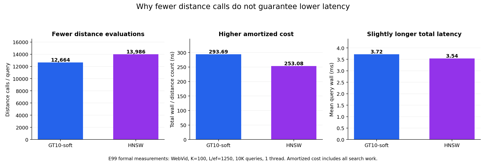
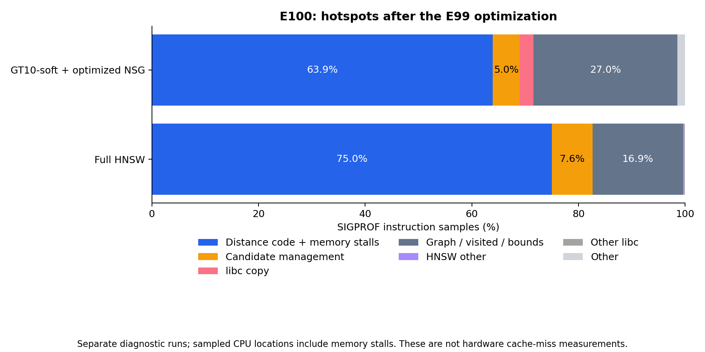

# E100：优化后的剩余搜索成本与 NSG 库使用核查

2026-09-16，诊断完成。E99 的加速已成立；本轮没有再修改生产搜索实现，没有新增正式 QPS 点，也没有证明新的加速收益。固定 WebVid 全部 10K 公开查询、GT10-soft 与完整 HNSW、K100/L1250，完成 80,000 次诊断搜索，返回 ID、距离 bits、入口及插桩轮逐 query NDC 均与 E99 一致。

结论：GT10 少做距离计算，但当前 NSG 搜索检查了更多邻接槽，且访问、预取、候选维护也消耗时间。应先补原生 Faiss NSG 对照，再验证减少空槽遍历等改造；不能把较低 NDC 直接解释为更高 QPS，也不能把换库当作已证实的加速方案。

## 当前 NSG 是否自己手写

现有实现是“库组件加项目搜索改造”。`ACSG/CMakeLists.txt` 直接链接 Faiss。`ACSG/IndexACSG.cpp:129` 的 build_type=1 分支创建 `faiss::IndexNSG`、调用 `add()` 建图，再复制其邻接和入口；项目的 `ACSG::build` 整理邻接，外层还调用 `fix_connectivity()`。因此不能将最后的项目图不加说明地称为未经修改的原生 Faiss 索引。

在线实际使用 `Worker → ACSG::search_new(mode=2) → search_on_graph_new`。距离计算器、向量存储和 visited 等仍复用 Faiss；项目维护多入口初始化、候选池、遍历及 trace 接口。GT10/GATE 每 query 注入最多三个真实入口；当前对照中标为 NSG 的方法只注入固定入口，随后使用同一个项目搜索内核。这是共享图和搜索实现的入口策略对照，尚不是单独测量的原生 Faiss NSG 基线。

本地 Faiss 原生 `NSG::search` 使用成员 `enterpoint`，`search_on_graph` 从入口邻居初始化并用随机点填满 L 个初始候选；项目版本从最多三个指定入口逐步扩展。原生公开接口不直接接受这套每 query 多入口参数，直接替换会改变搜索语义。可用库确实存在： [Faiss IndexNSG 官方接口](https://faiss.ai/cpp_api/struct/structfaiss_1_1IndexNSG.html)及[作者 NSG 实现](https://github.com/ZJULearning/nsg)。这里只解释当前接口的改造需求，不推断最初开发者未记录的历史决策。

还需注意，本地 Faiss 原生 NSG 同样循环 `graph.K` 并跳过无效邻接槽。空槽成本不完全是项目新引入的独有问题；原生版本也不保证更快。下一轮应该区分同图原生遍历、项目单入口遍历、最小多入口适配，按 Recall–QPS 判断，不能仅比较同 L 时间或要求语义不同的原生版本返回逐位一致。

## 为什么次数少仍然慢

以下性能数值来自 E99 已完成的同轮正式计时，本轮只重新整理；QPS 为各轮 QPS 均值，平均延迟直接来自各轮 wall，不从平均 QPS 反推。

| WebVid K100/L1250 | GT10-soft + E99 内核 | 完整 HNSW |
|---|---:|---:|
| Recall@100 | 90.6868% | 90.3718% |
| 平均 QPS | 268.864 | 282.511 |
| 平均每 query wall | 3.71936 ms | 3.53969 ms |
| 每 query 距离次数，含路由 | 12,664.32 | 13,986.45 |
| 总 wall / 距离次数 | 293.69 ns | 253.08 ns |

GT10 距离次数少约 9.45%，但每次距离所分摊的总成本高约 16.05%，最终延迟高约 5.08%，QPS 低约 4.83%。最后一行包括邻接访问、visited、候选维护、路由等全部工作，**不是纯距离函数耗时**。低预算 K100/L100 时，GT10 QPS 为 2816.58、HNSW 为 2488.48；不能把高预算瓶颈外推为所有预算都慢。

## 优化后新测出的结构成本

| 每 query 平均 | GT10-soft 的 NSG | 完整 HNSW |
|---|---:|---:|
| 展开次数 | 1256.226 | 1265.421 |
| 邻接槽/邻接项检查数 | 80,398.464 | 25,976.641 |
| NSG 无效邻接槽 | 57,743.690 | 不适用 |
| NSG 已访问跳过 | 10,105.406 | 未计此项 |
| NSG 新邻居距离计算 | 12,549.368 | 未计此项 |

NSG 每展开一个点总扫描 R=64 个槽，检查量约为 HNSW 的 3.095 倍；其中 **71.82% 是无效槽**。这些检查没有发生距离计算，因而不计入 NDC。HNSW 的上表检查数按实际邻接长度累计，包含上层访问；其未插桩的字段不能把 CSV 中的零解释为实际为零。

全量只读检查冻结 WebVid 图的 2,505,000 行：无效槽全为尾部连续的 -1，没有内部空洞或正数越界，平均有效度 19.805。实际查询加权有效度为 18.034。可考虑在加载后计算每行最后一个有效槽的位置，遍历时避开尾部；这种 span 对内部有空洞的其它图也能保留原检查顺序。Web R64 可用约 2.505 MB 的单字节辅助信息，通用 uint32 约 10.02 MB；本轮尚未实现。**71.82% 空槽不等于可节省 71.82% 时间**，空槽检查比向量计算便宜。

此外，每 query 候选插入约 3003.8 次，逻辑复制约 15.29 MB，71.75% 的复制量发生在池已满之后。该字节数不是 DRAM 流量。有效预取目标中 43.63% 在发出时已 visited，说明存在进一步筛选或调整距离的研究空间，但不能直接据此删除预取；E99 已实测它的总体收益。

## 新热点与证据限制

本轮重新采样 E99 优化后的真实内核。GT10/HNSW 分别得到 9360/8863 个 SIGPROF 样本：

| 采样位置类别 | GT10-soft | HNSW |
|---|---:|---:|
| 距离代码及其访存等待 | 63.94% | 75.01% |
| 候选维护 | 5.04% | 7.63% |
| libc 复制 | 2.55% | 0.01% |
| 图循环、visited、边界与预取附近 | 26.98% | 16.95% |

用样本比例乘对应采样轮 wall 作粗略定位，GT10 距离区域约 2.394 ms/query，低于 HNSW 的 2.660 ms；图循环等区域约 1.010 ms，对照约 0.601 ms。候选加复制两者约 0.284/0.271 ms。由此优先调查图访问与预取组织，而不能继续用 E98 优化前的“距离区域 77.3%”代表当前状态。

热点反汇编中，一处高频采样地址是向量预取后的 NOP，另一处是邻接读取后的检查。采样地址可能包含等待及采样偏移，不能说 NOP 本身昂贵，也不能把 26.98% 全归给 padding。本轮没有硬件 cache-miss、带宽或 TLB 计数；`perf_event_paranoid=4` 保持，未安装 perf 或改系统权限。预取能否隐藏延迟取决于发出时机，见 [GCC 官方说明](https://gcc.gnu.org/onlinedocs/gcc/Other-Builtins.html)。

独立分项测量中，GT10 路由为 18.795 us/query，只占总 wall 的约 0.503%；外层 setup 为 0.599 us/query。完全消掉路由也填不平当前约 5% 的时间差，因此这次证据不支持优先重训入口模型。

## 下一步验证顺序

1. **原生库对照与最小适配。** 冻结同一 base、metric、图、查询与单线程环境，加入原生 Faiss NSG 搜索；明确其初始化和返回语义差异。另保留项目单入口及 GT10 多入口，分辨库实现与入口策略的影响。同图移植需要核对 graph/enterpoint、符号与所有权；不顺便重建图，避免混入拓扑变化。先固定小范围预算，不自动启动全五集网格。
2. **跳过邻接尾部空槽。** 优先保持拓扑、有效边顺序、distance 调用顺序、结果与逐 query NDC 一致，检查含洞、空行、越界和生命周期。辅助 span 的生成、存储和计时边界需明确；不能把本图尾部连续性质直接假定于其它图。
3. **预取组织和单 query batch4。** 再研究只为待评估邻居安排足够提前的预取与四向量距离计算，保留 visited、插入与等距处理顺序。本轮锁定的 16,384 对标量/batch4 距离比较中 bits 差异为零，这是有限数值可行性证据，尚非完整搜索等价或速度证据。[Faiss 官方距离接口](https://faiss.ai/cpp_api/struct/structfaiss_1_1DistanceComputer.html)提供 batch4，但是否获益取决于实际实现与访问模式。
4. **最后再考虑候选结构和整体内存布局。** 满池复制仍存在，不过新采样不支持将它单独视为主要剩余差距；大幅改队列或图布局更容易改变等距顺序、内存成本与缓存行为。

这些是待验证方向，不是新增已上线功能。若实施无语义变化的内核优化，先差分/边界回归，再按用户已选范围重点测 WebVid Recall@1/100、其余四集一致性；所有共享 NSG 方法公平应用同一内核。原生库对照应单独命名，不能覆盖 E97/E99 历史“NSG”结果。所有新正式计时继续同机、CPU15、数值库与进程单线程、方法串行。

## 成本、保护与原始证据

诊断调度含加载 311.089 秒（5.185 分钟），两方法各 warmup/stages/SIGPROF 共 60,000 search，结构插桩各一次共 20,000 search；编译、代码审查、符号化和报告另外计，不把 5.185 分钟称为本轮全部人工与工具耗时。峰值 RSS 约 15.88 GiB。额外全图 padding 审计读取 641,280,000 字节、0.637 秒、0 search；数值比较是 16,384 对距离、0 ANN。无训练、新构图、新 GT 或新正式 QPS，未访问新的 held-out 或挑选失败子集。

本轮开始前将 E99 代码与结果备份为 `7d09367e85b956f4b4ab67c73e6f2b583ffcee38`，分支 `backup/post-e99-pre-cost-research-20260916_122453`，226 文件回读一致；原 `2739b09a` 备份保留。生产源码、旧构建库、E99 优化库及历史结果保持，默认仍 Web soft/Yandex hard。

- [协议](protocol.md)、[运行状态](state.json)、[完成记录](complete.json)
- [汇总 JSON](results/summary.json)、[正式成本 CSV](results/formal_cost.csv)、[工作量 CSV](results/work_mean.csv)、[padding 全图检查](results/padding_audit.json)
- [profile 源码](src/profile.cpp)、[独立插桩](src/ACSG.probe.cpp)、[分析入口](src/analyze.py)、[图脚本](src/plot.py)
- [诊断核验](reviews/diagnostic_audit.json)、[最终核验](reviews/final_review.json)、[Git 备份](reviews/git_backup.json)、[热点反汇编](reviews/prefetch_hotspot_disassembly.txt)

E99 的正式收益仍是 WebVid 四个固定预算、四种共享 NSG 方法约 +10.51% 至 +13.53% QPS；本轮不扩大成完整前沿或跨五集速度优势。新的结构和采样结果支持进一步工程验证，尚不能承诺超过 HNSW。
