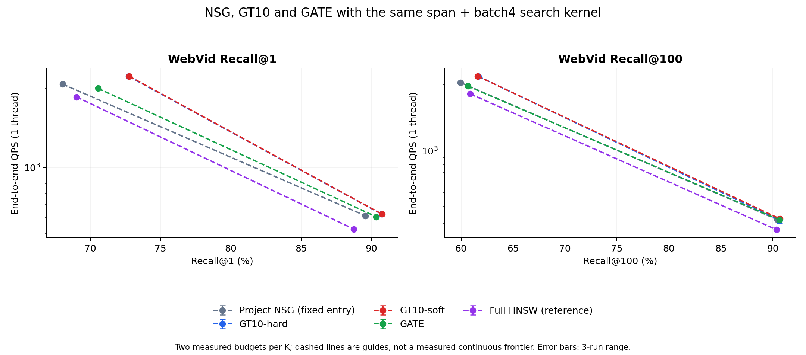
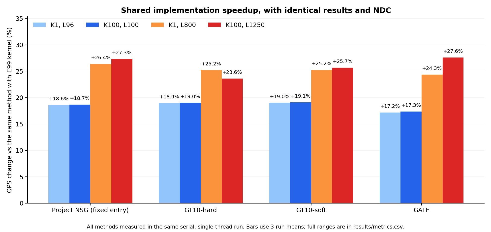

# E102：NSG、GT10、GATE使用相同优化后的公平比较

本轮已完成WebVid四预算、四入口方法各新旧内核及同轮完整HNSW，共36配置、108轮单线程plain；再完成其它四集64配置一致性，合计 **2296000次真实搜索**。所有WebVid warm/plain/count返回ID、距离bits、入口及逐query距离次数与E99一致，真实batch4计数已直接转发底层接口。

**NSG自身在四点的平均QPS变化为+18.58%至+27.28%。** K100/L1250从252.11提高至320.90 QPS，Recall@100保持90.4456%。因此批量距离和尾部空槽优化的收益属于共享搜索实现，不能全部归功于GT10入口方法。GT10/GATE的剩余优势应看同样优化后的对照，见下表。

## 比较合同

NSG是项目固定单入口，GT10-hard/soft为原画像三入口，GATE使用原已修复正负冲突模型及原三入口映射。四者的span+batch4直接调用同一份E101 ResearchKernel、同一冻结图与向量storage；current实际链接E99优化库。原图、模型、router小图、query与GT不变，无训练、新构图或新GT。HNSW继续使用原完整图与原生度量。本轮NSG不是Faiss原生填满初始L的版本；原生Faiss 1.9.0比较保留在E101，不混入本轮表。

WebVid完整10K原public query，K1/L96、K100/L100、K1/L800、K100/L1250。CPU15，进程及OMP/BLAS/MKL均线程1，所有方法串行，每点warm1+plain3+count1。QPS为三次N/wall的平均，范围为最小–最大，不是置信区间。完整计时包含原路由、图搜索及输出写入；GT/校验/加载/写盘外置。三轮波动和全部正负结果均保留，没有挑最快轮或按公开结果选hard/soft。

## 统一优化后的方法结果

| 方法 | 内核 | L96 Recall@1 | 平均QPS（最小–最大） | L800 Recall@1 | 平均QPS（最小–最大） |
|---|---|---:|---:|---:|---:|
| NSG | current | 68.0400% | 2696.96（2692.63–2705.03） | 89.5600% | 404.07（397.59–407.35） |
| NSG | span-batch4 | 68.0400% | 3198.06（3193.50–3203.00） | 89.5600% | 510.61（502.40–514.87） |
| GT10-hard | current | 72.7400% | 2997.33（2989.61–3005.44） | 90.7300% | 416.61（416.57–416.68） |
| GT10-hard | span-batch4 | 72.7400% | 3564.82（3560.59–3567.91） | 90.7300% | 521.67（521.41–522.08） |
| GT10-soft-t1 | current | 72.7700% | 3001.07（2999.86–3001.96） | 90.7500% | 416.55（416.43–416.73） |
| GT10-soft-t1 | span-batch4 | 72.7700% | 3571.47（3562.80–3577.13） | 90.7500% | 521.72（521.54–521.88） |
| GATE | current | 70.5600% | 2573.94（2567.82–2581.80） | 90.3400% | 404.44（404.37–404.58） |
| GATE | span-batch4 | 70.5600% | 3015.75（3009.68–3023.48） | 90.3400% | 502.90（492.08–508.69） |
| HNSW | reference | 69.0300% | 2675.13（2669.80–2678.21） | 88.7500% | 423.51（417.22–426.86） |

| 方法 | 内核 | L100 Recall@100 | 平均QPS（最小–最大） | L1250 Recall@100 | 平均QPS（最小–最大） |
|---|---|---:|---:|---:|---:|
| NSG | current | 59.9563% | 2608.75（2602.79–2612.54） | 90.4456% | 252.11（251.11–252.92） |
| NSG | span-batch4 | 59.9563% | 3095.93（3094.75–3097.70） | 90.4456% | 320.90（316.51–325.32） |
| GT10-hard | current | 61.6544% | 2888.56（2885.05–2894.58） | 90.6596% | 257.81（256.79–258.83） |
| GT10-hard | span-batch4 | 61.6544% | 3436.63（3434.93–3439.81） | 90.6596% | 318.62（302.41–327.28） |
| GT10-soft-t1 | current | 61.6003% | 2893.38（2891.69–2895.93） | 90.6868% | 258.55（257.04–260.86） |
| GT10-soft-t1 | span-batch4 | 61.6003% | 3445.21（3443.38–3447.23） | 90.6868% | 324.95（320.68–329.25） |
| GATE | current | 60.6542% | 2490.55（2486.64–2493.87） | 90.6317% | 250.55（248.60–253.06） |
| GATE | span-batch4 | 60.6542% | 2922.34（2912.92–2933.31） | 90.6317% | 319.69（316.99–321.71） |
| HNSW | reference | 60.8910% | 2566.26（2561.62–2569.36） | 90.3718% | 271.54（269.62–272.71） |

图上仅新内核的NSG/GT10/GATE和同轮HNSW；每个K只有两个实测预算，连线仅辅助阅读，不构成完整实测前沿。以下方法间变化以同样优化的NSG为参照，分别是K1/L800及K100/L1250：

| 都使用span+batch4 | Recall@1变化（pp） | QPS变化 | Recall@100变化（pp） | QPS变化 |
|---|---:|---:|---:|---:|
| GT10-hard 相对NSG | +1.1700 | +2.17% | +0.2140 | -0.71% |
| GT10-soft-t1 相对NSG | +1.1900 | +2.18% | +0.2412 | +1.26% |
| GATE 相对NSG | +0.7800 | -1.51% | +0.1861 | -0.38% |

这是同预算的局部比较。不同方法的Recall不一定相同，不能把QPS比例称作等Recall加速；若召回与QPS同时更高，也只支持这些已测点的优势，不能外推整条曲线或跨五集。

## GT10的入口选择是否仍有效

将公共内核保持一致后，GT10的独立贡献应直接与新NSG比较，而不是用GT10新内核对比NSG旧内核：

| 固定预算，同一新内核 | NSG Recall / QPS | GT10-hard Recall / QPS | GT10-soft Recall / QPS | soft相对NSG的Recall / QPS变化 |
|---|---:|---:|---:|---:|
| K1/L96 | 68.0400% / 3198.06 | 72.7400% / 3564.82 | 72.7700% / 3571.47 | +4.7300pp / +11.68% |
| K100/L100 | 59.9563% / 3095.93 | 61.6544% / 3436.63 | 61.6003% / 3445.21 | +1.6440pp / +11.28% |
| K1/L800 | 89.5600% / 510.61 | 90.7300% / 521.67 | 90.7500% / 521.72 | +1.1900pp / +2.18% |
| K100/L1250 | 90.4456% / 320.90 | 90.6596% / 318.62 | 90.6868% / 324.95 | +0.2412pp / +1.26% |

低预算的两个点支持GT10同时改善Recall和QPS；高预算下仍有Recall收益，但速度差距变小。高预算的小幅QPS差应结合上表三轮范围，不能据平均值给hard/soft或其它接近的方法排稳定名次，也不能据此宣布GT10全面第一或已经无效。

与结果相符的一种机制解释是：更好的入口在有限搜索预算下更有价值；当预算增加，固定入口NSG通过更多探索可以缩小差距。这只是当前证据下的解释，没有单独的因果消融验证。后续若要判断方法在目标召回区间的最终价值，需要共同内核下的等Recall实测前沿，本轮没有追加该实验。

## 公共内核分别带来多少提速

| 方法，新内核相对自身current | K1/L96 | K100/L100 | K1/L800 | K100/L1250 |
|---|---:|---:|---:|---:|
| NSG | +18.58% | +18.67% | +26.37% | +27.28% |
| GT10-hard | +18.93% | +18.97% | +25.22% | +23.59% |
| GT10-soft-t1 | +19.01% | +19.07% | +25.25% | +25.68% |
| GATE | +17.16% | +17.34% | +24.35% | +27.59% |

相同方法的新旧返回逐位相同，所以这张表直接衡量实现变化的速度收益。它与上一节相同内核下的方法差异是两种不同结论。完整三轮配对范围和“新最慢轮/旧最快轮−1”的保守描述见[speedup.csv](results/speedup.csv)；小差异若落在轮次波动内，不作稳定胜出判断。batch4含邻居聚合和预取组织变化，未单独归因硬件缓存等待与SIMD算术。

## 距离次数与成本

| K100/L1250 | Recall@100 | QPS | 路由NDC | 图NDC | 总NDC | ms/query |
|---|---:|---:|---:|---:|---:|---:|
| NSG | 90.4456% | 320.90 | 0.00 | 12727.31 | 12727.31 | 3.1166 |
| GT10-hard | 90.6596% | 318.62 | 118.15 | 12550.72 | 12668.87 | 3.1427 |
| GT10-soft-t1 | 90.6868% | 324.95 | 111.95 | 12552.37 | 12664.32 | 3.0778 |
| GATE | 90.6317% | 319.69 | 298.06 | 12661.20 | 12959.26 | 3.1281 |
| HNSW | 90.3718% | 271.54 | 0.00 | 13986.45 | 13986.45 | 3.6828 |

距离次数没有计入邻接槽检查、visited、候选池维护等全部开销；在每种方法NDC与结果不变时，执行组织仍能改变端到端wall。span数组占2,505,000字节，一次准备0.1016秒，计入加载阶段。

主WebVid程序含加载48.380分钟，其中查询及各轮检查48.236分钟；其余四集各程序含加载合计14.608分钟。整体runner含前后身份核验63.889分钟，编译与报告另计。主程序峰值RSS 15.887GiB。本轮新合成搜索0，继承E101已通过的6480配对组合普通及ASan/UBSan验证，未将继承成本冒充新执行；新包装由完整真实查询对照验收。

## 其他四集一致性

| 数据集 | 配置 | 搜索次数 | 不一致配置 |
|---|---:|---:|---:|
| yandex_t2i_official10M_ip_v1 | 16 | 160000 | 0 |
| deep10m_l2_v1 | 16 | 160000 | 0 |
| sift10m_bigann_l2_v1 | 16 | 160000 | 0 |
| gist1m_l2_v1 | 16 | 16000 | 0 |

其它四集返回ID、距离bits、入口及逐query route/graph NDC全部一致。该阶段只做真实batch4 count，0正式QPS，不能由此宣称Yandex/Deep/SIFT/GIST也提速。原完整query规模10K/10K/10K/1K，四方法各四预算，共496000次；没有LAION或Recall@10。

## 状态与复现

所有优化已应用到本轮独立统一评测入口，原生产API/trace和默认库未覆盖。默认仍Web soft/Yandex hard；本轮没有按public结果更换模型或追加网格。修改前Git备份`8afd61cd5dae388f15e26890ce75109ffffd0f2f`，main/index及历史产物保留。若后续合入主内核，仍需保留完整API、trace、特殊值/未知DC回退和图生命周期约束。

- [协议](protocol.md)、[配置](configs/webvid2_5m_light_v1.json)、[运行状态](state.json)、[最终验收](reviews/final_review.json)
- [36配置指标](results/metrics.csv)、[108轮计时](results/wall_rounds.csv)、[实现加速](results/speedup.csv)、[同内核方法差异](results/shared_kernel_comparison.csv)、[跨集回归](results/compatibility.csv)
- [统一入口](src/compare.cpp)、[共享优化内核](src/kernels.hpp)、[评分](src/analyze.py)、[数值验收](reviews/results_audit.json)、[输入身份](reviews/assets.json)、[结束身份核验](reviews/post_run_identity.json)、[Git备份](reviews/git_backup.json)
