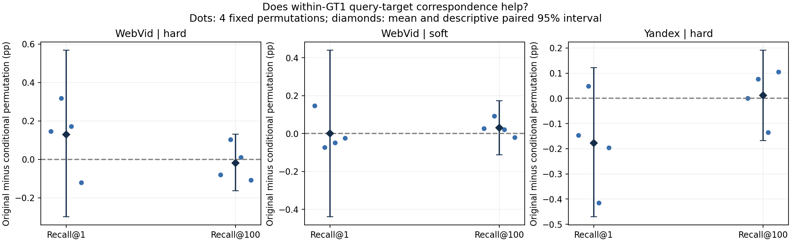
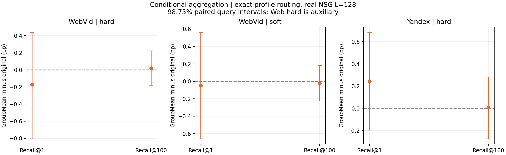

# E106：GT10条件机制分析与条件聚合检验

2026-09-20，已完成“机制推导 → 唯一候选 → 冻结实验 → 独立核验”的第一轮闭环。**STOP_GROUPMEAN_CANDIDATE**：两集均未达到事前质量门，不进入该候选的实际ANN建图/完整wall阶段。原默认WebVid GT10-soft-t1、Yandex GT10-hard及生产E99保持。没有找到稳定改进，也没有由本轮证明GT10收益的完整原因。

## 这轮改变了什么认识

GT10包含非随机的组内query–目标关联，但这种向量结构强，不等于真实搜索收益强。在保持每hub权重多重集与ESS的干预中，原画像相对四个条件置换没有稳定的Recall优势。把组内关联全部平均掉，同样没有稳定获益。两项结果只限制当前解释，不能推出“细节完全无用”或“GT10仅靠平滑有效”。

更早需要核对的前提是比较对象。当前两集、真实K1/K100、L128、精确画像路由下，GT10相对GT1的Recall差异本身就是混合的。既有GT10相对NSG的系统收益、GT10相对GT1的增量、相同Recall下的QPS，必须分别解释。本轮没有NSG单入口对照或新QPS，不能否定[E103完整五集前沿](../20260916_optimized_five_dataset_r1_r100_v1/report.md)，也不能用这一个L替代它。

## 先推导：GT10究竟估计了什么

原画像是固定相关性权重下的闭式球面代理解，详见[上一轮理论复盘](../20260920_gt10_theory_review_v1/report.md)。令单位query为z_i，完整GT10归属向量为a_i，g_i为该query的GT1目标最近原hub。以g分组，计数n_g，平均归属m_g，平均query方向c_g。对每hub h，未归一化画像严格满足：

\[
v_h=u_h+\sum_i a_{ih}z_i
=\underbrace{u_h+\sum_g n_gm_{gh}c_g}_{B_h}
+\underbrace{\sum_g\sum_{i\in g}(a_{ih}-m_{gh})(z_i-c_g)}_{D_h}.
\]

B保留GT1区域内部共同的多目标关系；D保留该区域内query方向与更细目标归属的交叉矩。GT1 hard在组内归属恒定，所以D=0；但GT10相对GT1的差异不全等于D，B也发生改变。

固定query，在每个同GT1组内均匀置换**完整a行**。每hub所有权重值、质量、平方和、ESS及query总质量均严格不变；GT1 hard标签保留。干预通过画像方向起作用，方向并非应固定的混杂因素。单例组不动，不强制无固定点。

\[
E_\pi[v_h^\pi]=B_h,\qquad
E_\pi\|D_h^\pi\|^2
=\sum_{g:n_g>1}\frac{\sum_{i\in g}(a_{ih}-m_{gh})^2\;\sum_{i\in g}\|z_i-c_g\|^2}{n_g-1}.
\]

后一式由无放回置换协方差及组内中心化得到；它是固定fit表上的干预尺度，不能冒充泛化误差或Recall定理。[推导、反例和旧分支区别](research.md)在fit及查询访问前锁定，[六种置换的独立枚举核验](reviews/analytic_check.json)通过。

由Eπ[vπ]=B只推导一个候选：**GroupMean=normalize(B)**。它在未归一化向量上取条件平均，再归一化；没有alpha、组数或网络选型。若需迁移的方向主要由B表示，它可能更稳；若D含有效信息，它可能变差。条件平均本身没有一般的MSE/Recall改进保证。GroupMean会增加ESS，严格匹配ESS的是置换对照，不能混淆两者。

Web soft沿用硬GT1分组，未保留query特定的GT1软概率，其机制结果不能称为纯第2–10名尾部效应。hard两集为主要机制，Web soft用于匹配实际默认。此项区别于E27全局tail打乱、E26单位画像插值、E80目标条件化子画像、E95查询矩构图；不声称条件置换本身是新算法。

## fit结果：关联存在，但还不能叫作搜索信号

各族20K合法fit query，原画像/归属摘要恢复；V=B+D最大误差7.07e−14。画像原件用于baseline，不用舍入后的重建文件替代。

| 族 | 原ESS中位数 | GroupMean ESS中位数 | 画像转角中位数 | 真实D能量 / 置换期望 |
| --- | --- | --- | --- | --- |
| WebVid hard | 67.36 | 208.36 | 9.95° | 6.71× |
| WebVid soft | 132.28 | 413.78 | 8.36° | 8.95× |
| Yandex hard | 60.08 | 144.42 | 11.58° | 4.91× |

真实D能量是随机干预期望的4.91–8.95倍，四个实际置换能量接近解析期望。说明当前fit关联有结构；不证明结构有检索价值，亦不提供总体显著性。

## 再检验：完整固定对照

模型全部冻结后，复制E105各4096条已曝光query及其原GT100作机制/开发验证，非新盲测。Web14/Y8方法：GT1 exact，每族原GT10 exact、GroupMean exact、四固定seed置换exact，另原默认真实ANN。全H原IP距离取真实3入口，再进同一原raw-IP NSG；实际返回K1/K100，L128。缓存路线只服务质量归因，不测在线QPS。

原默认ANN逐条恢复E105的入口、返回ID、距离bits和NDC。各方法完整count/plain输出一致，独立Python集合评分核验全部4096行；重复query及同三入口的输出/距离bits/NDC全匹配。每点8条返回距离使用原base做float64检查，exact每方法16条做独立全H排序检查。

条件置换结果，单位均为百分点：

| 族 | K | 原画像−四置换均值（pp） | 描述性95%区间 | 四个置换的独立方向值（pp） |
| --- | --- | --- | --- | --- |
| WebVid hard | 1 | +0.1282 | [-0.2991, +0.5676] | +0.1465, +0.3174, +0.1709, -0.1221 |
| WebVid hard | 100 | -0.0188 | [-0.1638, +0.1303] | -0.0798, +0.1030, +0.0103, -0.1086 |
| WebVid soft | 1 | +0.0000 | [-0.4395, +0.4395] | +0.1465, -0.0732, -0.0488, -0.0244 |
| WebVid soft | 100 | +0.0294 | [-0.1125, +0.1731] | +0.0259, +0.0925, +0.0200, -0.0208 |
| Yandex hard | 1 | -0.1770 | [-0.4700, +0.1221] | -0.1465, +0.0488, -0.4150, -0.1953 |
| Yandex hard | 100 | +0.0119 | [-0.1675, +0.1912] | +0.0007, +0.0764, -0.1348, +0.1052 |

六项描述性95%区间全部跨0，每项的四个seed方向均混合。四次随机干预不是四套独立数据，也不是校准的条件独立p值。此结果不支持“同GT1区域内细粒度对应必然提供稳定Recall收益”；也不是等效性证明，区间仍容许正负效应。

## 候选结果：未过预锁门

冻结主门要求Web soft与Y hard各自两K均值不降、至少一项≥0.5pp且至少一项校正98.75%区间下界>0；四主指标各20000次固定seed配对bootstrap。Web hard只作辅助，不用于重新选Web默认。

| 族 | K | 原GT10 exact Recall | GroupMean exact Recall | 差值（pp） | 98.75%区间 | 零命中 原→新 |
| --- | --- | --- | --- | --- | --- | --- |
| WebVid soft | 1 | 75.3906% | 75.3418% | -0.0488 | [-0.6592, +0.5615] | 1008→1010 |
| WebVid soft | 100 | 65.6191% | 65.5969% | -0.0222 | [-0.2261, +0.1816] | 4→0 |
| Yandex hard | 1 | 90.5762% | 90.8203% | +0.2441 | [-0.1953, +0.6836] | 386→376 |
| Yandex hard | 100 | 83.7341% | 83.7405% | +0.0063 | [-0.2739, +0.2812] | 24→24 |

两集均未过门，四主区间全部跨0。Web两个半段方向相反；Y两个半段都是小正值，但不足以通过门。Web hard辅助R1/R100为−0.1709/+0.0198pp，同样不能支持另选主族。Web soft K100零命中4→0这一正面变化完整保留，但平均Recall略降；不能只挑失败query子集宣布有效。

为防止把精确路由的收益计入新画像，下表另列当前实际ANN基线；候选仍是exact，不是已部署ANN对比：

| 族 | K | 当前默认ANN Recall | 零命中 ANN→候选exact | 候选exact−当前ANN（pp） |
| --- | --- | --- | --- | --- |
| WebVid soft | 1 | 75.3174% | 1011→1010 | +0.0244 |
| WebVid soft | 100 | 65.5408% | 5→0 | +0.0562 |
| Yandex hard | 1 | 90.6250% | 384→376 | +0.1953 |
| Yandex hard | 100 | 83.7917% | 24→24 | -0.0513 |

## 事后解释：画像、入口和真实收益之间隔了什么

以下只统计本轮已有全量输出，不新增搜索、不改变冻结门，脚本/全部36项保存在[action_effects.py](postprocess/action_effects.py)与[完整CSV](results/action_effects.csv)。

| 族 | K | 改变入口的查询 | 改变返回的查询 | Recall增 / 损查询 | 多找回 / 少找回目标 | 净目标数 |
| --- | --- | --- | --- | --- | --- | --- |
| WebVid soft | 1 | 3096/4096 (75.59%) | 153 | 48 / 50 | 48 / 50 | -2 |
| WebVid soft | 100 | 3096/4096 (75.59%) | 939 | 367 / 372 | 2136 / 2227 | -91 |
| Yandex hard | 1 | 2457/4096 (59.99%) | 66 | 31 / 21 | 31 / 21 | 10 |
| Yandex hard | 100 | 2457/4096 (59.99%) | 371 | 161 / 149 | 1793 / 1767 | 26 |

GroupMean改变Web soft 75.59%、Y hard 59.99%的三入口，但K1只有98/52条查询命中改变；K100只有739/310条查询命中数改变。其余入口改动未转化成当前指标差异。发生改变的查询又同时存在收益和损失，Web K100额外找回2136个目标却丢失2227个，Y为1793与1767。**改变很多入口不等于获得很大的净改进空间。** 此处计数是查询各自GT内的命中次数，不是全库去重目标数。

更直接的前提检查如下，均为已测相同exact路由条件：

| 族 | K | GT10 exact−GT1 exact（pp） | GT10 exact / GT1 exact Recall |
| --- | --- | --- | --- |
| WebVid hard | 1 | +0.1221 | 75.4883% / 75.3662% |
| WebVid hard | 100 | -0.0613 | 65.6013% / 65.6626% |
| WebVid soft | 1 | +0.0244 | 75.3906% / 75.3662% |
| WebVid soft | 100 | -0.0435 | 65.6191% / 65.6626% |
| Yandex hard | 1 | -0.2930 | 90.5762% / 90.8691% |
| Yandex hard | 100 | -0.1680 | 83.7341% / 83.9021% |

因此本轮不能从“GT10在这组条件上一定更准”出发构造故事。所有条件置换的平均graph NDC都略高于对应原GT10；主族GroupMean的NDC增加Web0.3622%、Y0.0656%。这些是实际距离计算量的描述，未做对应成本显著性/完整wall验证，不能换算QPS或据此声称保留了性能优势。

## 本轮之后，理论任务应如何收敛

先识别要解释的是**哪个baseline、哪段预算和哪种收益**。本轮只完成对“组内细节/条件平滑”的一次可证伪检验；目前尚未识别GT10相对NSG整体收益中，查询画像、真实hub覆盖、多入口和搜索路径各自的贡献。

已明确的缺口是代理到真实搜索的转换：q·p_h描述查询与训练目标区域的相关性；实际U_K,L(q,S)由三入口共同触发的有限预算轨迹决定。闭式代理目标再精确，也未控制两者误差；B/D分解本身不改变这个事实。需要建立可验证的路径/预算条件和反例，再推导新目标或可部署动作，不能把D能量大、ESS增加、角度变小当作收益定理。

下一方法立项必须先说明它如何区别于已有真实联合效用监督E104、已停的WFree E105和历史局部动作分支，并在同监督简单控制上提出会失败的可检验预言。此处不提出已被实验支持的新网络、收缩系数或门控方法；**停止GroupMean及其参数追加**。实际ANN/独立完整wall是通过质量门后的条件步骤，本候选未满足条件，所以不产生后续运行队列。

## 成本、身份与交付

fit闭式构造约12.24秒，编译约8.21秒；搜索编排约179.98秒（含输入/身份准备与加载），四搜索子进程合计170.65秒；主要独立评分约7.08秒。它们不是在线延迟/QPS。最大搜索RSS约9.92GiB。

共361856次NSG调用、16448次原默认小图ANN路由；前16行smoke与全4096行主测试分开保留。构造15份闭式候选/置换画像，**0梯度训练、0新GT、0新图、0新K10、0正式QPS**。CPU15、方法及数据串行、实际线程1；总量低于预锁400000次NSG、3600秒子进程和40GiB上限。

原fit/GT/归属/模型等23个保护文件SHA在前后核验；两完整base按E105 GT manifest重验SHA，大图沿用身份并核对stat、加载合同及内嵌base抽查，未声称重新全NSG哈希。模型与源码分别在评估载荷访问前封存。旧root文档的修改前快照、更新前快照以及全部正负结果保留；新报告/图表与根文档同步后由[收尾审计](reviews/completion_audit.json)确认完成。

证据入口：[冻结协议](protocol.md) · [配置](config.locked.json) · [全部44点指标](results/metrics.csv) · [完整候选配对](results/candidate_pairs.csv) · [候选/原画像零命中并集](results/failure_queries.csv) · [全方法逐query命中](results/aligned_hits.npz) · [原始搜索成本](reviews/jobs.json) · [数值核验](reviews/numeric_verification.json) · [预锁门判定](reviews/decision.json)。全方法原始返回保留于results各数据集目录；failure_queries.csv仅为原画像与GroupMean的失败并集，不能当所有置换方法失败清单。
