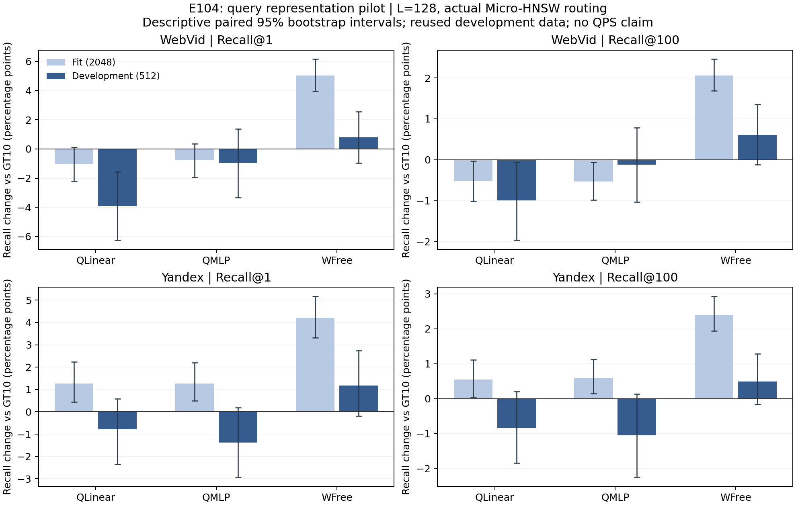

# E104：查询侧非线性表示验证

2026-09-20。**结论：STOP_REPRESENTATION，本版查询 MLP 未通过预锁的开发门，停止进入完整 QPS 阶段。** 两集的有限候选中确有真实收益余量，但一次轻量查询非线性变换没有稳定兑现它。更简单的静态自由画像 WFree 出现局部正值，保留为控制结果，不事后升格为主方法或替换默认。

当前仍为 WebVid GT10-soft-t1 / Yandex GT10-hard，生产 E99 不改。最新完整五集 Recall–QPS 证据仍是 E103；本轮没有新的 QPS 或五集前沿结论。

## 做了什么

按[研究阶段协议](../20260920_query_representation_research_v1/protocol.md)和[执行澄清](protocol.md)，两集各取原 E24 fit 前2048条、cal前512条，分别对应 router_train 源行10000—12047、0—511。行身份、不相交、GT100、hub映射已核对。它们都是历史开发数据，不能称新盲测；cal query/GT 在全部六个模型冻结后才打开。

真实底库、raw-IP、NSG、GT10画像及小图保持，所有方法使用逐字继承 E103 的 span+batch4 ResearchKernel。每条 query 的候选是两份 GT10 实际三入口的并集，再按 anchor 精确画像排名补足8个，枚举56个真实三入口集合。K1/K100 均以 K 对应的真实搜索、L128 执行。没有新增 Recall@10。

模型为 Identity、QLinear、QMLP、WFree。QLinear/QMLP 隐藏宽度16，前者线性、后者ReLU；两者同参数量、固定P/小图。WFree直接学习不逐行归一化的静态W，并独立构建普通HNSW。共同监督只包含已测56集合，不把未测集合当零收益。全部固定seed20260920、Adam1e-3、40epoch、batch256、温度0.05、分数漂移正则10，无调参/重训/epoch回选。底图始终使用原始查询。

## 开发集实际结果

以下均为各512条 cal、真实 Micro-HNSW 路由、L128。括号是相对各集现有默认 GT10 的百分点变化。

| 数据集 | 方法 | Recall@1 | Recall@100 | 图距离计算均值 |
|---|---|---:|---:|---:|
| WebVid | GT10-soft-t1 | 77.5391% | 65.9160% | 1642.98 |
| WebVid | QLinear | 73.6328%（−3.9063） | 64.9258%（−0.9902） | 1808.49 |
| WebVid | **QMLP** | **76.5625%（−0.9766）** | **65.8008%（−0.1152）** | **1788.56** |
| WebVid | WFree | 78.3203%（+0.7813） | 66.5234%（+0.6074） | 1725.73 |
| Yandex | GT10-hard | 91.2109% | 83.9570% | 2879.04 |
| Yandex | QLinear | 90.4297%（−0.7813） | 83.1172%（−0.8398） | 2988.66 |
| Yandex | **QMLP** | **89.8438%（−1.3672）** | **82.9043%（−1.0527）** | **2967.79** |
| Yandex | WFree | 92.3828%（+1.1719） | 84.4473%（+0.4902） | 2972.08 |

QMLP 相对 GT10 的四项描述性配对95% bootstrap区间均跨0：Web R1 [−3.3203,+1.3672]pp、R100 [−1.0352,+0.7875]pp；Yandex R1 [−2.9297,+0.1953]pp、R100 [−2.2542,+0.1376]pp。因此这里的结论是**没有达到预先要求的改善门**，不是证明总体必然下降。WFree的四个正值区间也均跨0，且未测完整wall，不能据此宣称稳定胜出。

QMLP 的失败迁移：Web K1救回17条、新损伤22条，零命中115→120；K100两者均0条零命中。Yandex K1救回5条、新损伤12条，零命中45→52；K100救回3条、新增7条零命中，合计4→8。WFree的K1零命中为111/39，K100为0/1，但其图距离计算也比原GT10更多。

完整72行 fit/cal ×全部方法×K 指标、逐query hit和控制差值见 [CSV](results/quality_metrics.csv)、[配对数组](results/quality_aligned.npz)、[简单控制比较](results/control_contrasts.json)。

[PDF图](figures/recall_changes.pdf)。误差线为同query配对重采样2000次的描述性区间；重复/多指标不增加独立数据集数，未作多重比较校正。

## 为什么停止，哪些现象确实得到验证

**1. 不是没有可用的入口组合。** 在训练部分，有限候选oracle相对anchor的R1/R100余量为Web +6.4941/+3.0747pp、Yandex +4.4922/+2.8369pp；58.64%/43.41%的query至少一个K可改善。开发部分仍有 +5.0781/+2.9141pp、+3.3203/+2.0410pp。oracle分别按实际结果事后选组合，只是有限动作上界，不是可部署算法或全H上界。[标签重评分](results/fit_label_analysis.json)

**2. 训练拟合成功不等于完整路由成功。** 六次训练目标均下降。WFree在训练56集合内的教师匹配达100%；QMLP为64.75%/68.31%。但QMLP在Web训练部分的实际ANN R1/R100也低于GT10（−0.7813/−0.5273pp）；Yandex训练部分正值+1.2695/+0.5977pp，到了cal变负。这里既有训练代理与实际动作不一致，也有跨查询迁移不足，不能全部归因于同一种过拟合。

**3. 小图近似不是唯一问题。** 去掉近似、在完整P上精确取top3，QMLP在cal相对同样精确的Identity仍下降：Web R1/R100 −1.3672/−0.5000pp，Yandex −1.7578/−0.9277pp。实际ANN下QMLP与精确top3的集合差异率52.34%/19.73%，但仅增大ef不能解释或消除精确路线已经存在的损失。

**4. 局部监督与全H动作存在明显差异。** QMLP在cal有93.95%/61.13%的最终ANN三元组不属于该query已测的56集合；这些动作本轮都重新真实搜索，没有假定其收益为0。训练仅约束有限集合之间的相对分数，部署则在全H中选top3，这一差异不能被训练loss下降排除。

门失败后，只利用已经测好的标签做了一次不训练、不搜索的诊断：把同一模型限制在原C8候选内选择，QMLP的cal R1/R100相对GT10变为Web +0.5859/+0.0586pp、Yandex +0.1953/+0.0117pp。这支持“动作范围改变影响结果”的解释，但其收益很小，也没有在线成本验证。WFree恰好相反，在C8内的结果弱于全H，说明不能把所有走出候选池的动作都视为坏动作，不能把覆盖差异当作单一已证明原因。[缓存诊断](results/cached_support_diagnostic.json)

上述C8限定动作均在本轮原标签中真实执行过，故其结果有完整执行依据；它不是新训练方法、不是一次新QPS实验，也不重开已经失败的门。

## 阶段门与成本

| 阶段 | 实际结果 |
|---|---|
| 身份与入口顺序 | 通过；两集各16个预锁位置、六种排列、K1/K100；新kernel与原search_new同入口返回/距离bits/NDC一致 |
| fit联合收益余量 | 两集通过；进入预定六次训练 |
| 训练实现/冻结 | 六模型、40epoch各一次；损失概率/梯度检查通过；C++与PyTorch编码误差≤3.58e-7，分数误差≤8.45e-7 |
| cal表示门 | **两集均失败**；QMLP未超过GT10，也未超过WFree；Yandex亦未超过QLinear |
| 完整wall、五L、8方法 | **依预锁条件未进入**；原计划160配置/480plain没有执行，不存在新QPS |

实际655808次NSG搜索：顺序/原kernel核验448、fit标签458752、cal标签114688、模型质量81920；另36000次小图路由、2次WFree小图构建。0新GT生成、0新大图构建、0新K10、0正式plain计时轮。

六次训练合计约11.61秒（训练进程计时、CPU-only；峰值RSS约360MiB），两个WFree小图新建合计0.132秒；搜索子进程从启动到退出共约314.80秒，包含加载/诊断，不能换算成在线QPS。搜索峰值RSS约9.96GiB。准备、编译、分析与人工编码时间另列完成核验；继承GT/大图/原画像的历史成本未在本轮重新测量，不视为零。

IdentityANN在全部fit/cal上恢复原GT10入口及质量；模型实际选到已测集合时，完整返回ID、距离bits、NDC逐项匹配缓存。新输出独立GT重评分、返回合法性及raw-IP距离抽查通过。大图本轮只检查size/mtime和加载shape/metric，继承既有身份，不声称重新全量hash大图。关键源/旧研究/原模型、小图的保护核验、调用总账及可复现路径见[完成审计](reviews/completion_audit.json)。

## 对方法方向的影响

本轮不支持把查询侧MLP作为当前最优先的论文主方法，也不支持通过加宽网络、换seed或改名RL继续本版本。它没有否定所有非线性查询学习：本次只检验了固定P、r16、有限候选监督及两套历史开发数据。

WFree的正值应完整保留，但它是较强的简单控制，当前证据首先说明“更复杂网络并非必要”。若以后继续方法研究，需要先提出能处理真实效用监督与实际动作范围差异、并能在未参与训练的查询上稳定兑现收益的机制。不能把这次小样本正值改写成已经找到GT10替代方案。本版停止，默认保持，无待运行的训练或wall队列。
