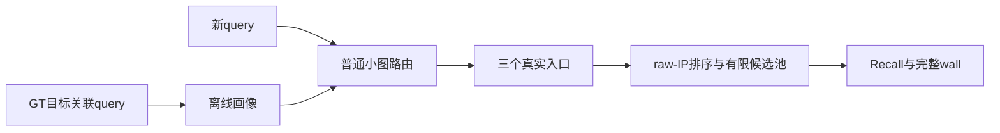

# GT10的收益来自哪里，下一步应该优化什么

2026-09-20首阶段理论研究综合。原13:05:42–16:00目标已由用户于15:34延长到19:00；本报告封存已完成的E107–E111与理论核验，整体目标仍在[19:00接续版本](../20260920_until1900_theory_v1/state.json)推进。

**本轮没有得到稳定替换GT10的方法，但已把几个相互混淆的问题分开，并通过原搜索内核检验了理论推导。** 当前保留WebVid `GT10-soft-t1`、Yandex `GT10-hard`及生产E99。GT10相对固定NSG仍有系统收益；现有证据不支持把它全部归因于“十目标画像更精确”，也不支持为了增加方法复杂度直接加入RL或MLP。

## 1. GT10究竟在优化什么

固定真实hub h，记单位hub向量为u_h、单位fit query为x_i、该query的GT10目标分给h的总质量为a_ih。源码构造为

`v_h = u_h + Σ_i a_ih x_i`，`p_h = v_h / ||v_h||`。

当v_h非零时，这正是单位球上加权亲和目标`max pᵀv_h`的全局最优解。它估计的是“目标落在这个区域时，与之相关的query朝向”，将base目标区域映射到query分布。给相同目标套一个输出静态单位画像的MLP，不能超过这个已知最优目标值。

这个解释有清楚的统计条件：[方向分布推导](research/probabilistic_profile_interpretation.md)将当前画像写成固定权重、方向先验下的最大后验解；公共浓度、等先验等条件下，内积排序才对应区域后验排序。真实数据是否满足这些条件尚未证明。GT10与GT1使用不同的目标分布，十个目标也共享同一query，不能解释成十倍独立样本或单纯降低方差。

更关键的是，**上述最优是画像代理目标最优，尚不是有限预算图搜索最优**。E106的精确分解/匹配置换未证明组内GT10细节有稳定Recall贡献；本轮进一步直接检查了目标信息、入口交互与实际ANN路由。

## 2. 收益需要分成四个环节

第一，真实H入口集合本身已经重要。固定原H、用单位hub向量精确选择一个入口，L128相对固定NSG的R1/R100均值已经提高：Web **4.5898/1.3228pp**，Yandex **1.3672/1.0408pp**。原H由QGT/GT参与选择，不能把这个控制称为完全无监督，也不能把上述比例当成因果贡献占比。[E107全矩阵](stages/e107_initialization_factorial/report.md)

第二，GT10并不普遍提供更好的精确入口。相同H、相同底图、精确排序对照中，GT1/GT10/单位hub的质量关系随数据、K和L变化。Web单位hub三入口在九个K/L均值都高于GT1三入口；GT10也没有形成普遍画像优势。这个事实修正的是收益解释，不是否定整套GT10相对固定NSG的历史收益。

第三，画像还改变小图恢复自身排名的难度。普通ANN对各自精确top3的**入口成员召回**，GT10/单位hub分别为Web **93.95%/81.25%**、Yandex **97.32%/91.75%**；路由距离计算约112/165、107/216。它与最终Recall不同，不能用入口成员召回代替真实搜索质量。同seed重建GT10控制也保留了这一差异。[E108](stages/e108_unit_hub_online/report.md)

第四，多个入口会通过候选池相互影响。单位hub从1到3入口的18个K/L均值全正，GT10为17负/1正，后者仅一项描述性区间排除0；不能把均值方向全部说成显著。原kernel的严格数值反例证明增加入口没有一般单调保证。强制画像top1先展开的E110反事实，确实修复原三入口的部分损失，但仍未稳定超过单入口。

精确与ANN的质量必须分开：记I为精确路由后的实际搜索效用、A为普通小图路由后的实际效用，则候选相对默认的差为`ΔA=ΔI+(A−I)_候选−(A−I)_默认`。E108逐query核对了这一恒等式；由于有限池交互，两个ANN项可以为正或负。

## 3. 为什么这次仍停止了候选

| 检验的问题 | 观测 | 决定 |
|---|---|---|
| 直接给真实目标均值或区域覆盖，是否足以改进搜索？ | Web真实覆盖35.42%→68.93%，R1却−0.6836pp；Y有正信号，两代理均未过跨数据门 | 不训练对应预测器；完美代理不是实际Recall上界 |
| 固定同三个入口，只改变第一次展开，是否能保留单入口收益？ | 相对原三入口的等K均值Web+0.1065pp、Y+0.1552pp；相对单入口仅+0.0479/+0.0016pp，区间均跨0 | 保留机制结论，停止该方法候选 |
| 能否从图结构直接给搜索收益保证？ | 排名核心证书是保守充分条件；Y的条件GT1恢复量仅0.1709pp、成功覆盖12.13% | 不用于本版监督，不扩大核心或路径网格 |

对应完整证据：[E109](stages/e109_perfect_proxy_gate/report.md)、[E110](stages/e110_first_expansion_intervention/report.md)、[E111](stages/e111_rank_core_certificate/report.md)。三个门分别检查代理是否有用、干预是否产生净收益、保证是否覆盖足够数据，不是三个换名网络试验。E109使用预锁fit2048/集；E110/E111使用各4096已曝光开发query，均不是独立泛化证据。

这也不等于“RL/MLP不行”。历史E104已使用真实联合效用集合监督，不能再把失败解释成从未考虑联合标签。代理错位、实际动作未变化、跨query增损抵消、迁移不足、ANN与在线成本是不同问题，应分别定位。[学习目标与搜索合同](research/learning_objective_and_search_contract.md)

## 4. 理论上已经得到的边界

保留引理：在完整有限池L搜索中，真实前m名核心满足m≤L及相应排序条件，则其中已发现节点不会被驱逐，最终会展开。从初始核心种子和**实际首展开节点**的核心邻居出发，沿核心诱导有向图可达的节点，给出条件Recall下界。这是直接使用搜索合同的桥接条件，不再用cosine区域归属代替可搜索性。[证明与条件](research/retained_target_reachability.md)

条件必须分层：核心与外部严格分离可保证核心成员保留；K1返回指定ID还要求GT1严格最优或与GT一致的并列规则。E111发现15条ID违例都属于同一条Web query的逐字重复向量，原GT1与返回节点ID不同。全部旧分数、query、GT和违例保留；它最多影响每个Web K1均值0.024414pp，解释不了大多数失败。原推导在这两层条件上的文字不足已单独[修正留档](reviews/theory_scope_correction.json)，E111冻结原件保持。m100与第101名的严格间隔本轮未新验证。

另外，[同几何、不同图反例](research/graph_dependence_v1/report.md)经四次原kernel合成执行确认：query/base/GT/入口都不变，仅图连接改变，两个入口的优劣就反转。因此不含图条件的几何代理无法对任意此类有向图保证搜索收益。它不证明固定当前NSG上的入口函数不可学习，也不声称这些合成cycle由NSG建图产生。

这些是基础推导和可证伪证据，尚不是新颖性已经确立的论文定理。[原论文条件对照](research/literature_scope.md)区分了欧氏入口理论、可导航图与停止条件、分区路由、方向统计和当前raw-IP多入口实现；LMG全文证明仍未完成核对，不据此主张首次性。

## 5. 当前实际性能与成本

下面仅列E108的L128便于读数，选择结论依据其完整K1五L、K100四L和三轮单线程wall。每格为 **Recall% / QPS / 零命中query数**，每数据集4096条开发query，K1/K100分别真实搜索。

| 数据 | K | 原GT10默认 | 单位hub小图 |
|---|---:|---:|---:|
| WebVid | 1 | 75.3174 / 2582.73 / 1011 | 75.4395 / 2588.65 / 1006 |
| WebVid | 100 | 65.5408 / 2572.30 / 5 | 65.8062 / 2580.54 / 6 |
| Yandex | 1 | 90.6250 / 2254.76 / 384 | 90.8203 / 2222.00 / 376 |
| Yandex | 100 | 83.7917 / 2252.04 / 24 | 83.6226 / 2206.20 / 34 |

单位hub没有形成跨数据替换：Web九点计时范围均重叠；Y四个点单位hub的完整范围更慢、另外五点重叠，K100四个质量均值均负。任何微小速度均值变化都不升格为稳定加速。当前仍保留原默认；最新完整五数据集前沿仍为[E103](../20260916_optimized_five_dataset_r1_r100_v1/report.md)，本轮两数据集开发检验不替代它。

本限时段完成 **2,797,056次真实NSG**，另有 **6次合成kernel调用**；只新增4张普通路由小图，**0新底层图、0新GT、0梯度训练、0held-out访问、0生产/默认变更**。E111有新的图派生诊断标签。E108含54正式配置、162轮单线程完整在线wall；其它阶段不宣称新增QPS。旧GT、底图及继承画像的历史成本未知部分仍不能当零。

| 阶段 | 真实NSG | 含加载的搜索进程秒 | 其它主要增量 |
|---|---:|---:|---|
| E107 | 1,181,184 | 1203.26 | 初始化因素与2次合成反例 |
| E108 | 1,106,688 | 1156.25 | 4小图；54配置/162轮wall |
| E109 | 66,304 | 59.52 | fit完美代理，不训练 |
| E110 | 442,880 | 469.62 | 仅首展开；失败编译另2.02秒 |
| E111 | 0 | 0.00 | 约17.81秒图派生进程，0搜索 |

成本按实际进程日志提取：搜索进程包含加载、smoke/count和输出核验，不能当纯在线wall；编译、准备、图派生和分析另计。[成本台账](results/cost_ledger.json)保留逐阶段定义及进程记录，E110首次编译失败约2.02秒亦保留。预算上限4M真实NSG/2GiB新增文件，截止身份、文档和资源核验见[最终验收](reviews/completion_audit.json)。

## 6. 下一步的研究决策

**停止围绕旧GT10画像继续更换优化器、网络名和小参数；保留GT10主线，先解决图条件与真实收益之间的缺口。** 下一份方法提案应回答：在固定底图、真实raw-IP与有限预算下，什么不依赖在线GT的信息，能预测一组可索引入口的净搜索收益，同时保留基线收益及在线成本？

门槛是具体的：先给出成立条件、反例及条件在两数据上的覆盖依据；再证明目标信息能在实际动作族上产生足够净收益；只有这些成立，才比较同监督的简单模型与MLP/双塔/RL，并检验普通小图与完整wall。当前排名核心证书覆盖不足、完美区域代理未过跨数据门，不能以换网络绕过。

针对论文，今天最有用的变化是问题定义更准确、对照更强、能解释哪些收益仍未被证明；尚未形成稳定新方法，也不能据此判断CCF B录用概率。新的独立数据、完整匹配对照和与前作的实质差异仍是发表证据缺口。原停止版本没有预排训练、扩大m/路径或追加seed/ef的任务。用户延长后的新研究由独立版本记录，不能把延长时间当作重启旧网格的理由。
