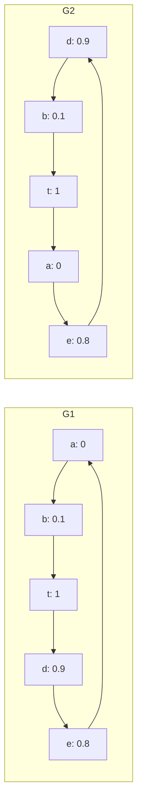

# 相同几何可以对应相反的入口搜索效用

2026-09-20，四次冻结原内核的合成执行通过，0真实数据NSG、ANN、GT、训练或正式QPS。编译及运行约7.48秒，CPU15/线程1。此例用于说明理论需要图结构条件，不是新的性能实验或可部署方法。

固定一维query q=1，五个base节点为a=0、b=0.1、t=1、d=0.9、e=0.8，采用原raw-IP距离。t是唯一GT1，入口候选为a与d，容量L=2、K=1。构造两张强连通有向cycle：

| 图 | 从a出发返回 | 从d出发返回 | 较优入口 |
|---|---|---|---|
| G1 | t，命中 | d，漏失 | a |
| G2 | d，漏失 | t，命中 | d |

G1从d出发时，d和e占据两个候选位置，a被拒绝，因此到不了a→b→t；G2从a出发时，e和d占据两个位置，b被拒绝，因此到不了b→t。另一个入口先进入b→t，便能命中。所有比较严格，没有并列解释。

任何只由这些固定q/base/目标/hub几何产生、没有图输入或图条件的代理，给a与d的相对得分相同，无法在两图上都保证正确的严格偏好。更形式化，设该代理差为c=C(a)−C(d)，对图G允许偏移a_G和非负斜率b_G，且对两入口均有`|U_G(h)−a_G−b_G C(h)|≤δ`。两入口相减得`|U_G(a)−U_G(d)−b_G c|≤2δ`。若c≥0，G2的真实差−1迫使δ≥1/2；若c<0，G1的真实差+1也迫使δ≥1/2。因而没有跨这两图的非平凡小误差保证。

这一结论的范围有限：它针对任意强连通有向图，不声明这些cycle满足NSG建图或文献的可导航结构条件；它不否定在固定数据库/固定图上，从query和图派生监督学习入口。GT10的H若由图/目标参与选择，也已经带有部分数据结构信息，不能将整套系统称为几何无结构方法。正确用途是要求后继明确其图、查询、预算条件及可检验覆盖。

[原始结果](results.json) · [执行锁](lock.json) · [源码](verify.cpp) · [完成核验](complete.json)。连通性逐起点核验，四个预先固定的期望返回全部通过；未修改E107内核及其依赖，合成调用在总台账中单列。
