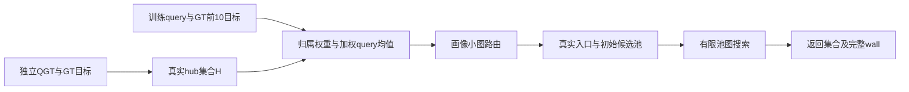

# GT10 理论复盘与方法决策

2026-09-20，持续至北京时间19:00的理论研究综合报告。各阶段已完成；最终状态与身份记录为本目录的`complete.json`。

**这次研究改变了对收益来源和失败原因的理解，尚未找到稳定超过GT10的新方法。** 当前WebVid仍用GT10-soft-t1，Yandex仍用GT10-hard，生产保持E99。不能凭MLP、双塔或RL的名称判断论文方法强度，也没有依据承诺CCF B的录用概率。

## 1. 先把“GT10为什么有效”拆开

GT10系统包含三步：用独立QGT查询及其真实目标选出真实hub；用训练查询及GT目标归属构造画像；在画像小图上路由，再从对应真实ID运行原NSG。三步的作用不能全部归给“十目标平均”。

对固定hub，实际公式为

`p_h = unit(u_h + Σ_i a_ih · unit(q_i))`。

GT目标向量决定权重`a_ih`，真正累加的是query方向；每query的总权重为1。在构造向量非零的条件下，这个公式精确最大化固定权重下的球面亲和目标；退化fallback与浮点误差不由这个解析结论覆盖。因此，**GT10已经是在学习一个有闭式解的查询代表**。换成网络去优化同一个固定目标，不会改善其精确最优值。它没有证明目标本身最适合有限预算搜索。[源码与推导](../20260920_gt10_theory_review_v1/report.md)

在固定H、IID查询、非零总体加权均值等条件下，可以给出方向估计的有限样本亲和风险界。有效支持量和方向一致性都重要；十个目标不是十份独立query，ESS增大也不保证方向更准确。GT1与GT10还改变了被估计的总体对象，不能把差别全解释为降方差。这些是基础推导，尚不是实际Recall定理或独立论文创新。[条件与证明](research/weighted_mean_statistical_scope.md)

## 2. 实测迫使我们收窄原来的解释

首先，“整套GT10系统优于固定NSG”与“使用十个目标优于一个目标”不是同一个命题。E106在相同H、全H精确三入口、L128和相同query下，hard GT10−hard GT1的R1/R100均值为Web **+0.1221/−0.0613pp**、Yandex **−0.2930/−0.1680pp**。它只覆盖该K/L机制点，不能据此改默认；但说明不能先假定十目标在所有条件下都有稳定增量，再寻找一个解释该假定的理论。匹配支持置换的六个描述性区间也全跨0，未分离出细粒度GT对应的稳定净收益。[E106原证据](../20260920_gt10_conditional_mechanism_v1/report.md)

E107固定原H、原图、query和kernel，只改变画像/路由/入口数。L128的精确单位hub单入口相对固定NSG，WebVid R1/R100已经增加**4.5898/1.3228pp**，Yandex增加**1.3672/1.0408pp**。相同查询上，当前GT10默认ANN的系统增量为4.2725/1.3127pp、1.6113/1.2871pp。**自适应真实入口本身已贡献明显收益，不能把整个系统增量当成GT10画像的独有贡献。** 原H由QGT/GT选择，这个控制仍含监督；不同入口数及路由方式也不构成独立因素的完整因果分解。[E107](../20260920_until1600_theory_v1/stages/e107_initialization_factorial/report.md)

但精确路由的质量不能决定线上替换。E108给单位hub建立真实小图后，Yandex的K100质量和速度变差。画像同时影响“精确分数是什么”和“小图能否低成本找到高分画像”：GT10与单位hub的小图入口成员恢复率分别为Web93.95%/81.25%、Yandex97.32%/91.75%，路由距离数约112/165、107/216。这是小图可检索性的实测差别，不是精确排序必然拥有更高实际Recall的定理。[E108完整比较](../20260920_until1600_theory_v1/stages/e108_unit_hub_online/report.md)

以下是E108各4096条已曝光开发query、同机CPU15/单线程、真实K、L128、三轮完整线上wall的匹配数据。R100的“零命中”指一个GT100成员也未返回，不是全部100个都未找全。这里只列一个预算帮助理解，方法决定使用完整54配置/162轮；旧完整五集前沿仍是[E103](../20260916_optimized_five_dataset_r1_r100_v1/report.md)。

| 数据集／K | 当前GT10 Recall | QPS均值 | 零命中数 | 单位hub Recall | QPS均值 | 零命中数 |
|---|---:|---:|---:|---:|---:|---:|
| WebVid／1 | 75.3174% | 2582.73 | 1011 | 75.4395% | 2588.65 | 1006 |
| WebVid／100 | 65.5408% | 2572.30 | 5 | 65.8062% | 2580.54 | 6 |
| Yandex／1 | 90.6250% | 2254.76 | 384 | 90.8203% | 2222.00 | 376 |
| Yandex／100 | 83.7917% | 2252.04 | 24 | 83.6226% | 2206.20 | 34 |

Web小幅速度均值的三轮范围全部重叠；Yandex四个K100预算的质量均值均负。单位hub不构成稳定跨集替换。原GT10有价值与新增强未通过，是两项不同结论。

E115进一步冻结评分P/U与完整小图状态GP/GU，补齐四格。固定评分后，GP在两集均减少路由NDC；但预定混合B=(U,GP)相对默认A在L128的Web R1/R100为−0.0977/−0.1482pp、Yandex−0.2930/−0.3481pp，四个校正区间均跨0，未过原质量门。评分和图的质量作用有交互，不能自由拼接各自优点。原GP/GU层级、初始入口不同，所以这里是完整图状态作用；旧E108同层级重建控制另行支持成本方向。[E115完整矩阵](stages/e115_score_topology_factorial/report.md)

随后只运行小图观察器，逐query恢复全部原入口、距离bits与NDC。固定U评分，换到GP后base展开**略多**，Yandex从11.55到12.73，但base扫描邻边从241.85降至160.63，总NDC从215.71降至129.31；Web方向相同。较便宜的小图搜索并非简单地走了更少步，而是主要处理了较少邻边/新节点。静态度、访问路径及层级共同变化，不能凭此推出继续删边就更好，也没有新增完整QPS。[路由工作恒等式](research/router_work_identity_v1/report.md)

进一步的保序反例说明，即使方向任意集中、绝对方差趋近0，距离比较与逻辑构图也能完全保持；因此集中度本身不足以解释图变稀疏。[几何原因的证据缺口](research/routing_geometry_scope.md)

## 3. 真正缺少的是“目标相关”到“搜得到”的联系

画像估计某类query和目标区域的关系。实际效用是

`U(q,S) = |Search(G,q,S,L,K) ∩ GT_K(q)| / K`，

其中S是实际入口集合。它依赖query、图、候选池、入口竞争、距离和同分规则。区域包含、几何接近或存在一条路径，均不足以保证有限池把必要节点展开。

E109直接给候选真实目标信息，跳过预测误差：Web区域覆盖从35.42%升到68.93%，实际R1/R100相对GT10反而−0.6836/−0.0908pp；Yandex为正，但跨集门失败。因此“把区域预测得更准，再加一个更强模型”缺少必要依据。这些特权代理不是全搜索效用上界。[E109](../20260920_until1600_theory_v1/stages/e109_perfect_proxy_gate/report.md)

候选池也没有一般的多入口单调性。E107中GT10单入口变三入口的18点均值17负、1正；只有1个描述性区间排除0，不能说全部退化已显著。E110保持同三入口，只让画像top1先展开，可以修复部分损失，却没有稳定超过单入口。**修复自己的退化，与超越强基线，是不同门槛。** [E110](../20260920_until1600_theory_v1/stages/e110_first_expansion_intervention/report.md)

本阶段进一步核验了一个必要性质：固定有限分数、最终池节点全部完成展开、没有额外提前中止且K≤L时，最终K1节点没有严格更高分的出邻居。E114的9575个不同query/终点、190109条原图邻接全部满足，独立算术核对也通过。八种旧入口策略在Web79.69%、Yandex90.60%的查询落到同一节点；当前默认失败中，**532/1011与202/384**在八种策略下都落到同一错误节点。[E114与条件](stages/e114_terminal_peaks/report.md)

这说明许多入口变动最终会汇合；改路由分数未必改结果。它不证明换任何入口都无效，也不把相同K1终点等同于相同K100、轨迹或耗时。对已返回节点再做一次一跳更高分重排无法改善严格分数；若允许更换同分ID后继续多跳，则不能套用反复不变的结论。[终点闭包的限制](research/terminal_closure_implications.md)

## 4. 为什么有真实教师，学习仍未改善

目前可以排除几种过于简单的解释，但尚未把所有因果份额分离。

| 猜测 | 现有核验 | 当前判断 |
|---|---|---|
| 只是网络不够强、训练没拟合 | E104 WFree在fit已标注C8的最优集合命中100%；后续E105未稳定复现收益 | 不能只提高训练拟合率；QMLP自身拟合和迁移问题仍分别存在 |
| 只是部署超出已标注动作 | QMLP有明显动作支持差；限制C8仍无明显恢复，WFree的cal全H反而好于C8 | 动作范围需要交代，但不是已证唯一原因 |
| 只是后续query造成分数漂移放大 | WFree后续cal/E105的平均分数残差为fit的0.93–0.98倍 | 没有总体分数漂移放大；不能排除局部排序边界效应 |
| 已有足够逐入口真实监督 | Web/Y每hub潜在非恒定教师支持中位只有13/10条；不是20K画像支持的同一计数 | 存在稀疏监督与共享信息问题；尚不能独立证明它造成全部失败 |
| K1与K100的教师折中是主因 | 原逐query等K教师等价于K1优先；cal分K最优额外K100仅0.186/0.064pp | 不能解释教师到学生的主要差距，不据此新开K权重或双头网格 |

证据：[教师损失与部署范围](research/teacher_loss_scope.md)、[锚定分数与支持统计](research/score_anchor_geometry_v1/report.md)、[K目标离散性](research/objective_quantization_v1/report.md)、[E105完整复验](../20260920_wfree_frozen_replication_v1/report.md)。平均分数残差不是Recall损失；这些检查是事后诊断，不是新独立验证。

WFree也并非没有改变动作：E105两集97%以上query的三入口已改变，但K1救回/损伤分别125/126、63/63，净收益接近0，完整QPS反而下降约5.90%/3.27%。应解释的是救回如何稳定超过损伤，而非单看入口变化率、fit最优集合命中率或某些修复案例。配对区间跨0没有证明真实增量精确为0，当前证据仍不满足原改进门。[净收益与不确定性](research/net_gain_and_uncertainty.md)

[导出PDF与口径](research/net_gain_figure_v1/report.md)。图中均为E105既有L128/K1汇总，0新增评测；完整曲线和不确定性仍以E105为准。

目标ID的重复也很稀疏。Yandex开发GT1在QGT GT1/GT100中出现的比例仅0.98%/16.11%；不同训练组之间同样稀疏。因此，直接记住目标ID或具体局部路径很难覆盖后续query；GT10通过几何归属共享信息，不能把精确ID的缺失质量当作GT10或NSG的性能上界。来源差异仍需保留，但不能把所有困难主要归因于后续来源漂移。[支持统计](research/source_support_v1/report.md) · [缺失质量的条件解释](research/missing_target_mass.md)

## 5. 从理论推出的两个方向，为什么在训练前停下

**首行图覆盖选H（E112）。** 对原图一个hub及其出邻接，定义真实目标覆盖下界，按固定H数量优化。经验集合目标单调且次模，贪心有相应经验近似保证；这不是实际Recall的近似保证。Web开发覆盖增量有信号，Yandex相对旧H仅+0.1404pp、98.75%区间跨0，对默认失败的条件GT1恢复为0。按事先门停止，未训练画像或运行新搜索，不能写成“GraphH实际Recall已失败”。[E112](stages/e112_one_hop_hub_design/report.md)

**实际比较对作为共享特征（E113）。** 图搜索分支由query对节点对的分数比较决定；合成核验显示，同一图与GT1下，任意接近的query也可能反转入口效用。但在原fit轨迹中，具体比较对只出现一次的比例为Web97.78%、Yandex99.29%。预锁字典支持条件下，Web只有10个对、覆盖7.28%查询；Yandex为0。停止具体ID对字典，未训练模型。它没有否定抽象图特征、查询表示或所有局部共享。[E113](stages/e113_comparison_support/report.md) · [合成反例及范围](research/query_branch_stability_v1/report.md)

两项停止减少了没有信息依据的训练投入。充分条件覆盖不足，只能停止相应设计；不能据此证明不存在可改进方法。

理论归属也作了修正：E111排名核心可达保证与NGFix的Escape Hardness有直接前作关系，不能宣称首次提出。返回稳定只限制两次返回之差，不保证正确；池容量L也不单独限制累计工作量为O(L)。这些边界影响论文表述，不改变封存实验或升级任何停止版本。[原文范围与基础反例](research/certificate_prior_work_addendum.md)

## 6. 方法决策：暂不启动下一种网络

另一个人工强连通图给出了更明确的能力边界：同图、同GT1的四个query，最优的两个单入口选择可呈XOR，两个静态线性分数不能全部表达。但四个线性画像映射两个入口，或很小的非线性query表示都能表达。8次原内核合成调用验证了这个构造；它没有证明当前约800hub/三入口的WFree不可能性，也没有选择出必须使用的网络。表达能力需要证据，模型名称不能替代这种分析。[完整例子与限制](research/xor_entry_expressivity_v1/report.md)

当前尚未找到同时满足下列要求的新监督信息：与真实有限池搜索增益有联系；能跨不同目标和query共享；在线可计算并可低成本索引；足以保留GT10原有收益。**这是后继研究问题，尚不是已实现方案。**

已有全H集合CE、结构化margin、精确期望真实效用、更多教师、多画像、query近邻Atlas和有代价的在线探针都做过相应版本。不能把“真实reward”“双塔”“图特征”几个词重新组合后当成未试的新方法。静态hub侧网络最终导出的内积向量仍属于WFree表示族；固定线性query塔可折叠进画像。表示包含关系不否定不同训练的归纳偏置，但要求说明新增价值来自哪里。[前作与表示审查](research/prior_work_and_representation_exclusions.md)

后继立项应先交付一个可被反驳的命题：什么在线信息，在什么图/预算条件下，能够预测相对默认入口的**净收益**。先检查它能否区分救回和损伤，而非只描述成功轨迹或复现已知目标。然后用同监督简单模型作控制；只有共享信息门和开发质量门通过，才投入MLP等学习与完整wall。不得从本轮失败query选子集调规则，也不得把本轮4096条/集改称未曝光测试。

对CCF B，当前可用的研究材料是低成本解析画像、入口/小图/有限池的分层机制、五数据集完整比较和适用范围；仍缺乏经过查新和独立验证的方法增量。基础恒等式、一般反例或更多失败次数本身不构成论文方法贡献。GATE已研究查询/拓扑增强入口，学习图遍历也有前作；仅加入RL/MLP/双塔不能建立差异。[GATE原文](https://arxiv.org/html/2506.15986v1) · [Learning to Route in Similarity Graphs](https://proceedings.mlr.press/v97/baranchuk19a.html)

完整的命题、证据与条件另列于[理论表述复查](reviews/theory_claim_review.md)。

## 7. 成本、身份和交付范围

本轮使用已曝光开发数据进行机制研究。每个新阶段冻结协议，并不消除此前看过这些数据所带来的选择；四项主比较的区间校正也不覆盖整个多阶段研究过程。因此这些区间不能冒充独立最终测试的泛化保证。确定性输出、恒等式和源码条件可以在当前样本上核验，但若未来新方法通过开发门，仍需另立独立验证，当前没有自动开启该任务。

16:00首阶段已独立封存：2,797,056次真实NSG、6次合成调用、4个路由小图；E107–E110搜索进程wall合计2888.65秒，包含加载、诊断和输出，不是线上QPS计时。新增到19:00阶段为328,448次真实NSG、12次合成调用、98,560次路由ANN（E115 33,024、工作分解65,536）；两阶段合计3,125,504次真实NSG、18次合成调用。98,560仅为后阶段ANN，未冒充两阶段ANN总量。E106及此前E104/E105有单独历史账本，不包含在这个两阶段计数中。[首阶段账本](../20260920_until1600_theory_v1/results/cost_ledger.json)

本阶段E112图标签进程49.73秒、编译8.68秒、成功分析4.45秒；两个序列化失败及机械修正原件保留，失败分析没有精确进程wall。E113轨迹进程39.60秒、编译8.58秒、分析5.66秒；E114只读终点分析4.84秒。统计分析另有记录；上述时长不相加冒充完整研究用时或在线QPS。历史GT、图和画像成本不为零。[E112成本](stages/e112_one_hop_hub_design/reviews/cost_ledger.json) · [E113成本](stages/e113_comparison_support/reviews/cost_ledger.json)

E115另有295,680次NSG、33,024次ANN，搜索进程327.36秒、编译8.53秒、分析5.72秒，4份混合索引及4份before副本；这些不是普通构图。后继工作分解65,536次ANN、编译5.07秒、路由进程0.56秒。XOR核验另有8次合成调用及1张人工图、编译7.72秒、合成进程0.004秒。新增阶段0普通图构建、GT生成、梯度或画像训练、正式QPS及held-out访问；有原图派生标签、离线H优化、旧模型分数残差计算及ANN诊断，不能笼统称“零计算”。底图/GT/原模型及负结果保留，默认与生产未变。各阶段都有源身份、parity、独立数值检查和完成审查；补充更正单独保留，不改写封存原件。

截至19:00，全部阶段与登记任务结束，原GT10默认及生产E99保持；本报告不产生新的训练、搜索或调参队列。两阶段文件约1.31GiB，最终测量口径见[完整成本账本](reviews/final_audit/cost_ledger.json)；已封存旧阶段的字节统计发生在它写入最后身份/文档回执之前，本次另记其实际目录大小，未改旧回执。

[最终身份核验](reviews/final_audit/identity.json) · [文档检查](reviews/final_audit/documents.json) · [完成审查](reviews/final_audit/audit.json)。预检中历史文件名笔误和串行任务分类漏计分别保留修正记录；实验源数据、分数、门和默认未因文档修正而改变。
