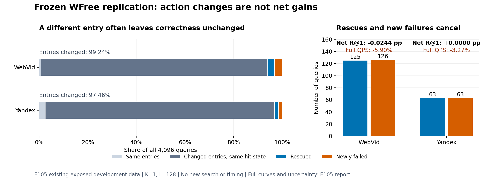

# 入口改变与净收益：E105冻结数据图

2026-09-20，仅复用E105主L128/K1汇总，两集各4096条已曝光开发query，0新搜索、训练或计时。当前图片及PDF已实际查看，数据、标签、图例可读。

左图四部分之和为4096：同三入口、三入口改变但K1命中状态相同、救回、新增失败。相同实际入口的原NSG输出一致性已由E105验收，因而命中状态变化必属改入口query。中性部分是按已核验计数相减，不是新增逐query分类或相同返回节点的断言。

右图显示救回/损伤125/126与63/63及原完整线上QPS均值变化。仅这一K/L帮助解释机制，未替代原完整曲线、校正区间和冻结质量/速度门。原区间跨0不能证明真值精确0；相反，当前证据没有建立要求的改进。

[PDF](net_gain.pdf) · [原始聚合数据](data.json) · [完整E105证据](../../../20260920_wfree_frozen_replication_v1/report.md) · [完成与源身份](complete.json)。
