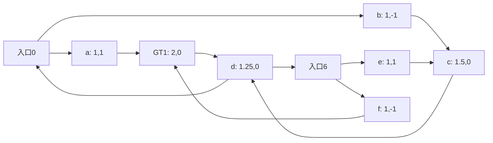

# 相同目标下的query内部搜索分支反转

2026-09-20，4次合成核验通过。原图、唯一GT1、两入口及hop距离固定，q第二维的符号改变后，入口0/6的成功排序反转。GT1对次优点的IP间隔始终为0.5，两个query的NDC各6；无目标切换、无预算变化。

| query | 入口0 | 入口6 |
|---|---|---|
| (1,+1/16) | 返回GT1节点5 | 返回非GT1节点3 |
| (1,−1/16) | 返回非GT1节点3 | 返回GT1节点5 |

该toy是任意强连通有向图，未由NSG构图程序生成。它证明一般的图连通性/GT1/最短hop标签不足以保证当前有限池搜索，不能证明真实数据经常如此、全部GT目标标签无效或query函数不可学习。这里简单线性query符号就能区分最优入口，不要求深网络。

[推导与预锁范围](protocol.md) · [源码](verify.cpp) · [实际结果](result.json) · [编译/执行成本](jobs.json) · [完成身份](complete.json)。0真实NSG/ANN/新GT/数据集图/训练；4合成调用单列，不作性能点。
