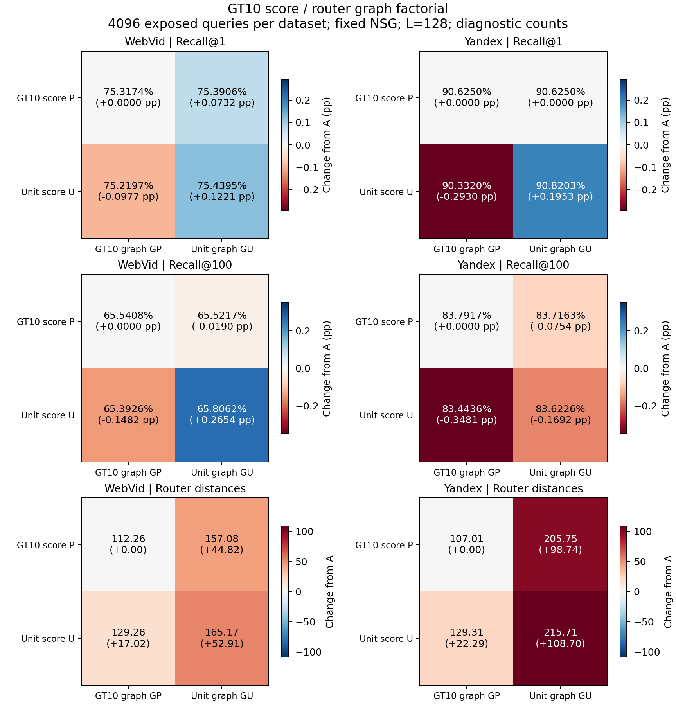

# E115：拆开GT10评分与路由小图

2026-09-20。**STOP_CROSS_SCORE_TOPOLOGY_CANDIDATE**。四格对照支持GT10小图的路由计算优势，但预定混合候选B在两集主质量点均未过门，未启动条件正式wall，不更换默认。评分与小图相互作用，不能从不同版本各取一个正向结果后推断组合必然更好。

## 动机和冻结设计

E108同时更换评分向量与路由小图，无法单独解释其路由NDC差异。本次固定原GT10画像P、单位hub向量U、原GT10完整小图状态GP和E108单位hub小图GU，构成A=(P,GP)、B=(U,GP)、C=(P,GU)、D=(U,GU)。**只有B是事先候选，C仅作机制控制**。E54已经采用模型/图交叉分析，E56/E95也研究过构图，本次是针对GT10的归因补充，不是新图学习算法。

GP/GU包含所有有序分层邻接、层级、入口节点和标签。混合索引仅改向量字节；四份before副本、完整非向量字节hash、所有向量行及real-ID均已核对。raw query、ef=10、3真实入口按ID升序进入同一NSG。两集各4096条E105已曝光开发query；K1的L64/128/256/400/800，K100的L128/256/400/800，全72点。路由缓存跨K/L复用，所以本次没有可报告的端到端QPS。

## 匹配结果

L128；Recall单位%，失败为该K返回与GT完全无交集的query数。K1/K100虽然终止搜索相同，Recall定义不同。下表完整NSG NDC取K1，已验证相同L的K1/K100一致。

| 数据 | 四格 | Recall@1 | Recall@100 | 失败K1/K100 | 路由NDC | NSG NDC |
|---|---|---:|---:|---:|---:|---:|
| Web | A_P_GP | 75.3174 | 65.5408 | 1011/5 | 112.259 | 1649.165 |
| Web | B_U_GP | 75.2197 | 65.3926 | 1015/11 | 129.278 | 1637.970 |
| Web | C_P_GU | 75.3906 | 65.5217 | 1008/6 | 157.082 | 1647.927 |
| Web | D_U_GU | 75.4395 | 65.8062 | 1006/6 | 165.168 | 1623.966 |
| Yandex | A_P_GP | 90.6250 | 83.7917 | 384/24 | 107.014 | 2858.890 |
| Yandex | B_U_GP | 90.3320 | 83.4436 | 396/43 | 129.309 | 2886.567 |
| Yandex | C_P_GU | 90.6250 | 83.7163 | 384/26 | 205.754 | 2857.095 |
| Yandex | D_U_GU | 90.8203 | 83.6226 | 376/34 | 215.711 | 2869.370 |

B−A主差值及预锁98.75%配对区间：Web K1 −0.0977pp [−1.0254,+0.8057]、K100 −0.1482pp [−0.5381,+0.2349]；Yandex K1 −0.2930pp [−0.9521,+0.3662]、K100 −0.3481pp [−0.7979,+0.0752]。Web K1恢复111/损伤115，Yandex52/64，说明动作改变可以带来相互抵消。区间跨0不证明效果恰为零；本次候选没有满足预定改进证据。

按K跨全部L平均，B−A为Web +0.1123/−0.0152pp、Yandex −0.1611/−0.1674pp。两集均不满足“两个主K非负、至少一个≥0.5pp且至少一个校正下界>0、各K跨L均值非负”。停止B，不改选C、某个L或单数据集，也不追加ef/seed/阈值。完整数字见[metrics](results/metrics.csv)、[paired](results/paired.csv)、[gate](results/gate.json)。

## 机制解释与归因边界

固定评分时，GP在两种评分背景、两集都减少路由NDC。例如U评分下，Yandex从215.711降至129.309，Web从165.168降至129.278。固定GP时，P又比U省路由计算。这表明低路由成本来自评分和图状态共同作用，**路由NDC减少不等于完整wall更好，也不等于真实召回提高**。

逐query精确恒等式为D−A=(B−A)+(C−A)+(D−B−C+A)。最后一项是交互项。L128的K1/K100平均交互分别为Web +0.1465/+0.4326pp、Yandex +0.4883/+0.2544pp。所有主B−A区间按冻结四检验口径；其余交互区间仅描述，不据其选择新候选或声明全部点显著。整数命中数恒等式73728行全部通过。

事后只读二进制解析发现：**原GP与GU的层级和初始入口不同**。因此本对照隔离完整小图状态，不能把C−A称为严格同层级的建边因果效应。E108同seed重建GP与GU的层级、入口相同；原GP与重建GP的所有第0层有序邻接完全一致，但上层不同。已有同层级控制的路由NDC仍为Web119.236对165.168、Yandex109.314对215.711，方向相同；它不是本次新增性能测量。

静态第0层平均出度为Web GP9.239/GU13.148、Yandex GP11.029/GU20.593。较稀疏邻接是成本差异的一个可检验解释，但静态出度不能单独分出实际展开次数、新访问节点和重复邻居的贡献。该描述在结果之后生成，不改变原门。[拓扑描述](results/topology_description.json)。

[PDF图](figures/score_topology.pdf)使用同一表；图已实际查看，坐标、数值与图例可读。

## 验收、成本与结论

A/D全部返回ID、距离bits、入口、两段NDC恢复E108；四格smoke的计数/普通/链接E99内核完全一致。独立全量评分，预定query的另一实现复算、131072行K1前缀、111681行相同入口一致性均通过。

新增295680次真实NSG（294912主诊断+768 smoke）、33024次路由ANN；4份混合索引及4份before副本，0普通构图/底图/新GT/训练/held-out/正式QPS。搜索进程含加载及smoke共327.357980秒，编译8.527983秒、序列化0.032110秒、分析5.721926秒、静态描述0.040991秒；最大进程RSS 9.916813GiB。成本不是QPS。六个登记native进程均正常结束。

本次获得机制证据，没有稳定替代GT10的方法。Web GT10-soft-t1、Yandex GT10-hard、生产E99均保持。原始负点、协议和身份记录保留；评分/建边换名及追加参数网格不进入待运行队列。

[冻结协议](protocol.md) · [配置](config.locked.json) · [诊断成本](reviews/diagnostic_complete.json) · [数值核验](reviews/analysis_complete.json) · [完整图状态身份](reviews/model_identity_gate.json)。
