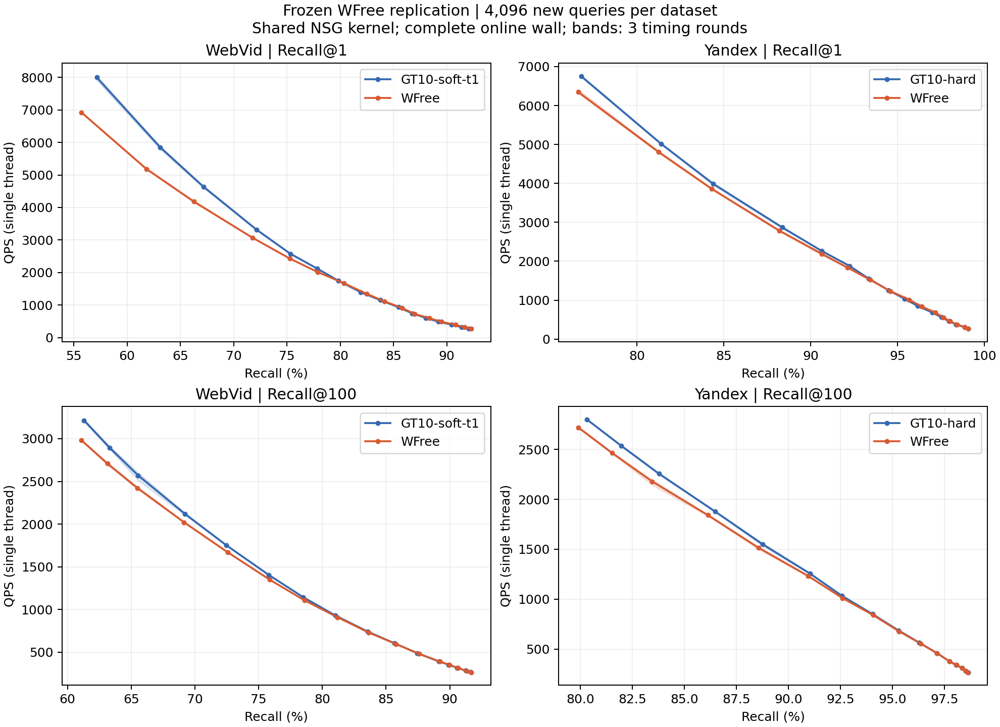
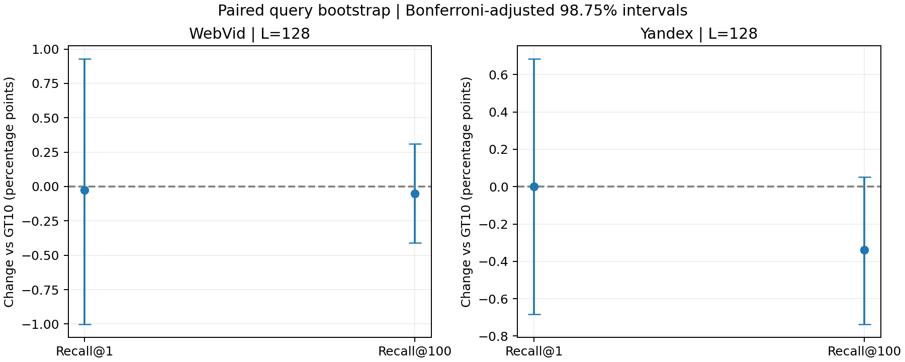

# E105｜冻结 WFree 独立复验

**未通过预锁复验门，停止本版 WFree 的继续投入。** WebVid GT10-soft-t1 / Yandex GT10-hard 默认及生产E99保持。候选、参数和图均未调整；完整原值和负点保留。

用户于2026-09-20明确“试试”后执行。本版固定E104最终WFree，与当前GT10在每集4096条新源行query上比较真实K1/K100；各K 16预算、完整单线程wall，实测128配置/384轮。其他数据集或GATE/NSG/HNSW新基线不在本轮结论内，E103仍是最新完整五集比较。

E104每集512条cal的正值未在本轮L128复现：Web/Y的K1救回与新增失败几乎抵消，Yandex K100零命中增加10条。部分高预算点仍有小幅Recall提升，但7个共同可达预设门槛的平均QPS全部更低，无法通过完整wall门。四项校正置信区间均跨0；这里作未达到预设改善标准的投入决策，不宣称已证明所有条件均有损伤。

## L128 主复验

| 数据集 | K | GT10 Recall | WFree Recall | ΔRecall/pp | 配对98.75%区间/pp | ΔQPS | 零命中 GT10→WFree | 救回/新增失败 |
|---|---:|---:|---:|---:|---|---:|---:|---:|
| WebVid | 1 | 75.3174% | 75.2930% | -0.0244 | [-1.0010, +0.9277] | -5.90% | 1011→1012 | 125/126 |
| WebVid | 100 | 65.5408% | 65.4895% | -0.0513 | [-0.4094, +0.3093] | -5.76% | 5→5 | 2/2 |
| Yandex | 1 | 90.6250% | 90.6250% | +0.0000 | [-0.6836, +0.6836] | -3.27% | 384→384 | 63/63 |
| Yandex | 100 | 83.7917% | 83.4541% | -0.3376 | [-0.7361, +0.0522] | -3.40% | 24→34 | 8/18 |

区间按query成对重采样20000次，四主指标采用98.75%逐项区间；原95%区间也保存。三轮wall不增加Recall样本。主门要求每集两K均值不退化、至少一K增益≥0.5pp且至少一项校正区间下界>0，不能只报正的一项。

## 完整Recall–QPS

| 数据集 | K | 目标 | GT10 L / 实际Recall / QPS | WFree L / 实际Recall / QPS | QPS变化 | 三轮同向 |
|---|---:|---:|---|---|---:|---|
| WebVid | 1 | 90% | 1000 / 90.4541% / 395.60 | 1000 / 90.8203% / 391.14 | -1.13% | 否 |
| WebVid | 1 | 95% | 未达到 | 未达到 | 不比较 | — |
| WebVid | 1 | 99% | 未达到 | 未达到 | 不比较 | — |
| WebVid | 100 | 90% | 1250 / 90.5815% / 317.31 | 1250 / 90.6655% / 315.63 | -0.53% | 否 |
| WebVid | 100 | 95% | 未达到 | 未达到 | 不比较 | — |
| WebVid | 100 | 99% | 未达到 | 未达到 | 不比较 | — |
| Yandex | 1 | 90% | 128 / 90.6250% / 2268.11 | 128 / 90.6250% / 2193.98 | -3.27% | 否 |
| Yandex | 1 | 95% | 320 / 95.4102% / 1035.00 | 320 / 95.6787% / 1013.39 | -2.09% | 否 |
| Yandex | 1 | 99% | 1500 / 99.0723% / 266.65 | 1500 / 99.0723% / 263.71 | -1.11% | 否 |
| Yandex | 100 | 90% | 256 / 91.0444% / 1256.07 | 256 / 90.9441% / 1233.48 | -1.80% | 否 |
| Yandex | 100 | 95% | 512 / 95.2961% / 686.52 | 512 / 95.3298% / 676.71 | -1.43% | 否 |
| Yandex | 100 | 99% | 未达到 | 未达到 | 不比较 | — |

每个门槛取达到目标的最快实测L，不插值、不外推；实际Recall不必相等。三轮同向只表示计时方向一致，不是严格显著性检验。完整wall门要求每集至少一项共同可达门槛提升≥3%且三轮同向，其余共同门槛不退化超过3%。重复L/门槛不计独立胜场。

| 数据集 | L128质量门 | 完整wall门 | 该集联合门 |
|---|---|---|---|
| WebVid | 未通过 | 未通过 | 未通过 |
| Yandex | 未通过 | 未通过 | 未通过 |

各K完整16预算的同L增益范围：

- WebVid K1：ΔRecall -1.4404 至 +0.5615pp；ΔQPS -13.44% 至 -0.46%。这些范围不构成等召回比较。
- WebVid K100：ΔRecall -0.2073 至 +0.1526pp；ΔQPS -7.24% 至 -0.42%。这些范围不构成等召回比较。
- Yandex K1：ΔRecall -0.1709 至 +0.2686pp；ΔQPS -6.02% 至 +0.01%。这些范围不构成等召回比较。
- Yandex K100：ΔRecall -0.4282 至 +0.0579pp；ΔQPS -3.40% 至 -0.06%。这些范围不构成等召回比较。

## 数据来源、实现与校验

两集各4096条query，在模型及协议冻结后，按原始source的预锁窗口依序选择。WebVid源245万行起、Yandex learn源200万行起；排除已登记aco/router/validation/public全部query的逐行字节重复和新集合内部重复。Web选样跳过91条重复，Yandex跳过0条。未根据GT、难度或模型效果选样。源窗口并非全源随机抽样；字节互斥不证明语义独立，也不声称排除全部未登记历史曝光。

新GT100在原完整base/raw-IP上以Faiss IndexFlatIP生成；两个base完整SHA与旧manifest匹配，16条独立float64全库top100集合全部一致。在线NSG内嵌base另作每集16位置字节核对。Python GT用Faiss 1.15.0，C++查询保持项目已有静态库及逐字E103 span+batch4；没有更新依赖。

WFree完整流程保持E104：query单位化用于小图，原raw query进入NSG。GT10保持原raw-query路由。两者加载各自原物理小图、ef10、相同H与真实ID升序；单位化、路由、映射、NSG和输出均在plain wall内，GT/count/hash/加载/写盘在外。比较的是完整冻结流程，不能将收益单独归因于画像范数或图拓扑。

两集历史16条fit恢复的返回ID、距离bits、入口和两类NDC通过；正式每点warm/plain三轮/count逐位一致。全部原始返回独立GT评分，额外集合评分和float64输出距离抽查通过；相同三入口的返回bits/图NDC一致，入口在各K/L保持。配置与实际进程/库线程均1、CPU15，各方法串行。

## 成本与边界

- 新精确GT：8192条、GT100，约5.13分钟，主扫描51,220,480,000次query–base配对距离；另16条float64全库复核。
- 完整查询：2,621,440次NSG；恢复检查384次，共2,621,824次NSG及同数量小图路由。
- 正式搜索子进程含加载/count/I/O合计63.79分钟；单线程plain共384轮，QPS仅来自这些独立完整wall。
- 搜索峰值RSS约9.92GiB。新训练、新小图/底图构建、K10搜索均为0。
- E104训练/56集合监督、原GT10/base/NSG为继承依赖；未重新发生的成本不等于从零成本为零，详见原报告。

本版两集两门均未通过，按预锁协议停止，不追加模型、seed、归一化变体、L网格或根据失败query选子集。8192条query现已用于复验，不能再次标作未曝光测试。本轮不证明全部离线学习或MLP/RL不可行，也不建立论文创新或CCF B录用概率。

## 原始证据

- [预锁协议](protocol.md) · [配置](config.locked.json) · [模型/协议访问前封存](reviews/pre_query_lock.json) · [query封存](reviews/query_freeze.json)
- [主指标与区间](results/primary_L128.json) · [完整128点](results/metrics.csv) · [384轮wall](results/wall_rounds.csv) · [全预算配对](results/paired.csv) · [失败query](results/failure_queries.csv)
- [判定门](reviews/decision.json) · [数值核验](reviews/numeric_verification.json) · [调用/冻结核验](reviews/search_complete.json) · [成本](reviews/cost.json)
- [解释边界](report_context.md) · [原E104报告](../20260920_query_representation_pilot_v1/report.md)
