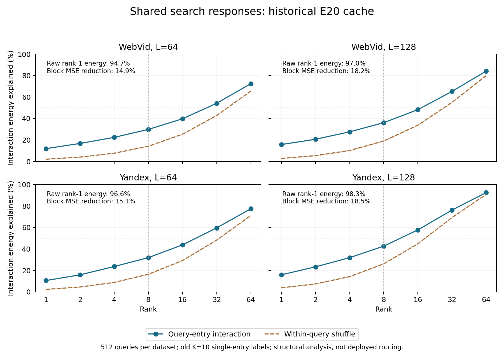

# GT10为何有效，以及如何把收益放大

2026-09-21。理论推导、五类合成代数核验、两数据集旧缓存结构检验完成。**主要判断：GT10可以理解为用目标几何建立的、很便宜的反向查询—入口映射；更大的空间可能在于学会搜索效果的共享结构。新检查支持部分共享结构，但否定“全局8维足以解释大部分差异”的强版本。** 没有得到新的可部署性能结果，当前WebVid soft/Yandex hard和生产E99保持。

本版响应用户“大胆假设，验证才需要小心”：先把强假设写成有数值含义的预测，再接受数据对其中一部分的反驳。不能把强猜想写成已证明机制，也不因为强版本失败就宣称所有共享表示无效。

## 1. GT10收益究竟来自哪里

需要分清三个增量：自适应入口相对固定NSG入口；查询画像相对raw hub评分；10目标归属相对1目标归属。E103确认的是整个系统的收益，不能全部记到“10”上。E107已经表明，使用原QGT选出的真实hub做单位向量精确路由，就能恢复不少系统收益；E108又表明，画像会影响小图检索的工作量和近似程度。

目前最可信的解释链是：

`代表性真实入口池 → 查询与入口的匹配 → 小图便宜地取回入口 → 原NSG以更有利的状态开始 → Recall与完整wall变化`。

在固定底图和原搜索规则下，入口只能改变初始化及其后续轨迹。它不会让原本不存在的图边出现，但能避免从不利位置开始付出搜索成本，也能改变有限候选池最终保留下来的探索方向。有限池使“多给入口”不具有一般单调性；入口离GT更近也不等于有限搜索一定更有效。

E103的90%门槛例子：Web默认R1 QPS相对NSG约+24.99%，R100约+0.79%；Yandex约+9.63%/+6.96%。这些差异提示收益高度依赖预算、指标和查询结构，不支持一个固定比例的“画像加速定理”。原证据：[E103](../20260916_optimized_five_dataset_r1_r100_v1/report.md)、[初始化因素](../20260920_until1600_theory_v1/stages/e107_initialization_factorial/report.md)、[真实小图对照](../20260920_until1600_theory_v1/stages/e108_unit_hub_online/report.md)。

## 2. 为什么这个简单画像有理论依据

设单位查询为z_i，单位真实hub为u_h。hard版用每条查询的前10个真近邻确定权重：

\[
a_{ih}=\frac1{10}\sum_{j=1}^{10}
 1\{h=\arg\max_g\langle\bar x_{ij},u_g\rangle\},\qquad
\sum_h a_{ih}=1.
\]

soft版将单个目标的指示函数换成归一化softmax，仍对10目标平均。实际代码生成：

\[
v_h=u_h+\sum_i a_{ih}z_i,\qquad p_h=v_h/\|v_h\|.
\]

是“单位hub先验+加权单位query之和”再归一化，不能写成平均query再加同权先验。这个方向精确求解固定权重的代理目标：

\[
\max_{\|p\|=1}\left[\langle p,u_h\rangle+
\sum_i a_{ih}\langle p,z_i\rangle\right]=\|v_h\|.
\]

Cauchy–Schwarz即得，v_h非零时最优方向唯一。权重固定后，没有必要用大模型重新近似这个闭式最优；改进应来自权重含义、表示或真实搜索目标的变化。源码：[build_profiles.py](../20260910_gt_topk_profiles_v1/src/build_profiles.py)。

忽略逐渐减弱的先验，人口版本是 `p_h ∥ E[a_h(Q) Z]`。它在回答“哪些查询的目标会落到h所代表的区域”，所以是**从目标区域反推查询方向**。当query与base存在分布/模态错位时，这比直接把raw hub向量当作query的代表更合理。这个条件均值解释不要求先假定vMF分布；但由它推到真实Recall仍需要“目标区域与该入口的服务效果相关”这一桥梁。

十目标可能放大的，是归属的稳定性和支持范围。一个GT1跨过很近的排序边界，就可能改变唯一标签；多个相关目标允许把支持分给几个邻近区域。若用一个简化模型令每目标归属指示同方差σ²、两两相关系数c，则

\[
\mathrm{Var}\left(\frac1k\sum_{j=1}^k I_j\right)
=\sigma^2\frac{1+(k-1)c}{k}.
\]

c=0时有1/k的方差下降，c=0.9时k=10只下降到0.91倍。实际top10不是独立样本，目标分布也可能随排名改变；这个式子说明降噪的条件，不证明GT10在实测上一定降噪或必优于GT1。

更一般地，令π=E[a]、m=E[aZ]、ρ=||m||/π、n_eff=nπ²/E[a²]。IID查询下，

\[
E\|\hat m-m\|^2=\frac{E[a^2]-\|m\|^2}{n},
\]

方向误差可由 `4 E||m_hat-m||²/||m||²` 控制；加入单位先验/n时，分子再增加1/n²的偏差平方。因此有利的量约为 **n_eff ρ²**：既要有足够有效支持，也要让共享一个画像的query方向一致。扩大GT目标数可以提高支持，也可能把不同服务模式混在一起、降低ρ；不存在越多越好的结论。

## 3. 更大胆的模型：GT10在近似搜索服务关系

固定图G、原kernel、K与L，定义真实服务响应 `U(q,h)=Recall(q,{h})`。也可定义包含实际时间的效用，但本版缓存只检查Recall结构。服务区域应按效果定义，例如 `D_h(t)={q: U(q,h)-U(q,S0(q))≥t}`，允许区域重叠；它不等于向量空间Voronoi区域，也不等于一个固定图连通块。

**强假设H：许多不同查询和入口的服务关系，由少数共同的搜索分支类型决定。GT10用GT邻域几何粗略识别了这些类型，因此一个很简单的方向均值也能有用。进一步识别这些类型，就可能放大收益。**

最容易先反驳的数学版本是：

\[
U(q,h)=a(q)+b(h)+z(q)^T v(h)+\varepsilon(q,h).
\]

a(q)表示查询整体难度，b(h)表示入口总体效果，交互项才表示“这个查询特别适合这个入口”。z、v暂时只是数学因子，不能凭SVD就命名为某种真实图通道或语义概念。

如果这个结构足够集中，离线监督便可以在查询、入口之间共享，不必为每个hub从少量样本中硬挑唯一赢家。线上可以尝试从query预测z，再与预存v匹配。**本次新检验的是搜索响应是否共享，尚未检验query能否预测这个响应坐标。**

## 4. 如何从假设推到可部署收益

三个环节必须连接起来。

第一，响应近似误差要小。假设 `|ε(q,h)|≤η`、`||v(h)||≤B`，线上得到z_hat且误差不超过e；若a、b及v准确，则效用预测误差至多 `δ=η+B e`。其他估计误差也应加入δ。

第二，预测误差要小于真正决策的收益。若所有动作的预测误差至多δ，按预测最大值选动作，则

\[
U(q,h^*)-U(q,\hat h)\le 2\delta.
\]

证明是在真最优和预测最优之间插入两个预测值，中间项因argmax非正。因而oracle相对当前默认的平均空间必须大于误差损失，才有净改进保证。MSE降低只是相关诊断，不能直接替代这个决策误差条件；低能量成分也可能决定两个近乎同分动作的胜负。

第三，完整时间必须合算。基线平均时间t0，主搜索平均节省g，额外路由/特征时间c，则

\[
\frac{QPS_{new}}{QPS_0}=\frac{t_0}{t_0-g+c}.
\]

只有g>c才加速。即使最终回退默认，已经计算的特征成本仍然支付。NDC不能无条件换成时间。

如果允许回退原GT10三入口，动作族必须包含它，并标注它的真实联合搜索效果。single响应只支持single排序，不能相加成三入口效果。加性行项a(q)虽不影响同一查询的single排名，却影响“最佳single是否胜过默认”的判断；本次借锚入口响应估计的query难度不能在线免费取得。

两条容易误判的代数事实也需要保留：

- 换成相对默认收益 `G=U-u0·1^T` 后，双中心交互矩阵完全相同：`H_N G H_H=H_N U H_H`。只改为差值标签，不会自动使服务结构低秩。
- 若z(q)=W^Tq，`z(q)^Tv(h)=q^T Wv(h)`，仍是静态线性画像打分。加一个“共享表示”名称并没有扩展原线性函数类；加入口偏置只得到可用增广坐标表达的仿射形式。新价值必须来自监督结构、归纳偏置或必要的非线性，而不是因子化写法。

## 5. 本次实际检验：有共享信号，但没有极低秩魔法

[协议](protocol.md)在读取数值载荷前冻结。只重用E20两集各512查询×815/821入口、L64/128的完整single旧命中矩阵，不运行新搜索。**这些是历史Recall@10开发缓存，与当前GT10的训练目标数10、真实R1/R100性能比较分别独立。**

先去掉查询均值和入口均值，再做响应分解。原矩阵rank1能解释94.74%–98.31%的平方能量，但这主要说明公共难度/平均命中占据大量能量，不能证明选择入口很简单。真正的交互项结果如下：

| 旧数据/预算 | 交互rank8能量 | 行内置换rank8范围 | 解释90%交互所需秩 | 未见块MSE降低 |
|---|---:|---:|---:|---:|
| WebVid L64 | 29.82% | 14.07%–14.33% | 128 | 14.91% |
| WebVid L128 | 36.11% | 18.83%–19.30% | 83 | 18.15% |
| Yandex L64 | 31.88% | 16.24%–16.50% | 111 | 15.15% |
| Yandex L128 | 42.58% | 26.01%–26.27% | 57 | 18.46% |

每集固定分成256训练查询、256剩余查询；入口也固定分为两半。只看三个块A/B/C，用固定rank8预测第四块D。行列加性项单独估计，交互用 `D_hat=D0+Cc A_c,8^+ Bc`。**C提供剩余查询在约400个锚入口上的实际搜索效果，这是特权信息；它不是线上可计算的query向量。**

精确rank-r模型下，若锚块完整覆盖r维因子且数值条件良好，这个四块关系可以精确恢复D；近似/噪声情形会受截断、遗漏方向及小奇异值放大影响。相关矩阵分解是已有方法，本版不主张原创；参见[Mahoney与Drineas的CUR论文](https://www.stat.berkeley.edu/~mmahoney/pubs/cur-pnas.pdf)。

在D的入口范围内，按预测选入口相对“训练查询上平均效果最佳的固定入口”：

| 旧数据/预算 | Recall差 pp | 配对98.75%CI pp | 查询改善/损伤/相同 |
|---|---:|---:|---:|
| WebVid L64 | +4.2578 | [+1.1719,+7.4534] | 56 / 21 / 179 |
| WebVid L128 | +5.4688 | [+2.8906,+8.5156] | 50 / 8 / 198 |
| Yandex L64 | +3.7891 | [+0.5859,+7.1875] | 32 / 20 / 204 |
| Yandex L128 | +3.2813 | [+1.1794,+5.8594] | 25 / 3 / 228 |

这里“改善/损伤”指旧K10 Recall升降，不是K1失败救回。对照是固定平均最佳入口，**不是当前GT10**。区间是在固定训练块/分割条件下对256行做bootstrap，历史曝光、一个分割及有限样本限制均保留；不是跨构建或全新测试证据。按行打乱入口身份的八个对照，每格MSE改善都变负，范围−0.75%至−2.11%；这支持完整入口身份之间有可复用关系，八置换不足以单独给正式p值。

预先写下的强版本要求四格rank8能量≥50%、MSE降低≥10%、固定入口控制提升≥1pp。后两项点估计满足，第一项四格全失败，**强版本整体不成立**。保留的判断是“共享结构存在并有特权条件下的预测价值”，不把50%门改低，也不调秩或seed挽救原假设。决策只需要有用方向，不一定需要解释大部分矩阵能量，所以这个反驳没有抹去预测信号。

## 6. 更值得押注的后继假设与操作方式

我优先押注：**服务结构的坐标，与搜索中反复出现的比较方向有关；不同具体节点对，可能共享相同的分支类型。** 这是进一步的待检验假设，本轮没有读取真实图来验证它。

raw-IP比较两个节点u、v，由 `q^T(x_u-x_v)` 的符号决定。原E113发现具体节点ID对很少跨query复现，只否定了那种ID字典的支持；如果不同边的差向量方向相近，仍可能共享监督。令单位比较法向量为n，某共享单位方向为d，单位query为z，则

\[
\|n-d\|\le\epsilon,\quad |z^Td|>\epsilon
\;\Longrightarrow\; \mathrm{sign}(z^Tn)=\mathrm{sign}(z^Td).
\]

证明由 `|z^T(n-d)|≤ε` 得到。反向平行法向量可记录方向翻转后共享。这是**跨不同节点身份共享分支信息的充分条件**。它只证明单次比较；若要保证轨迹相同，必须覆盖实际所有影响执行的比较、初始化、tie规则等，不能用一个边际条件跳到完整Recall保证。

据此，理论上放大收益的操作链可以是：

1. 离线用真实搜索响应寻找哪些入口具有相似的服务效果，保留完整收益差、平局和损伤，不硬压成一个赢家ID。
2. 将相关轨迹中的比较方向按几何与margin共享，检验少数方向是否反复解释服务差异。共享对象由节点ID变为比较条件，但只有真实跨query支持才能成立。
3. 用query对这些方向的投影及必要的简单非线性，预测服务坐标或动作净收益。离线方向与入口表示预先存储，线上仅计算少量投影，主NSG不改。
4. 对相同响应监督先做简单线性/固定特征控制，再判断非线性是否带来额外可迁移信息。如果完全线性的学生已足够，就保留便宜形式；若廉价query信号不能预测服务坐标，停止这条具体实现，不能由teacher的正值宣称部署可行。
5. 新真实验证只使用K1/K100，动作包括原默认和强固定入口控制，按冻结数据角色比较净救回/损伤及完整wall。入口数量、候选家族不能悄悄改变；若要改变，单独隔离其贡献。

这比“GT10→更多GT→更大MLP”提出了更明确的机制：从目标几何共享，走向搜索分支条件共享。是否成立仍取决于真实图中比较方向的重复性、query是否远离关键分界、响应能否跨query转移，以及投影成本。全局8维不够，并不自动支持增加维数；也可能需要按在线可见条件分开的局部结构，这又是一个新假设而非本轮结果。

## 7. 与旧方法及前作的实质关系

搜索赢家重聚合query已经在search-aware centroid中做过；真实效用加权、全H软收益、低秩W、局部query Atlas、query MLP、四动作成本树也有历史版本。不能把“真实reward”“低秩”“蒸馏”本身当新颖性。本轮增量是直接检查响应矩阵的交互结构、三块到第四块的迁移，并明确服务坐标可预测性仍是缺口。参考[旧效用/表示记录](../../experiment_history/04_utility_and_representation.md)、[E22及后续设计](../../experiment_history/11_ab_fixed_slot_exploration.md)、[E117](../../experiment_history/119_entry_set_pilot.md)。

GATE已经使用hub拓扑信息、查询监督和对比双塔，因此“图感知双塔选入口”不能成为这里独有的论点。[GATE原文](https://arxiv.org/html/2506.15986v1)。新比较方向假设还需要专项查重，当前不主张论文新颖性或录用等级。

聚类路由的Learning-to-Rank工作假定簇内精确搜索，因此“选中包含目标的簇”有直接含义；原NSG有限池不满足这一前提，不能借用它的相关性代理保证作为我们的搜索保证。[原文](https://arxiv.org/html/2404.11731v1)。

## 8. 核验、成本、状态与复现

五类合成核验通过：固定权重画像方向；rank3加行列项四块恢复（最大误差4.00e−15）；原矩阵近rank1但交互高秩的反例；rank1响应但观测特征丢失query类型、最佳可见策略0.5而oracle0.9的反例；1000组2δ决策regret核验。最后一个信息反例是**压缩观测φ(q)相同**，不是声称固定确定性图上完全相同q会产生不同效用。

独立数值实现用Gram特征分解重新恢复所有四块预测，最大差6.83e−15；同时检查原矩阵/分割、谱、指标、配对区间、源SHA及协议/脚本身份。由同一agent编写，不冒称第二位独立审查者。18个源文件完整SHA保持；只分析既有命中，原返回的GT正确性沿用E20已审计来源，本轮未重新读取真实base/GT重评分。[核验](results/verification.json)。

缓存分析进程4.055秒（含八置换及合成核验），不含编写、文献、绘图和审查时间。0新NSG/ANN/GT/图/当前K10评测/查询路由模型；有离线响应SVD分解拟合。环境内限制四个数值库线程变量为1。没有在线QPS结果，也没有未曝光held-out访问。

运行命令：`.venv_cpu/bin/python entry_method_exploration/20260921_service_structure_theory_v1/analyze.py`；它拒绝覆盖已有results，复现须复制代码与冻结协议到新版本。随后运行对应`verify.py`、`plot.py`。来源、分割、全部预测及正负统计均保留：[输入manifest](results/input_manifest.json)、[完整统计](results/analysis.json)、[配置](config.locked.json)、[日志](run.log)。

本轮理论与检查完成；没有新的方法部署或自动训练队列。下一项真正值得解决的问题已经具体化：**能否从廉价的query比较特征恢复有用的服务坐标，并把它转换成超过当前GT10的净收益？**
