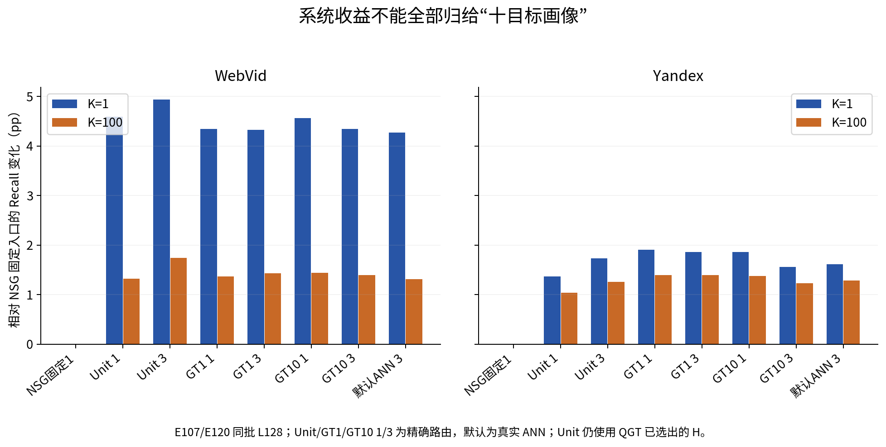
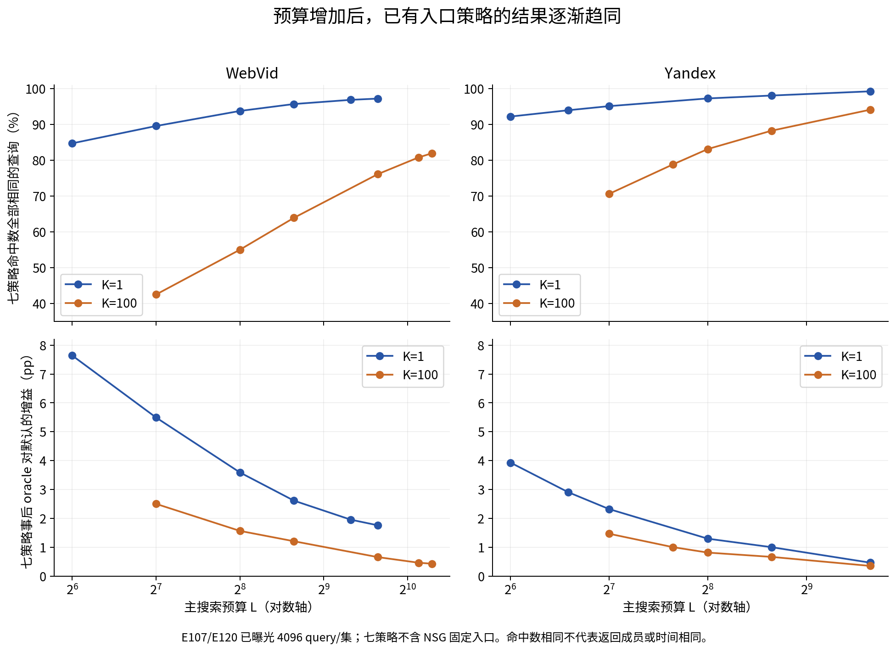
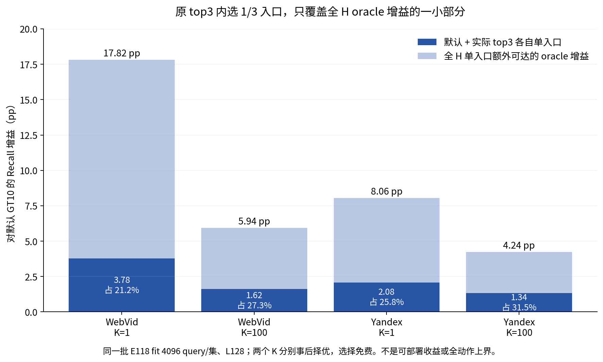
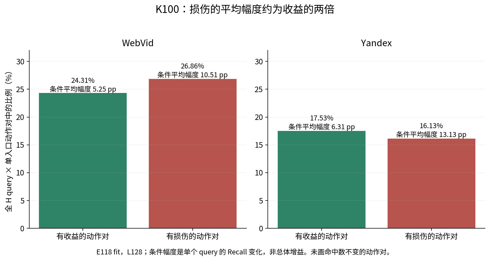

# 为什么GT10难以超越：项目现状、机制证据与改进方向

2026-09-22，按用户要求研究至17:00。本轮是只读历史核算、源码/理论审查和一手文献调研，不是新的性能实验。默认仍为 **WebVid GT10-soft-t1、Yandex GT10-hard，生产E99**；E103仍是最近完整五数据集比较。

**核心判断：GT10的强项是一个组合——GT引导的真实入口池、把大量查询监督压缩成静态画像、与画像匹配且便宜的小图路由。后继面对的是较小、易抵消、跨预算变化的残差，还要支付额外在线费用。现有证据不支持“十目标画像本身解释了全部系统增益”，也不支持“GT10已经达到理论最优”。**

阅读入口：[理论与反例](theory.md) · [15项一手文献核对](literature/review.md) · [按优先级排列的改进方向](directions.md) · [数字核验](reviews/numeric_audit.json)。

## 1. 先区分三件常被混在一起的事

| 要回答的问题 | 合适对照 | 当前结论 |
|---|---|---|
| GT10整个系统为什么胜固定NSG入口？ | 同一底图/内核下，固定入口对QGT候选与画像路由 | 自适应选入口有收益，但相当一部分质量收益在不使用GT10画像的UnitHub控制中已出现。 |
| 从GT1改为GT10，十目标到底增加了什么？ | 同H、同监督样本、hard对hard，再分离路由近似 | 支持更分散、画像改变明显；最终增益小且依数据/预算，ESS及目标细节的因果贡献尚未完全分开。 |
| 为什么后继模型难胜当前默认？ | 当前默认与冻结候选的真实K1/K100完整Recall–QPS | 动作机会、可迁移信息、损伤抵消、预算错配、在线费用同时限制；失败不是一个统一原因。 |

“几十次实验”包含同一分支的诊断、控制、修复和完整验收，并非几十个独立的新范式。历史K10开发指标也不能直接替代今天的K1/K100。结论应按作用机制和证据强度整理，而不是累计负实验数量。

## 2. 当前性能到底强到哪里

下表由E103原800点指标重算，选择 **实测Recall达到90%的最快已测配置**。这不是两方法实际Recall完全相等的精确匹配，也不是显著性结论；所有NSG入口方法共用span+batch4内核。Web/Y使用当前默认，其他集展示GT10-soft-t1，不为此更改其默认。

| 数据 | K | GT10实测Recall / L | GT10 QPS | NSG QPS | 相对NSG |
|---|---:|---:|---:|---:|---:|
| WebVid | 1 | 90.7500% / 800 | 520.79 | 416.68 | +24.99% |
| WebVid | 100 | 90.6868% / 1250 | 340.46 | 337.80 | +0.79% |
| Yandex | 1 | 91.0500% / 128 | 2406.16 | 2194.80 | +9.63% |
| Yandex | 100 | 90.9805% / 256 | 1241.64 | 1160.90 | +6.96% |
| Deep | 1 / 100 | 94.1300% / 32；92.6021% / 100 | 8804.34 / 3503.61 | 7497.14 / 3298.49 | +17.44% / +6.22% |
| SIFT | 1 / 100 | 95.9100% / 32；94.0603% / 100 | 7661.98 / 3015.93 | 7227.79 / 2922.68 | +6.01% / +3.19% |
| GIST | 1 / 100 | 92.2000% / 96；91.6700% / 256 | 1229.41 / 550.73 | 1220.23 / 550.43 | +0.75% / +0.05% |

所以“GT10很强”不是每个K/数据集都有巨大优势。Web K1很突出，Web K100在这个门槛只有小优势，GIST接近持平且其他门槛会落后。GT10家族在22/25个可达门槛格子描述性最快，也不等于某个统一模型显著支配全部方法。[重算表](results/e103_thresholds.json) · [E103原报告](../20260916_optimized_five_dataset_r1_r100_v1/report.md)。

还要扣除实现混杂：E101–E103发现span+batch4本身会明显加速NSG；例如E102 NSG四点自身平均QPS提升18.58%–27.28%。今天讨论方法优势必须使用统一优化内核，不能把旧内核到新内核的提升算作GT10机制。[E102](../../experiment_history/95_shared_span_batch4_comparison.md)。

最近后继结果：E118 GraphCost在20个匹配预算点逐query命中等于默认但QPS更低；E119强评分器拟合内正收益没有迁移；E120/record125 TargetKNN在12个匹配点召回均值均正，但Web完整QPS下降17.58%–26.96%，Y下降27.88%–54.06%。后者是“有质量增益但不划算”，不能写成“完全没学到东西”。

## 3. GT10好在哪里：证据与推断分开

### 3.1 一个已经使用GT的好入口池

QGT先用独立5K query做球面聚类，按簇中心附近的query依次扫描其GT100，选全局未使用的真实base ID，形成815/821个候选。它不是随意挑点、不是GT频次投票，也不是有近似保证的set cover。**UnitHub依然使用这个已由GT选好的H，因此不是完全无监督基线。**

E107同批L128：UnitHub1相对NSG在Web K1/K100已有+4.5898/+1.3228pp，默认GT10为+4.2725/+1.3127pp；Y分别为+1.3672/+1.0408pp与+1.6113/+1.2871pp。这说明画像以外的自适应初始化已经很强。但UnitHub1是精确全H选点，没有完整路由费用，不能据此直接换默认，也不能把它当QGT相对随机H的因果份额。

### 3.2 静态画像把query分布信息提前算完

GT10把每条训练query的前10个GT目标分配给已有hub，将质量平均，再对单位query加权求和并归一化：

`p_h = normalize(unit(real_hub_h) + Σ_i a_ih × unit(query_i))`。

这个方向是固定权重下线性亲和目标的精确最优解。训练20K query的监督被压缩为H个向量，线上不读GT、不运行query MLP、不枚举完整动作组合；一次小HNSW取3个真实入口，交给原NSG。它保持了很强的计算经济性。离线GT、QGT构建和画像成本不能因为无梯度就记为零；当前缺失的GT-inclusive全链成本仍应保留缺口。

从GT1到GT10-hard，E27的每query平均参与hub数为Web5.993、Y4.571，hub ESS中位数由16→67.361、22→60.082；约78.10%/63.65%的三入口发生改变，但最终命中变化小。十目标可以提供更平滑、覆盖更广的监督，这是合理机制；尚不能宣称这是最终收益的唯一原因。shuffle和E106组均值控制没有完成这种因果识别。[E27](../../experiment_history/16_gt10_mechanism.md) · [E106](../../experiment_history/101_gt10_conditional_mechanism.md)。

E106同H、精确top3、L128的直接GT10对GT1比较也没有统一正方向：Web soft的K1/K100为+0.0244/−0.0435pp，Y hard为−0.2930/−0.1680pp。这些局部均值不推翻GT10完整系统的地位，却要求把“十目标的增量作用”与“整个系统为什么好”严格分开。

### 3.3 好的不只是评分向量，还有它诱导的小图

E108：GT10小图对其自身精确top3的成员召回为Web93.953%、Y97.323%，UnitHub小图为81.250%/91.748%；同时平均路由NDC为112.26/107.01，低于UnitHub的165.17/215.71。这里的“成员召回”是小图路由精度，不是最终R1/R100。

E115把评分P/U和小图状态GP/GU交叉，固定U评分时换成GP仍省NDC。进一步计数表明，Y的base展开 **11.546→12.735，反而增加**，邻边扫描却241.854→160.630；GP/GU第0层平均出度为11.029/20.593。Web方向相同。因此更准确的解释是“处理更少邻边和新节点”，而非“路径一定更短”。层级、访问节点和评分仍交互，不能全归因静态度，也不能由此要求继续删边。[E115原报告](../20260920_until1900_theory_v1/stages/e115_score_topology_factorial/report.md) · [工作量恒等式](../20260920_until1900_theory_v1/research/router_work_identity_v1/report.md)。

这种路由优势的绝对规模也有边界。E27历史Web L128分项中，路由只占总wall约1.49%，GT1→GT10的路由节省0.367微秒，仅为原总时间约0.079%，不能独自解释该点0.890%的QPS增幅。分项独立计时不能相加做精确归因；在更高预算，主搜索往往更占主导。应强调GT10的路由足够便宜且可索引，避免把总吞吐优势全部归给小图。[原分项证据](../20260911_gt10_mechanism_v1/report.md)。

### 3.4 后继必须胜过一个很便宜的默认，不能只胜画像代理

E36总NDC仅增约0.3%–0.4%，完整QPS却降8%–9%，选择器的非距离费用是真实成本。今天KNN召回全正而QPS全负再次验证了这一点。E118即使回退到完全相同命中，也要付新决策过程的费用。GT10的低在线成本是一项直接可测的优势。

## 4. 本轮新增核算：剩余空间长什么样

本轮读取旧输出，不新增搜索。E107/E120组是各4096条已曝光E105来源query；E118全H组是另一批4096条历史fit query。**两组不相减、不拼接为因果分解。** 以下同批全H/四动作比较才可相减。每个K分别按真实指标计算。

### 4.1 原有策略越来越多地给出相同命中数

七策略为UnitHub1/3、GT1 1/3、GT10 1/3及实际DefaultANN，不含NSG固定入口。每个query的事后oracle取七者最好，选择免费。完整23个K/L点见[数据](results/finite_responses.json)。

| 数据/K/预算 | 七策略命中数全相同的query | oracle对默认增益 | oracle能补回的默认缺失命中质量 |
|---|---:|---:|---:|
| Web K1 L128 | 89.55% | 5.4932pp | 22.26% |
| Web K1 L800 | 97.19% | 1.7578pp | 16.25% |
| Web K100 L128 | 42.55% | 2.5007pp | 7.26% |
| Web K100 L1250 | 81.93% | 0.4272pp | 4.54% |
| Y K1 L128 | 95.09% | 2.3193pp | 24.74% |
| Y K1 L800 | 99.22% | 0.4639pp | 22.89% |
| Y K100 L128 | 70.63% | 1.4648pp | 9.04% |
| Y K100 L256 | 83.13% | 0.8125pp | 9.07% |

Web K1 L800在这批只有89.1846% Recall，不能称R90实测点。K100“命中数相同”不代表返回成员相同；任何K也不代表路径或时间相同。这些百分比是有限策略族的经验响应平台，不是全H上界。

在L128，仅把GT10从ANN改成精确画像top3：Web有580条入口不同，K1只救回21/损伤18；Y有270条入口不同，只救回6/损伤8。改变入口的query中分别93.28%/94.81%命中不变。**更准地实现同一个代理排序，未必产生值得付费的搜索改进。**[完整逐方法配对](results/finite_pairs.csv)。

### 4.2 全H空间仍大，但原top3仅触及小部分

同一E118 fit、L128，以默认三入口作回退，比较所有H个单入口，及仅原实际top3各自单入口。两个oracle都查看真实返回，选择免费，两个K分别选择；不代表存在一个策略同时实现它们。

| 数据/K | 全H单入口+默认 oracle增益 | 原top3各自单入口+默认 oracle增益 | 后者覆盖前者 |
|---|---:|---:|---:|
| Web / 1 | 17.8223pp | 3.7842pp | 21.23% |
| Web / 100 | 5.9446pp | 1.6228pp | 27.30% |
| Y / 1 | 8.0566pp | 2.0752pp | 25.76% |
| Y / 100 | 4.2410pp | 1.3379pp | 31.55% |

Web默认K1失败935条，全H可救730条，原top3 singles只可救155条；Y为345、330、85条。于是不能只根据原top3门控失败就说“入口已无空间”。同时，原top3内反复做更强分类，也不会触及其余机会。[同批分解](results/same_cohort_candidate_coverage.json)。

### 4.3 有空间不代表一个普通入口就能捡到

在至少一个单hub能救回的query中，能救回的hub比例中位数仅Web2.33%、Y9.93%。均匀随机换一个H中的单入口，K1总体反而下降3.9813/1.0352pp。甚至假设免费知道默认是否会错、只在失败时随机选单入口，也只获得2.1289/1.7956pp，远低于逐query全H oracle。后者只是区分失败检测与动作识别的诊断，不是新的部署策略或普遍上界。

K100更能说明“看胜率会出错”：Web有收益动作对平均增加该query的5.25pp Recall，有损伤动作对平均损失10.51pp；Y为6.31/13.13pp。Y正动作对占17.53%，负动作对占16.13%，**正例更多但均匀换入口的净Recall仍下降1.0116pp**。必须学的是带幅度的净效用。[完整分布](results/full_h_opportunity.json)。

## 5. 为什么几十次后继没有形成替换

| 障碍 | 关键实证 | 应有结论 |
|---|---|---|
| 代理与真实搜索不对齐 | E109完美覆盖/目标均值在Web未改善，Y有局部正值 | 先检查代理到搜索的桥梁；不能默认更强回归必有收益。 |
| 联合入口不是独立覆盖并集 | E107 GT10 1→3在18项中17个均值为负；E110首展开干预只修复部分且未胜强单入口 | 入口间存在有限池竞争；别用单入口收益相加训练三入口策略。 |
| 大范围改入口但净效应抵消 | E105入口改变97%以上；Web K1救回125/损伤126，Y63/63 | “确实改变了结果”不等于提高平均质量，也不是完全空动作。 |
| 可拟合不等于可迁移 | E119 GBDT/TabM拟合U正、query-out U负；E113绝大多数精确比较对只被一条query使用 | 共享信息、样本支持与选择误差尚未解决；不是所有深模型不可能。 |
| 学习/评价工作点错配 | E120低预算选择在目标K100预算仅保留43.31%/70.49%的七策略oracle收益 | 标签必须服务实际K/L；目标预算KNN又未胜固定/打乱控制，修对齐仍不够。 |
| 在线费用吃掉小收益 | E36、E118、record125的完整wall | 必须同时过召回和完整时间；NDC不是QPS。 |
| 统计分辨率与选择曝光 | E105 Web K1配对标准误约0.387pp；许多数据/动作反复用于开发 | CI跨0不能证明真实效果恰为0；历史小正值也不能直接当新测试收益。 |

旧RL/画像/多模态分支也不能简单概括为“所有点都差”：E32真实收益目标有更强fit与小幅开发信号，E36有Y局部信号，E94有相对compact的质量修复；它们均未形成稳定默认前沿替换。具体原件见[E32](../../experiment_history/21_direct_reward_policy.md)、[E36](../../experiment_history/25_query_swap_policy.md)、[E37](../../experiment_history/26_offline_profile_rl.md)、[E94](../../experiment_history/83_frozen_final_comparison.md)、[E95停止](../../experiment_history/87_query_moment_graph_and_branch_stop.md)。

先前原生/评分/输入身份/线程审计已排除了多项实验错误；本轮又独立重写算术，核验6,709,248个query×动作的K1标签与K100位图计数，以及23个有限策略点。Web同向量不同ID的已知tie只影响特定K1均值0.0244pp，不能解释大量后继失败；不删除该query或重写原指标。

## 6. 哪些理论已经成立，哪些仍是空缺

已经成立：固定权重下的球面亲和闭式最优解；IID条件下的均值方差和方向误差界；有限比较程序的局部行为稳定条件；Recall的救回−损伤恒等式；候选遗漏、信息不足、估计遗憾的非负分解；完整时间的费用约束。它们有助于组织证据，但大部分是标准工具，不能仅靠换术语构成新颖性。

还未成立：画像代理误差足够小即可保证真实有限搜索Recall提高；GT10在全H/全base动作中最优；十目标优于任意目标数量；只靠增大网络或数据必能突破；当前七策略高预算oracle能代表全H高预算oracle。详细证明、条件、反例见[theory.md](theory.md)。

相关前作直接约束论文定位：[GATE](https://arxiv.org/html/2506.15986v1)已有学静态入口表示与小图；[NGFix](https://arxiv.org/html/2510.22316v1)已有排名瓶颈/可达性；[SIGIR 2024分区路由](https://arxiv.org/html/2404.11731v1)有不同的代理桥梁；[EDBT 2026](https://openproceedings.org/2026/conf/edbt/paper-253.pdf)已有历史查询辅助入口。理论贡献应放在本问题特有的可验证桥梁和适用范围，不放在“用了GT/RL/双塔/查表”。完整逐项区别见[文献核对](literature/review.md)。

## 7. 下一步建议

**主线先转为完善GT10的机制与边界。** 用现有强基线、完整公平曲线与受控反例组织论文；重点补H选择/画像/小图归因和新query来源稳健性，而不是继续证明已经知道的闭式均值最优。

**入口算法仅保留一个可证伪的信息方向。** 研究原路由已经产生的状态能否支持离线编译的入口选择，在线只查表/回退；若允许候选超出原top3，应明确这才可能接触本轮发现的多数遗漏机会。现有四动作表仍缺对齐信息/成本，新扩展更未完成新颖性和泛化证明，实施GO仍为0。先同监督固定/打乱/简单表控制，不能直接上新网络。

**较大的收益需要单独讨论范围扩展。** 若目标工作点的允许入口族确实无足够空间，再考虑query感知大图或自适应预算；与RoarGraph、NGFix、CDMG、Ada-ef对照，并明确改变了当前固定底图/固定L范围。当前数据还不足以宣布必须改图。

每条的具体机制、最小证伪、同监督控制、成本和停止边界已写在[directions.md](directions.md)。本轮没有找出新的稳定胜者；找到的是可验证的原因分层，和不该再盲目投入的分支。

## 8. 本轮产物与证据边界

新增3个只读核算/核验脚本与绘图脚本、23点响应统计、4组全H机会分布、4组同批候选覆盖分解、完整E103门槛重算、理论/文献/方向文档及4幅三格式图。没有新ANN/NSG、GT、图、模型训练、性能计时或新鲜测试载荷。统计都是已曝光历史query上的描述性结果；没有事后改模型、追调参数或重开旧runner。

数值核验是同一会话的另一份实现，**不是独立人员/代理审稿**。代码和输入身份见[主核算完成](reviews/analysis_complete.json)、[机会分解](reviews/opportunity_complete.json)、[独立算术核验](reviews/numeric_audit.json)。旧源、图、标签、结果保留，根四文档仅同步本研究记录和下一边界；最终状态与封存见[state.json](state.json)。
