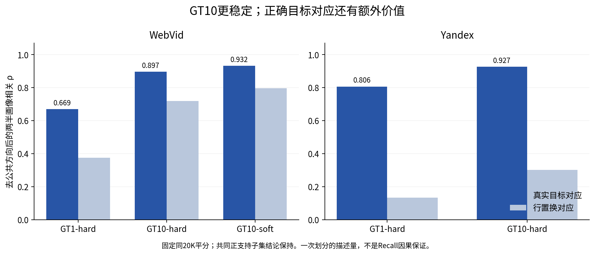
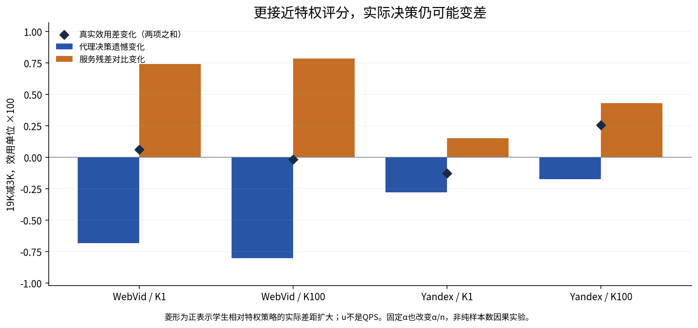
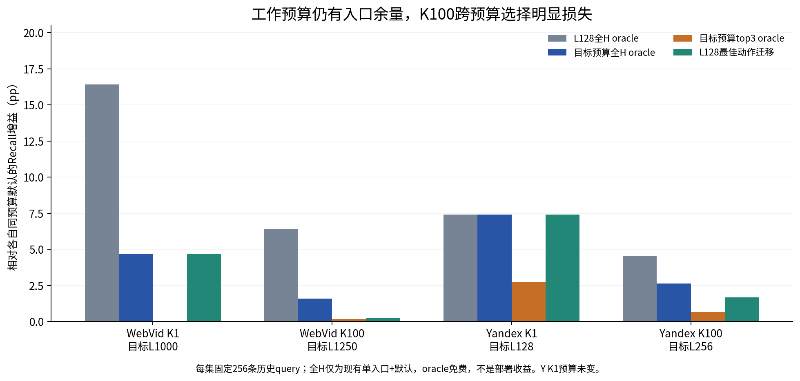
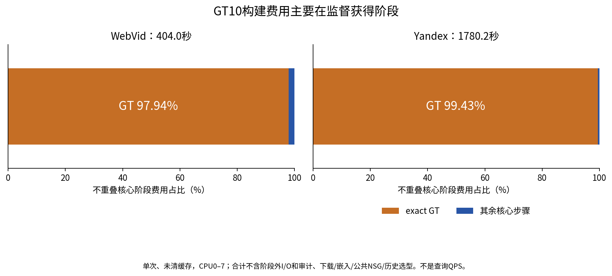
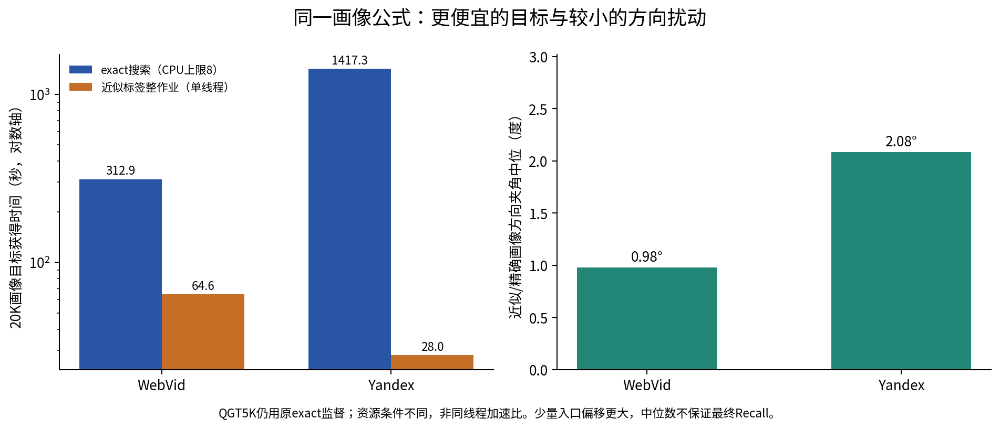
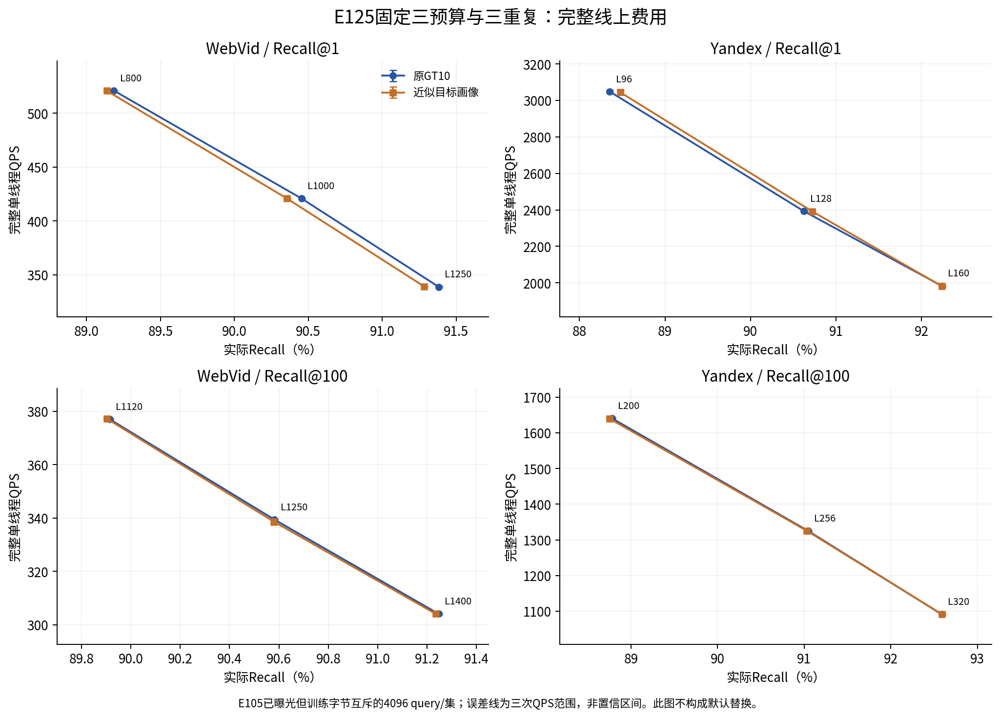

# GT10理论与性能改进研究

2026-09-22晚间研究。原17:00交付已独立封存；用户随后授权实际改进并延长至22:00，只有理论和经核验的完整性能同时提高才提前结束。21点后用户进一步要求复测E125并调整旧门一票否决；冻结模型的Web新查询单点测试已于21:21前完成核验。随后完成研究策略、理论和交付审查。

## 当前判断

**GT10仍是默认，没有出现经过完整Recall–QPS验证的新替代方法。理论解释已经更具体：它把GT引导的真实入口、稳定的查询方向画像和便宜的小图路由结合起来；后继模型虽然能学到关联，却常常没有学到值得付在线费用的入口决策。**

当前WebVid使用GT10-soft-t1，Yandex使用GT10-hard；生产主搜索保持E99。E103仍是最近完整五数据集重测，E118仍是最近宽预算候选前沿。最新轻量三点比较是E125：标签费用明显降低，原Web非劣区间门未过。用户随后授权冻结模型新源复测，Web K1/L1000少命中6/4096（−0.146484pp）、完整QPS−0.104439%；现在保留为低成本候选，未证明无损，也不替换默认。旧门不再一票否决探索资格。

“几十次没有超过”不能解释成GT10全局最优，也不能都归为实验错误、模型不够强或数据量不够。多条分支已通过原生返回、GT语义、角色隔离和独立数值实现检查；部分候选存在局部召回正值，却支付了更大的查询时间或没有迁移到新来源。

## 1. 已经确立的性能与边界

下表取E103中各方法达到90%门槛的最快已测配置；方法实际Recall和L未必完全相同，不是同Recall插值显著性结论。

| 数据 / 指标 | GT10 Recall | GT10 QPS | 原NSG QPS | QPS差 |
|---|---:|---:|---:|---:|
| WebVid / R1 | 90.7500% | 520.79 | 416.68 | +24.99% |
| WebVid / R100 | 90.6868% | 340.46 | 337.80 | +0.79% |
| Yandex / R1 | 91.0500% | 2406.16 | 2194.80 | +9.63% |
| Yandex / R100 | 90.9805% | 1241.64 | 1160.90 | +6.96% |
| Deep / R1、R100 | 94.13%、92.6021% | 8804.34、3503.61 | 7497.14、3298.49 | +17.44%、+6.22% |
| SIFT / R1、R100 | 95.91%、94.0603% | 7661.98、3015.93 | 7227.79、2922.68 | +6.01%、+3.19% |
| GIST / R1、R100 | 92.20%、91.67% | 1229.41、550.73 | 1220.23、550.43 | +0.75%、+0.05% |

后三集是已测soft配置，不是在今晚重新选择默认。GT10在Web/Y更有研究价值，在GIST并无普遍的大幅领先。公共搜索优化的收益也不能全部记给入口方法。完整曲线、三次计时范围与配置见[E103原报告](../20260916_optimized_five_dataset_r1_r100_v1/report.md)，门槛复算见[17:00报告数据](../20260922_gt10_strength_review_v1/results/e103_thresholds.json)。

E118 GraphCost在20个匹配点逐query命中与默认相同，但全部QPS更低。E120后续补齐的三点三重复则在12匹配点召回均值全部增加，完整QPS下降约18%–54%。二者说明：“没有稳定替代”既包含没有质量增量，也包含增量抵不过费用。E105又表明旧开发上的画像改进没有通过新来源复验，不能用反复曝光数据上的正点宣布替代。

## 2. GT10好在哪里：从合理故事到可核查证据

第一，真实入口H不是随意抽样，而是QGT监督选出的候选。原单位hub单入口已经获得相对固定NSG的大部分收益，因此整体优势不能全算作“用了十个目标”。

第二，画像使用query方向累加，解决的是query与base分布不同的问题。公式p_h=unit(u_h+Σ_i a_ih x_i)对固定加权亲和目标有闭式最优解。它用20K query把监督压缩到815/821个方向，推理继续使用原小图。GT10并不是对稀疏有限搜索残差做800多个独立复杂回归。

第三，本轮实际归一化画像的稳定性证据成立，而不只停留在ESS或未归一化统计矩。

| 数据 | 方法 | 固定两半画像夹角中位 | 去公共方向后的ρ | 打乱对应后的ρ |
|---|---|---:|---:|---:|
| Web | GT1-hard | 24.51° | 0.6693 | 0.3756 |
| Web | GT10-hard | 12.13° | 0.8966 | 0.7188 |
| Web | GT10-soft-t1 | 8.54° | 0.9325 | 0.7963 |
| Yandex | GT1-hard | 27.23° | 0.8061 | 0.1333 |
| Yandex | GT10-hard | 16.49° | 0.9268 | 0.3005 |

固定相同20K随机平分，限制GT1两半都有正支持的hub仍保持结果；真实对应的跨半亲和在十个方向上都超过保持质量结构的置换，也超过全局query均值。但置换GT10本身也更稳定，因此一般平滑与正确语义对应都有作用，不能把稳定性全部归于GT语义。十个目标相关，样本单位仍为query，不是独立样本数乘十。

第四，画像还改变小图可检索性。已有E115的证据是扫描邻边减少，不能声称走过的节点或路径都更少。亲和、路由误差、有限主搜索、最终wall之间仍有不同桥接条件。

因此，当前可支持的解释是**稳定且有语义对应的静态压缩，加上适合现有系统的低成本推理**。尚不能支持“GT10对真实Recall理论最优”“10是最优数量”“soft一定更强”或“稳定性解释全部收益”。详细[理论](theory.md)及[画像控制与核验](research/profile_direction_stability_v1/report.md)保留条件与反例。

## 3. 今晚实际检验了什么

所有候选只用原底图、原主搜索和已曝光训练来源；四折外折属于开发控制，不冒充新盲测。下表u为ΔRecall−0.1×旧graph-only相对时间，等K平均。它没有包含新评分、路由全部在线费用，不是QPS。

| 阶段 / 唯一主候选 | 新假设 | Web ΔR1 / ΔR100 pp | Y ΔR1 / ΔR100 pp | Web / Y u×100 | 结论 |
|---|---|---:|---:|---:|---|
| E121 StateCost | 原路由上层状态可支撑全H动作表 | −1.0742 / −0.3154 | −0.3418 / −0.2839 | −1.1668 / −1.1385 | 停止本版 |
| E122 FunctionSmooth | 相近真实入口响应可共享统计 | −0.1709 / −0.1182 | −0.2197 / +0.0139 | −0.5326 / −0.9519 | 停止本版 |
| E123 TargetService | 目标区域到实际成员服务有迁移结构 | +5.3955 / +0.1709 | +2.5635 / +0.7129 | +2.9808 / +1.6965 | 仅特权信息门通过 |
| E124 SemanticService19k | 将目标语义预测与服务表静态编译 | +0.0732 / −0.0073 | 0 / −0.0334 | −0.0762 / −0.4888 | 停止本版 |

E121确实胜打乱状态，但不胜默认；51/52种状态面临约800动作，表项跨折不稳定。E122先证实入口响应的局部性，正确几何正则减轻独立回归的损失，却未胜同谱打乱关系，也未超过默认。相关结构存在，不等于当前估计器能用好它。

E123最有价值的正结果是：真实GT目标区域经过实际搜索服务表后，可以产生超过默认的策略。它不需要假设“目标属于这个区域就一定有用”，而用训练响应建立区域—入口关系。不过真实GT在线不可得，获取费用也未包含，故它不是性能新方法。

E124把上述服务关系与query语义预测合并为静态仿射评分。它比直接回归实际效用好，但主效用仍未过正门，亦未胜打乱服务控制。用更多历史语义query后，区域预测MSE和准确率改善，决策没有同步改善；固定α下有效正则强度也改变，不能据此单独归因为样本数。

原协议、全部控制、独立核验与成本分别见[E121](stages/e121_router_state_table_v1/report.md)、[E122](stages/e122_action_coupled_ridge_v1/report.md)、[E123](stages/e123_target_service_gate_v1/report.md)、[E124](stages/e124_semantic_service_ridge_v1/report.md)。没有把失败版本换参数或换名字继续训练。

## 4. 为什么预测更准仍未赢：本轮最关键的理论修正

常见设想是“既然真实GT区域有帮助，就先把GT区域预测准，再接一个服务表”。问题在于服务表本身不一定是query条件下的真实动作价值。

令g=AS为真实GT区域构成的服务代理，ĝ=ÂS为预测服务代理，u为实际效用，r=u−g。特权策略a_g和学生a_hat之间有逐query精确分解：

    u(a_g)−u(a_hat) = g(a_g)−g(a_hat) + r(a_g)−r(a_hat)。

学生更像教师会减小第一项，却可能增大第二项。本轮19K对3K四格的语义MSE、服务MSE和代理决策损失全部改善，真实效用仍两格升、两格降；这些差异已逐query恢复。**一个好用的特权策略，只证明这条策略有效，不证明它的全部评分都适合让便宜学生逼近。**

区域条件平均E[D|G]再按query目标区域平均，一般不等于E[D|q]。区域内query、目标rank和有限搜索状态的差异可能被抹掉；条件期望不能任意交换。负语义分量不是该失败的必要条件，已有合法概率反例。换softmax、决策损失或更大模型都不能自动消除服务代理偏差。

另一个限制来自排序：在E122主模型上，即使免费准确决定是否采用当前最高分入口，也只能取得全H召回余量的约13%–23%；当前遗憾的76%–86%来自排序。不能把失败简化为“只差一个回退阈值”。这些比例只属于被诊断的当前模型。

这使理论比“监督噪声大所以深模型失败”更具体：应分别核验代理偏差、便宜表示可预测性、动作排序、近似路由和完整成本，而不是继续优化同一个可能失配的代理。见[精确分解与反例](research/semantic_decision_geometry_v1/theory.md)、[数值核验](research/semantic_decision_geometry_v1/report.md)、[排序/回退分解](research/decision_decomposition_v1/report.md)。

## 5. 实际工作预算下的全H余量

固定256-query全H诊断与独立审计已完成。Web K1/L1000、K100/L1250及Y K1/L128、K100/L256的默认Recall都超过91%，全H-single+默认事后增益仍分别为4.6875、1.5859、7.4219、2.6406pp。原top3-single+默认仅覆盖0%、10.34%、36.84%、24.85%的机会。

相同样本L128最佳入口迁到目标预算，K100只保留目标oracle的Web15.76%/Y63.31%；Web K1却保留100%，不能把预算迁移统一说成失败。高预算余量减少但未消失，候选之外仍有机会；低预算反馈和廉价线上决策之间仍缺可靠桥梁。

这补齐了“此前七策略趋同是否代表全入口无空间”的证据缺口，但没有新方法GO。样本为256条历史fit、K1单query步长0.390625pp，oracle免费用真实标签且仅含现有H单入口。628404次新NSG、777.022秒CPU15单线程作业，全部返回和统计独立核验通过；没有QPS测量。[完整表、区间与冻结策略迁移](research/target_budget_fullH_v1/report.md)。

## 6. GT10完整入口构建成本

当前默认从训练GT起算的重建已通过：两集各QGT5K+画像20K，合计5万条exact top100全部恢复旧GT；H、画像逐位相同，两张Micro-HNSW结构及5万对旧/新路由一致。

| 不重叠阶段（秒） | Web | Yandex |
|---|---:|---:|
| exact GT搜索 | 395.684 | 1770.125 |
| base加载/Flat建立 | 6.054 | 9.379 |
| QGT选H | 0.365 | 0.177 |
| GT10归属与画像 | 1.839 | 0.506 |
| 小图构建 | 0.055 | 0.045 |
| 核心阶段合计 | **403.997** | **1780.232** |

GT占核心阶段97.94%/99.43%。这是未清缓存、CPU0–7、各库池上限8的单次离线测量；15个驻留线程限制在8个CPU上，不能称实际只有8线程。合计不含阶段外校验/I/O、下载、嵌入、公共底图及历史选型；为恢复旧账本生成top100，画像实际只用top10。完整过程与各阶段不能重复求和。

因此GT10的优势应写成“把较昂贵的一次性监督压缩成便宜在线路由”，而不只是“画像几秒”。独立完整GT比较、图格式解码及旧文件身份检查通过。[完整费用与核验](research/gt_inclusive_build_cost_v1/report.md)。

### E125：稳定画像能否使用更便宜的目标

依据上述新成本证据，另冻结一次近似目标试验：原H、20K、十目标公式及小图不变，用固定NSG medoid产生近似训练目标。QGT5K exact监督仍保留。候选标签作业单线程64.591/28.040秒，对应原八CPU exact20K搜索312.862/1417.293秒；资源条件不同，不宣称同线程加速比。新画像相对原件夹角中位0.980°/2.082°，两个exact控制逐位恢复。

追加源码追踪确认：Web温度0.016201138496398926由原20K精确GT1的hub分数间隔标定，E125直接继承；Y-hard没有温度依赖。因此费用改进限定在**既有H和参数固定时的近似标签获取**，尚未完成新数据集从零构建的低费用验证。原脚本还读取exact GT做控制/诊断，不能将研究作业宣称为完全不需旧GT的部署流程。这个范围不改变新查询Recall/QPS，但冷启动需要单独解决温度来源。 [费用依赖审查](research/approximate_supervision_scope_v1/report.md)。

在E105已曝光、训练query字节互斥的4096query/集上，12匹配点、三次完整单线程wall全部执行。QPS变化−0.2161%至+0.0893%，各点召回均值损失不超过0.10pp。可是Web K1/L1000为−0.097656pp，98.75%区间[−0.292969,+0.073242]，未达到预锁下界≥−0.25pp；因此旧协议记录为**STOP_APPROX_TARGET_PROFILE_PILOT**。这个历史门未过不等于已经证明质量退化，也不等于后续没有验证价值。用户已明确调整策略；原门和原结果不改，当前候选资格由下述新证据与实际成本取舍重新判断。

两候选画像、全部98304返回、12默认点的60数组及四区间独立核验通过。初版复用工具加载了未调用的GT10 router，另完成不读取画像/图的生成器及64条完整标签/E99核验；原4万标签和计时保留，不扣除多余加载成本。合计532096新NSG、2候选画像/图，0新exact GT或新来源。全量方法点、费用及修正见[E125报告](stages/e125_approximate_target_profiles_v1/report.md)。

### 用户要求的单组新查询复测与策略修订

模型、训练目标、预算和图不改，只从另一源窗口取4096条与登记split、E105整个20K窗口及原拟合输入无字节重复的query，再生成精确GT。固定Web K1/L1000、三次完整单线程wall，结果如下。

| 方法 | Recall@1 | 命中 / 4096 | 完整QPS |
|---|---:|---:|---:|
| 原GT10-soft-t1 | 90.795898% | 3719 | 419.559 |
| 原ApproxTarget10 | 90.649414% | 3713 | 419.121 |

救回6、损伤12，差−0.146484pp，单点配对bootstrap95%描述区间[−0.341797,+0.048828]；QPS−0.104439%，两方法三次范围重叠。旧批次同点净损4条、新批净损6条，支持小质量代价的判断，不能只称随机误差或无损。与此同时，构建标签费用优势具体存在，当前证据也不足以据单点区间否定整条近似监督路线。

**当前判定为保留低成本候选，默认保持。** “能否继续探索”与“能否替换默认”分开：效应量、成本收益和复测一致性决定探索价值；默认替换仍要与应用可接受的质量取舍匹配。未证明非劣记为证据不足，不直接记为方法失败。旧98.75%门不回写为通过；这次95%只属于预先冻结的单点描述。

新4096 GT、40992 NSG、40960 ANN，0新训练/图；实际1线程、warm/plain/count和32次E99检查通过。8192返回独立重评分，另用精确卷积复核bootstrap端点；源和模型身份保持。源顺序窗口不是全源随机或语义独立证明。首次启动监控在taskset绑定前误触发、0搜索，修正监控时序后一次完整运行；全部原件保留。[复测报告](stages/e125_web_fresh_check_v1/report.md) · [新策略](research_decision_policy.md)。

补充对齐全部入口与返回：新Web有1150/4096条查询更换三入口集合，但仅21条改变最终K1返回ID；旧Web/Y对应1111/875条换集合、13/27条改返回。小画像扰动并未保证入口不变，却在当前预算下大多保持最终返回；这支持区分路由变化与实际搜索增量，不能解释为轨迹相同或全H无余量。[只读逐行核验](reviews/routing_robustness_summary.json)。

## 7. 实验错误、费用与证据身份

本轮保留了所有发现的错误和失败前件。E123首次拟合前发现同分重复向量使“GT1在K100池中”等价“实际K1命中”的前件不成立：原ID、query和收益评分保留，只把服务标签语义修正为池成员包含，随后在v2首次拟合。E124独立正规方程、全动作及query字节隔离通过。机制分析和准备脚本的编译/索引引用错误均在产生相应有效结果前停止，原文件和修正版分开保留。

独立核验指同一agent另写计算实现，不是独立人员盲审。已有缓存时间不包含新预测费用；GT、画像和路由重建属于离线费用；全H搜索作业时间属于标签生成费用。所有完整查询性能仍沿用CPU15实际单线程、方法串行的规则。没有把标签作业或NDC换算成新QPS。

今晚候选离线拟合本身很便宜：E121约6.16秒，E122约10.39秒，E123有效拟合约10.71秒，E124约13.62秒；这些数字排除继承响应标签获取费用及独立审计。后继模型原有全H标签成本达数小时，不能假装本轮重用标签就不曾有成本。画像稳定性新增25次闭式聚合；不会写成“零拟合”。

## 8. 最后的改进方向

第一，保留ApproxTarget10为明确降低监督获得费用的工程候选，按实际应用权衡小幅召回差，优先补真正影响取舍的证据；不要求所有探索点先同时显著。Web两批均小幅为负需要如实保留，不马上重训或在这批新测试上调整教师。

第二，完善GT10的条件理论：加权query方向是估计对象，十目标降低波动与正确目标对应各有作用；近似标签误差应看对画像方向的扰动，再连接到排名margin、实际路由和有限搜索。第三，若目标仍是显著线上提速，应寻找工作预算上便宜且可迁移的动作信息；E123特权收益不自动变成学生收益，全H仍有空间但当前模型无法稳定兑现。

只读训练缓存已补核算：随机残差校正要在合力归一化的向量总和MSE上优于直接近似，Web/Y解析临界m约3269/8517，占20K的16.34%/42.58%。残差方差虽小，直接近似偏差也已部分抵消，少量补标不必更好。没有据此训练模型或选择m；这不是Recall门或否定混合监督，只用于评估投入。 [只读核算](research/approximate_residual_variance_v1/report.md)。

E121/E122/E124的已测负结果保留，后继按实质新证据和预期价值决定投入；历史STOP不作为对有理由的冻结复测的永久禁令。今晚这一组已完成，没有追加到通过的队列。详细操作与论文边界见[改进方向](directions.md)。

前作与方向条件见[理论](theory.md)、[特权学习与预测后优化原文范围](literature/privileged_surrogate_scope.md)及[17:00完整调研](../20260922_gt10_strength_review_v1/report.md)。
