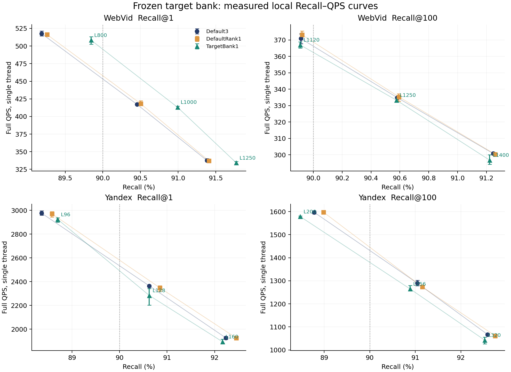

# 冻结目标库曲线：Web R1质量收益保留，综合改进未获证实

2026-09-30完成全部36点、108轮完整wall及独立核验。**冻结目标库保留WebVid R1的质量/速度取舍，尚无已测点的稳定Recall–QPS综合改善；结束本次有限曲线核验，不扩网格、ef、样本或重复。默认保持Web GT10-soft-t1、Yandex GT10-hard与生产E99。

## 实际结果

固定165原物理目标图、slot映射和ef10；没有重新拟合或构图。三方法为原GT10三入口、完整原路由后仅rank1、相同20K物理目标slot的TargetBank单入口。每个原工作点仅取E105旧网格的前邻/原点/后邻，一次事前固定。两集各4096条历史E105开发query，未使用今日151/157新源或held-out；中心点与165相同查询/返回，不是新独立质量复验。

| 工作点 | 默认Recall % / QPS | TargetBank Recall % / QPS | ΔRecall pp及95%描述区间 | ΔQPS |
|---|---:|---:|---|---:|
| WebVid R1/L800 | 89.184570 / 517.829 | 89.843750 / 508.319 | +0.659180 [+0.170898, +1.123047] | -1.8363% |
| WebVid R1/L1000 | 90.454102 / 417.190 | 90.991211 / 413.177 | +0.537109 [+0.122070, +0.952148] | -0.9620% |
| WebVid R1/L1250 | 91.381836 / 337.677 | 91.772461 / 334.231 | +0.390625 [+0.000000, +0.781250] | -1.0204% |
| WebVid R100/L1120 | 89.914062 / 370.836 | 89.908936 / 366.989 | -0.005127 [-0.082037, +0.071295] | -1.0375% |
| WebVid R100/L1250 | 90.581543 / 334.895 | 90.576416 / 333.291 | -0.005127 [-0.079834, +0.069824] | -0.4789% |
| WebVid R100/L1400 | 91.246826 / 300.849 | 91.222412 / 296.787 | -0.024414 [-0.089600, +0.041504] | -1.3501% |
| Yandex R1/L96 | 88.354492 / 2977.307 | 88.696289 / 2924.234 | +0.341797 [-0.366211, +1.049805] | -1.7826% |
| Yandex R1/L128 | 90.625000 / 2364.615 | 90.625000 / 2283.658 | +0.000000 [-0.634766, +0.634766] | -3.4237% |
| Yandex R1/L160 | 92.236328 / 1926.629 | 92.163086 / 1894.736 | -0.073242 [-0.634766, +0.512695] | -1.6554% |
| Yandex R100/L200 | 88.779297 / 1597.015 | 88.473145 / 1578.539 | -0.306152 [-0.622339, +0.009778] | -1.1569% |
| Yandex R100/L256 | 91.044434 / 1289.884 | 90.885010 / 1264.985 | -0.159424 [-0.441901, +0.122803] | -1.9303% |
| Yandex R100/L320 | 92.588135 / 1067.030 | 92.524902 / 1042.613 | -0.063232 [-0.332526, +0.209241] | -2.2883% |

Web R1三个预算的Recall差均值为+0.659180、+0.537109、+0.390625pp，前两个95%描述区间为正，第三个下界为0；对应救回/损伤为63/36、50/28、42/26。三个点都稍慢，因此保留可信的局部质量/速度取舍，而不将其写成方法无信息或已经获得同Recall加速。

Web R100三点接近但均值微负；Y R1三点分别正、零、负，区间均跨零；Y R100三点均值负、区间跨零。不能把区间跨零称为等效或已证明无损。TargetBank全部12个同预算点pooled QPS均低于Default3，约−0.479%至−3.424%。三次完整wall均保留，未删去Y K1/L128较慢的一轮。

预定72项TargetBank与Default3/DefaultRank1的跨预算比较全部完成，没有一项同时满足Recall均值不低与pooled QPS更高。此结论仅针对已测点；网格稀疏，不能据此否定连续预算下的一切可能收益。另一方面，也不能把图中连线或插值当成新的实测优势。

## 唯一预定90%阈值

| 组合 | 各自最快实测R90的L | 默认实际Recall / QPS | TargetBank实际Recall / QPS |
|---|---:|---:|---:|
| WebVid R1 | 1000 | 90.454102% / 417.190 | 90.991211% / 413.177 |
| WebVid R100 | 1250 | 90.581543% / 334.895 | 90.576416% / 333.291 |
| Yandex R1 | 128 | 90.625000% / 2364.615 | 90.625000% / 2283.658 |
| Yandex R100 | 256 | 91.044434% / 1289.884 | 90.885010% / 1264.985 |

三方法在四组合中选中的L均为原中心点。Web TargetBank L800的实际R1为89.843750%，未达到90%；不能四舍五入成达标或事后改阈值。上述实际Recall不同，因此只是同阈值最快实测点比较，不是完全相同Recall。DefaultRank1在Web R100仍有很小的正均值组合，原始区间和全部轮次见完整表；不将它归功于目标库。

竖向误差线是三轮QPS范围，非总体速度置信区间；连接线只引导读图。全部36点及72比较、成员增损、原始wall/路由与主图NDC见[完整表](results/tables.md)和[全部CSV](results/metrics.csv)。PDF图见[独立文件](figures/curves.pdf)。

## 机制和证据限制

目标库路由NDC固定为Web234.444/Y304.942；其主图NDC在所有点均低于原默认，但总NDC更高。主图节省只有Web约14–23、Y约65–89次距离，无法在本实现中抵消更昂贵的目标路由。NDC仍不等于wall，精确的成本归因需要单独机制证据；本轮以完整wall为速度结论。

所有区间来自10000次query-paired bootstrap，同一数据集全部K/L共用query重采样，种子事前固定。历史曝光、多重比较、从网格后选最快达标点使它们只适合描述，不是新的盲测确认。不能按本次结果追加一个更有利的L或延长重复。构建成本不是当前优化重点，本轮甚至没有新模型；判断依据始终是完整线上Recall和QPS。

## 实现审计与成本

原生逐位检查全部20K目标向量，所有Default3点的E105五字段恢复；中心点三方法的165六字段恢复。每点16条plain/count/E99、三轮重复与完整count一致；相同L的K1首返回/距离和K100一致。独立集合实现重评分147456返回行，复算真实成员增损、所有72比较、90%选择、整数加权bootstrap；区间最大差0。源、模型、输入冻结hash保持。独立实现由同一agent完成，不冒充另一审查人员。

实际新增596160 NSG、595584 ANN，0新GT/图/画像。原生控制器两集作业1010.690833秒，编译8.178411秒；CPU15实际1线程、严格串行，最高观测RSS11.071GiB。搜索结束阶段68880767字节、全日1358251644字节，文档/图另计入最终封存。作业wall含加载和核验，不替代纯查询QPS。

冻结目标库保留WebVid R1的质量/速度取舍，尚无已测点的稳定Recall–QPS综合改善；结束本次有限曲线核验，不扩网格、ef、样本或重复。默认保持Web GT10-soft-t1、Yandex GT10-hard与生产E99。

[事前协议](protocol.md) · [全统计](results/analysis.json) · [跨预算CSV](results/all_cross_budget_comparisons.csv) · [作业账](reviews/jobs_complete.json) · [独立核验](reviews/independent_audit.json) · [图表身份](reviews/render_identity.json)。
