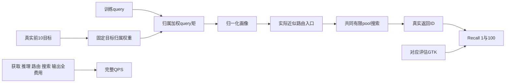

# 2026-10-02下午纯理论研究

已按今天16:00（Asia/Shanghai，UTC+8）截止收口，状态为COMPLETED_THEORY_ONLY_NO_EXPERIMENTS。用户要求先完善理论，不开始实验，本轮严格遵守。最新真实性能166、Web GT10-soft-t1/Y GT10-hard与生产E99不变，相对当前默认的后继可靠Recall–QPS综合改善尚未实现。此处不否定GT10默认此前相对同核NSG基线已记录的效果。

最新口径：**训练和离线准备可以增加投入，主目标是完整在线QPS与Recall综合提高。** 不以省训练、省构建、拟合变好或NDC下降替代该目标；离线更充分不免除线上推理/访问/路由/搜索/输出费用，也没有改变本轮不实验的范围。

[增加离线投入的研究口径](offline_training_and_online_gain.md)将这一要求具体化：可以花更多代价取得正确联合响应、降低所选策略类的误差或构建可靠几何metadata；部署改善仍需实际完整费用和共享最快默认比较。

## 当前理论推进

主要推进是补出了代理目标、真实响应与收费决策之间缺失的条件，并给出不满足条件时的具体反例。尚未证明某个新方法能改善真实性能。

| 理论对象 | 当前已推导内容 | 对真实方法仍缺的前件 |
|---|---|---|
| [GT10画像到真实效用](surrogate_to_search_theory.md) | 现行query归属矩闭式目标；代理最优却同线性族质量更差的GT10-hard例；另有兼容算子且优于raw-unit-H的截断对称正例 | 固定H算子例不代表选H器；真实query/响应图未知，近似路由/native/cost都未保证 |
| GT10生成解释 | hard稀疏责任与full-support后验不符；soft/hard有限值责任也不能精确等于非平凡连续vMF后验；方向对齐可以成立而不要求posterior等同 | 不能把这些反证写成所有后验或GT10经验效果被否定；近似误差/真实方向前件未测 |
| [多入口与目标rank](joint_response_and_target_rank_theory.md) | exact single utility仍可能因重复覆盖选错top3；只有可分响应才可top-m；训练10目标与评估1/100之间另有失配界 | 真实共同pool非单调，soft质量不是实际命中分解；不能把single或GT10保证跨到joint/K100 |
| [有限搜索局部条件](finite_search_strengthening.md) | 满pool＋完整出口上界的局部封闭；native逐ID保留与任意GTK损伤界；局部安全路径；同入口增大容量的展开前缀与额外Recall条件 | 当前pool/完整边界/native界/旧默认返回都须付费取得；粗任意GTK界不能证明严格改善，需额外真值或更强真实排序合同；实际机会和代价未知 |
| [原拒收组省评分](certified_group_elision_theory.md) | 完整原组native上界≤cutoff可保持逐ID结果；pivot正交/正交子空间残差可给非空包络，嵌套子空间实数上界收紧 | 可更重离线准备，但原分组、FP区间、metadata完整性与在线净费用未知；FINGER/ball pruning都是已有直接前作 |
| [决策信息与完整费用](decision_information_theory.md) | 全query已有信息与有限计算/表示分开；正确signed监督和条件校准；缓存状态Bellman/付费回退；两坐标可行域与dual费用上界 | 未知真实条件效用、访问结果联合模型和完整suffix成本；默认同机会控制不能省 |
| [前作和表示边界](theory_prior_and_falsifier_audit.md) | 固定target响应表下线性矩恢复的行空间/维数；ordinal例限制一般维数外推；压缩query内响应shift及signed矩换测度失效 | low-rank并不提供在线廉价特征或迁移；fit组校准和输入density ratio仍不保证确认域正确；已有真实效用监督/蒸馏/ridge不能换名当新gap |

## 一条更准确的解释链

闭式最优只约束画像构造处的亲和目标。每条向后箭头都需要自己的响应、排序、数值或费用合同；完整query可见并不表示这些函数能在允许费用内计算。上述图不是新实现调用链，实际架构仍以根spec为准。

## 当前可用的研究判断

“画像训练误差小”“目标更近”“更高分新入口”“三个single都好”“teacher较强”均不足以推出有限搜索或完整Recall–QPS改善。理论上有用的对象更具体：同合同联合动作的相对质量/完整时间、能保护真实返回ID的局部条件，以及获取它们后的可承受费用。

本地E04已有signed残差query画像，E25已有rescue/damage加权与按需专家，E36已有实际三入口联合反馈，E118已有共享比较方向/真实质量标签和费用回退，E164已有真实状态/rank在线验证。Bayes、vMF、loss embedding、calibration、次模覆盖和数值界也都有直接原论文。当前增量是完善这些对象的前件与可否证界限，不是命名一个新模型或重启旧runner。

各命题已经多名研究代理交叉手审，实质修正见[review_notes](review_notes.md)。[命题台账](proof_ledger.md)区分解析条件、结论与尚未取得的真实前件；[论文清单](literature_manifest.md)逐项注明原始版本和实读章节。三份分工专题稿已于15:35–15:40冻结，身份及人工审阅范围见[审阅记录](proof_review_completion.json)。16:00已结束研究并完成交接收口；手审通过不代表真实前件或净收益已成立。

## 执行边界

本轮只做数学、原文及静态源码/旧封存文字审阅；没有真实或合成实验、枚举、旧数组新诊断、训练、GT、构图、画像或性能，不读取新query/base向量。上午167全部封存artifact保持身份。理论有成立条件，未知真实前件不写成已满足；解析反例限制无条件推论，不冒充真实库负结果。

本轮于16:00结束，没有候选实现或实验GO。保留两个具体理论对象：同部署合同联合动作质量/完整费用的便宜表示，以及可靠完整原评分组拒收；真实可得性、迁移/数值、覆盖率及共享最快默认后的净费用继续HOLD，不自动恢复旧runner。

截止根交接文档单独复制到source_after，身份登记于root_handoff_identity.json；本版本seal只保护冻结版本及这些副本，日后合法根文档修订不回改本轮历史。行政核对记录见[document_checks](document_checks.json)，只说明JSON/链接/文件身份及声明scope，不是数学或性能验证。上午41份封存artifact及原identity保持原样。
