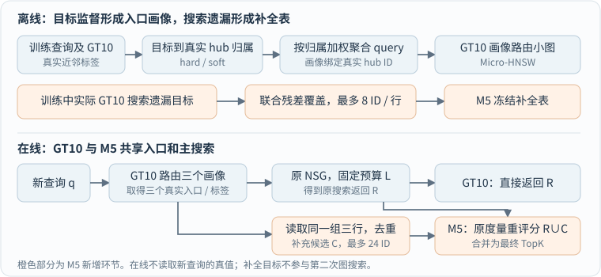

# GT10 与 M5 方法说明

GT10 通过目标监督构造查询画像，为每条查询选择三个真实图入口；M5 在 GT10 搜索结束后补充少量候选目标，再按原始检索分数合并返回。**M5 目前正在研究。**

## 1. 方法关系与整体流程

| 方法 | 查询入口 | 主搜索 | 返回结果 |
|---|---|---|---|
| NSG | 原图固定入口 | 原 NSG 搜索 | 直接返回 |
| GT10 | 画像路由选三个真实入口 | 原 NSG 搜索 | 直接返回 |
| M5 | 与 GT10 相同 | 与同预算 GT10 相同 | 补充候选、重评分与合并 |

GT10 处理“从哪里开始搜索”；M5 处理“搜索结束后补回哪些遗漏”。M5 复用 GT10 已取得的三个标签，补全目标只参与最终返回，不加入主搜索池。

符号约定：q 为查询，B 为向量库，h 为真实图入口，R 为原搜索返回，C 为补充候选。K 是返回数量，L 是主搜索候选池预算；正式检索使用原始内积分数 qᵀB[v]。GT10 名称中的“10”表示训练时使用前十个真值目标。

## 2. GT10：目标监督的入口画像

**离线步骤一：选择真实入口。** 对另设的查询做球面聚类，从代表查询的真值近邻中选择互异的库内目标，作为真实入口 hub。当前 WebVid、Yandex 分别使用 815、821 个入口。

**离线步骤二：目标归属与查询聚合。** 每条训练查询使用前十个真值目标。目标按与各入口的余弦相似度分配到入口；hard 分配给最相似的一个入口，soft 按温度 T 分配权重。

设 xᵢ=unit(qᵢ)，uₕ=unit(B[h])，tᵢⱼ 为训练查询 i 的第 j 个真值目标：

hard：wₕ(t) = 1[h = argmaxᵣ unit(B[t])ᵀuᵣ] 
soft：wₕ(t) = exp(unit(B[t])ᵀuₕ / T) / Σᵣ exp(unit(B[t])ᵀuᵣ / T) 
aᵢₕ = (1/10) Σⱼ₌₁¹⁰ wₕ(tᵢⱼ)，Σₕ aᵢₕ = 1

按目标归属权重聚合查询方向，得到入口画像：

mₕ = uₕ + Σᵢ aᵢₕ xᵢ 
pₕ = mₕ / ‖mₕ‖，mₕ ≠ 0

目标决定查询对各入口的归属，查询向量决定画像方向。每个画像 pₕ 绑定一个真实入口 h；它描述与该入口相关的查询，而不是重新改变库向量。

固定入口与归属权重、且合力非零时，pₕ 是单位球面上线性亲和目标 pᵀmₕ 的闭式最优解，无需梯度训练。该目标用于构造画像，并不直接等于图搜索的 Recall 或 QPS。

**离线步骤三：构建画像路由小图。** 在数百个画像上建立 Micro-HNSW，保存画像与真实入口 ID 的映射。当前两集画像均由 20K 查询拟合，另 5K 查询用于入口选择。

**在线流程。** 新查询先在画像小图中检索三个画像，将绑定的真实 ID 作为原 NSG 搜索入口，再使用原始查询、原始内积和指定预算 L 完成主搜索。当前 WebVid 使用 GT10-soft-t1，Yandex 使用 GT10-hard；t1 表示中档温度，不表示 T=1。

## 3. M5：基于搜索残差的目标补全（正在研究）

**离线构表。** 对训练查询运行 GT10，记录实际取得的三个路由标签 Jᵢ 及搜索返回 Rᵢ,K。以真值近邻集合 G_K(qᵢ) 与实际返回的差集作为遗漏监督：

Mᵢ,K = G_K(qᵢ) ∖ Rᵢ,K

为每个标签选择最多 8 个真实目标 ID，形成列表 Pₕ。在线可见候选是三个列表的并集：

C_A(q) = ∪ₕ∈J(q) Pₕ，|Pₕ| ≤ 8，|C_A(q)| ≤ 24

一张表同时用于 K=1 和 K=100。构表目标等权考虑两个指标的归一化遗漏覆盖：

F(A) = (1/N) Σᵢ [(1/2)|Mᵢ,1 ∩ C_A(qᵢ)| 
　　　　　　　　+ (1/200)|Mᵢ,100 ∩ C_A(qᵢ)|]

每次全局选择新增覆盖收益最大的“标签—目标”组合，直至各行达到容量或没有正收益。实现按“新覆盖一个 K1 遗漏记 100 分、新覆盖一个 K100 遗漏记 1 分”计算边际收益。某查询的目标已被其一个标签覆盖时，另外两个标签重复保存该目标不再增加这条收益。

因此，M5 学习的是有限预算搜索的实际遗漏，并联合考虑三个标签的冗余，而不是各行独立选择最常见的全部近邻。

**在线补全。** 完整执行原 GT10 路由和原 NSG 主搜索，得到 R；读取同一组三个标签的列表，去重并排除 R 中已有目标，得到 C。随后对 R∪C 使用原始内积重新评分，合并为最终 TopK；只有严格优于当前最差项的新增目标才替换。没有新增候选时直接保留原返回。

**成本与作用。** 每条查询最多读取 24 个补充 ID；存在新增候选时，还会重评原返回，因此 K=1 最多额外评分 25 个目标，K=100 最多 124 个。表文件每集约 52 KiB，保存 ID 及标签映射，不复制库向量。

同 L 时，M5 通过额外候选补回遗漏；减少 L 时，希望用补全弥补减少图搜索带来的质量损失。收益取决于新查询的遗漏是否出现在实际读取的三行中，以及补全质量与全部额外开销的关系。当前测试复用固定表，比较 NSG、GT10、M5 在多档 L 下的真实 Recall 与完整 QPS。
