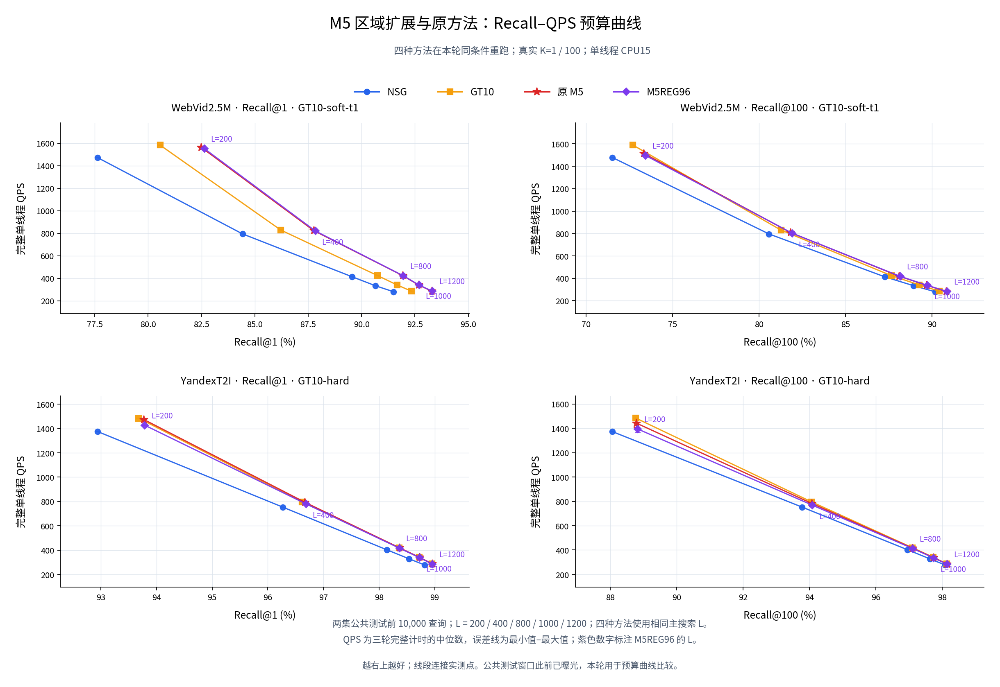

# E175：公共10K五档Recall–QPS曲线已完成

[PNG主图](analysis/final_v1/figures/recall_qps_budget_curves.png) · [SVG](analysis/final_v1/figures/recall_qps_budget_curves.svg) · [80点CSV](analysis/final_v1/points.csv) · [完整报告](analysis/final_v1/report.md)

实际完成80点/240完整单线程计时：WebVid/Yandex各公共前10,000查询，真实K1/K100，L=200/400/800/1000/1200，NSG/GT10/原M5/M5REG96。四法本轮匹配重测，QPS三轮中位与min–max；80点、200比较、20机制已独审，图80点映射及误差线独核。

区域补全相对原M5，同L Recall17升/3平，QPS20降：增量0～+0.16pp，配对QPS变化−3.261940%～−0.034929%。跨L双升只有WebVid K1两组预算对，原M5也已在这两组双升；新区域扩展无新增双升预算组合。原M5保留研究，GT10默认保持。新增TRAIN=0。

本轮是已曝光公共窗口、单public_test角色，非新独立确认；有限网格及交付已完成后停止。旧E173/E174原协议、结果与STOP保持其历史scope，不拼旧timing。native run_state保存原生完成当时的阶段状态；评价/交付当前终态见[state.json](state.json)。

阅读[详细复盘](../../experiment_history/175_m5_region_budget_curve_v1.md)、[独立结果审计](reviews/independent_result_audit/report.json)、[曲线独核](reviews/final_curve_delivery_review.json)、[协议](protocol.md)、[参数锁](parameter_lock.json)、[执行锁](execution_lock.json)、[数据预检](reviews/data_preflight.json)。全部[200比较](analysis/final_v1/comparisons.csv)与[20机制](analysis/final_v1/mechanisms.csv)保留。
