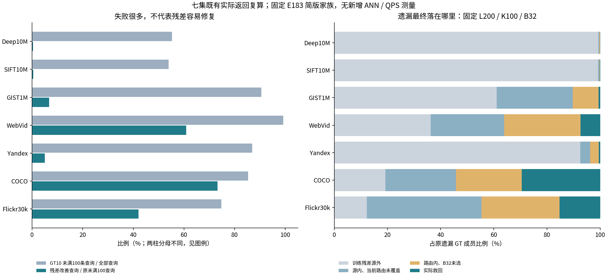
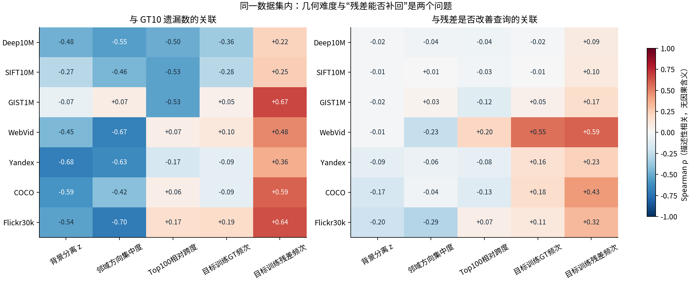

# 残差为什么只在部分数据集有效：空间分布与失败修复诊断

2026-10-24；E184 离线诊断。基底 HEAD `96cf05d5410cf51272048cd1f90b4bb194e23c62`，分支 `research/state-20261002`。新文件仍为本地工作，未提交或发布。

**当前默认保留 E99 GT10（WebVid soft-t1 / Yandex hard）。空间结构与查询失败存在关联，但当前静态残差的跨集收益，更直接受“遗漏目标在训练中能否重复出现、当前路由能否覆盖、有限表能否保留”约束。不能概括成多模态天然有效、越小越有效或越聚集越有效。**

这里的残差是 `GT_K − GT10实际返回` 的遗漏目标 posting 补全，不是向量量化残差。B32 每个路由行32槽，三个hub去重前最多96个候选；它补最终结果，不改变主图遍历。

本轮重算 E183 56,000 条已有测试查询的 L200 实际返回，增加原向量几何诊断；没有训练、构图、ANN、新GT或QPS重测。E183 仍是最新性能证据。

## 1. 各集到底失败多少、改进多少

固定 L200，Deep/SIFT/WebVid 用 soft，其余 hard，补全统一同家族B32。这个展示继承E183简版，不按本轮结果换赢家。K1是实际K1返回，未由K100包含GT1冒充。

| 数据集 | 查询数 | K1失败率 | K1救回 / 原失败 | K100未满100查询 | K100少于90查询 | 残差改善 / 原未满100查询 | 恢复100/100 / 原未满100 |
| --- | --- | --- | --- | --- | --- | --- | --- |
| Deep10M | 10000 | 0.50% | 0/50 | 55.24% | 7.53% | 21/5524 (0.38%) | 0/5524 (0.00%) |
| SIFT10M | 10000 | 0.08% | 0/8 | 53.91% | 2.37% | 25/5391 (0.46%) | 5/5391 (0.09%) |
| GIST1M | 1000 | 3.00% | 0/30 | 90.50% | 43.00% | 61/905 (6.74%) | 0/905 (0.00%) |
| WebVid | 10000 | 19.44% | 307/1944 | 99.16% | 78.54% | 6033/9916 (60.84%) | 34/9916 (0.34%) |
| Yandex | 10000 | 6.32% | 14/632 | 86.89% | 33.60% | 441/8689 (5.08%) | 8/8689 (0.09%) |
| COCO | 10000 | 1.92% | 104/192 | 85.32% | 11.08% | 6245/8532 (73.20%) | 1402/8532 (16.43%) |
| Flickr30k | 5000 | 0.28% | 5/14 | 74.74% | 3.06% | 1572/3737 (42.07%) | 282/3737 (7.55%) |

“未满100”包括只差一个成员；“改善”指逐query净命中数增加，不能等同整条失败解决。下表“遗漏率”和“修复率”以成员计，上表以查询计；所有主分析 L200 点成员损伤为0，其他L的历史边界损伤仍保留。

| 数据集 | 原遗漏成员率 | 被修复的遗漏成员 | 净 Recall 增量 pp | Recall@100：GT10→B32 | 完整QPS：GT10→B32 | 同L QPS变化 |
| --- | --- | --- | --- | --- | --- | --- |
| Deep10M | 2.9220% | 0.0719% | 0.0021 | 97.0780% → 97.0801% | 1934.02 → 1867.56 | -3.44% |
| SIFT10M | 1.8468% | 0.1354% | 0.0025 | 98.1532% → 98.1557% | 1617.15 → 1565.00 | -3.22% |
| GIST1M | 10.8860% | 0.6063% | 0.0660 | 89.1140% → 89.1800% | 611.73 → 601.90 | -1.61% |
| WebVid | 27.2967% | 7.4210% | 2.0257 | 72.7033% → 74.7290% | 1756.55 → 1661.32 | -5.42% |
| Yandex | 11.2276% | 0.5077% | 0.0570 | 88.7724% → 88.8294% | 1632.56 → 1569.01 | -3.89% |
| COCO | 4.6556% | 29.4591% | 1.3715 | 95.3444% → 96.7159% | 2690.89 → 2522.93 | -6.24% |
| Flickr30k | 2.7928% | 15.3251% | 0.4280 | 97.2072% → 97.6352% | 2569.23 → 2428.35 | -5.48% |

QPS全部引用E183三轮完整wall中位数；同L下降是补点费用，不能单独否定同Recall曲线收益。E183中WebVid/COCO两K共同Recall区间折线受益，Flickr交叉、Yandex K100较低，Deep/SIFT K100较低、GIST混合。折线不是新增等Recall实测，本轮未重新推导或重测前沿。

## 2. 失败率与修复率不是同一回事

例如COCO的K100遗漏成员率低于WebVid，却能修复更高比例的遗漏；Flickr的库更小，但修复率低于COCO。Deep/SIFT的Top1接近饱和，但仍有超过一半查询未找齐Top100。因此“剩余失败量很少”只能解释部分K1现象，解释不了全部K100差异。

在本次七集上，以下相关仅为七个异质数据集的描述；规模、metric、特征、训练密度和图没有配平。留一范围不是置信区间，也不提供跨总体显著性。

| 与K100成员修复率的跨集关联 | Spearman ρ | 留一集最小..最大 |
| --- | --- | --- |
| GT_K100_incomplete_pct | 0.429 | 0.143 .. 0.600 |
| K100_missing_member_pct | 0.214 | -0.143 .. 0.543 |
| K100_missing_source_seen_pct | 0.964 | 0.943 .. 1.000 |
| train_residual_repeat_factor | 0.964 | 0.943 .. 1.000 |
| train_GT_repeat_factor | 0.929 | 0.886 .. 0.943 |
| base_n | -0.889 | -0.880 .. -0.870 |
| median_background_z | -0.357 | -0.543 .. -0.086 |
| median_GT100_direction_concentration | -0.357 | -0.543 .. -0.086 |
| base_sample_effective_rank | 0.250 | 0.086 .. 0.543 |

源覆盖与修复率不是两项独立的外部证据：救回必须位于源中，二者有结构性包含关系。相关系数用于描述差异，不能凭它宣称发现了因果机制或泛化预测器。

## 3. 真正的瓶颈分解

下面所有数字都是“query–GT成员事件”，不是不同base节点数。源为16K合法训练遗漏；路由为当前三个真实hub关联的未裁剪源；表为B32。

| 数据集 | 测试遗漏 | 曾在训练GT100 | 训练残差源内 | 当前路由源内 | B32实际救回 | 源内比例 |
| --- | --- | --- | --- | --- | --- | --- |
| Deep10M | 29220 | 3217 | 195 | 86 | 21 | 0.667% |
| SIFT10M | 18468 | 2250 | 140 | 62 | 25 | 0.758% |
| GIST1M | 10886 | 8122 | 4242 | 1117 | 66 | 38.967% |
| WebVid | 272967 | 214688 | 173900 | 98679 | 20257 | 63.707% |
| Yandex | 112276 | 29887 | 8452 | 4261 | 570 | 7.528% |
| COCO | 46556 | 46072 | 37606 | 25246 | 13715 | 80.776% |
| Flickr30k | 13964 | 13964 | 12252 | 6233 | 2140 | 87.740% |

忽略并列/舍入损伤时，汇总净提升有以下**记账恒等式**，不是独立拟合出的解释模型：

`净ΔRecall = 原遗漏成员比例 × 源覆盖率 × 源内路由覆盖率 × 路由内表保留率 × 候选最终救回率 − 损伤比例`

在主分析L200中，候选覆盖的遗漏全部进入最终结果且损伤0，因此最后救回率为1。一般场景必须核对真实合并输出，不能默认等于1。

- Deep/SIFT：99%以上测试遗漏在当前训练残差源外。即使取出固定源的全部目标、不计费用，最多额外提升Recall 0.0195/0.0140pp；保持当前路由源时上限更低，为0.0086/0.0062pp。这里的“上限”针对固定源/当前GT10/L200的可补成员，不是已部署算法保证。只扩大当前B32无法填补源外遗漏。
- GIST：源内覆盖约39%，但路由后只剩1117个，再经B32只补66个。源覆盖不足、路由关联和容量保留是不同损失；本集更应关注后两项，不能沿用Deep/SIFT的单一源外解释。
- Yandex：训练残差源内仅约7.53%，最终修复0.51%；同时有来源与选择限制。不能把它说成“空间平坦”或全部归因千万级规模。
- WebVid/COCO/Flickr：训练遗漏有较多重复目标，表有可复用内容，但容量、路由与原遗漏量仍决定实际收益；Flickr高源覆盖不等于比COCO高修复率。

全局/路由固定源的乐观Recall上限已在 [coverage_chain.csv](analysis/coverage_chain.csv) 逐集保存，不是插值性能点。

## 4. 与空间分布的关联：直接测了什么

使用全部原测试query及其原GT100目标向量，float64重评分原平方L2/负内积。每集另抽固定8192个base目标，用于背景分布与全局协方差；保留样本ID及样本向量SHA。未修改base/query归一化或GT。

- 背景分离z：GT100边界比均匀base样本背景均值好多少个标准差。z大表示该指标下分离更明显；不是论文原始relative contrast，不把IP当欧氏半径。
- 邻域方向集中度：原GT100目标各自单位化后的均值长度；只作辅助几何统计，不改变实际搜索metric。
- Top100相对跨度、query/目标范数：检查局部紧密程度及原IP的模长相关。
- 样本协方差有效秩：`tr(C)^2/tr(C^2)`，C为中心化的总体形式样本协方差；它是各向异性摘要，不能称真实流形内在维数。

| 数据集 | 背景z中位数 | GT100方向集中度中位数 | 样本协方差有效秩 | 训练残差singleton token | 训练残差重复倍率 |
| --- | --- | --- | --- | --- | --- |
| Deep10M | 4.737 | 0.854 | 44.96 | 99.42% | 1.003 |
| SIFT10M | 3.758 | 0.912 | 26.72 | 98.90% | 1.006 |
| GIST1M | 1.360 | 0.938 | 17.81 | 59.73% | 1.307 |
| WebVid | 4.288 | 0.869 | 43.39 | 36.00% | 1.896 |
| Yandex | 5.012 | 0.769 | 113.71 | 92.48% | 1.041 |
| COCO | 4.155 | 0.846 | 66.21 | 19.41% | 2.683 |
| Flickr30k | 2.981 | 0.713 | 80.49 | 12.07% | 3.455 |

不同metric/来源之间的z和有效秩只作描述，不按单个数值给所有数据集排序。下面在各数据集内关联，所有特征均为离线诊断，使用GT的量不能直接上线。

| 数据集 | z与遗漏数ρ | 方向集中度与遗漏数ρ | z与残差改善ρ | 训练GT频次与改善ρ | 训练残差频次与改善ρ |
| --- | --- | --- | --- | --- | --- |
| Deep10M | -0.477 | -0.553 | -0.023 | -0.017 | 0.089 |
| SIFT10M | -0.274 | -0.460 | -0.012 | -0.006 | 0.100 |
| GIST1M | -0.072 | 0.072 | -0.018 | 0.049 | 0.172 |
| WebVid | -0.452 | -0.674 | -0.008 | 0.549 | 0.589 |
| Yandex | -0.684 | -0.633 | -0.093 | 0.156 | 0.230 |
| COCO | -0.592 | -0.416 | -0.166 | 0.177 | 0.428 |
| Flickr30k | -0.537 | -0.699 | -0.205 | 0.107 | 0.325 |

与原遗漏数的关系回答“哪些query难”；与残差改善的关系回答“当前表能帮助哪些query”。Deep/SIFT的背景分离或邻域集中与遗漏数有负相关，而与残差改善的相关接近0；存在几何难度差异，也不保证具体遗漏ID能从静态训练表复用。GIST目标方向集中度较高、补全收益仍小，否定“更聚集就一定更适合残差”的简单解释。

完整四分位条件率在 [feature_quartiles.csv](analysis/feature_quartiles.csv)；按原遗漏数1–4、5–9、10–49、50+分层后比较特征高低半组的改善概率，见 [baseline_stratified_associations.csv](analysis/baseline_stratified_associations.csv)。只在两组各至少10条的层中标准化，报告覆盖查询数；它仍有层内混杂、选择条件和稀有事件限制，不是因果调整或部署效果。

**几何也不能被排除。** 粗略控制原遗漏量后，WebVid/COCO的高背景分离组，改善概率仍分别高8.17/11.50pp；同样分层下，高训练残差频次组分别高44.69/19.61pp。无条件ρ接近0可能掩盖“容易的query错误少、但同等错误下更好补”的相反作用；这仍是观察关联，不能宣称几何独立因果已被识别。

| 数据集 | 按遗漏量分层：高z−低z改善概率 pp | 高残差频次−低频次改善概率 pp |
| --- | --- | --- |
| Deep10M | 0.122 | 1.047 |
| SIFT10M | 0.064 | 1.537 |
| GIST1M | -0.563 | 4.388 |
| WebVid | 8.171 | 44.691 |
| Yandex | 0.713 | 6.392 |
| COCO | 11.504 | 19.608 |
| Flickr30k | 4.071 | 3.840 |

这些差值比较的是各数据集全体query特征高低半组，在可比较的遗漏数量层内按层大小加权；两特征可纳入的查询数可能不同，应读原CSV中的included/total字段。

全预算敏感性：既有全部K100/L与hard/soft的B32成员修复率范围如下。它不是把各L当独立重复，也不是再择优；Deep/SIFT很低、Web/COCO较高的大体差异不依赖单个L200展示点。

| 数据集 | 全部已测L / 已有家族B32修复率 |
| --- | --- |
| Deep10M | 0.000% .. 0.147% |
| SIFT10M | 0.086% .. 0.462% |
| GIST1M | 0.586% .. 1.028% |
| WebVid | 6.411% .. 9.913% |
| Yandex | 0.423% .. 0.703% |
| COCO | 23.524% .. 30.613% |
| Flickr30k | 11.248% .. 23.876% |

## 5. 文献、现有规模控制与可证伪解释

[Hubs in Space (JMLR 2010)](https://www.jmlr.org/papers/v11/radovanovic10a.html)讨论某些目标反复成为其他点近邻的k-occurrence。它提示要看目标频次分布；这种统计hub与项目中H个真实图入口不同。本轮测的是训练query到base目标的近邻频次/遗漏频次，跨模态场景不直接满足论文同分布设定。

[On the Difficulty of Nearest Neighbor Search (ICML 2012)](https://icml.cc/2012/papers/580.pdf)用随机点与最近邻的距离对比描述难度，并给出LSH方面的理论分析。本轮借鉴“量化分离度”的思路，未套用其LSH结论去证明有限NSG或残差收益。

E182同源规模控制已显示：固定H815时K100=90%的折线QPS增益由24.33%降至16.41%；H按规模匹配后为14.07/17.75/17.71/16.41%，不再单调。改变H还改变路由及每hub训练密度；这是容量因素的证据，不是纯几何/纯规模因果分解。当前七集不能覆盖这项混杂。

**更符合现有证据的解释**：有限图搜索在某些query上产生稳定且可复用的遗漏目标；如果训练query与测试query在目标身份/路由上重复支持这些遗漏，静态表能集中有限槽位而受益。局部几何影响主搜失败，目标重复与路由集中影响补全机会，两者可以分离。这是结合观测的机制假说，未通过随机干预证明。

可证伪方向（尚未实施）：在固定合法训练源上，以目标重现率/路由分散度预测独立查询角色的修复；用源覆盖匹配的简单频次表作对照，检验几何结构是否仍有额外解释力。对源外主导的数据，应先证明新合法来源能提高目标覆盖；对GIST类则先证明路由/保留策略能利用已有源。全部线上选择、检索、补算费用最终仍须完整T1曲线验证，事后GT特征不是免费门控。

## 6. 核验、成本与结束边界

所有主分析整数与E183既有CSV一致；另用不导入主分析或NumPy的stdlib set/Counter脚本逐条复核56,000查询的K1/K100救损、训练源频次与覆盖分区。每集8条query直接对8192背景样本重算距离均值/方差，验证矩公式。该第二实现由同一执行者完成，不冒称独立审稿人或新GT证明。

小输入实际SHA与大base当前stat前后核对；完整大base SHA继承E183而非本轮重算。本次几何读取的8192样本有新SHA，GT目标向量也从原base直接读取。原图、模型、E183产物未写。

首个诊断尝试在Deep的布尔数组常量判断处因NumPy不支持布尔减法退出，已保存 [原失败日志](failed_run_v1.log)，修正为等值常量判断后按同协议重算；没有ANN/性能重测。失败尝试精确wall未记录，不能填0。成功诊断成本见 [receipt.json](analysis/receipt.json)，整数第二实现见 [integer_audit.json](analysis/integer_audit.json)；它们不是线上QPS。历史离线/性能成本保留，不重复计入。

局限：单图/单画像、已曝光测试、GIST仅1K；固定L200跨集难度不相等；全部L/已测家族敏感性另存；8192背景样本不是全库分布证明；秩相关是描述，未作多重检验或泛化校准；覆盖链有结构依赖；几何特征含GT、没有线上代价测量。不能由本轮归因编码器、模态、维度、图质量或得出新可靠Recall–QPS改善。

本诊断范围完成后停止，无新模型/性能队列，默认不变。

复算：在仓库根目录运行 `.venv_cpu/bin/python entry_method_exploration/20261024_residual_geometry_diagnosis_v1/analyze.py`，输出目录非空会拒绝覆盖；要另建版本，不删除旧结果。整数审计和报告脚本分别为 `audit_integers.py` / `build_report.py`。新分析依赖外部原向量/GT/实际返回，不能把只有Git文件的快照说成完整可运行包。
