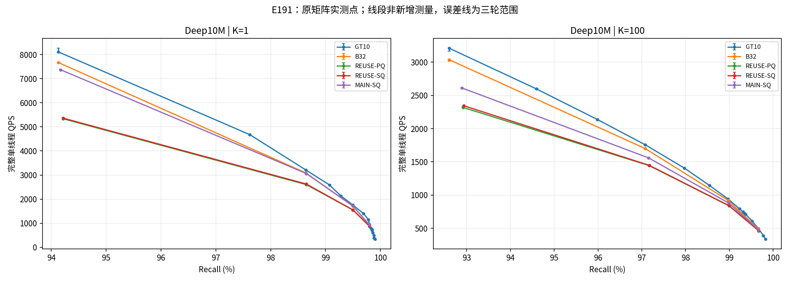
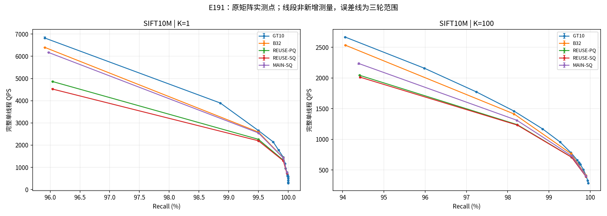
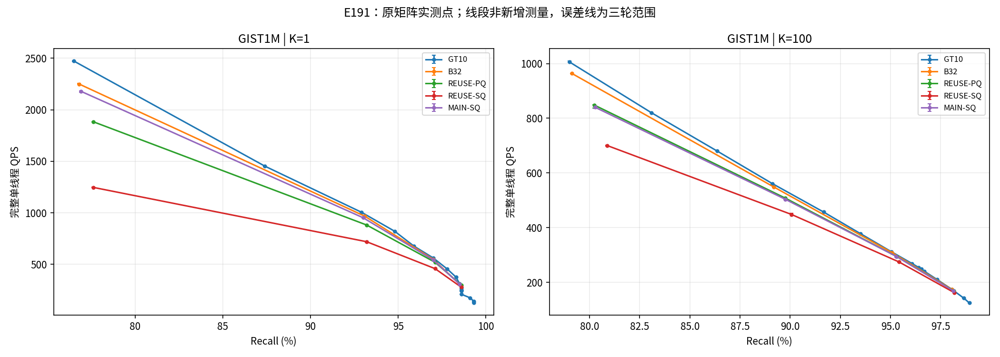
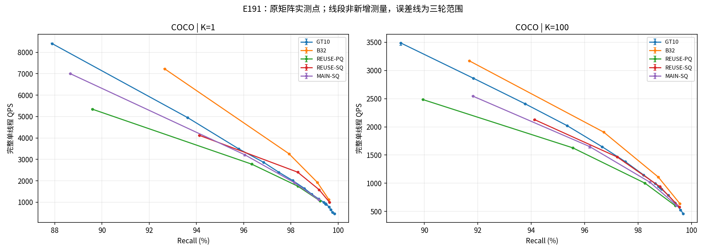
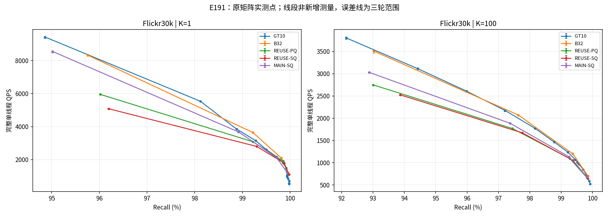
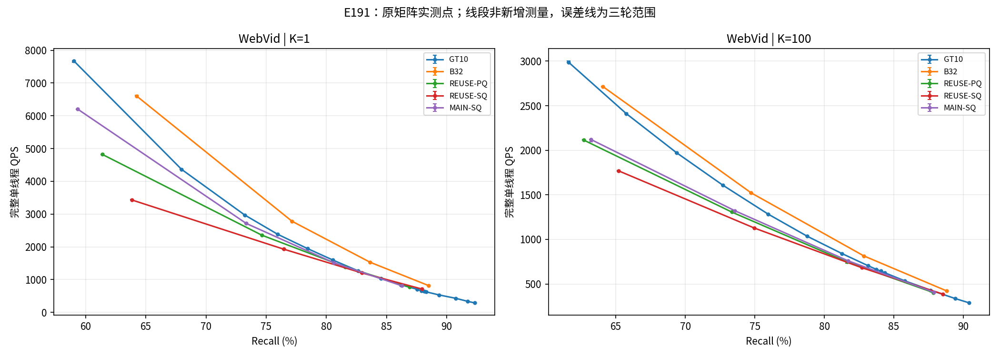
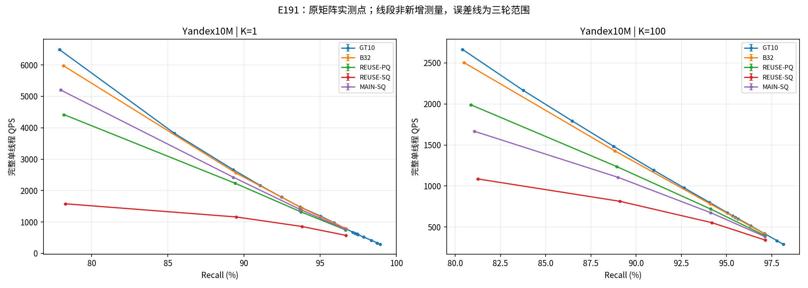

# E191：七数据集、两K的候选来源与评分综合测试

2026-10-28启动，2026-10-29完成；完整单线程、原metric/图/GT10保持。按用户后续明确授权，完成测试后制作详细中文PDF。

七集真实K1/K100：原矩阵448点/1344完整T1轮；另一次密集控制541点/1623轮。112个SQ来源/预算点中，原网格66个通过探索筛选，密集同窗口后12个仍通过；默认E99 GT10保持。

## 七集完整结果的详细结论

结论是保留具体场景，暂不替换默认。七集真实K1/K100共989个计时点、2967轮完整T1测量，另有140资格点；覆盖较强共享观测的COCO/Flickr，也覆盖Deep/SIFT等弱覆盖情形。这里没有人为构造零共享因果组，新块表12K与旧B32的16K监督角色分别保留。

固定扫描下，SQ显著减少PQ筛选损失：K100/L200的COCO短名单覆盖2131→18747，WebVid为6320→22639。SQ保住99%以上扫描内遗漏，但不代表覆盖全部遗漏。Deep的168个短名单到返回损失均有相同向量的其他ID；严格GT-ID、并列规则和原metric均未改写。

弱覆盖场景确实能救回旧残差源外目标，但代价不能略去。Deep/SIFT在K100/L200分别救回913/808个成员，其中旧源外904/794；Recall仅增0.0913/0.0808pp，完整平均查询耗时增21.32%/18.63%，扫描仅覆盖原遗漏3.73%/4.42%。源外不等于从未受任何监督。

66个表面阳性经一次密集GT10控制，50个被覆盖、4个未过门、12个保留：COCO4、Flickr3、WebVid3、Deep1、GIST1。COCO的K1/SQ在L100/200/400有21.50%/32.64%/31.23%阈值速度优势；这是有限网格参照。Deep只多4个K1命中，GIST仅预算门通过，Flickr高Recall点也须看小计数。

再比较已有补全，12点中5点被覆盖：WebVid三点和COCO的K100/L800被B32覆盖，GIST点被PQ覆盖。其余7点未被已测方法覆盖，但B32仅有原四档L，尚无同样密集的费用匹配控制；不能宣称7点已经优于充分调节预算的B32，更不能称通用最佳。

严重失败修复有限。K100/L200的SQ使WebVid严格0–9命中查询53→40，Yandex为86→82；完整耗时分别增42.63%和81.94%。COCO虽Recall增1.8747pp，原1个严重失败仍未修复。MAIN-SQ有源外救回，但来源信息与访问量同时改变，不能当纯共享因果消融。

默认E99 GT10保持，本轮固定矩阵收口。后续先补已有B32密集费用控制，再用合法新查询/图确认；不自动追加实验。当前是一套图/画像、历史曝光测试，三轮只重复计时；无分段时间归因或总NDC。已复核的一处0.05pp浮点边界不改变选点及最终判断。

## 先读结论的适用范围

本报告检验固定候选PQ→SQ8评分能否迁移，并加入无训练遗漏块表的MAIN-SQ。共享较强/弱是旧数据上的观测分层；完整结果按数据集、K、L和候选源分别保留，不用一个COCO结果代替全部数据。保留探索价值与默认替换分开判断。

出现密集控制后保留的场景候选，见下表；它们是一图/画像、历史曝光query上的可复现局部证据，尚无新系统盲确认。

## 数据、角色与历史共享观测

| 数据 | N×d | metric | 家族/H | test n | 旧GT100重合 | 旧遗漏覆盖 |
| --- | --- | --- | --- | --- | --- | --- |
| Deep10M | 10000000×96 | squared L2 | soft/800 | 10000 | 5.80% | 0.07% |
| SIFT10M | 10000000×128 | squared L2 | soft/800 | 10000 | 5.16% | 0.00% |
| GIST1M | 1000000×960 | squared L2 | hard/800 | 1000 | 8.08% | 0.43% |
| COCO | 118272×512 | raw IP | hard/815 | 10000 | 42.00% | 10.51% |
| Flickr30k | 31782×512 | raw IP | hard/815 | 5000 | 33.61% | 3.48% |
| WebVid | 2505000×512 | raw IP | soft/815 | 10000 | 15.10% | 5.44% |
| Yandex10M | 10000000×200 | raw IP | hard/821 | 10000 | 6.69% | 0.57% |

后两列来自E185每集固定512query的“最近合法训练query”诊断；GT重合与遗漏覆盖分母不同，不是本轮新测，也不是因果/语义独立标签。Deep/SIFT并非近邻完全不重合，而是训练遗漏对test遗漏覆盖很弱。[E185原表](../20261024_manifold_residual_probe_v1/report_zh.md)。

原图/GT10与任务原metric不变，IP不变成cosine，L2不额外归一化。GT是特征近邻而非人工语义配对。家族在读新结果前固定；H、库规模、维度、metric、训练密度未因果配平。

## 机制与同预算条件

GT10不补全。B32为旧16K/K100L200目标ID表；新入口块表只用合法前12K同教师遗漏，每hub8块；末4K不拟合、不选配置。三个hub块表与真实主返回最高8块去重最多32，原metric中心排序，整块扫描≤2048。REUSE-PQ/SQ逐query pool、扫描块/顺序完全一致，各取96追加原metric精算/严格合并。

MAIN-SQ只用真实主返回最高8块，不使用训练遗漏块表；每块≤128，实际≤1024码，K1只有一个主返回块。它的来源信息及实际访问量同时变化，不能当纯共享因果消融；原GT10本身仍有监督，不称整个系统无监督。

K1真实只返回/使用一个主结果，命中仅对GT1；没有暗中取100个主结果。两K共享K100教师的同张块表/固定96精算上限是实验条件，不是各K最佳配置。B32含末4K标签，只作正式参考，不进校准选择。

SQ8原base全库逐维minmax编码，无query/GT训练；COCO/Deep沿旧块与表，其他集同机制新建。PQ通常M16，Yandex d200合法适配M20；这不是完全等码长跨数据因果控制。SQ8码为d字节，PQ码为M字节；更准确评分的内存和全部线上工作都支付，次数不能替代分段耗时。

## 固定L200的完整表现：两K、七集

### K=1

| 数据 | GT10 Recall/QPS | B32 | REUSE-PQ | REUSE-SQ | MAIN-SQ |
| --- | --- | --- | --- | --- | --- |
| Deep10M | 99.5000% / 1753.23 | 99.5000% / 1713.75 | 99.5000% / 1548.21 | 99.5000% / 1552.19 | 99.5000% / 1709.62 |
| SIFT10M | 99.9200% / 1453.62 | 99.9200% / 1425.51 | 99.9200% / 1319.54 | 99.9200% / 1295.25 | 99.9200% / 1416.93 |
| GIST1M | 97.0000% / 561.71 | 97.0000% / 548.42 | 97.1000% / 519.99 | 97.1000% / 458.16 | 97.0000% / 542.78 |
| COCO | 98.0800% / 2011.72 | 99.1200% / 1931.54 | 98.2900% / 1752.16 | 99.2000% / 1584.56 | 98.1500% / 1914.99 |
| Flickr30k | 99.7200% / 2175.09 | 99.8200% / 2095.05 | 99.8600% / 1901.35 | 99.8800% / 1788.88 | 99.7200% / 2120.78 |
| WebVid | 80.5600% / 1594.36 | 83.6300% / 1530.60 | 81.5600% / 1388.63 | 82.9700% / 1201.44 | 80.6300% / 1513.48 |
| Yandex10M | 93.6800% / 1477.26 | 93.8200% / 1439.79 | 93.7400% / 1321.75 | 93.8000% / 856.42 | 93.6900% / 1396.78 |

### K=100

| 数据 | GT10 Recall/QPS | B32 | REUSE-PQ | REUSE-SQ | MAIN-SQ |
| --- | --- | --- | --- | --- | --- |
| Deep10M | 97.0780% / 1757.02 | 97.0801% / 1699.73 | 97.1627% / 1445.11 | 97.1693% / 1448.23 | 97.1540% / 1560.23 |
| SIFT10M | 98.1532% / 1460.57 | 98.1557% / 1413.06 | 98.2311% / 1239.22 | 98.2340% / 1231.19 | 98.2229% / 1310.57 |
| GIST1M | 89.1140% / 561.15 | 89.1800% / 549.09 | 89.7570% / 508.25 | 90.0690% / 448.37 | 89.7610% / 503.89 |
| COCO | 95.3444% / 2021.72 | 96.7159% / 1906.75 | 95.5575% / 1628.36 | 97.2191% / 1466.30 | 96.1862% / 1651.52 |
| Flickr30k | 97.2072% / 2176.25 | 97.6352% / 2071.80 | 97.4498% / 1767.66 | 97.7616% / 1671.51 | 97.3746% / 1885.32 |
| WebVid | 72.7033% / 1607.71 | 74.7290% / 1522.47 | 73.3353% / 1306.98 | 74.9672% / 1127.18 | 73.5475% / 1322.57 |
| Yandex10M | 88.7724% / 1482.06 | 88.8294% / 1427.91 | 88.9353% / 1236.76 | 89.0952% / 814.57 | 88.9889% / 1107.20 |

所有QPS是本轮同一可执行程序的完整batch wall三轮中位数；实际返回来自计时包。绝对速度不拼接E190/E183；正常分配初始化、路由、主搜、补全、六数组复制与销毁均计入，加载/保存/GT/oracle在外。

## 原网格阳性与一次密集控制

| 数据 | K | 方法 | L | 原阈值速度% | 密集阈值速度% | 密集预算Recall差pp | 决定 |
| --- | --- | --- | --- | --- | --- | --- | --- |
| Deep10M | 1 | REUSE-SQ | 32 | 14.640047953825164 | -22.99088283876265 | -2.3999999999999915 | COVERED_BY_DENSE_GT10 |
| Deep10M | 1 | MAIN-SQ | 32 | 57.64373452571143 | 2.9170962876889472 | 0.04000000000000625 | RETAIN_EXPLORATORY |
| Deep10M | 1 | MAIN-SQ | 100 | 18.188878175211933 | 0.8221368653803296 | 0.010000000000005116 | NO_DENSE_SCREEN_PASS |
| Deep10M | 100 | MAIN-SQ | 100 | 0.5577236852479128 | -14.520478869845622 | -1.4166999999999774 | COVERED_BY_DENSE_GT10 |
| Deep10M | 100 | REUSE-SQ | 200 | 2.9847700037124225 | -12.497953596634904 | -0.5577999999999861 | COVERED_BY_DENSE_GT10 |
| Deep10M | 100 | MAIN-SQ | 200 | 10.948988635144419 | -6.49029883310196 | -0.2837000000000103 | COVERED_BY_DENSE_GT10 |
| Deep10M | 100 | REUSE-SQ | 400 | 5.919767543633991 | -7.038044081962913 | -0.11720000000001107 | COVERED_BY_DENSE_GT10 |
| Deep10M | 100 | MAIN-SQ | 400 | 10.69387104254076 | -2.957643653324382 | -0.02960000000001628 | COVERED_BY_DENSE_GT10 |
| Deep10M | 100 | REUSE-SQ | 800 | 18.80508025504186 | -1.1330014322270987 | -0.02019999999998845 | COVERED_BY_DENSE_GT10 |
| Deep10M | 100 | MAIN-SQ | 800 | 21.699668397619142 | 1.4952295754929068 | 0.0040000000000048885 | NO_DENSE_SCREEN_PASS |
| SIFT10M | 1 | REUSE-SQ | 32 | 16.085840725111677 | -25.795478659368932 | -2.2099999999999937 | COVERED_BY_DENSE_GT10 |
| SIFT10M | 1 | MAIN-SQ | 32 | 58.432495163913266 | -1.693216403897435 | -0.730000000000004 | COVERED_BY_DENSE_GT10 |
| SIFT10M | 100 | MAIN-SQ | 100 | 3.5581676447651756 | -15.207224784986051 | -1.3237999999999914 | COVERED_BY_DENSE_GT10 |
| SIFT10M | 100 | REUSE-SQ | 200 | 5.314053145482611 | -14.833858995603656 | -0.5311000000000092 | COVERED_BY_DENSE_GT10 |
| SIFT10M | 100 | MAIN-SQ | 200 | 12.103623304025213 | -9.380289982059098 | -0.3312000000000097 | COVERED_BY_DENSE_GT10 |
| SIFT10M | 100 | REUSE-SQ | 400 | 7.02688426739615 | -9.296735346225681 | -0.09300000000000352 | COVERED_BY_DENSE_GT10 |
| SIFT10M | 100 | MAIN-SQ | 400 | 10.87389437567532 | -6.242497919792578 | -0.07440000000001135 | COVERED_BY_DENSE_GT10 |
| SIFT10M | 100 | REUSE-SQ | 800 | 19.043651874154953 | -3.7300729189098103 | -0.005400000000008731 | COVERED_BY_DENSE_GT10 |
| SIFT10M | 100 | MAIN-SQ | 800 | 21.8714619015012 | -1.6722294076302324 | -0.0062000000000210775 | COVERED_BY_DENSE_GT10 |
| GIST1M | 1 | MAIN-SQ | 32 | 50.06569452184766 | -1.8453785176834825 | -2.299999999999997 | COVERED_BY_DENSE_GT10 |
| GIST1M | 1 | MAIN-SQ | 100 | 15.99221643544244 | -1.0022950119590979 | -0.5 | COVERED_BY_DENSE_GT10 |
| GIST1M | 1 | REUSE-SQ | 200 | 0.9283059934173776 | -15.207249203783924 | -0.6000000000000085 | COVERED_BY_DENSE_GT10 |
| GIST1M | 1 | REUSE-SQ | 400 | 3.5140041168605363 | -5.949494724015036 | 0.0 | COVERED_BY_DENSE_GT10 |
| GIST1M | 100 | MAIN-SQ | 100 | 2.365670922916596 | -9.25004155461514 | -1.6910000000000025 | COVERED_BY_DENSE_GT10 |
| GIST1M | 100 | MAIN-SQ | 200 | 10.190435696133736 | -2.250951596992723 | -0.375 | COVERED_BY_DENSE_GT10 |
| GIST1M | 100 | REUSE-SQ | 400 | 2.0398443301690827 | -7.024573893907881 | -0.3509999999999991 | COVERED_BY_DENSE_GT10 |
| GIST1M | 100 | MAIN-SQ | 400 | 9.556795452139188 | -0.6751781579118266 | -0.13400000000000034 | COVERED_BY_DENSE_GT10 |
| GIST1M | 100 | REUSE-SQ | 800 | 13.830742578633192 | -3.736921892723244 | -0.14799999999999613 | COVERED_BY_DENSE_GT10 |
| GIST1M | 100 | MAIN-SQ | 800 | 18.624123087193546 | 0.2095630460587028 | 0.08100000000000307 | RETAIN_EXPLORATORY |
| COCO | 1 | REUSE-SQ | 32 | 17.981417079335273 | -15.983611267039377 | -1.5100000000000051 | COVERED_BY_DENSE_GT10 |
| COCO | 1 | MAIN-SQ | 32 | 41.44295859207367 | -9.397470329567081 | -0.539999999999992 | COVERED_BY_DENSE_GT10 |
| COCO | 1 | REUSE-SQ | 100 | 45.7609171453814 | 21.501302039005445 | 1.4500000000000028 | RETAIN_EXPLORATORY |
| COCO | 1 | MAIN-SQ | 100 | 12.116957828451792 | -2.371146581243744 | -0.07000000000000739 | COVERED_BY_DENSE_GT10 |
| COCO | 1 | REUSE-SQ | 200 | 59.313857360910816 | 32.6416071282851 | 0.6299999999999955 | RETAIN_EXPLORATORY |
| COCO | 1 | MAIN-SQ | 200 | 16.1405114477996 | 1.574410175753238 | 0.030000000000015348 | NO_DENSE_SCREEN_PASS |
| COCO | 1 | REUSE-SQ | 400 | 52.57281064928343 | 31.2288480042058 | 0.23999999999999488 | RETAIN_EXPLORATORY |
| COCO | 100 | REUSE-SQ | 100 | 5.260555844755532 | -12.84521816073514 | -1.2188999999999766 | COVERED_BY_DENSE_GT10 |
| COCO | 100 | REUSE-SQ | 200 | 6.142436361201353 | -4.66151987877772 | -0.19490000000000407 | COVERED_BY_DENSE_GT10 |
| COCO | 100 | MAIN-SQ | 200 | 0.17095995725016078 | -8.633295691743514 | -0.4665999999999997 | COVERED_BY_DENSE_GT10 |
| COCO | 100 | REUSE-SQ | 400 | 2.210358317429506 | -1.5147826672295528 | -0.011399999999994748 | COVERED_BY_DENSE_GT10 |
| COCO | 100 | MAIN-SQ | 400 | 2.5928355197561315 | -6.001994623532447 | -0.14730000000001553 | COVERED_BY_DENSE_GT10 |
| COCO | 100 | REUSE-SQ | 800 | 9.188055282482388 | 3.539274682879179 | 0.049100000000009913 | RETAIN_EXPLORATORY |
| COCO | 100 | MAIN-SQ | 800 | 14.862111583754167 | -0.6691662065337001 | -0.02980000000000871 | COVERED_BY_DENSE_GT10 |
| Flickr30k | 1 | MAIN-SQ | 32 | 54.40808365443453 | 1.920476852669184 | 0.1600000000000108 | RETAIN_EXPLORATORY |
| Flickr30k | 1 | REUSE-SQ | 100 | 7.142708284360055 | -5.145410802186278 | -0.060000000000002274 | COVERED_BY_DENSE_GT10 |
| Flickr30k | 1 | MAIN-SQ | 100 | 16.664444607074103 | -0.4805667639303013 | -0.0799999999999983 | COVERED_BY_DENSE_GT10 |
| Flickr30k | 1 | REUSE-SQ | 200 | 20.483408459903863 | 7.929759561091521 | 0.1599999999999966 | RETAIN_EXPLORATORY |
| Flickr30k | 1 | REUSE-SQ | 400 | 54.422583503177016 | 49.038473604674174 | 0.04000000000000625 | RETAIN_EXPLORATORY |
| Flickr30k | 100 | MAIN-SQ | 200 | 6.382431339808825 | -9.925989977066706 | -0.5357999999999805 | COVERED_BY_DENSE_GT10 |
| Flickr30k | 100 | MAIN-SQ | 400 | 6.194796396576874 | -5.733271094694381 | -0.10020000000000095 | COVERED_BY_DENSE_GT10 |
| Flickr30k | 100 | REUSE-SQ | 800 | 9.835415791480063 | 1.3467993102592946 | 0.0049999999999954525 | NO_DENSE_SCREEN_PASS |
| Flickr30k | 100 | MAIN-SQ | 800 | 15.299316087054526 | -1.941835887681187 | -0.01279999999999859 | COVERED_BY_DENSE_GT10 |
| WebVid | 1 | MAIN-SQ | 32 | 42.23052569559906 | -9.488652149962762 | -1.6099999999999994 | COVERED_BY_DENSE_GT10 |
| WebVid | 1 | MAIN-SQ | 100 | 13.86153784915547 | -4.470476522443912 | -0.769999999999996 | COVERED_BY_DENSE_GT10 |
| WebVid | 1 | REUSE-SQ | 200 | 16.57303225662563 | -1.0398685716804912 | -0.010000000000005116 | COVERED_BY_DENSE_GT10 |
| WebVid | 1 | MAIN-SQ | 200 | 19.309816042239625 | -1.0925958730937935 | -0.3200000000000074 | COVERED_BY_DENSE_GT10 |
| WebVid | 1 | REUSE-SQ | 400 | 11.296133912024064 | 8.460642917743865 | 0.5699999999999932 | RETAIN_EXPLORATORY |
| WebVid | 1 | MAIN-SQ | 400 | 15.559195047851349 | -0.04070321379980868 | -0.21000000000000796 | COVERED_BY_DENSE_GT10 |
| WebVid | 100 | MAIN-SQ | 200 | 2.993490937841381 | -10.349249664130511 | -1.3862000000000023 | COVERED_BY_DENSE_GT10 |
| WebVid | 100 | MAIN-SQ | 400 | 7.603420408734141 | -3.2803562393106556 | -0.5726999999999975 | COVERED_BY_DENSE_GT10 |
| WebVid | 100 | REUSE-SQ | 800 | 15.172887601476837 | 4.539227930060519 | 0.5233000000000061 | RETAIN_EXPLORATORY |
| WebVid | 100 | MAIN-SQ | 800 | 21.1725451652071 | 0.9851573647185585 | 0.22860000000000014 | RETAIN_EXPLORATORY |
| Yandex10M | 1 | MAIN-SQ | 32 | 35.98113906379117 | -12.245643157368068 | -3.1500000000000057 | COVERED_BY_DENSE_GT10 |
| Yandex10M | 1 | MAIN-SQ | 100 | 11.902840097480972 | -6.2028889169265415 | -0.6700000000000017 | COVERED_BY_DENSE_GT10 |
| Yandex10M | 1 | MAIN-SQ | 200 | 17.55767208433323 | -2.314039510196264 | -0.28000000000000114 | COVERED_BY_DENSE_GT10 |
| Yandex10M | 100 | MAIN-SQ | 800 | 14.533117288465181 | -5.394607535777684 | -0.2376999999999896 | COVERED_BY_DENSE_GT10 |

探索门为达到候选Recall的最快已测GT10参照上速度≥+2%且三轮同向，或完整费用内最好GT10之上Recall≥+0.05pp。原网格阳性只作筛选；按协议一次性冻结质量括号内5个等距整数L并同窗口重测候选。无模型/预算修改、不迭代细分到通过。有限网格不等于精确等Recall；密集与原窗口绝对QPS不混用。[冻结决定](dense_freeze.json)。

## Deep10M：分别看来源、排序和完整费用

### K=1，L200

| 方法 | Recall% | QPS | ΔRecall pp | 额外耗时% | 救回/损伤 | 旧源外救回 | 扫码/query | 追加精算/query |
| --- | --- | --- | --- | --- | --- | --- | --- | --- |
| GT10 | 99.5000 | 1753.23 | — | — | — | — | — | — |
| B32 | 99.5000 | 1713.75 | +0.0000 | +2.30 | 0/0 | 0 | — | 91.0 |
| REUSE-PQ | 99.5000 | 1548.21 | +0.0000 | +13.24 | 0/0 | 0 | 1969.7 | 96.0 |
| REUSE-SQ | 99.5000 | 1552.19 | +0.0000 | +12.95 | 0/0 | 0 | 1969.7 | 96.0 |
| MAIN-SQ | 99.5000 | 1709.62 | +0.0000 | +2.55 | 0/0 | 0 | 93.1 | 85.9 |

### K=100，L200

| 方法 | Recall% | QPS | ΔRecall pp | 额外耗时% | 救回/损伤 | 旧源外救回 | 扫码/query | 追加精算/query |
| --- | --- | --- | --- | --- | --- | --- | --- | --- |
| GT10 | 97.0780 | 1757.02 | — | — | — | — | — | — |
| B32 | 97.0801 | 1699.73 | +0.0021 | +3.37 | 21/0 | 0 | — | 91.0 |
| REUSE-PQ | 97.1627 | 1445.11 | +0.0847 | +21.58 | 847/0 | 840 | 2016.6 | 96.0 |
| REUSE-SQ | 97.1693 | 1448.23 | +0.0913 | +21.32 | 913/0 | 904 | 2016.6 | 96.0 |
| MAIN-SQ | 97.1540 | 1560.23 | +0.0760 | +12.61 | 760/0 | 758 | 749.4 | 96.0 |

| K | 方法 | 原遗漏 | 池覆盖 | 扫描覆盖 | 短名单覆盖 | 最终救回 |
| --- | --- | --- | --- | --- | --- | --- |
| 1 | REUSE-PQ | 50 | 6 | 6 | 6 | 0 |
| 1 | REUSE-SQ | 50 | 6 | 6 | 6 | 0 |
| 1 | MAIN-SQ | 50 | 4 | 4 | 4 | 0 |
| 100 | REUSE-PQ | 29220 | 1091 | 1090 | 938 | 847 |
| 100 | REUSE-SQ | 29220 | 1091 | 1090 | 1081 | 913 |
| 100 | MAIN-SQ | 29220 | 937 | 937 | 928 | 760 |

K100/L200的固定候选池覆盖1091/29220个遗漏，实际扫描覆盖1090（3.73%原遗漏）。相同扫描下，PQ短名单保留938，SQ保留1081（99.17%扫描内遗漏）。这是成员发生次数，不是修复同数量query。

这套候选来源/扫描路径对本集遗漏的覆盖较低，改善码评分不能越过这部分覆盖上限。该上限只约束当前来源与预算。

SQ已保住绝大多数扫描内遗漏，后续收益更多受当前来源/扫描和完整费用约束；不能继续把大部分损失归给本轮SQ筛选。

SQ K100/L200救回中的旧16K残差源外事件为904，MAIN-SQ为758。源外仅表示不在旧残差ID并集，不表示从未出现在任何GT10监督中，也不自动证明不依赖邻域共享。

本集原网格阳性10点，密集控制后保留1点。保留对应K/L/来源作为场景候选；不将其扩写为其他K、全部预算或默认替换。

## SIFT10M：分别看来源、排序和完整费用

### K=1，L200

| 方法 | Recall% | QPS | ΔRecall pp | 额外耗时% | 救回/损伤 | 旧源外救回 | 扫码/query | 追加精算/query |
| --- | --- | --- | --- | --- | --- | --- | --- | --- |
| GT10 | 99.9200 | 1453.62 | — | — | — | — | — | — |
| B32 | 99.9200 | 1425.51 | +0.0000 | +1.97 | 0/0 | 0 | — | 90.0 |
| REUSE-PQ | 99.9200 | 1319.54 | +0.0000 | +10.16 | 0/0 | 0 | 1984.5 | 96.0 |
| REUSE-SQ | 99.9200 | 1295.25 | +0.0000 | +12.23 | 0/0 | 0 | 1984.5 | 96.0 |
| MAIN-SQ | 99.9200 | 1416.93 | +0.0000 | +2.59 | 0/0 | 0 | 92.1 | 84.7 |

### K=100，L200

| 方法 | Recall% | QPS | ΔRecall pp | 额外耗时% | 救回/损伤 | 旧源外救回 | 扫码/query | 追加精算/query |
| --- | --- | --- | --- | --- | --- | --- | --- | --- |
| GT10 | 98.1532 | 1460.57 | — | — | — | — | — | — |
| B32 | 98.1557 | 1413.06 | +0.0025 | +3.36 | 25/0 | 0 | — | 90.0 |
| REUSE-PQ | 98.2311 | 1239.22 | +0.0779 | +17.86 | 779/0 | 765 | 2018.2 | 96.0 |
| REUSE-SQ | 98.2340 | 1231.19 | +0.0808 | +18.63 | 808/0 | 794 | 2018.2 | 96.0 |
| MAIN-SQ | 98.2229 | 1310.57 | +0.0697 | +11.45 | 697/0 | 691 | 744.6 | 96.0 |

| K | 方法 | 原遗漏 | 池覆盖 | 扫描覆盖 | 短名单覆盖 | 最终救回 |
| --- | --- | --- | --- | --- | --- | --- |
| 1 | REUSE-PQ | 8 | 0 | 0 | 0 | 0 |
| 1 | REUSE-SQ | 8 | 0 | 0 | 0 | 0 |
| 1 | MAIN-SQ | 8 | 0 | 0 | 0 | 0 |
| 100 | REUSE-PQ | 18468 | 816 | 816 | 787 | 779 |
| 100 | REUSE-SQ | 18468 | 816 | 816 | 816 | 808 |
| 100 | MAIN-SQ | 18468 | 704 | 704 | 704 | 697 |

K100/L200的固定候选池覆盖816/18468个遗漏，实际扫描覆盖816（4.42%原遗漏）。相同扫描下，PQ短名单保留787，SQ保留816（100.00%扫描内遗漏）。这是成员发生次数，不是修复同数量query。

这套候选来源/扫描路径对本集遗漏的覆盖较低，改善码评分不能越过这部分覆盖上限。该上限只约束当前来源与预算。

SQ已保住绝大多数扫描内遗漏，后续收益更多受当前来源/扫描和完整费用约束；不能继续把大部分损失归给本轮SQ筛选。

SQ K100/L200救回中的旧16K残差源外事件为794，MAIN-SQ为691。源外仅表示不在旧残差ID并集，不表示从未出现在任何GT10监督中，也不自动证明不依赖邻域共享。

本集原网格阳性9点，密集控制后保留0点。本固定版本尚未建立通过密集探索门的综合收益；来源、排序和费用的机制证据仍分别保留。

## GIST1M：分别看来源、排序和完整费用

### K=1，L200

| 方法 | Recall% | QPS | ΔRecall pp | 额外耗时% | 救回/损伤 | 旧源外救回 | 扫码/query | 追加精算/query |
| --- | --- | --- | --- | --- | --- | --- | --- | --- |
| GT10 | 97.0000 | 561.71 | — | — | — | — | — | — |
| B32 | 97.0000 | 548.42 | +0.0000 | +2.42 | 0/0 | 0 | — | 95.5 |
| REUSE-PQ | 97.1000 | 519.99 | +0.1000 | +8.02 | 1/0 | 1 | 2000.5 | 96.0 |
| REUSE-SQ | 97.1000 | 458.16 | +0.1000 | +22.60 | 1/0 | 1 | 2000.5 | 96.0 |
| MAIN-SQ | 97.0000 | 542.78 | +0.0000 | +3.49 | 0/0 | 0 | 90.4 | 84.5 |

### K=100，L200

| 方法 | Recall% | QPS | ΔRecall pp | 额外耗时% | 救回/损伤 | 旧源外救回 | 扫码/query | 追加精算/query |
| --- | --- | --- | --- | --- | --- | --- | --- | --- |
| GT10 | 89.1140 | 561.15 | — | — | — | — | — | — |
| B32 | 89.1800 | 549.09 | +0.0660 | +2.20 | 66/0 | 0 | — | 95.1 |
| REUSE-PQ | 89.7570 | 508.25 | +0.6430 | +10.41 | 643/0 | 436 | 2019.5 | 96.0 |
| REUSE-SQ | 90.0690 | 448.37 | +0.9550 | +25.16 | 955/0 | 630 | 2019.5 | 96.0 |
| MAIN-SQ | 89.7610 | 503.89 | +0.6470 | +11.36 | 647/0 | 466 | 730.1 | 96.0 |

| K | 方法 | 原遗漏 | 池覆盖 | 扫描覆盖 | 短名单覆盖 | 最终救回 |
| --- | --- | --- | --- | --- | --- | --- |
| 1 | REUSE-PQ | 30 | 5 | 5 | 5 | 1 |
| 1 | REUSE-SQ | 30 | 5 | 5 | 5 | 1 |
| 1 | MAIN-SQ | 30 | 4 | 4 | 4 | 0 |
| 100 | REUSE-PQ | 10886 | 980 | 955 | 643 | 643 |
| 100 | REUSE-SQ | 10886 | 980 | 955 | 955 | 955 |
| 100 | MAIN-SQ | 10886 | 647 | 647 | 647 | 647 |

K100/L200的固定候选池覆盖980/10886个遗漏，实际扫描覆盖955（8.77%原遗漏）。相同扫描下，PQ短名单保留643，SQ保留955（100.00%扫描内遗漏）。这是成员发生次数，不是修复同数量query。

这套候选来源/扫描路径对本集遗漏的覆盖较低，改善码评分不能越过这部分覆盖上限。该上限只约束当前来源与预算。

SQ已保住绝大多数扫描内遗漏，后续收益更多受当前来源/扫描和完整费用约束；不能继续把大部分损失归给本轮SQ筛选。

SQ K100/L200救回中的旧16K残差源外事件为630，MAIN-SQ为466。源外仅表示不在旧残差ID并集，不表示从未出现在任何GT10监督中，也不自动证明不依赖邻域共享。

本集原网格阳性10点，密集控制后保留1点。保留对应K/L/来源作为场景候选；不将其扩写为其他K、全部预算或默认替换。

## COCO：分别看来源、排序和完整费用

### K=1，L200

| 方法 | Recall% | QPS | ΔRecall pp | 额外耗时% | 救回/损伤 | 旧源外救回 | 扫码/query | 追加精算/query |
| --- | --- | --- | --- | --- | --- | --- | --- | --- |
| GT10 | 98.0800 | 2011.72 | — | — | — | — | — | — |
| B32 | 99.1200 | 1931.54 | +1.0400 | +4.15 | 104/0 | 0 | — | 92.7 |
| REUSE-PQ | 98.2900 | 1752.16 | +0.2100 | +14.81 | 21/0 | 2 | 1449.4 | 96.0 |
| REUSE-SQ | 99.2000 | 1584.56 | +1.1200 | +26.96 | 112/0 | 6 | 1449.4 | 96.0 |
| MAIN-SQ | 98.1500 | 1914.99 | +0.0700 | +5.05 | 7/0 | 1 | 90.3 | 83.7 |

### K=100，L200

| 方法 | Recall% | QPS | ΔRecall pp | 额外耗时% | 救回/损伤 | 旧源外救回 | 扫码/query | 追加精算/query |
| --- | --- | --- | --- | --- | --- | --- | --- | --- |
| GT10 | 95.3444 | 2021.72 | — | — | — | — | — | — |
| B32 | 96.7159 | 1906.75 | +1.3715 | +6.03 | 13715/0 | 0 | — | 87.5 |
| REUSE-PQ | 95.5575 | 1628.36 | +0.2131 | +24.16 | 2131/0 | 410 | 1741.1 | 96.0 |
| REUSE-SQ | 97.2191 | 1466.30 | +1.8747 | +37.88 | 18747/0 | 2403 | 1741.1 | 96.0 |
| MAIN-SQ | 96.1862 | 1651.52 | +0.8418 | +22.42 | 8418/0 | 1392 | 729.0 | 96.0 |

| K | 方法 | 原遗漏 | 池覆盖 | 扫描覆盖 | 短名单覆盖 | 最终救回 |
| --- | --- | --- | --- | --- | --- | --- |
| 1 | REUSE-PQ | 192 | 112 | 112 | 21 | 21 |
| 1 | REUSE-SQ | 192 | 112 | 112 | 112 | 112 |
| 1 | MAIN-SQ | 192 | 7 | 7 | 7 | 7 |
| 100 | REUSE-PQ | 46556 | 18932 | 18747 | 2131 | 2131 |
| 100 | REUSE-SQ | 46556 | 18932 | 18747 | 18747 | 18747 |
| 100 | MAIN-SQ | 46556 | 8418 | 8418 | 8418 | 8418 |

K100/L200的固定候选池覆盖18932/46556个遗漏，实际扫描覆盖18747（40.27%原遗漏）。相同扫描下，PQ短名单保留2131，SQ保留18747（100.00%扫描内遗漏）。这是成员发生次数，不是修复同数量query。

SQ已保住绝大多数扫描内遗漏，后续收益更多受当前来源/扫描和完整费用约束；不能继续把大部分损失归给本轮SQ筛选。

SQ K100/L200救回中的旧16K残差源外事件为2403，MAIN-SQ为1392。源外仅表示不在旧残差ID并集，不表示从未出现在任何GT10监督中，也不自动证明不依赖邻域共享。

本集原网格阳性14点，密集控制后保留4点。保留对应K/L/来源作为场景候选；不将其扩写为其他K、全部预算或默认替换。

## Flickr30k：分别看来源、排序和完整费用

### K=1，L200

| 方法 | Recall% | QPS | ΔRecall pp | 额外耗时% | 救回/损伤 | 旧源外救回 | 扫码/query | 追加精算/query |
| --- | --- | --- | --- | --- | --- | --- | --- | --- |
| GT10 | 99.7200 | 2175.09 | — | — | — | — | — | — |
| B32 | 99.8200 | 2095.05 | +0.1000 | +3.82 | 5/0 | 0 | — | 90.4 |
| REUSE-PQ | 99.8600 | 1901.35 | +0.1400 | +14.40 | 7/0 | 0 | 826.2 | 96.0 |
| REUSE-SQ | 99.8800 | 1788.88 | +0.1600 | +21.59 | 8/0 | 0 | 826.2 | 96.0 |
| MAIN-SQ | 99.7200 | 2120.78 | +0.0000 | +2.56 | 0/0 | 0 | 40.9 | 39.7 |

### K=100，L200

| 方法 | Recall% | QPS | ΔRecall pp | 额外耗时% | 救回/损伤 | 旧源外救回 | 扫码/query | 追加精算/query |
| --- | --- | --- | --- | --- | --- | --- | --- | --- |
| GT10 | 97.2072 | 2176.25 | — | — | — | — | — | — |
| B32 | 97.6352 | 2071.80 | +0.4280 | +5.04 | 2140/0 | 0 | — | 87.5 |
| REUSE-PQ | 97.4498 | 1767.66 | +0.2426 | +23.11 | 1213/0 | 98 | 1064.4 | 96.0 |
| REUSE-SQ | 97.7616 | 1671.51 | +0.5544 | +30.20 | 2772/0 | 205 | 1064.4 | 96.0 |
| MAIN-SQ | 97.3746 | 1885.32 | +0.1674 | +15.43 | 837/0 | 114 | 337.9 | 96.0 |

| K | 方法 | 原遗漏 | 池覆盖 | 扫描覆盖 | 短名单覆盖 | 最终救回 |
| --- | --- | --- | --- | --- | --- | --- |
| 1 | REUSE-PQ | 14 | 8 | 8 | 7 | 7 |
| 1 | REUSE-SQ | 14 | 8 | 8 | 8 | 8 |
| 1 | MAIN-SQ | 14 | 0 | 0 | 0 | 0 |
| 100 | REUSE-PQ | 13964 | 2772 | 2772 | 1213 | 1213 |
| 100 | REUSE-SQ | 13964 | 2772 | 2772 | 2772 | 2772 |
| 100 | MAIN-SQ | 13964 | 837 | 837 | 837 | 837 |

K100/L200的固定候选池覆盖2772/13964个遗漏，实际扫描覆盖2772（19.85%原遗漏）。相同扫描下，PQ短名单保留1213，SQ保留2772（100.00%扫描内遗漏）。这是成员发生次数，不是修复同数量query。

SQ已保住绝大多数扫描内遗漏，后续收益更多受当前来源/扫描和完整费用约束；不能继续把大部分损失归给本轮SQ筛选。

SQ K100/L200救回中的旧16K残差源外事件为205，MAIN-SQ为114。源外仅表示不在旧残差ID并集，不表示从未出现在任何GT10监督中，也不自动证明不依赖邻域共享。

本集原网格阳性9点，密集控制后保留3点。保留对应K/L/来源作为场景候选；不将其扩写为其他K、全部预算或默认替换。

## WebVid：分别看来源、排序和完整费用

### K=1，L200

| 方法 | Recall% | QPS | ΔRecall pp | 额外耗时% | 救回/损伤 | 旧源外救回 | 扫码/query | 追加精算/query |
| --- | --- | --- | --- | --- | --- | --- | --- | --- |
| GT10 | 80.5600 | 1594.36 | — | — | — | — | — | — |
| B32 | 83.6300 | 1530.60 | +3.0700 | +4.17 | 307/0 | 0 | — | 94.9 |
| REUSE-PQ | 81.5600 | 1388.63 | +1.0000 | +14.82 | 100/0 | 7 | 1836.0 | 96.0 |
| REUSE-SQ | 82.9700 | 1201.44 | +2.4100 | +32.70 | 241/0 | 12 | 1836.0 | 96.0 |
| MAIN-SQ | 80.6300 | 1513.48 | +0.0700 | +5.34 | 7/0 | 0 | 91.3 | 85.2 |

### K=100，L200

| 方法 | Recall% | QPS | ΔRecall pp | 额外耗时% | 救回/损伤 | 旧源外救回 | 扫码/query | 追加精算/query |
| --- | --- | --- | --- | --- | --- | --- | --- | --- |
| GT10 | 72.7033 | 1607.71 | — | — | — | — | — | — |
| B32 | 74.7290 | 1522.47 | +2.0257 | +5.60 | 20257/0 | 0 | — | 93.2 |
| REUSE-PQ | 73.3353 | 1306.98 | +0.6320 | +23.01 | 6320/0 | 1453 | 1989.4 | 96.0 |
| REUSE-SQ | 74.9672 | 1127.18 | +2.2639 | +42.63 | 22639/0 | 4647 | 1989.4 | 96.0 |
| MAIN-SQ | 73.5475 | 1322.57 | +0.8442 | +21.56 | 8442/0 | 3093 | 742.9 | 96.0 |

| K | 方法 | 原遗漏 | 池覆盖 | 扫描覆盖 | 短名单覆盖 | 最终救回 |
| --- | --- | --- | --- | --- | --- | --- |
| 1 | REUSE-PQ | 1944 | 248 | 243 | 101 | 100 |
| 1 | REUSE-SQ | 1944 | 248 | 243 | 243 | 241 |
| 1 | MAIN-SQ | 1944 | 9 | 9 | 9 | 7 |
| 100 | REUSE-PQ | 272967 | 24088 | 22639 | 6320 | 6320 |
| 100 | REUSE-SQ | 272967 | 24088 | 22639 | 22639 | 22639 |
| 100 | MAIN-SQ | 272967 | 8442 | 8442 | 8442 | 8442 |

K100/L200的固定候选池覆盖24088/272967个遗漏，实际扫描覆盖22639（8.29%原遗漏）。相同扫描下，PQ短名单保留6320，SQ保留22639（100.00%扫描内遗漏）。这是成员发生次数，不是修复同数量query。

这套候选来源/扫描路径对本集遗漏的覆盖较低，改善码评分不能越过这部分覆盖上限。该上限只约束当前来源与预算。

SQ已保住绝大多数扫描内遗漏，后续收益更多受当前来源/扫描和完整费用约束；不能继续把大部分损失归给本轮SQ筛选。

SQ K100/L200救回中的旧16K残差源外事件为4647，MAIN-SQ为3093。源外仅表示不在旧残差ID并集，不表示从未出现在任何GT10监督中，也不自动证明不依赖邻域共享。

本集原网格阳性10点，密集控制后保留3点。保留对应K/L/来源作为场景候选；不将其扩写为其他K、全部预算或默认替换。

## Yandex10M：分别看来源、排序和完整费用

### K=1，L200

| 方法 | Recall% | QPS | ΔRecall pp | 额外耗时% | 救回/损伤 | 旧源外救回 | 扫码/query | 追加精算/query |
| --- | --- | --- | --- | --- | --- | --- | --- | --- |
| GT10 | 93.6800 | 1477.26 | — | — | — | — | — | — |
| B32 | 93.8200 | 1439.79 | +0.1400 | +2.60 | 14/0 | 0 | — | 95.9 |
| REUSE-PQ | 93.7400 | 1321.75 | +0.0600 | +11.77 | 6/0 | 4 | 1947.6 | 96.0 |
| REUSE-SQ | 93.8000 | 856.42 | +0.1200 | +72.49 | 12/0 | 7 | 1947.6 | 96.0 |
| MAIN-SQ | 93.6900 | 1396.78 | +0.0100 | +5.76 | 1/0 | 0 | 91.6 | 85.1 |

### K=100，L200

| 方法 | Recall% | QPS | ΔRecall pp | 额外耗时% | 救回/损伤 | 旧源外救回 | 扫码/query | 追加精算/query |
| --- | --- | --- | --- | --- | --- | --- | --- | --- |
| GT10 | 88.7724 | 1482.06 | — | — | — | — | — | — |
| B32 | 88.8294 | 1427.91 | +0.0570 | +3.79 | 570/0 | 0 | — | 95.8 |
| REUSE-PQ | 88.9353 | 1236.76 | +0.1629 | +19.83 | 1629/0 | 1416 | 2013.2 | 96.0 |
| REUSE-SQ | 89.0952 | 814.57 | +0.3228 | +81.94 | 3228/0 | 2721 | 2013.2 | 96.0 |
| MAIN-SQ | 88.9889 | 1107.20 | +0.2165 | +33.86 | 2165/0 | 2010 | 739.2 | 96.0 |

| K | 方法 | 原遗漏 | 池覆盖 | 扫描覆盖 | 短名单覆盖 | 最终救回 |
| --- | --- | --- | --- | --- | --- | --- |
| 1 | REUSE-PQ | 632 | 12 | 12 | 6 | 6 |
| 1 | REUSE-SQ | 632 | 12 | 12 | 12 | 12 |
| 1 | MAIN-SQ | 632 | 1 | 1 | 1 | 1 |
| 100 | REUSE-PQ | 112276 | 3266 | 3228 | 1629 | 1629 |
| 100 | REUSE-SQ | 112276 | 3266 | 3228 | 3228 | 3228 |
| 100 | MAIN-SQ | 112276 | 2165 | 2165 | 2165 | 2165 |

K100/L200的固定候选池覆盖3266/112276个遗漏，实际扫描覆盖3228（2.88%原遗漏）。相同扫描下，PQ短名单保留1629，SQ保留3228（100.00%扫描内遗漏）。这是成员发生次数，不是修复同数量query。

这套候选来源/扫描路径对本集遗漏的覆盖较低，改善码评分不能越过这部分覆盖上限。该上限只约束当前来源与预算。

SQ已保住绝大多数扫描内遗漏，后续收益更多受当前来源/扫描和完整费用约束；不能继续把大部分损失归给本轮SQ筛选。

SQ K100/L200救回中的旧16K残差源外事件为2721，MAIN-SQ为2010。源外仅表示不在旧残差ID并集，不表示从未出现在任何GT10监督中，也不自动证明不依赖邻域共享。

本集原网格阳性4点，密集控制后保留0点。本固定版本尚未建立通过密集探索门的综合收益；来源、排序和费用的机制证据仍分别保留。

## 已有B32/PQ对照的进一步判断

相对密集GT10保留的12点中，5点被同窗口已有B32/PQ的实测Recall与中位QPS共同覆盖；7点未被当前已测方法网格覆盖。B32仅有原四档补全L，没有密集费用匹配的中间L；未覆盖不能写成优于充分调节预算的B32或全局最优。

[逐候选核对](analysis/candidate_assessment.csv) · [全部方法网格覆盖](analysis/all_method_dominance.csv)。中位QPS覆盖与三轮范围不重叠另列；三轮计时不等于独立质量样本。

## 严重失败、完整恢复与损伤

| 数据 | 方法 | L | 原0–9命中 | 现0–9 | 原失败改善 | 脱离 | 新增 | 完整恢复query |
| --- | --- | --- | --- | --- | --- | --- | --- | --- |
| Deep10M | B32 | 100 | 4 | 4 | 0 | 0 | 0 | 0 |
| Deep10M | REUSE-PQ | 100 | 4 | 4 | 2 | 0 | 0 | 117 |
| Deep10M | REUSE-SQ | 100 | 4 | 4 | 2 | 0 | 0 | 131 |
| Deep10M | MAIN-SQ | 100 | 4 | 4 | 0 | 0 | 0 | 121 |
| Deep10M | B32 | 200 | 2 | 2 | 0 | 0 | 0 | 0 |
| Deep10M | REUSE-PQ | 200 | 2 | 2 | 1 | 0 | 0 | 65 |
| Deep10M | REUSE-SQ | 200 | 2 | 2 | 1 | 0 | 0 | 78 |
| Deep10M | MAIN-SQ | 200 | 2 | 2 | 0 | 0 | 0 | 65 |
| Deep10M | B32 | 400 | 1 | 1 | 0 | 0 | 0 | 1 |
| Deep10M | REUSE-PQ | 400 | 1 | 1 | 0 | 0 | 0 | 33 |
| Deep10M | REUSE-SQ | 400 | 1 | 1 | 0 | 0 | 0 | 35 |
| Deep10M | MAIN-SQ | 400 | 1 | 1 | 0 | 0 | 0 | 27 |
| Deep10M | B32 | 800 | 0 | 0 | 0 | 0 | 0 | 2 |
| Deep10M | REUSE-PQ | 800 | 0 | 0 | 0 | 0 | 0 | 16 |
| Deep10M | REUSE-SQ | 800 | 0 | 0 | 0 | 0 | 0 | 18 |
| Deep10M | MAIN-SQ | 800 | 0 | 0 | 0 | 0 | 0 | 11 |
| SIFT10M | B32 | 100 | 1 | 1 | 0 | 0 | 0 | 1 |
| SIFT10M | REUSE-PQ | 100 | 1 | 0 | 1 | 1 | 0 | 176 |
| SIFT10M | REUSE-SQ | 100 | 1 | 0 | 1 | 1 | 0 | 187 |
| SIFT10M | MAIN-SQ | 100 | 1 | 0 | 1 | 1 | 0 | 175 |
| SIFT10M | B32 | 200 | 0 | 0 | 0 | 0 | 0 | 5 |
| SIFT10M | REUSE-PQ | 200 | 0 | 0 | 0 | 0 | 0 | 128 |
| SIFT10M | REUSE-SQ | 200 | 0 | 0 | 0 | 0 | 0 | 135 |
| SIFT10M | MAIN-SQ | 200 | 0 | 0 | 0 | 0 | 0 | 119 |
| SIFT10M | B32 | 400 | 0 | 0 | 0 | 0 | 0 | 2 |
| SIFT10M | REUSE-PQ | 400 | 0 | 0 | 0 | 0 | 0 | 69 |
| SIFT10M | REUSE-SQ | 400 | 0 | 0 | 0 | 0 | 0 | 73 |
| SIFT10M | MAIN-SQ | 400 | 0 | 0 | 0 | 0 | 0 | 67 |
| SIFT10M | B32 | 800 | 0 | 0 | 0 | 0 | 0 | 1 |
| SIFT10M | REUSE-PQ | 800 | 0 | 0 | 0 | 0 | 0 | 13 |
| SIFT10M | REUSE-SQ | 800 | 0 | 0 | 0 | 0 | 0 | 14 |
| SIFT10M | MAIN-SQ | 800 | 0 | 0 | 0 | 0 | 0 | 9 |
| GIST1M | B32 | 100 | 0 | 0 | 0 | 0 | 0 | 0 |
| GIST1M | REUSE-PQ | 100 | 0 | 0 | 0 | 0 | 0 | 5 |
| GIST1M | REUSE-SQ | 100 | 0 | 0 | 0 | 0 | 0 | 11 |
| GIST1M | MAIN-SQ | 100 | 0 | 0 | 0 | 0 | 0 | 11 |
| GIST1M | B32 | 200 | 0 | 0 | 0 | 0 | 0 | 0 |
| GIST1M | REUSE-PQ | 200 | 0 | 0 | 0 | 0 | 0 | 9 |
| GIST1M | REUSE-SQ | 200 | 0 | 0 | 0 | 0 | 0 | 15 |
| GIST1M | MAIN-SQ | 200 | 0 | 0 | 0 | 0 | 0 | 14 |
| GIST1M | B32 | 400 | 0 | 0 | 0 | 0 | 0 | 0 |
| GIST1M | REUSE-PQ | 400 | 0 | 0 | 0 | 0 | 0 | 15 |
| GIST1M | REUSE-SQ | 400 | 0 | 0 | 0 | 0 | 0 | 20 |
| GIST1M | MAIN-SQ | 400 | 0 | 0 | 0 | 0 | 0 | 14 |
| GIST1M | B32 | 800 | 0 | 0 | 0 | 0 | 0 | 3 |
| GIST1M | REUSE-PQ | 800 | 0 | 0 | 0 | 0 | 0 | 11 |
| GIST1M | REUSE-SQ | 800 | 0 | 0 | 0 | 0 | 0 | 17 |
| GIST1M | MAIN-SQ | 800 | 0 | 0 | 0 | 0 | 0 | 10 |
| COCO | B32 | 100 | 2 | 2 | 0 | 0 | 0 | 288 |
| COCO | REUSE-PQ | 100 | 2 | 2 | 0 | 0 | 0 | 53 |
| COCO | REUSE-SQ | 100 | 2 | 2 | 0 | 0 | 0 | 1007 |
| COCO | MAIN-SQ | 100 | 2 | 2 | 0 | 0 | 0 | 370 |
| COCO | B32 | 200 | 1 | 1 | 0 | 0 | 0 | 1402 |
| COCO | REUSE-PQ | 200 | 1 | 1 | 0 | 0 | 0 | 73 |
| COCO | REUSE-SQ | 200 | 1 | 1 | 0 | 0 | 0 | 1782 |
| COCO | MAIN-SQ | 200 | 1 | 1 | 0 | 0 | 0 | 541 |
| COCO | B32 | 400 | 1 | 1 | 0 | 0 | 0 | 1680 |
| COCO | REUSE-PQ | 400 | 1 | 1 | 0 | 0 | 0 | 70 |
| COCO | REUSE-SQ | 400 | 1 | 1 | 0 | 0 | 0 | 1645 |
| COCO | MAIN-SQ | 400 | 1 | 1 | 0 | 0 | 0 | 493 |
| COCO | B32 | 800 | 0 | 0 | 0 | 0 | 0 | 963 |
| COCO | REUSE-PQ | 800 | 0 | 0 | 0 | 0 | 0 | 30 |
| COCO | REUSE-SQ | 800 | 0 | 0 | 0 | 0 | 0 | 833 |
| COCO | MAIN-SQ | 800 | 0 | 0 | 0 | 0 | 0 | 227 |
| Flickr30k | B32 | 100 | 0 | 0 | 0 | 0 | 0 | 101 |
| Flickr30k | REUSE-PQ | 100 | 0 | 0 | 0 | 0 | 0 | 58 |
| Flickr30k | REUSE-SQ | 100 | 0 | 0 | 0 | 0 | 0 | 236 |
| Flickr30k | MAIN-SQ | 100 | 0 | 0 | 0 | 0 | 0 | 106 |
| Flickr30k | B32 | 200 | 0 | 0 | 0 | 0 | 0 | 282 |
| Flickr30k | REUSE-PQ | 200 | 0 | 0 | 0 | 0 | 0 | 129 |
| Flickr30k | REUSE-SQ | 200 | 0 | 0 | 0 | 0 | 0 | 351 |
| Flickr30k | MAIN-SQ | 200 | 0 | 0 | 0 | 0 | 0 | 99 |
| Flickr30k | B32 | 400 | 0 | 0 | 0 | 0 | 0 | 292 |
| Flickr30k | REUSE-PQ | 400 | 0 | 0 | 0 | 0 | 0 | 89 |
| Flickr30k | REUSE-SQ | 400 | 0 | 0 | 0 | 0 | 0 | 301 |
| Flickr30k | MAIN-SQ | 400 | 0 | 0 | 0 | 0 | 0 | 46 |
| Flickr30k | B32 | 800 | 0 | 0 | 0 | 0 | 0 | 151 |
| Flickr30k | REUSE-PQ | 800 | 0 | 0 | 0 | 0 | 0 | 49 |
| Flickr30k | REUSE-SQ | 800 | 0 | 0 | 0 | 0 | 0 | 148 |
| Flickr30k | MAIN-SQ | 800 | 0 | 0 | 0 | 0 | 0 | 22 |
| WebVid | B32 | 100 | 192 | 144 | 120 | 48 | 0 | 2 |
| WebVid | REUSE-PQ | 100 | 192 | 172 | 81 | 20 | 0 | 1 |
| WebVid | REUSE-SQ | 100 | 192 | 129 | 131 | 63 | 0 | 10 |
| WebVid | MAIN-SQ | 100 | 192 | 174 | 60 | 18 | 0 | 8 |
| WebVid | B32 | 200 | 53 | 46 | 26 | 7 | 0 | 34 |
| WebVid | REUSE-PQ | 200 | 53 | 48 | 12 | 5 | 0 | 18 |
| WebVid | REUSE-SQ | 200 | 53 | 40 | 22 | 13 | 0 | 47 |
| WebVid | MAIN-SQ | 200 | 53 | 50 | 8 | 3 | 0 | 25 |
| WebVid | B32 | 400 | 20 | 16 | 9 | 4 | 0 | 95 |
| WebVid | REUSE-PQ | 400 | 20 | 16 | 6 | 4 | 0 | 15 |
| WebVid | REUSE-SQ | 400 | 20 | 13 | 9 | 7 | 0 | 67 |
| WebVid | MAIN-SQ | 400 | 20 | 19 | 1 | 1 | 0 | 27 |
| WebVid | B32 | 800 | 3 | 3 | 0 | 0 | 0 | 168 |
| WebVid | REUSE-PQ | 800 | 3 | 2 | 1 | 1 | 0 | 14 |
| WebVid | REUSE-SQ | 800 | 3 | 2 | 1 | 1 | 0 | 110 |
| WebVid | MAIN-SQ | 800 | 3 | 3 | 0 | 0 | 0 | 23 |
| Yandex10M | B32 | 100 | 167 | 167 | 12 | 0 | 0 | 4 |
| Yandex10M | REUSE-PQ | 100 | 167 | 165 | 21 | 2 | 0 | 51 |
| Yandex10M | REUSE-SQ | 100 | 167 | 163 | 27 | 4 | 0 | 75 |
| Yandex10M | MAIN-SQ | 100 | 167 | 167 | 6 | 0 | 0 | 65 |
| Yandex10M | B32 | 200 | 86 | 85 | 5 | 1 | 0 | 8 |
| Yandex10M | REUSE-PQ | 200 | 86 | 84 | 12 | 2 | 0 | 50 |
| Yandex10M | REUSE-SQ | 200 | 86 | 82 | 12 | 4 | 0 | 87 |
| Yandex10M | MAIN-SQ | 200 | 86 | 86 | 2 | 0 | 0 | 66 |
| Yandex10M | B32 | 400 | 45 | 44 | 4 | 1 | 0 | 23 |
| Yandex10M | REUSE-PQ | 400 | 45 | 43 | 8 | 2 | 0 | 31 |
| Yandex10M | REUSE-SQ | 400 | 45 | 42 | 8 | 3 | 0 | 63 |
| Yandex10M | MAIN-SQ | 400 | 45 | 45 | 1 | 0 | 0 | 42 |
| Yandex10M | B32 | 800 | 23 | 22 | 4 | 1 | 0 | 13 |
| Yandex10M | REUSE-PQ | 800 | 23 | 22 | 5 | 1 | 0 | 16 |
| Yandex10M | REUSE-SQ | 800 | 23 | 21 | 5 | 2 | 0 | 37 |
| Yandex10M | MAIN-SQ | 800 | 23 | 23 | 0 | 0 | 0 | 23 |

K100严重失败严格为0–9命中，恰好10排除。成员救回、查询有所改善、脱离严重失败和完整恢复分别计数。GIST仅1000query、Flickr5000；稀少尾部个例不外推。所有成员损伤保持严格GT-ID，重复向量不同ID及浮点边界只分类不改GT。

## 按旧训练遗漏源覆盖分层

| 数据 | K | 方法 | L | 分层 | query数 | ΔRecall pp | 救回 | 损伤 | 旧源外 |
| --- | --- | --- | --- | --- | --- | --- | --- | --- | --- |
| Deep10M | 1 | REUSE-SQ | 200 | no_missing | 9950 | +0.0000 | 0 | 0 | 0 |
| Deep10M | 1 | REUSE-SQ | 200 | no_old_source | 50 | +0.0000 | 0 | 0 | 0 |
| Deep10M | 1 | MAIN-SQ | 200 | no_missing | 9950 | +0.0000 | 0 | 0 | 0 |
| Deep10M | 1 | MAIN-SQ | 200 | no_old_source | 50 | +0.0000 | 0 | 0 | 0 |
| Deep10M | 100 | REUSE-SQ | 200 | no_missing | 4476 | +0.0000 | 0 | 0 | 0 |
| Deep10M | 100 | REUSE-SQ | 200 | no_old_source | 5343 | +0.1596 | 853 | 0 | 853 |
| Deep10M | 100 | REUSE-SQ | 200 | source_0_to_25pct | 149 | +0.3691 | 55 | 0 | 49 |
| Deep10M | 100 | REUSE-SQ | 200 | source_25_to_75pct | 26 | +0.1538 | 4 | 0 | 2 |
| Deep10M | 100 | REUSE-SQ | 200 | source_over_75pct | 6 | +0.1667 | 1 | 0 | 0 |
| Deep10M | 100 | MAIN-SQ | 200 | no_missing | 4476 | +0.0000 | 0 | 0 | 0 |
| Deep10M | 100 | MAIN-SQ | 200 | no_old_source | 5343 | +0.1349 | 721 | 0 | 721 |
| Deep10M | 100 | MAIN-SQ | 200 | source_0_to_25pct | 149 | +0.2483 | 37 | 0 | 36 |
| Deep10M | 100 | MAIN-SQ | 200 | source_25_to_75pct | 26 | +0.0769 | 2 | 0 | 1 |
| Deep10M | 100 | MAIN-SQ | 200 | source_over_75pct | 6 | +0.0000 | 0 | 0 | 0 |
| SIFT10M | 1 | REUSE-SQ | 200 | no_missing | 9992 | +0.0000 | 0 | 0 | 0 |
| SIFT10M | 1 | REUSE-SQ | 200 | no_old_source | 8 | +0.0000 | 0 | 0 | 0 |
| SIFT10M | 1 | MAIN-SQ | 200 | no_missing | 9992 | +0.0000 | 0 | 0 | 0 |
| SIFT10M | 1 | MAIN-SQ | 200 | no_old_source | 8 | +0.0000 | 0 | 0 | 0 |
| SIFT10M | 100 | REUSE-SQ | 200 | no_missing | 4609 | +0.0000 | 0 | 0 | 0 |
| SIFT10M | 100 | REUSE-SQ | 200 | no_old_source | 5257 | +0.1470 | 773 | 0 | 773 |
| SIFT10M | 100 | REUSE-SQ | 200 | source_0_to_25pct | 89 | +0.2809 | 25 | 0 | 19 |
| SIFT10M | 100 | REUSE-SQ | 200 | source_25_to_75pct | 30 | +0.2333 | 7 | 0 | 2 |
| SIFT10M | 100 | REUSE-SQ | 200 | source_over_75pct | 15 | +0.2000 | 3 | 0 | 0 |
| SIFT10M | 100 | MAIN-SQ | 200 | no_missing | 4609 | +0.0000 | 0 | 0 | 0 |
| SIFT10M | 100 | MAIN-SQ | 200 | no_old_source | 5257 | +0.1284 | 675 | 0 | 675 |
| SIFT10M | 100 | MAIN-SQ | 200 | source_0_to_25pct | 89 | +0.1798 | 16 | 0 | 14 |
| SIFT10M | 100 | MAIN-SQ | 200 | source_25_to_75pct | 30 | +0.1333 | 4 | 0 | 2 |
| SIFT10M | 100 | MAIN-SQ | 200 | source_over_75pct | 15 | +0.1333 | 2 | 0 | 0 |
| GIST1M | 1 | REUSE-SQ | 200 | no_missing | 970 | +0.0000 | 0 | 0 | 0 |
| GIST1M | 1 | REUSE-SQ | 200 | no_old_source | 19 | +5.2632 | 1 | 0 | 1 |
| GIST1M | 1 | REUSE-SQ | 200 | source_over_75pct | 11 | +0.0000 | 0 | 0 | 0 |
| GIST1M | 1 | MAIN-SQ | 200 | no_missing | 970 | +0.0000 | 0 | 0 | 0 |
| GIST1M | 1 | MAIN-SQ | 200 | no_old_source | 19 | +0.0000 | 0 | 0 | 0 |
| GIST1M | 1 | MAIN-SQ | 200 | source_over_75pct | 11 | +0.0000 | 0 | 0 | 0 |
| GIST1M | 100 | REUSE-SQ | 200 | no_missing | 95 | +0.0000 | 0 | 0 | 0 |
| GIST1M | 100 | REUSE-SQ | 200 | no_old_source | 163 | +0.5031 | 82 | 0 | 82 |
| GIST1M | 100 | REUSE-SQ | 200 | source_0_to_25pct | 171 | +1.3509 | 231 | 0 | 192 |
| GIST1M | 100 | REUSE-SQ | 200 | source_25_to_75pct | 529 | +1.1834 | 626 | 0 | 356 |
| GIST1M | 100 | REUSE-SQ | 200 | source_over_75pct | 42 | +0.3810 | 16 | 0 | 0 |
| GIST1M | 100 | MAIN-SQ | 200 | no_missing | 95 | +0.0000 | 0 | 0 | 0 |
| GIST1M | 100 | MAIN-SQ | 200 | no_old_source | 163 | +0.4479 | 73 | 0 | 73 |
| GIST1M | 100 | MAIN-SQ | 200 | source_0_to_25pct | 171 | +0.9883 | 169 | 0 | 149 |
| GIST1M | 100 | MAIN-SQ | 200 | source_25_to_75pct | 529 | +0.7448 | 394 | 0 | 244 |
| GIST1M | 100 | MAIN-SQ | 200 | source_over_75pct | 42 | +0.2619 | 11 | 0 | 0 |
| COCO | 1 | REUSE-SQ | 200 | no_missing | 9808 | +0.0000 | 0 | 0 | 0 |
| COCO | 1 | REUSE-SQ | 200 | no_old_source | 18 | +33.3333 | 6 | 0 | 6 |
| COCO | 1 | REUSE-SQ | 200 | source_over_75pct | 174 | +60.9195 | 106 | 0 | 0 |
| COCO | 1 | MAIN-SQ | 200 | no_missing | 9808 | +0.0000 | 0 | 0 | 0 |
| COCO | 1 | MAIN-SQ | 200 | no_old_source | 18 | +5.5556 | 1 | 0 | 1 |
| COCO | 1 | MAIN-SQ | 200 | source_over_75pct | 174 | +3.4483 | 6 | 0 | 0 |
| COCO | 100 | REUSE-SQ | 200 | no_missing | 1468 | +0.0000 | 0 | 0 | 0 |
| COCO | 100 | REUSE-SQ | 200 | no_old_source | 272 | +0.5404 | 147 | 0 | 147 |
| COCO | 100 | REUSE-SQ | 200 | source_0_to_25pct | 29 | +2.1034 | 61 | 0 | 40 |
| COCO | 100 | REUSE-SQ | 200 | source_25_to_75pct | 2351 | +2.2067 | 5188 | 0 | 1549 |
| COCO | 100 | REUSE-SQ | 200 | source_over_75pct | 5880 | +2.2706 | 13351 | 0 | 667 |
| COCO | 100 | MAIN-SQ | 200 | no_missing | 1468 | +0.0000 | 0 | 0 | 0 |
| COCO | 100 | MAIN-SQ | 200 | no_old_source | 272 | +0.3125 | 85 | 0 | 85 |
| COCO | 100 | MAIN-SQ | 200 | source_0_to_25pct | 29 | +0.9310 | 27 | 0 | 18 |
| COCO | 100 | MAIN-SQ | 200 | source_25_to_75pct | 2351 | +1.0459 | 2459 | 0 | 893 |
| COCO | 100 | MAIN-SQ | 200 | source_over_75pct | 5880 | +0.9944 | 5847 | 0 | 396 |
| Flickr30k | 1 | REUSE-SQ | 200 | no_missing | 4986 | +0.0000 | 0 | 0 | 0 |
| Flickr30k | 1 | REUSE-SQ | 200 | source_over_75pct | 14 | +57.1429 | 8 | 0 | 0 |
| Flickr30k | 1 | MAIN-SQ | 200 | no_missing | 4986 | +0.0000 | 0 | 0 | 0 |
| Flickr30k | 1 | MAIN-SQ | 200 | source_over_75pct | 14 | +0.0000 | 0 | 0 | 0 |
| Flickr30k | 100 | REUSE-SQ | 200 | no_missing | 1263 | +0.0000 | 0 | 0 | 0 |
| Flickr30k | 100 | REUSE-SQ | 200 | no_old_source | 140 | +0.1429 | 20 | 0 | 20 |
| Flickr30k | 100 | REUSE-SQ | 200 | source_0_to_25pct | 4 | +0.7500 | 3 | 0 | 3 |
| Flickr30k | 100 | REUSE-SQ | 200 | source_25_to_75pct | 632 | +0.7532 | 476 | 0 | 113 |
| Flickr30k | 100 | REUSE-SQ | 200 | source_over_75pct | 2961 | +0.7676 | 2273 | 0 | 69 |
| Flickr30k | 100 | MAIN-SQ | 200 | no_missing | 1263 | +0.0000 | 0 | 0 | 0 |
| Flickr30k | 100 | MAIN-SQ | 200 | no_old_source | 140 | +0.0786 | 11 | 0 | 11 |
| Flickr30k | 100 | MAIN-SQ | 200 | source_0_to_25pct | 4 | +0.5000 | 2 | 0 | 2 |
| Flickr30k | 100 | MAIN-SQ | 200 | source_25_to_75pct | 632 | +0.2516 | 159 | 0 | 58 |
| Flickr30k | 100 | MAIN-SQ | 200 | source_over_75pct | 2961 | +0.2246 | 665 | 0 | 43 |
| WebVid | 1 | REUSE-SQ | 200 | no_missing | 8056 | +0.0000 | 0 | 0 | 0 |
| WebVid | 1 | REUSE-SQ | 200 | no_old_source | 357 | +3.3613 | 12 | 0 | 12 |
| WebVid | 1 | REUSE-SQ | 200 | source_over_75pct | 1587 | +14.4297 | 229 | 0 | 0 |
| WebVid | 1 | MAIN-SQ | 200 | no_missing | 8056 | +0.0000 | 0 | 0 | 0 |
| WebVid | 1 | MAIN-SQ | 200 | no_old_source | 357 | +0.0000 | 0 | 0 | 0 |
| WebVid | 1 | MAIN-SQ | 200 | source_over_75pct | 1587 | +0.4411 | 7 | 0 | 0 |
| WebVid | 100 | REUSE-SQ | 200 | no_missing | 84 | +0.0000 | 0 | 0 | 0 |
| WebVid | 100 | REUSE-SQ | 200 | no_old_source | 256 | +0.4375 | 112 | 0 | 112 |
| WebVid | 100 | REUSE-SQ | 200 | source_0_to_25pct | 720 | +1.1125 | 801 | 0 | 625 |
| WebVid | 100 | REUSE-SQ | 200 | source_25_to_75pct | 5259 | +2.0036 | 10537 | 0 | 3235 |
| WebVid | 100 | REUSE-SQ | 200 | source_over_75pct | 3681 | +3.0397 | 11189 | 0 | 675 |
| WebVid | 100 | MAIN-SQ | 200 | no_missing | 84 | +0.0000 | 0 | 0 | 0 |
| WebVid | 100 | MAIN-SQ | 200 | no_old_source | 256 | +0.3789 | 97 | 0 | 97 |
| WebVid | 100 | MAIN-SQ | 200 | source_0_to_25pct | 720 | +0.8167 | 588 | 0 | 486 |
| WebVid | 100 | MAIN-SQ | 200 | source_25_to_75pct | 5259 | +0.8905 | 4683 | 0 | 2104 |
| WebVid | 100 | MAIN-SQ | 200 | source_over_75pct | 3681 | +0.8351 | 3074 | 0 | 406 |
| Yandex10M | 1 | REUSE-SQ | 200 | no_missing | 9368 | +0.0000 | 0 | 0 | 0 |
| Yandex10M | 1 | REUSE-SQ | 200 | no_old_source | 548 | +1.2774 | 7 | 0 | 7 |
| Yandex10M | 1 | REUSE-SQ | 200 | source_over_75pct | 84 | +5.9524 | 5 | 0 | 0 |
| Yandex10M | 1 | MAIN-SQ | 200 | no_missing | 9368 | +0.0000 | 0 | 0 | 0 |
| Yandex10M | 1 | MAIN-SQ | 200 | no_old_source | 548 | +0.0000 | 0 | 0 | 0 |
| Yandex10M | 1 | MAIN-SQ | 200 | source_over_75pct | 84 | +1.1905 | 1 | 0 | 0 |
| Yandex10M | 100 | REUSE-SQ | 200 | no_missing | 1311 | +0.0000 | 0 | 0 | 0 |
| Yandex10M | 100 | REUSE-SQ | 200 | no_old_source | 4986 | +0.2509 | 1251 | 0 | 1251 |
| Yandex10M | 100 | REUSE-SQ | 200 | source_0_to_25pct | 3060 | +0.5147 | 1575 | 0 | 1315 |
| Yandex10M | 100 | REUSE-SQ | 200 | source_25_to_75pct | 547 | +0.5320 | 291 | 0 | 142 |
| Yandex10M | 100 | REUSE-SQ | 200 | source_over_75pct | 96 | +1.1562 | 111 | 0 | 13 |
| Yandex10M | 100 | MAIN-SQ | 200 | no_missing | 1311 | +0.0000 | 0 | 0 | 0 |
| Yandex10M | 100 | MAIN-SQ | 200 | no_old_source | 4986 | +0.1990 | 992 | 0 | 992 |
| Yandex10M | 100 | MAIN-SQ | 200 | source_0_to_25pct | 3060 | +0.3379 | 1034 | 0 | 929 |
| Yandex10M | 100 | MAIN-SQ | 200 | source_25_to_75pct | 547 | +0.2395 | 131 | 0 | 89 |
| Yandex10M | 100 | MAIN-SQ | 200 | source_over_75pct | 96 | +0.0833 | 8 | 0 | 0 |

分层由实际GT/主返回事后计算，只解释来源覆盖，不是线上可见特征或可用门控器。no_old_source表示原遗漏成员均不在旧16K残差源；不同于一般语义/GT近邻不共享。原主返回已完整的query单列no_missing，零分母不包装成100%修复。

## SQ与精确96的只读诊断

| 数据 | K | 方法 | 样本原遗漏 | 扫描覆盖 | 实际短名单 | float64精确96 |
| --- | --- | --- | --- | --- | --- | --- |
| COCO | 1 | REUSE-PQ | 5 | 2 | 1 | 2 |
| COCO | 1 | REUSE-SQ | 5 | 2 | 2 | 2 |
| COCO | 1 | MAIN-SQ | 5 | 0 | 0 | 0 |
| COCO | 100 | REUSE-PQ | 577 | 221 | 23 | 221 |
| COCO | 100 | REUSE-SQ | 577 | 221 | 221 | 221 |
| COCO | 100 | MAIN-SQ | 577 | 98 | 98 | 98 |
| Deep10M | 1 | REUSE-PQ | 1 | 0 | 0 | 0 |
| Deep10M | 1 | REUSE-SQ | 1 | 0 | 0 | 0 |
| Deep10M | 1 | MAIN-SQ | 1 | 0 | 0 | 0 |
| Deep10M | 100 | REUSE-PQ | 341 | 9 | 8 | 9 |
| Deep10M | 100 | REUSE-SQ | 341 | 9 | 9 | 9 |
| Deep10M | 100 | MAIN-SQ | 341 | 7 | 7 | 7 |
| Flickr30k | 1 | REUSE-PQ | 1 | 1 | 1 | 1 |
| Flickr30k | 1 | REUSE-SQ | 1 | 1 | 1 | 1 |
| Flickr30k | 1 | MAIN-SQ | 1 | 0 | 0 | 0 |
| Flickr30k | 100 | REUSE-PQ | 470 | 98 | 41 | 98 |
| Flickr30k | 100 | REUSE-SQ | 470 | 98 | 98 | 98 |
| Flickr30k | 100 | MAIN-SQ | 470 | 37 | 37 | 37 |
| GIST1M | 1 | REUSE-PQ | 5 | 1 | 1 | 1 |
| GIST1M | 1 | REUSE-SQ | 5 | 1 | 1 | 1 |
| GIST1M | 1 | MAIN-SQ | 5 | 1 | 1 | 1 |
| GIST1M | 100 | REUSE-PQ | 1335 | 103 | 75 | 103 |
| GIST1M | 100 | REUSE-SQ | 1335 | 103 | 103 | 103 |
| GIST1M | 100 | MAIN-SQ | 1335 | 77 | 77 | 77 |
| SIFT10M | 1 | REUSE-PQ | 0 | 0 | 0 | 0 |
| SIFT10M | 1 | REUSE-SQ | 0 | 0 | 0 | 0 |
| SIFT10M | 1 | MAIN-SQ | 0 | 0 | 0 | 0 |
| SIFT10M | 100 | REUSE-PQ | 182 | 6 | 6 | 6 |
| SIFT10M | 100 | REUSE-SQ | 182 | 6 | 6 | 6 |
| SIFT10M | 100 | MAIN-SQ | 182 | 6 | 6 | 6 |
| WebVid | 1 | REUSE-PQ | 24 | 1 | 1 | 1 |
| WebVid | 1 | REUSE-SQ | 24 | 1 | 1 | 1 |
| WebVid | 1 | MAIN-SQ | 24 | 0 | 0 | 0 |
| WebVid | 100 | REUSE-PQ | 4105 | 290 | 86 | 290 |
| WebVid | 100 | REUSE-SQ | 4105 | 290 | 290 | 290 |
| WebVid | 100 | MAIN-SQ | 4105 | 116 | 116 | 116 |
| Yandex10M | 1 | REUSE-PQ | 9 | 0 | 0 | 0 |
| Yandex10M | 1 | REUSE-SQ | 9 | 0 | 0 | 0 |
| Yandex10M | 1 | MAIN-SQ | 9 | 0 | 0 | 0 |
| Yandex10M | 100 | REUSE-PQ | 1246 | 37 | 18 | 37 |
| Yandex10M | 100 | REUSE-SQ | 1246 | 37 | 37 | 37 |
| Yandex10M | 100 | MAIN-SQ | 1246 | 31 | 31 | 31 |

每集固定128query/seed20261028，只在已有扫描ID上以原metric float64排序，未改模型/预算/测试点，不属于免费在线方法或原生反事实。全量短名单→最终返回损失另见[分类](analysis/merge_loss_summary.csv)与逐例CSV。

## 实际费用与可复现限制

| 数据 | 离线准备秒 | SQ准备秒 | 正式suite秒 | 内含timed秒 | 正式峰RSS GiB | 辅助数组MiB | 本轮模型MiB | 线程 |
| --- | --- | --- | --- | --- | --- | --- | --- | --- |
| Deep10M | 1.25 | 24.80 | 1998.04 | 1932.80 | 7.21 | 1186.43 | 915.53 | 1 |
| SIFT10M | 98.40 | 21.78 | 2382.86 | 2312.85 | 8.72 | 1506.04 | 1506.77 | 1 |
| GIST1M | 82.87 | 15.77 | 626.51 | 567.13 | 4.81 | 981.53 | 985.52 | 1 |
| COCO | 1.25 | 0.25 | 1640.28 | 1582.58 | 0.43 | 63.81 | 0.00 | 1 |
| Flickr30k | 7.01 | 0.50 | 748.57 | 719.99 | 0.15 | 18.80 | 20.91 | 1 |
| WebVid | 99.15 | 21.03 | 2300.97 | 2226.98 | 6.80 | 1335.71 | 1337.94 | 1 |
| Yandex10M | 183.78 | 33.05 | 2506.52 | 2393.83 | 12.14 | 2262.30 | 2263.31 | 1 |

suite包含内部timed、预热、输出及oracle，不重复相加。旧图/GT/画像/教师及复用块/码本的历史构建债不清零；完整冷启动总费用未知。共同benchmark装载的辅助数组/RSS不等于默认GT10部署依赖或某单方法最低内存。离线每库8线程，观察到的总线程可能更多，实际收据单列；正式全部实际1线程。

首轮actual timed原始字节无损tar+zstd归档，支持验证及精确还原，后两轮bits/SHA；trace为wall外从实际主包重建，部分无损gzip且保留原SHA。新增大产物在/root/acsg-e191-storage，项目storage链接；没有删除旧证据。次数为原metric追加精算、块中心、PQ码、SQ码各自口径，不能相加冒充总NDC或阶段耗时占比。

配对bootstrap5000次只作描述，没有多比较调整或语义IID保证，未由stdlib脚本独立重算。三轮是计时重复，不是三份独立质量样本；所有query窗口历史曝光，一套图/画像，无新的系统盲确认。

## 核验与交付索引

全部448原点、541密集点保存实际包；全部质量/救损/覆盖链/严格失败/预算比较由另一份stdlib实现复算。七集历史GT10/B32同K/L返回全包核对147点；资格140点、训练hub表全部重建、SQ编码与原metric/筛选阈值另抽检。不同实现均同一执行者，非独立人员复现。旧E190 seal保持。

[协议](protocol.md) · [冻结](freeze.json) · [密集冻结](dense_freeze.json) · [448原点](analysis/all_primary_points.csv) · [密集点](analysis/all_dense_points.csv) · [全部救损](analysis/all_paired.csv) · [覆盖链](analysis/all_coverage.csv) · [来源分层](analysis/all_source_strata.csv) · [原离散比较](analysis/all_discrete_comparisons.csv) · [密集比较](analysis/all_dense_comparisons.csv) · [成本](analysis/cost_ledger.csv)

[详细中文PDF（含汇总CSV附件）](E191_七数据集_K1_K100_综合测试报告.pdf)。原冻结no_PDF为后续授权之前的交付计划；科学配置/矩阵/结束条件保持，见[后续授权](delivery_authorization_update.json)。

当前归档与还原方式见[存储修订](storage_format_update.md)；原协议的物理raw计划保留历史身份。

## 筛选数值边界复核

冻结浮点门与整数命中数复核发现一处：原网格WebVid/K1/MAIN-SQ/L400对预算控制GT10/L400多5个命中，5/10000=0.05pp；浮点差保存为0.04999999999999716，原预算门记为未通过。该点原速度门已经通过，因此仍在原66点冻结名单中；密集控制后被GT10覆盖。保持原门实现、原名单和原结果，边界不改变最终12点/5点已有方法覆盖/7点网格未覆盖的判断。见[复核收据](reviews/screen_numerics_audit.json)。
