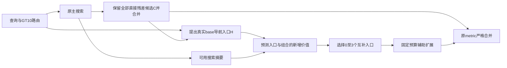

# 残差导航入口质量改进：学习真实收益，按查询筛选入口

2026-11-01。按用户最新要求：当前不以离线训练费用限制设计，优先提高残差提供的导航入口质量，并筛除不适合当前查询、搜索状态和预算的入口。本文完成方法设计和旧方法对比；新算法状态为 **THEORY_ONLY_UNIMPLEMENTED_UNTESTED**。新做的数值工作仅为只读复算E195已有单入口探针，没有新训练、ANN、GT、QPS或默认替换。

## 1. 推荐方案与当前判断

建议把后继主线改为：**用真实有限预算搜索训练入口收益模型，另建导航入口候选表，按查询选择互补入口，并允许全部拒绝。** 离线可以大量运行候选搜索、挖掘反例和训练较强模型，先确认入口价值可以被识别，再压缩线上模型。直接补全省费降为辅助工程任务。

研究对象包含三个相互独立的问题：

1. **候选里有没有好入口？** 残差点自身、其有向导航代表，以及按路由学习的入口表，要能提供实际可用的起点。
2. **能否选出它？** 模型预测从该点展开后，超出完整GT10+B32直接返回的真实增量，结合当前查询、搜索状态、K和剩余预算。
3. **哪些入口应该拒绝？** 拒绝无增量、与主搜索或其他入口重复、在当前预算下走不出去、或者质量风险高的动作；不强制凑满三个。

当前默认仍为E99 GT10。E196的51个配置、102个窗口点中，97点被更紧的GT10/OPT-B32控制覆盖，0个配置两窗同时保留未覆盖状态。这收窄的是当前六种启发式导航策略，尚未测试本文的学习入口。原M5/B32/SQ的有效历史场景继续保留，不能把新方法的理由写成“旧残差普遍无效”。

## 2. 已有数据为什么支持研究入口质量

### 2.1 最近的残差点未必是最好的导航点

重新汇总E195原始单入口探针：每集每窗口前64条查询，两窗共128条；L200；在按原metric距离排序的前6个C中，分别只用一个seed执行最多384次新增精算。下面是 **K100**，所有增量均相对该查询完整GT10+B32直接返回。`最近点/最好点净救回`为128条查询的新增GT成员数之和，不是查询数或正式Recall–QPS。

| 数据 | 有正增量的探针 / 768 | 至少一个有用入口的查询 / 128 | 最好点优于最近点的查询 / 128 | 最近点 / 最好点净救回成员 |
| --- | --- | --- | --- | --- |
| COCO | 132 | 54 | 36 | 33 / 92 |
| Flickr | 113 | 52 | 38 | 25 / 71 |
| WebVid | 383 | 118 | 85 | 226 / 550 |
| Yandex | 255 | 91 | 68 | 102 / 241 |
| Deep10M | 115 | 52 | 30 | 29 / 69 |
| SIFT10M | 65 | 40 | 30 | 14 / 46 |
| GIST | 278 | 97 | 74 | 56 / 195 |

七集K100合计5376次探针中，1341次正增量、4035次零增量；当前探针没有负净增量。既存在可选收益，也存在大量可以尝试识别和拒绝的零效动作。**零增量只表示该查询、K、L、后端及384预算下无增量，不是永久坏节点。** K1合计5376次探针只有25次正增量、13条查询有至少一个有用入口；必须独立处理稀疏标签，不能借用K100的平均收益宣称K1也成立。

“最好点”读取事后GT，是有限候选内诊断参考：不包含识别费用，不证明可学习，不是全图上界，也不代表三个seed联合搜索。单入口最近点也不是E195逐路由行选最多三点的DIST方法。没有新增正式搜索；逐查询表、按窗口表及原始gzip全字段核验见[复算收据](analysis/reanalysis_validation.json)、[汇总](analysis/seed_quality_summary.csv)、[逐查询](analysis/seed_quality_queries.csv)。

### 2.2 静态度数与密度不够，直接补全支持也不等于导航支持

E195中入/出度、背景r8与导航增量的关联弱或跨窗换向；COCO/Flickr的新邻居数有一定关联，但付费NOVEL仍未形成E196跨窗净优势。不能据此实施“低度/低密度一律淘汰”。

Deep/SIFT当前残差固定ID源覆盖不到1%的主搜索遗漏，这是**直接补答案**的限制；同一批残差点作为seed，已有52/40条K100探针查询出现正增量。因此，入口不必本身等于遗漏答案，能够沿图到达其他目标也有价值。Yandex同理：固定答案源支持较弱，不等于导航必然无效。最终是否值得使用还要看可预测性和完整wall。

## 3. 新方法的完整流程

先建立可比较的独立辅助搜索版本；如果之后研究状态复用，另设后端与消融。现有search_new没有完整pause/resume能力，图中的“搜索摘要”也不代表它已经导出所有评分和展开状态。

### 3.1 答案候选C与导航入口H分别学习

直接补全仍按原metric保留完整C及其合并资格。新增H只决定是否展开以及从哪里展开。一个点可以是好答案、差入口，也可以不是答案却是好入口。拒绝其入口资格不会自动删除其答案资格。

导航候选从三个层次形成，每层单独测贡献：

| 层次 | 候选怎样产生 | 解决的问题 |
| --- | --- | --- |
| 同池学习选择 | 先用原C全部候选，不截成距离前6/12个 | 在同一来源、同一后端上隔离入口排序/拒绝是否有效 |
| 学习导航代表 | 离线从残差点的真实有向入邻居、有限反向多跳及训练轨迹中提出多个代表，再用真实扩展收益保留 | 一个残差点本身不易展开时，寻找能提供更多新目标的真实base起点 |
| 路由条件入口表 | 从合法训练查询的有益seed中，按现有GT10路由组织独立导航表；可加入训练中有用的其他base节点 | 避免导航入口永远被当前固定残差ID表锁死 |

代表h满足h→r只是一种提名依据；r已作为答案补入，单纯再到达r没有新的导航价值。代表必须在实际有限预算搜索中带来**其他尚未找回的目标**。每个r可保留多个适用于不同查询/预算的代表，替代E195“一点固定一个最高度代表”。

候选表本身也按多个查询上的边际覆盖和泛化筛选，而非逐行高频或最高度。在线只能由当前query、路由、C、冻结表和已实际导出的状态提出候选；不能根据测试GT临时找到入口。候选数上限、代表数、路由表容量和额外评分预算需要在未来协议中固定，本文不把建议数值冒称已冻结配置。

### 3.2 用真实搜索构造标签，而不是用度数代替导航质量

设R0为当前query在真实K/L下的GT10+B32返回；F_b(q,S,z)为从入口集合S执行特定辅助后端后，按原metric合并得到的最终Top-K。b是整个动作共同使用的剩余预算，z为该后端真实可用状态；空集合返回R0。

记录每次实际动作的新增GT成员、损失GT成员、净增量、到达目标前消耗、邻接访问、精算、展开和完整动作耗时。对新增入口的条件标签为：

`u_b(h | q,z,S) = hits_GT(F_b(q,S∪{h},z)) − hits_GT(F_b(q,S,z))`。

比较时整个集合共用同一个b，不能给每个seed各384再宣称三个seed只花384。加入入口会改变队列与预算分配，条件增量允许为负，不假定单调或次模性质。成员救损分别保留，不能只预测一个非负“覆盖数”。

若代表h不在原C里，其首次评分可能本身补回答案。这部分记为“入口自身直接收益”；从展开带来的后续收益另记。可用该动作实际已付的入口评分与R0先合并，得到R_seed，再以最终F相对R_seed的新增/损失定义路径收益。总收益用于最终动作比较，路径收益用于判断导航质量，防止把多补了几个答案误报为入口变好。

离线标签应覆盖不同K、L、预算和入口组合。先跑所有单入口，再对有潜力或互补的短名单做成对/三元组真实重放，补充共享预算、竞争与重复覆盖标签。组合教师若只用枚举子集、束搜索或贪婪近似，应注明搜索范围，不能写“全局最优”。不能用独立命中集合并集替代联合重放。

训练费用目前不作为减分项：可扩大合法训练查询、增加真实搜索标签、做多轮困难反例挖掘和较强模型训练。标签规模由覆盖和泛化需要决定；正式性能测试期间仍不并发训练。

### 3.3 先训练强教师识别入口价值，再选择线上模型

建议采用**学习图节点表示＋查询/状态条件的入口排序模型**。图表示离线编码有向邻接和训练搜索表现；条件模型读query表示、入口表示、原metric分数/秩、路由来源、K/L/b及实际可用搜索摘要。度数、背景密度可以作为普通特征，不能作为未经验证的硬准入条件。

教师可采用图编码器配合较强的交互/集合模型；模型结构的价值要由合法开发集验证，不因为训练便宜或昂贵就预设深度模型一定更好。多头分别预测：有正路径收益的概率、净救回数量、损伤风险、消耗，以及对已选集合的条件边际价值。与梯度提升树、小型MLP等简单可部署模型比较，先判断预测是否有效，再决定是否蒸馏。

教师可以读取离线轨迹、GT和实际命中集合来生成监督；线上学生只读取明确登记的可用特征。候选跑完后的未来轨迹、真实遗漏数量、GT身份均不得混入线上输入。优先把图编码提前计算，避免线上对全部候选运行多跳GNN；预计算节点/路由表示可以随图冻结，query变换和重排本身仍计时。

建议第一版的具体模型形态为：离线有向图编码器生成入口表示e_h，查询编码器生成e_q；入口头以`[e_q,e_h,query与h交互,原metric分数/秩,路由来源,K,L,b,main_seen(h),主返回分数摘要]`预测收益和风险。已选集合通过表示聚合或集合交互进入条件头，用于判断新入口的边际价值。线上只导出冻结候选表涉及的节点表示，不默认要求部署全N节点浮点embedding。维度、层数及候选表容量属于未来开发选择，未冻结。

训练损失同时包含同一query内的收益排序、净/路径增量回归、正收益与损伤分类，以及组合条件增量；可增加教师到学生的蒸馏项。排序标签必须来自同一K/L/预算/后端，不能把不同难度query的绝对命中数直接混排。损失权重与拒绝阈值在合法开发角色内决定；离线训练秒数不进入当前优化目标。在线消耗头用于比较同预算动作与实际完整费用，不把省训练当方法收益。

第一版线上能使用原query、三路画像分数/ID、C及其已付分数、主返回距离、E195已有的只读visited，以及离线静态节点/路由表示。**“h已展开”“被淘汰节点的缓存分数”“完整未展开边界”目前不是已导出的部署特征。** 若教师依赖它们，学生必须另用可用信息逼近；若改成在线采集，则归入独立的状态导出版本并支付实际费用。这也使新模型相对E193增加的信息来源可核对。

### 3.4 学习拒绝和互补选择，数量允许为0

筛选分三种，不把它们混成“节点永久好坏”：

| 筛选 | 条件与处理 | 注意事项 |
| --- | --- | --- |
| 明确无效 | 非法ID、重复ID、当前动作没有合法展开可能 | 对仅能作为答案的点保留直接合并，导航可拒绝 |
| 查询条件不适合 | 预测零/负增量、路径方向或预算不适合、风险/不确定性过高 | 阈值由独立校准数据确定；模型拒绝不是确定性无效证书 |
| 集合冗余 | 与主搜索已覆盖工作或已选入口高度重复，新增边际价值不足 | 比较条件增量，不能只取独立得分前三名 |

初步排序先找有用入口，组合选择再处理重叠；可用较小短名单的组合模型或有限束搜索，比较0、1、2、3个入口并允许停止。训练中加入难反例：距离近但无收益、高度但绕远、只重复主搜索区域、单独有效但与另一个入口重复、预算不足以及跨查询表现不稳。不能把“未测”当负例。

已主搜索评分但未展开的C仍可能是好seed，不因直接答案省费证书而被剔除。E195后续跳过main visited/未选C的限制也应作为明确后端条件：第一阶段在相同限制下学排序；第二阶段若允许已评分中间点入队或复用评分，另导出必要状态、分开训练并计实际费用。

## 4. 与之前方法的逐项对比

| 方法 | 它在选什么 | 已有结果/边界 | 本方案增加什么 |
| --- | --- | --- | --- |
| M5 / B32 | 用训练遗漏编译直接答案候选，在线精确评分合并 | 有历史有效场景；当前B32仍是强参考；本身不学习导航价值 | 保留答案分支，增加独立导航入口分支 |
| E174 一跳、E195 ONEHOP/DIST | 每路由行取query-best残差点，再一跳/多步扩展 | 有新增救回；当前导航未形成E196跨窗可靠净优势 | 同池比较真实搜索效用，选择和拒绝均按查询条件学习 |
| E195 NOVEL | 在距离前12个C里贪婪选未访问邻接更多的点 | 邻居数量不等于新GT覆盖，线上选择有费用 | 学“新目标价值”和联合冗余，拓扑计数只作特征 |
| E195 REP | 每个残差点固定一个高出度真实入邻居，再按距离选 | 代表生成未受实际导航收益监督 | 每点多个候选代表，按真实有向路径增益训练和筛选 |
| E193 GATE | 用query/route/返回分数摘要决定是否调用固定SQ | 六组学习点被GT10/B32覆盖；仍保留有限理想门空间 | 从“开不开整个固定动作”细化到“哪个seed/组合在当前状态有效”，增加seed与图信息 |
| 早期finite-beam / utility Atlas | 真实入口轨迹教师，query近邻局部平均预测入口效用 | trace有增量信息；具体query-only Atlas未建立可靠正效用，未做正式端到端QPS | 残差后置上下文、图节点表示、条件组合标签与难反例；仍需单独证明可预测性 |
| 2026-10-30理论稿 | 区分答案/导航，定义有限预算价值，提出代表/路径研究 | 当时纯理论；E195实现了部分静态代理与独立队列 | 将其具体化为训练标签、候选表、条件排序、拒绝和分阶段对照 |

“重教师再蒸馏”本身并非新概念，真实有限beam监督也已经做过。本次实质变化是**以完整直接补全为起点，学习残差入口的条件新增路径收益，同时改进导航候选支持与组合筛选**，不声称重新发明学习路由。

## 5. 各数据集怎样安排

| 数据 | 当前依据 | 优先研究问题 |
| --- | --- | --- |
| WebVid | K100同池选择差异最大；K1也有少量真信号，保留原M5/B32有效基线 | 完整C排序、条件组合、K1稀疏正例学习；先研究最有希望的可靠收益 |
| COCO / Flickr | 直接源支持较好，探针中多数seed无新增价值 | 保住直接补全，识别真正带来额外路径价值的少量入口，拒绝冗余 |
| GIST | 同池排序差异明显，来源/路由/容量都有损失 | 排序与导航候选表扩充分别测；高维评分费用另报 |
| Yandex | 直接源覆盖弱，但有较多正导航探针 | 直接源外的导航代表与路由条件入口；保持原raw-IP，不套归一化密度规则 |
| Deep / SIFT | 固定答案ID支持低，仍存在有效残差seed | 同池选择能否泛化、能否转向有用搜索边界/导航表；不因答案源低覆盖排除入口研究 |

先以WebVid/K100和GIST/K100回答能否学会，再用COCO/Flickr验证拒绝与直接分支保护；Yandex/Deep/SIFT承担不同支持机制的检验。有价值的场景均保留，各集真实K1/K100分别报告；不是要求七集全胜才能继续，也不以单窗偶然增益决定默认替换。

## 6. 详细验证设计：把入口质量、可预测性与线上收益分开

### 6.1 训练/校准/确认角色

E195/E196的A/B都是已曝光公共窗口，只作为开发证据，不能再次称为新盲测试。新候选表与选择器只能用合法训练角色构建，校准仅选模型/阈值/容量，确认阶段固定后不回调。

残差标签尤其需要处理自拟合：若某query参与了B32或导航表的生成，再用它评价“完整补全后的剩余入口收益”，容易扭曲遗漏与泛化。可采用训练query分组交叉拟合表和标签，保留每折表/GT/图/模型身份；最终训练表与旧16K B32参考的角色差异必须单列。旧GT10画像曾用过的监督也披露，不把选择器未见过某query冒称整个系统从未使用它。新的完整系统确认需要另核查询来源、身份/向量去重和合法GT；当前七集是否都有可用新确认查询尚未核定。

### 6.2 必须保留的消融与对照

1. **同池同后端**：原C、相同总预算，对比距离、随机同数量、度数、NOVEL、学习独立排序、学习排序＋拒绝、条件组合选择。此阶段不同时换源或队列。
2. **候选扩充**：固定已选模型/后端，比较C、自身＋学习代表、再加入路由导航表；分别报告提名覆盖、入选率和新增路径收益。
3. **状态改进**：固定候选和训练目标，单独比较E195独立队列与新状态复用后端。只有实施后才讨论该后端，不能把未实现的恢复能力算进第一阶段。
4. **默认与强残差控制**：相同环境重测GT10、OPT-B32、适用的原M5/SQ，以及费用邻近更大L。离线选择器不能只胜过失败导航基线而省略更强直接补全。
5. **GT教师与线上模型分栏**：展示候选内诊断空间、模型保留多少、拒绝丢失多少、真实完整费用，不能将GT选择的收益记到可部署模型。

候选质量看真实有用入口的提名/保留率、给定数量的净救回；拒绝质量看留下入口的有用比例、丢掉的正收益、不同启用率下的收益保持曲线。候选内“最好”要标明枚举范围。二分类accuracy在零增量占多数时价值有限，不能以全拒绝的高accuracy交付。

联合质量报告每query/每K/L的净救回与损伤、冗余损失、0/1/2/3入口比例，以及K100严格0–9命中失败的有所改善/脱离/新增。区间按query或合法来源组配对，不能把每query的多个seed视为独立查询。正例重采样只用于训练，校准与报告恢复真实分布。

最终线上收益仍是完整单线程Recall@1/100–QPS：路由、主搜、直接补点、状态导出、query变换、候选提名/评分、模型、集合选择、辅助展开、合并和正常输出生命周期全部计wall。训练不设当前费用惩罚，不意味着线上推断和附加工作免费。入口质量验证可以先成立，默认替换继续需要适用场景的可复现完整收益。

### 6.3 结果怎样决定后继

- 候选内真实空间不足：改导航候选支持/动作，不只加深模型；该判断限定于已测候选和预算。
- 教师有空间、模型选不出：定位特征、标签覆盖、自拟合与泛化，增加合法标签/表示能力；不把oracle当成功。
- 独立排序有效、组合增量低：重点处理重复覆盖与预算竞争。
- 模型入口质量提高、完整QPS仍被调L覆盖：质量方法成立到该层，线上收益未成立，单独研究推断/执行实现。
- 某集/预算稳定有效：保留该适用场景，另做确认；其他数据分别解释，不强行一套阈值覆盖所有数据。

具体样本数、模型候选数、容量、预算、效应门槛、存储与结束边界应在执行协议里固定。本文交付设计及已有探针复算，未启动该训练/实验矩阵，不新增E197实验编号。

## 7. 相关工作与证据位置

学习图路由已有先例：[Learning to Route in Similarity Graphs](https://proceedings.mlr.press/v97/baranchuk19a.html)学习节点附加表示与路由；本方案聚焦固定主搜索后的残差入口选择，其论文收益不能借作本项目结果。[RoarGraph](https://arxiv.org/html/2408.08933v1)利用查询分布构建投影图；[NGFix/RFix](https://arxiv.org/html/2510.22316v1)研究图缺陷和可达性修复。本文首先保持原图，只学习入口，不将改图机制混为同一消融，也不声称已证明方法创新性。

本地依据：

- [E195协议](../20261101_residual_navigation_diagnosis_v1/protocol.md)、[源码](../20261101_residual_navigation_diagnosis_v1/src/benchmark.cpp)、[辅助队列实际边界](../20261101_residual_navigation_diagnosis_v1/implementation_boundary.md)、[单seed原表](../20261101_residual_navigation_diagnosis_v1/analysis/single_seed.csv)。
- [E196最终定位](../20261101_residual_navigation_cost_controls_v1/findings_zh.md)、[固定51配置](../20261101_residual_navigation_cost_controls_v1/analysis/stability.csv)、[102窗口点比较](../20261101_residual_navigation_cost_controls_v1/analysis/candidate_comparisons.csv)。
- [E174详细复盘](../../experiment_history/174_m5_residual_regions.md)及[原协议](../20261010_m5_residual_regions_v1/protocol.md)、[E193协议](../20261029_adaptive_completion_gate_v1/protocol.md)、[历史finite-beam/Atlas](../../experiment_history/06_finite_beam_and_atlas.md)、[Atlas原设计](../../finite_beam_reachability_diagnostics/v2_distillation/design.md)与[原判定](../../finite_beam_reachability_diagnostics/v2_distillation/decision.json)。
- [答案/导航理论](../20261030_residual_navigation_theory_v1/theory_zh.md)、[历史有效残差场景](../../experiment_history/_maintenance/20261029_residual_positive_evidence_sync_v1/conclusion_zh.md)。

旧科学源码、原始返回、计时、协议、PDF和seal均保留。根文档优先级变化用修改前快照桥接，维护核验不等于新算法或性能验证。
