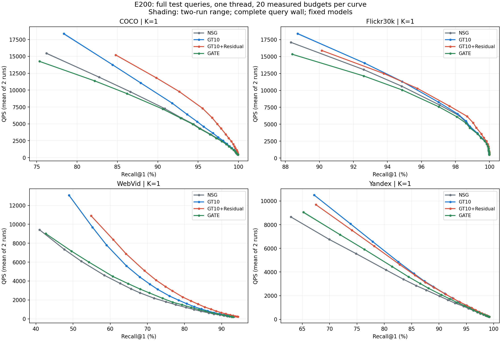
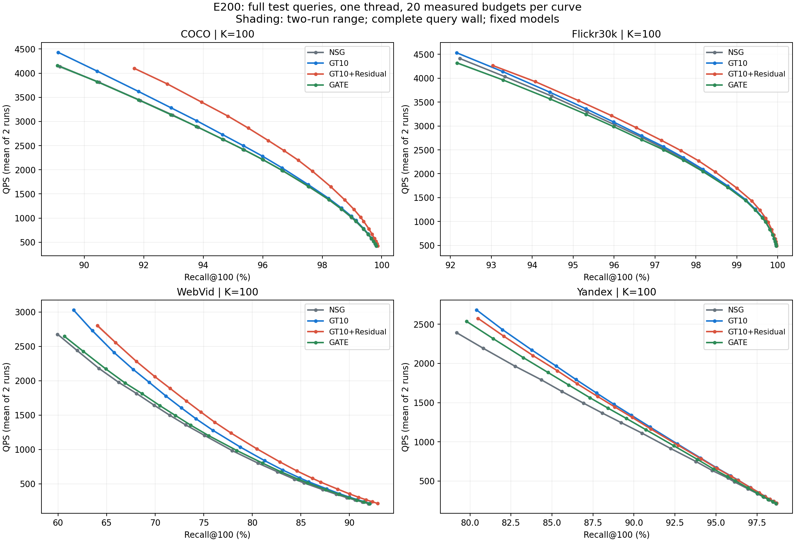

# E200 四多模态数据集四方法加密重测

完整矩阵：4集 × 4方法 × 2个K × 20档预算 = 640点；每点两遍，共1280完整单线程批次、1120万正式查询。默认保持E99 GT10。

NSG、GT10、GT10＋直接残差和GATE共用同一原scalar主核。GT10固定WebVid soft-t1，其余hard；残差为完整16K/B32表及返回等价工程优化。GATE为E97修正标签后的外部入口基线。

## 当前判断与方法取舍

**默认保持E99 GT10。此次完整重测支持在COCO、WebVid保留直接残差作为有用配置，Flickr按召回目标选择；Yandex优先GT10。** GATE是E97外部入口基线，和此前停止扩展的残差门控不同。本轮没有恢复这些学习导航或门控分支，也没有自动改变生产默认。

- **COCO：残差有清晰收益。** 95%召回门槛下，K1为95.530% / 7319.78 QPS，对GT10的95.670% / 4593.71提速59.34%；K100为95.513% / 2863.94，对GT10的95.344% / 2500.35提速14.54%。实际召回不同，属于门槛比较。下面另给召回与速度同时改善的实测点对。
- **Flickr30k：保留条件性收益。** 95%门槛下，残差相对GT10的K1/K100 QPS分别提高24.61%/5.07%；但K100在90%和99%门槛反而慢5.89%/1.95%。不能据曲线局部优势写成所有质量目标都应启用残差。
- **WebVid：两种K均有收益。** K1的残差L640为91.130% / 526.47 QPS，优于GT10 L800的90.750% / 427.63（QPS +23.11%）。K100达到90%门槛的QPS提高31.15%，但GT10 L1120实际为89.9997%，刚低于门槛；该百分比部分受离散预算跳档影响。更接近的实测点对是残差L960的90.0171% / 352.85对GT10 L1120的89.9997% / 305.80，QPS提高15.39%。本轮到L1600仍未达到95%，不向更大预算外推。
- **Yandex：入口改进有用，固定B32追加收益小。** L200时残差在K1/K100仅增加0.1400/0.0570个百分点召回，完整平均耗时增加1.64%/2.35%。所有本轮已达到的90%/95%/99%门槛组合均是GT10比残差快；99% K100四方法都未达到。很小的Recall增量也会造成有限网格“未被覆盖”，不能把这种计数当成有实际意义的整体提速。
- **GATE没有形成独立的实测前沿收益。** 其160个点均被同数据/K矩阵中的其他方法在Recall不低、平均QPS不低且至少一项严格更好的条件下覆盖。这只评价本轮冻结模型、预算、图与查询窗口，不代表所有GATE适配或学习入口都无效。

GT10与NSG也有明确边界：WebVid/Yandex的同L召回均提高，COCO/Flickr的K100则有微小降低（最大分别0.0691/0.0818个百分点），伴随本轮平均完整耗时下降。COCO还保留一条GT10新增的严重低召回查询，见后文。入口方法的均值收益不能解释成逐查询保证。

### 召回与速度同时改善的实测例子

下表从完整矩阵选取代表点，两个指标均直接来自实际返回和两轮完整wall；不是插值或严格相同Recall实验。对应两轮QPS范围均不重叠，但两次重复不足以证明统计显著性或跨机器稳定性。完整曲线和全部负例仍保留。

| 数据 | K | GT10：L / Recall% / QPS | ＋残差：L / Recall% / QPS | QPS变化 |
| --- | --- | --- | --- | --- |
| COCO | 1 | 320 / 98.8800 / 1695.32 | 200 / 99.1200 / 2423.64 | +42.96% |
| COCO | 100 | 256 / 96.6528 / 2038.59 | 200 / 96.7159 / 2397.12 | +17.59% |
| Flickr30k | 1 | 96 / 98.8400 / 4693.23 | 80 / 99.0400 / 5203.05 | +10.86% |
| WebVid | 1 | 800 / 90.7500 / 427.63 | 640 / 91.1300 / 526.47 | +23.11% |
| WebVid | 100 | 1120 / 89.9997 / 305.80 | 960 / 90.0171 / 352.85 | +15.39% |

较复杂的历史M5/SQ、区域扫描和学习残差方案仍按原实验范围保留条件有效或无效证据；本轮四方法比较没有重测这些版本，也不把跨实验绝对QPS拼入本表。论文取舍与训练GT说明继续遵循[写作约定](../../../../论文写作约定.md)。

每条曲线保留20个实测预算点；QPS是两次N/wall的算术平均，阴影仅为两轮范围，不是置信区间。平均wall与合并QPS另列CSV，不混用。Recall由实际返回和原GT重新计算，两轮返回逐字节相同。

## 达到召回门槛的最快实测点

单元格为实际Recall% / 平均QPS（L）；未达到记—。这些是有限预算网格上的门槛比较，实际召回可能不同，不能称严格等Recall提速。

| 数据 | K | 目标Recall | NSG | GT10 | GT10＋残差 | GATE |
| --- | --- | --- | --- | --- | --- | --- |
| COCO | 1 | 90% | 90.860% / 7262.95 (L48) | 91.790% / 8065.39 (L48) | 92.660% / 9784.65 (L32) | 90.620% / 7193.71 (L48) |
| COCO | 1 | 95% | 95.270% / 4303.65 (L96) | 95.670% / 4593.71 (L96) | 95.530% / 7319.78 (L48) | 95.160% / 4309.73 (L96) |
| COCO | 1 | 99% | 99.150% / 1377.67 (L400) | 99.180% / 1413.05 (L400) | 99.120% / 2423.64 (L200) | 99.110% / 1385.63 (L400) |
| COCO | 100 | 90% | 90.503% / 3810.80 (L112) | 90.435% / 4042.32 (L112) | 91.678% / 4101.59 (L100) | 90.433% / 3824.39 (L112) |
| COCO | 100 | 95% | 95.375% / 2413.84 (L200) | 95.344% / 2500.35 (L200) | 95.513% / 2863.94 (L160) | 95.340% / 2422.87 (L200) |
| COCO | 100 | 99% | 99.134% / 928.35 (L640) | 99.133% / 949.28 (L640) | 99.062% / 1182.46 (L480) | 99.129% / 937.88 (L640) |
| Flickr30k | 1 | 90% | 92.600% / 13068.17 (L24) | 92.660% / 14022.70 (L24) | 90.140% / 15888.49 (L16) | 92.600% / 12134.45 (L24) |
| Flickr30k | 1 | 95% | 97.060% / 7842.18 (L48) | 97.000% / 8258.70 (L48) | 95.760% / 10291.55 (L32) | 97.020% / 7575.09 (L48) |
| Flickr30k | 1 | 99% | 99.300% / 3613.74 (L128) | 99.280% / 3697.08 (L128) | 99.040% / 5203.05 (L80) | 99.300% / 3559.10 (L128) |
| Flickr30k | 100 | 90% | 92.230% / 4411.19 (L100) | 92.148% / 4532.80 (L100) | 93.031% / 4265.78 (L100) | 92.163% / 4318.72 (L100) |
| Flickr30k | 100 | 95% | 95.340% / 3291.21 (L144) | 95.312% / 3360.12 (L144) | 95.131% / 3530.61 (L128) | 95.313% / 3244.48 (L144) |
| Flickr30k | 100 | 99% | 99.217% / 1449.91 (L400) | 99.216% / 1458.68 (L400) | 99.371% / 1430.29 (L400) | 99.216% / 1438.11 (L400) |
| WebVid | 1 | 90% | 90.650% / 333.54 (L1000) | 90.750% / 427.63 (L800) | 91.130% / 526.47 (L640) | 90.340% / 416.42 (L800) |
| WebVid | 1 | 95% | — | — | — | — |
| WebVid | 1 | 99% | — | — | — | — |
| WebVid | 100 | 90% | 90.580% / 263.91 (L1280) | 90.816% / 269.05 (L1280) | 90.017% / 352.85 (L960) | 90.772% / 263.68 (L1280) |
| WebVid | 100 | 95% | — | — | — | — |
| WebVid | 100 | 99% | — | — | — | — |
| Yandex | 1 | 90% | 90.070% / 1968.30 (L128) | 91.050% / 2176.04 (L128) | 91.220% / 2120.21 (L128) | 90.430% / 2074.41 (L128) |
| Yandex | 1 | 95% | 95.390% / 917.62 (L320) | 95.020% / 1188.54 (L256) | 95.120% / 1170.20 (L256) | 95.590% / 949.04 (L320) |
| Yandex | 1 | 99% | 99.020% / 239.17 (L1400) | 99.110% / 246.68 (L1400) | 99.120% / 245.32 (L1400) | 99.010% / 244.37 (L1400) |
| Yandex | 100 | 90% | 90.482% / 1111.15 (L256) | 90.980% / 1188.69 (L256) | 91.028% / 1163.20 (L256) | 90.725% / 1154.08 (L256) |
| Yandex | 100 | 95% | 95.727% / 537.12 (L576) | 95.030% / 669.31 (L480) | 95.060% / 661.02 (L480) | 95.702% / 555.78 (L576) |
| Yandex | 100 | 99% | — | — | — | — |

## 同L增量与费用

同L200用于分阶段记账，不能代替等费用前沿。残差救回/损伤指正确成员事件；严重低召回仅K100的0–9命中。

| 数据 | K | GT10 Recall/QPS | ＋残差 Recall/QPS | ΔRecall pp | 完整平均耗时变化 | 救回/损伤 |
| --- | --- | --- | --- | --- | --- | --- |
| COCO | 1 | 98.0800% / 2505.29 | 99.1200% / 2423.64 | +1.0400 | +3.37% | 104/0 |
| COCO | 100 | 95.3444% / 2500.35 | 96.7159% / 2397.12 | +1.3715 | +4.31% | 13715/0 |
| Flickr30k | 1 | 99.7200% / 2563.74 | 99.8200% / 2503.41 | +0.1000 | +2.41% | 5/0 |
| Flickr30k | 100 | 97.2072% / 2568.72 | 97.6352% / 2484.21 | +0.4280 | +3.40% | 2140/0 |
| WebVid | 1 | 80.5600% / 1606.04 | 83.6300% / 1559.00 | +3.0700 | +3.02% | 307/0 |
| WebVid | 100 | 72.7033% / 1604.42 | 74.7290% / 1543.08 | +2.0257 | +3.98% | 20257/0 |
| Yandex | 1 | 93.6800% / 1478.95 | 93.8200% / 1455.07 | +0.1400 | +1.64% | 14/0 |
| Yandex | 100 | 88.7724% / 1478.95 | 88.8294% / 1445.06 | +0.0570 | +2.35% | 570/0 |

## 低召回尾部与成员替换

严重低召回固定为K100命中0–9个GT成员，即严格Recall@100<10%。L200统计如下，分母为该集全部测试查询；全20档对应计数在points.csv和paired.csv中保留。

| 数据 | NSG低召回 | GT10低召回 | ＋残差低召回 | GATE低召回 | GT10相对NSG救出/新增 | 残差相对GT10救出/新增 |
| --- | --- | --- | --- | --- | --- | --- |
| COCO | 0 | 1 | 1 | 0 | 0 / 1 | 0 / 0 |
| Flickr30k | 0 | 0 | 0 | 0 | 0 / 0 | 0 / 0 |
| WebVid | 142 | 53 | 46 | 112 | 113 / 24 | 7 / 0 |
| Yandex | 174 | 86 | 85 | 126 | 128 / 40 | 1 / 0 |

GT10在WebVid/Yandex减少了严重低召回的净数量，但也新增了24/40条；残差只进一步救出7/1条。COCO的平均残差收益没有救回该条尾部问题。因此，本轮支持“入口改进后仍存在可补的遗漏”，不能写成残差普遍解决搜索迷失，也不能据这些计数认定密度或连通性为原因。

残差160个同L配置中159个平均Recall增加，Yandex K1/L1600持平；本轮所有残差配对均未发现逐查询命中数下降。但正确成员集合并非严格包含原集合：COCO K100/L800 query 8121发生1个正确成员替换；WebVid query 92在K100/L960、1120、1280各发生1次。四次都是99命中→99命中，新进入和被替换的各有一个GT成员。边界实际float32分数非常接近；仍按原GT如实保留4个成员损失事件，不修改GT或把它们抹为0。详情见[报告派生证据](report_evidence.json)中的member_loss_details。这里的查询行号为零基。

## 完整费用与离线准备

同L残差的完整平均耗时在全部160点均增加，幅度0.32%–20.67%；小L时固定补点开销占比更大。L200的分阶段质量/费用见上表；较小L加补点能否优于较大L主搜索，需要同时看前面的实际点对和完整门槛表。

| 费用项 | 本轮记录 | 计量边界 |
| --- | --- | --- |
| 1280个正式batch wall之和 | 13723.78 s（3.812 h） | 正式查询完整生命周期，1120万次查询。 |
| 八个原生测量进程之和 | 14037.69 s | 已包含上行；另含加载、预热、写出、hash/oracle等，不与上行相加。 |
| 逐任务无损压缩及往返校验 | 78.95 s | 在正式计时外串行完成。 |
| run_suite完整命令进程 | 14240.44 s（3.956 h） | 包含测量进程、压缩和输入身份复核，不能再重复加上前三行。 |
| COCO/Flickr新GATE准备 | 已记录费用下界2079.17 s（34.65 min） | 特征/标签、训练已完成阶段和恢复阶段；中断未提交费用未知，不是完整总成本。 |
| 继承的图、GT10、B32、Web/Yandex GATE | 本轮复用，历史成本未重测 | 复用不表示离线成本为零；不能将本轮新训练费用视为公平的全历史构建费用比较。 |

新GATE离线训练使用16线程，正式查询始终CPU15实际1线程。COCO选epoch22，Flickr选epoch7，均按预定patience20结束。标签来自训练查询的实际单入口NSG/L64响应；线上只用导出的W和小图，不运行66M参数训练塔，也不读新查询GT。训练期间主机重启的恢复与成本未知部分见后文。

## 核验与复现入口

全部64个资格点通过；48个NSG/GT10/B32点与旧E183实际返回一致，16个GATE点与独立旧E97评测器一致。正式640点全部两轮返回逐字节/SHA一致、原生残差合并oracle通过。第二份stdlib实现复核640点GT交集、1280轮平均、480组配对、96行门槛、640行覆盖关系和2560个压缩payload的往返身份。独审为同执行者不同实现，不冒称独立人员审查。

两张PNG已实际查看；对应SVG均含16条曲线、每条20个标记，合计640个点，图例/单位/数据集与K标注完整。两轮范围是描述性波动，不是置信区间；高召回附近曲线重叠应查CSV数值。

[协议](../../protocol.md) · [冻结输入与代码](../../formal_freeze.json) · [测量完成收据](../../reviews/measurement_complete.json) · [独立核验](independent_audit.json) · [各阶段费用](../../reviews/formal_process_costs.json) · [GATE准备费用](../../reviews/gate_preparation_costs.json) · [交付验收目录](../../reviews/)。完整交付的最终状态以该目录delivery_validation.json为准；各阶段收据的pending字段保留生成时身份。

## 数据、成本与解释边界

完整测试查询为COCO 10000、Flickr30k 5000、WebVid 10000、Yandex 10000；原raw-IP、底库、NSG图、测试GT和GT10/残差训练资产保持。公开测试已有曝光；本轮是完整重测，不是新的盲确认。

Web/Yandex GATE复用冻结模型；COCO/Flickr沿E97复现流程补建512hub、拓扑特征和离线塔。两集GATE训练/monitor来自合法residual角色前10000/随后1024，与测试向量和身份组分离，但曾参与B32监督。方法继承的训练规模不同，不能称等监督量因果消融。GT只用于离线标签与返回后评测。

离线新GATE阶段耗时见reviews/gate_preparation_costs.json；正式进程与压缩耗时见reviews/formal_process_costs.json，内部wall已包含于进程耗时，不能重复加总。继承的构图/GT/训练成本没有清零；文件大小不等于RSS。

Flickr GATE离线训练期间运行环境发生重启，已从epoch7的完整模型、优化器和torch随机数检查点接续epoch8；原日志和恢复检查点保留于reviews/recovery_boot1。模型选择仍遵守原监控集和早停规则。中断前已提交训练时间与恢复后进程时间分列，未完成epoch的耗时未知，不将主机停机时长当作训练成本，也不把所记录的下界当作完整构建总成本。重启发生在全部正式计时开始之前。

完整wall包含正常输出生命周期、路由、搜索、残差评分合并及统一复制销毁；加载、GT、写盘、hash、压缩和独审在外。没有将E103优化核或旧实验QPS拼入新主表。两轮计时范围不提供跨机器或统计显著性保证，有限网格未覆盖不等于全局最优。

[全部点](points.csv) · [两遍原始计时](rounds.csv) · [同L救损与费用](paired.csv) · [门槛点](targets.csv) · [有限网格前沿](frontier.csv)。独立整数/计时核验及实际图形审查均已完成，原始数值、科学资产与默认保持。
